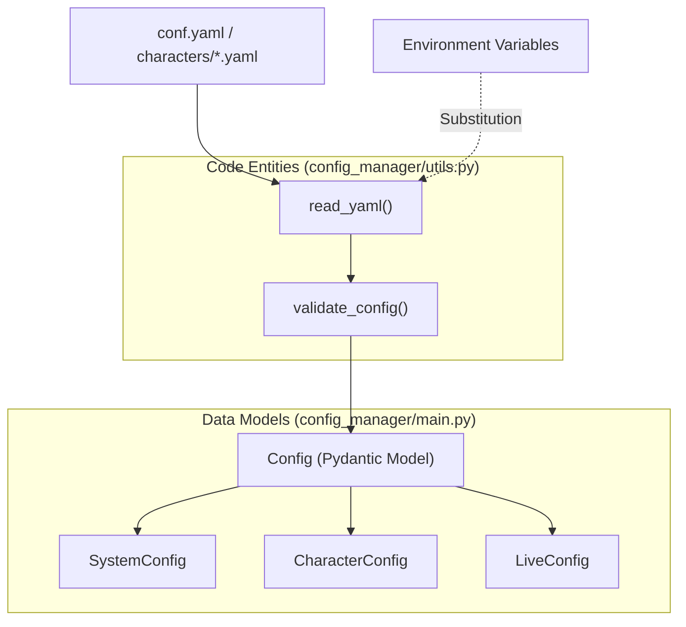
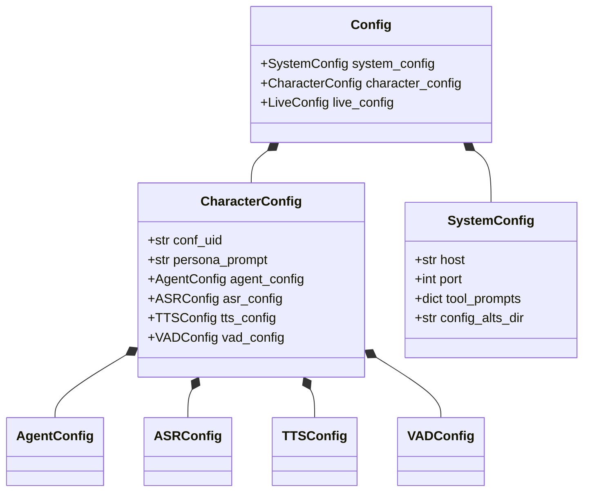

<!-- source: DeepWiki mcp.deepwiki.com · repo Open-LLM-VTuber/Open-LLM-VTuber · page 2 Configuration System · fetched 2026-10-30 -->

# Configuration System

Relevant source files

The following files were used as context for generating this wiki page:

- [config_templates/conf.ZH.default.yaml](config_templates/conf.ZH.default.yaml)
- [config_templates/conf.default.yaml](config_templates/conf.default.yaml)
- [src/open_llm_vtuber/config_manager/__init__.py](src/open_llm_vtuber/config_manager/__init__.py)
- [src/open_llm_vtuber/config_manager/character.py](src/open_llm_vtuber/config_manager/character.py)
- [src/open_llm_vtuber/config_manager/main.py](src/open_llm_vtuber/config_manager/main.py)
- [src/open_llm_vtuber/config_manager/system.py](src/open_llm_vtuber/config_manager/system.py)
- [src/open_llm_vtuber/config_manager/utils.py](src/open_llm_vtuber/config_manager/utils.py)

The Open-LLM-VTuber configuration system is a modular, type-safe framework built on **Pydantic** and **YAML**. It manages everything from server network settings to individual character personalities and AI engine credentials. The system supports environment variable substitution, multi-language descriptions (i18n), and runtime switching between different character profiles.

## System Overview

The configuration is managed by the `config_manager` package, which serves as the central authority for loading, validating, and saving application settings [src/open_llm_vtuber/config_manager/__init__.py:1-6](). The primary entry point is the `Config` class, which aggregates sub-configurations into a single object tree [src/open_llm_vtuber/config_manager/main.py:11-19]().

### Core Components

| Component | Code Entity | Responsibility |
|:---|:---|:---|
| **Main Config** | `Config` | Root model containing system, character, and live settings [src/open_llm_vtuber/config_manager/main.py:11-19](). |
| **System Settings** | `SystemConfig` | Server host/port, proxy settings, and tool prompt registration [src/open_llm_vtuber/config_manager/system.py:7-15](). |
| **Character Profile** | `CharacterConfig` | Persona, Live2D model name, and engine-specific overrides [src/open_llm_vtuber/config_manager/character.py:13-29](). |
| **Utility Functions** | `utils.py` | YAML reading, environment variable injection, and directory scanning [src/open_llm_vtuber/config_manager/utils.py:16-65](). |

### Configuration Data Flow

The following diagram illustrates how raw YAML files are transformed into validated Python objects used by the server.

**Config Loading & Validation Pipeline**

Sources: [src/open_llm_vtuber/config_manager/utils.py:16-75](), [src/open_llm_vtuber/config_manager/main.py:11-19]()

## Configuration Hierarchy

The system distinguishes between global server settings and character-specific settings. While `conf.yaml` provides the default state, files in the `characters/` directory allow for modular character definitions.

### System Configuration
Defined in the `system_config` section, these settings control the FastAPI server lifecycle and global prompt behavior [config_templates/conf.default.yaml:2-26]().
*   **Networking**: `host` and `port` for the web server [src/open_llm_vtuber/config_manager/system.py:11-12]().
*   **Tool Prompts**: References to utility prompts (e.g., `live2d_expression_prompt`, `mcp_prompt`) that are dynamically injected into the character's persona [src/open_llm_vtuber/config_manager/system.py:14]().
*   **Alternative Configs**: `config_alts_dir` defines where the system looks for additional character YAML files [config_templates/conf.default.yaml:7]().

For a full field reference, see **[Configuration Schema Reference](#2.1)**.

### Character Configuration
The `character_config` section defines the identity of the VTuber [src/open_llm_vtuber/config_manager/character.py:13-29]().
*   **Identity**: `character_name`, `avatar`, and `persona_prompt` [src/open_llm_vtuber/config_manager/character.py:19-22]().
*   **Engines**: Nested configurations for ASR, TTS, VAD, and the LLM Agent [src/open_llm_vtuber/config_manager/character.py:23-26]().
*   **Validation**: The `CharacterConfig` class uses Pydantic validators to ensure `persona_prompt` is not empty and defaults `character_name` to the configuration name if missing [src/open_llm_vtuber/config_manager/character.py:72-85]().

For details on managing multiple characters, see **[Character Configuration & Multi-Character Support](#2.2)**.

## Dynamic Features

### Environment Variable Substitution
The `read_yaml` function automatically replaces patterns like `${VAR_NAME}` in YAML files with values from the system environment [src/open_llm_vtuber/config_manager/utils.py:39-46](). This is particularly useful for securing API keys without hardcoding them in config files.

### Runtime Character Switching
The system can scan the `config_alts_dir` (usually `characters/`) to find alternative profiles using `scan_config_alts_directory` [src/open_llm_vtuber/config_manager/utils.py:127-171](). These can be swapped at runtime via WebSocket commands, allowing the VTuber to change persona, voice, and model without restarting the server.

### Multi-language Support (i18n)
Models inherit from `I18nMixin`, allowing the UI to display configuration descriptions in multiple languages (English and Chinese) using the `DESCRIPTIONS` class variable [src/open_llm_vtuber/config_manager/character.py:31-70](). This is supported by the `MultiLingualString` and `Description` types [src/open_llm_vtuber/config_manager/i18n.py]().

**Configuration Model Mapping**

Sources: [src/open_llm_vtuber/config_manager/main.py:11-19](), [src/open_llm_vtuber/config_manager/character.py:13-29](), [src/open_llm_vtuber/config_manager/system.py:7-15]()

## Child Pages

*   **[Configuration Schema Reference](#2.1)**: Detailed breakdown of every key in `conf.yaml`, including validation rules and engine-specific parameters for ASR, TTS, and LLM backends.
*   **[Character Configuration & Multi-Character Support](#2.2)**: Guide on creating `.yaml` files in the `characters/` folder and how the system handles unique IDs (`conf_uid`) for session persistence.
*   **[Prompt System](#2.3)**: Explanation of how `tool_prompts` and the `persona_prompt` are merged by the `prompt_loader` to create the final system instruction for the AI agent.

Sources: [src/open_llm_vtuber/config_manager/__init__.py:1-125](), [src/open_llm_vtuber/config_manager/utils.py:1-182](), [config_templates/conf.default.yaml:1-91]()

---

