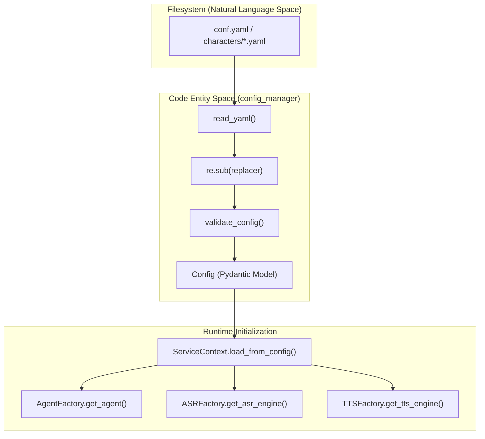
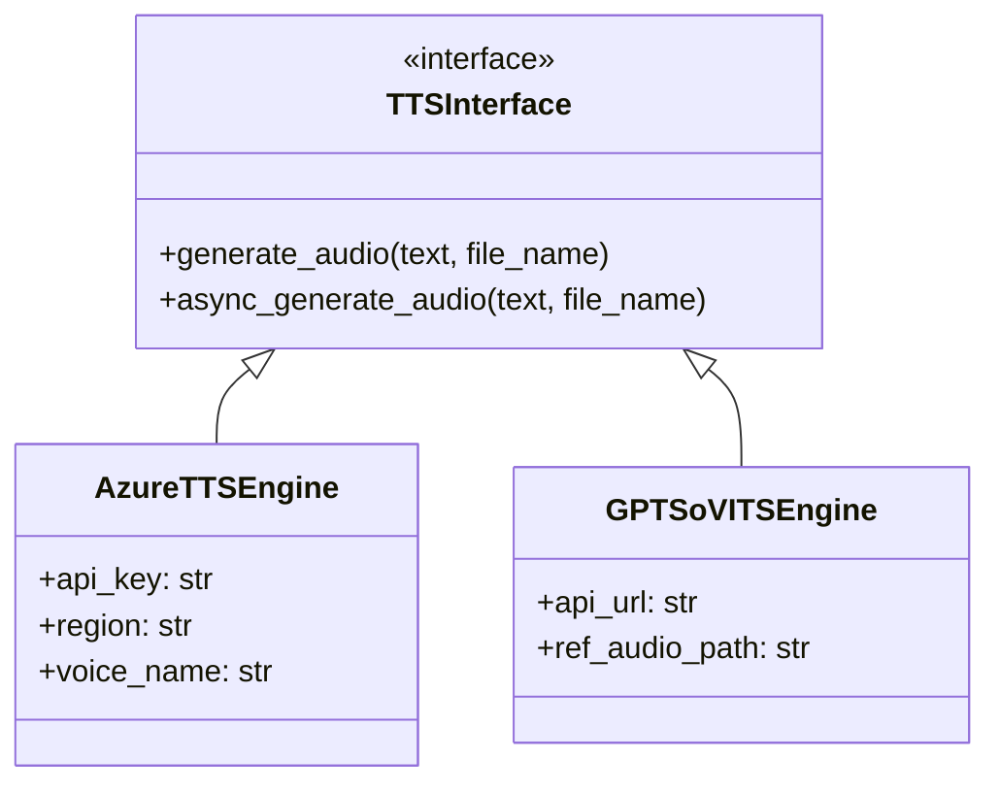

<!-- source: DeepWiki mcp.deepwiki.com · repo Open-LLM-VTuber/Open-LLM-VTuber · page 2.1 Configuration Schema Reference · fetched 2026-10-30 -->

# Configuration Schema Reference

Relevant source files

The following files were used as context for generating this wiki page:

- [config_templates/conf.ZH.default.yaml](config_templates/conf.ZH.default.yaml)
- [config_templates/conf.default.yaml](config_templates/conf.default.yaml)
- [src/open_llm_vtuber/agent/stateless_llm_factory.py](src/open_llm_vtuber/agent/stateless_llm_factory.py)
- [src/open_llm_vtuber/asr/openai_whisper_asr.py](src/open_llm_vtuber/asr/openai_whisper_asr.py)
- [src/open_llm_vtuber/config_manager/__init__.py](src/open_llm_vtuber/config_manager/__init__.py)
- [src/open_llm_vtuber/config_manager/agent.py](src/open_llm_vtuber/config_manager/agent.py)
- [src/open_llm_vtuber/config_manager/asr.py](src/open_llm_vtuber/config_manager/asr.py)
- [src/open_llm_vtuber/config_manager/character.py](src/open_llm_vtuber/config_manager/character.py)
- [src/open_llm_vtuber/config_manager/i18n.py](src/open_llm_vtuber/config_manager/i18n.py)
- [src/open_llm_vtuber/config_manager/main.py](src/open_llm_vtuber/config_manager/main.py)
- [src/open_llm_vtuber/config_manager/stateless_llm.py](src/open_llm_vtuber/config_manager/stateless_llm.py)
- [src/open_llm_vtuber/config_manager/system.py](src/open_llm_vtuber/config_manager/system.py)
- [src/open_llm_vtuber/config_manager/utils.py](src/open_llm_vtuber/config_manager/utils.py)
- [src/open_llm_vtuber/tts/siliconflow_tts.py](src/open_llm_vtuber/tts/siliconflow_tts.py)

The configuration system in Open-LLM-VTuber is built upon **Pydantic** models, ensuring strict type validation and schema consistency. The primary configuration file is `conf.yaml`, which is parsed, validated, and transformed into a central `Config` object at runtime.

## Configuration Loading Architecture

The system uses a layered approach to load settings. It supports environment variable substitution using the `${VAR_NAME}` syntax and handles multiple character configurations via a dedicated directory.

### Data Flow and Code Entities

The following diagram illustrates how raw YAML files are transformed into the `ServiceContext` used by the application.

**Config to Code Entity Mapping**

- **Environment Variable Substitution**: Performed in `read_yaml` using a regex pattern `\$\{(\w+)\}` [src/open_llm_vtuber/config_manager/utils.py:40-46]().
- **Validation**: The `validate_config` function instantiates the `Config` Pydantic model, which triggers recursive validation across all sub-configs [src/open_llm_vtuber/config_manager/utils.py:55-74]().
- **i18n Support**: Most configuration models inherit from `I18nMixin`, providing multilingual descriptions for UI rendering [src/open_llm_vtuber/config_manager/i18n.py:79-86]().

**Sources:** [src/open_llm_vtuber/config_manager/utils.py:16-74](), [src/open_llm_vtuber/config_manager/main.py:1-20](), [src/open_llm_vtuber/config_manager/i18n.py:79-140]()

---

## Configuration Sections

### 1. System Config (`system_config`)
Defines the server's network settings and the directory structure for alternative character configurations.

| Key | Type | Description |
|:---|:---|:---|
| `conf_version` | `str` | Version of the configuration schema [config_templates/conf.default.yaml:3](). |
| `host` | `str` | Network interface to bind to (e.g., `localhost` or `0.0.0.0`) [config_templates/conf.default.yaml:4](). |
| `port` | `int` | Port number for the FastAPI server [config_templates/conf.default.yaml:5](). |
| `config_alts_dir` | `str` | Directory where character-specific YAML files are stored [config_templates/conf.default.yaml:7](). |
| `enable_proxy` | `bool` | Enables proxy mode for multiple clients sharing one connection [src/open_llm_vtuber/config_manager/system.py:15](). |

**Sources:** [src/open_llm_vtuber/config_manager/system.py:7-40](), [config_templates/conf.default.yaml:1-26]()

### 2. Character Config (`character_config`)
Defines the identity, visual representation, and persona of the VTuber.

- **Persona**: The `persona_prompt` field contains core instructions for the LLM. It is validated to ensure it is not empty [src/open_llm_vtuber/config_manager/character.py:22-78]().
- **Live2D**: `live2d_model_name` must match an entry in `model_dict.json` [config_templates/conf.default.yaml:32]().
- **Visuals**: `avatar` points to a file in the `avatars/` directory [config_templates/conf.default.yaml:34]().
- **Identity**: Includes `character_name` and `human_name` for conversational context [src/open_llm_vtuber/config_manager/character.py:19-20]().

**Sources:** [src/open_llm_vtuber/config_manager/character.py:13-85](), [config_templates/conf.default.yaml:29-46]()

### 3. Agent Config (`agent_config`)
Controls the high-level logic of the AI, including memory management and tool usage.

- **`conversation_agent_choice`**: Selects the agent implementation (e.g., `basic_memory_agent`, `letta_agent`, `hume_ai_agent`) [src/open_llm_vtuber/config_manager/agent.py:202-207]().
- **`basic_memory_agent`**:
    - `llm_provider`: References a key in `llm_configs` [src/open_llm_vtuber/config_manager/agent.py:17-30]().
    - `faster_first_response`: If true, the system streams audio as soon as the first sentence segment is ready [src/open_llm_vtuber/config_manager/agent.py:32]().
    - `use_mcpp`: Enables Model Context Protocol for tool use [src/open_llm_vtuber/config_manager/agent.py:34]().
    - `mcp_enabled_servers`: List of active MCP tool servers [src/open_llm_vtuber/config_manager/agent.py:35]().

**Sources:** [src/open_llm_vtuber/config_manager/agent.py:14-207](), [config_templates/conf.default.yaml:49-90]()

### 4. LLM Configs (`llm_configs`)
A pool of credentials and connection details for stateless LLM providers.

The system supports various backends, mostly standardizing on OpenAI-compatible APIs:
- **`OpenAICompatibleConfig`**: Base for `Ollama`, `LMStudio`, `OpenAI`, `Groq`, etc. [src/open_llm_vtuber/config_manager/stateless_llm.py:58-88]().
- **`OllamaConfig`**: Adds `keep_alive` and `unload_at_exit` parameters [src/open_llm_vtuber/config_manager/stateless_llm.py:93-118]().
- **`ClaudeConfig`**: Specifically for Anthropic's API [src/open_llm_vtuber/config_manager/stateless_llm.py:186-192]().
- **`LlamaCppConfig`**: For local GGUF execution via `model_path` [src/open_llm_vtuber/config_manager/stateless_llm.py:203-207]().

**Sources:** [src/open_llm_vtuber/config_manager/stateless_llm.py:7-210](), [src/open_llm_vtuber/agent/stateless_llm_factory.py:14-78]()

---

## Engine Configurations (ASR, TTS, VAD)

### ASR Config (`asr_config`)
Configures Automatic Speech Recognition. The `asr_model` field determines which backend is used.

| Provider | Config Class | Key Settings |
|:---|:---|:---|
| **Sherpa-ONNX** | `SherpaOnnxASRConfig` | `encoder_path`, `tokens_path`, `model_type` [src/open_llm_vtuber/config_manager/asr.py:184-216]() |
| **Faster-Whisper** | `FasterWhisperConfig` | `model_path`, `compute_type`, `device` [src/open_llm_vtuber/config_manager/asr.py:28-38]() |
| **FunASR** | `FunASRConfig` | `model_name`, `vad_model`, `use_itn` [src/open_llm_vtuber/config_manager/asr.py:119-130]() |
| **Azure ASR** | `AzureASRConfig` | `api_key`, `region`, `languages` [src/open_llm_vtuber/config_manager/asr.py:7-12]() |

**Sources:** [src/open_llm_vtuber/config_manager/asr.py:7-228](), [config_templates/conf.default.yaml:173-240]()

### TTS Config (`tts_config`)
Configures Text-to-Speech. The `tts_engine` field selects the provider.

The `TTSFactory` uses these configs to instantiate engine classes that implement `TTSInterface`.

**TTS Engine Abstraction**

**Sources:** [src/open_llm_vtuber/config_manager/tts.py:28-563](), [src/open_llm_vtuber/config_manager/__init__.py:28-40]()

### VAD Config (`vad_config`)
Voice Activity Detection settings. Primarily uses `SileroVAD` for detecting when a user starts and stops speaking.

- **`threshold`**: Probability threshold for speech detection [src/open_llm_vtuber/config_manager/vad.py:11]().
- **`min_silence_duration_ms`**: Minimum silence to consider speech finished [src/open_llm_vtuber/config_manager/vad.py:13]().

**Sources:** [src/open_llm_vtuber/config_manager/vad.py:7-45]()

---

## Tool Prompts (`tool_prompts`)

Tool prompts are modular system prompt snippets injected into the LLM's context. They are defined in `system_config.tool_prompts` and loaded from the `prompts/` directory.

- **`live2d_expression_prompt`**: Provides instructions for outputting expression tags like `[happy]`. Keywords are automatically loaded into `[<insert_emomap_keys>]` [config_templates/conf.default.yaml:12]().
- **`mcp_prompt`**: Injected when `use_mcpp` is enabled to guide the LLM on how to interact with Model Context Protocol tools [config_templates/conf.default.yaml:20]().
- **`think_tag_prompt`**: Encourages the LLM to use `<think>` tags for internal reasoning that is not synthesized into speech [config_templates/conf.default.yaml:14]().
- **`group_conversation_prompt`**: Added to the memory of AI participants during multi-agent conversations [config_templates/conf.default.yaml:17]().

**Sources:** [config_templates/conf.default.yaml:9-26](), [src/open_llm_vtuber/config_manager/system.py:14-30]()

---

