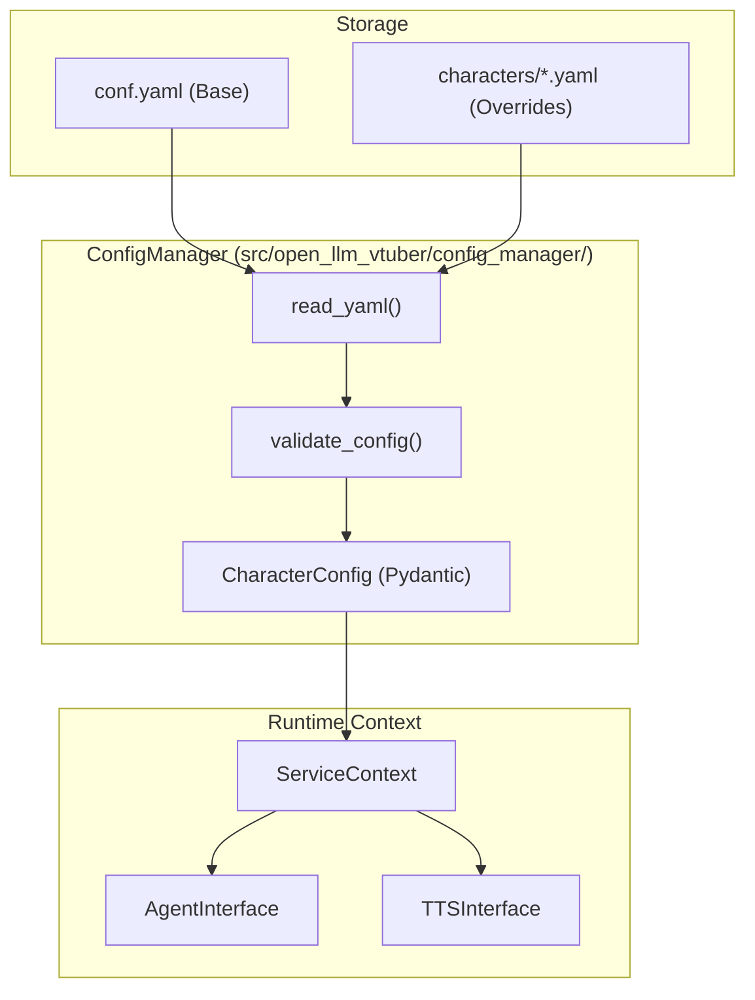
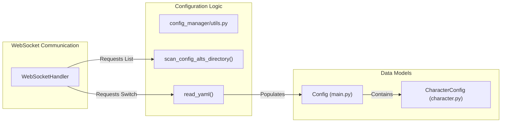

<!-- source: DeepWiki mcp.deepwiki.com · repo Open-LLM-VTuber/Open-LLM-VTuber · page 2.2 Character Configuration & Multi-Character Support · fetched 2026-10-30 -->

# Character Configuration & Multi-Character Support

Relevant source files

The following files were used as context for generating this wiki page:

- [backgrounds/README.md](backgrounds/README.md)
- [characters/README.md](characters/README.md)
- [characters/en_nuke_debate.yaml](characters/en_nuke_debate.yaml)
- [prompts/README.md](prompts/README.md)
- [src/open_llm_vtuber/config_manager/__init__.py](src/open_llm_vtuber/config_manager/__init__.py)
- [src/open_llm_vtuber/config_manager/character.py](src/open_llm_vtuber/config_manager/character.py)
- [src/open_llm_vtuber/config_manager/main.py](src/open_llm_vtuber/config_manager/main.py)
- [src/open_llm_vtuber/config_manager/system.py](src/open_llm_vtuber/config_manager/system.py)
- [src/open_llm_vtuber/config_manager/utils.py](src/open_llm_vtuber/config_manager/utils.py)

The character configuration system allows for the creation, management, and runtime switching of distinct AI personas. Each character is defined by a YAML file in the `characters/` directory, which can override global settings for LLM agents, TTS voices, ASR engines, and Live2D models.

## Character Configuration Schema

Character configurations are managed via the `CharacterConfig` Pydantic model [src/open_llm_vtuber/config_manager/character.py:13-29](). This model defines the identity and behavior of a specific VTuber persona.

| Field | Type | Description |
| :--- | :--- | :--- |
| `conf_name` | `str` | Display name in the frontend UI [characters/README.md:75-78](). |
| `conf_uid` | `str` | Unique identifier used for history tracking and internal logic [characters/README.md:80-83](). |
| `live2d_model_name` | `str` | Must match a name entry in `model_dict.json` [characters/README.md:85-87](). |
| `character_name` | `str` | The name the AI uses to refer to itself in chat [src/open_llm_vtuber/config_manager/character.py:19-19](). |
| `human_name` | `str` | The name of the user in conversation [src/open_llm_vtuber/config_manager/character.py:20-20](). |
| `avatar` | `str` | Filename of the image located in the `/avatars` folder [characters/README.md:97-100](). |
| `persona_prompt` | `str` | The core system prompt defining the character's soul [characters/README.md:102-104](). |
| `agent_config` | `AgentConfig` | Overrides for the LLM agent and provider settings [src/open_llm_vtuber/config_manager/character.py:23-23](). |
| `asr_config` | `ASRConfig` | Overrides for the Automatic Speech Recognition engine [src/open_llm_vtuber/config_manager/character.py:24-24](). |
| `tts_config` | `TTSConfig` | Overrides for the Text-to-Speech engine and voice [src/open_llm_vtuber/config_manager/character.py:25-25](). |
| `vad_config` | `VADConfig` | Overrides for Voice Activity Detection [src/open_llm_vtuber/config_manager/character.py:26-26](). |
| `tts_preprocessor_config` | `TTSPreprocessorConfig` | Settings for text cleaning before synthesis [src/open_llm_vtuber/config_manager/character.py:27-29](). |

**Sources:** [src/open_llm_vtuber/config_manager/character.py:13-70](), [characters/README.md:71-109]()

## Inheritance and Override Mechanism

The system uses a "Base + Override" approach. The `conf.yaml` in the project root acts as the base configuration [characters/README.md:7-8](). When a character is selected, the application loads the specific YAML from the `characters/` directory and merges it with the base settings.

### Configuration Loading Flow
The system utilizes `read_yaml` to parse files with environment variable substitution [src/open_llm_vtuber/config_manager/utils.py:16-53]() and `validate_config` to instantiate the Pydantic `Config` model [src/open_llm_vtuber/config_manager/utils.py:55-74]().

**Character Configuration Data Flow**

**Sources:** [src/open_llm_vtuber/config_manager/utils.py:16-74](), [characters/README.md:7-13]()

## Multi-Character Support & Discovery

The server automatically discovers available characters by scanning the directory defined in `system_config.config_alts_dir` [src/open_llm_vtuber/config_manager/system.py:13-13]().

- **Discovery:** The function `scan_config_alts_directory` walks the specified folder, reading each `.yaml` to extract the `conf_name` for UI display [src/open_llm_vtuber/config_manager/utils.py:127-171]().
- **Isolation:** Each character is isolated by its `conf_uid`. This UID is used to manage distinct chat histories and prevents conflicts between different personas [characters/README.md:80-83]().
- **Backgrounds:** Similarly, `scan_bg_directory` scans the `backgrounds/` folder for images available for switching in the UI [src/open_llm_vtuber/config_manager/utils.py:174-181]().

**Sources:** [src/open_llm_vtuber/config_manager/utils.py:127-181](), [src/open_llm_vtuber/config_manager/system.py:7-23]()

## Runtime Configuration Switching

Switching characters occurs over the WebSocket connection without restarting the server. When a client requests a configuration change:

1.  **Request:** The client sends a message containing the new configuration filename.
2.  **Validation:** The system validates the new configuration against the `Config` model [src/open_llm_vtuber/config_manager/utils.py:55-74]().
3.  **Re-initialization:** The runtime environment (often managed by `ServiceContext`) reloads engines based on the overrides found in the character-specific YAML [characters/README.md:106-109]().
4.  **Prompt Reconstruction:** The system prompt is updated using the new `persona_prompt` [src/open_llm_vtuber/config_manager/character.py:22-22]().

### Code Entity Association
This diagram maps the conceptual "Switch" to the actual classes and functions involved in the configuration lifecycle.

**Switching Logic Entity Map**

**Sources:** [src/open_llm_vtuber/config_manager/utils.py:127-171](), [src/open_llm_vtuber/config_manager/main.py:11-19](), [src/open_llm_vtuber/config_manager/character.py:13-29]()

## Implementation Details

### Environment Variable Substitution
The `read_yaml` utility supports substituting environment variables using the `${VAR_NAME}` syntax [src/open_llm_vtuber/config_manager/utils.py:39-46](). This allows sensitive keys (like API keys) to be kept out of character YAML files.

### Validation Logic
- **Persona Check:** `persona_prompt` cannot be empty [src/open_llm_vtuber/config_manager/character.py:72-78]().
- **Default Naming:** If `character_name` is omitted, it defaults to the `conf_name` [src/open_llm_vtuber/config_manager/character.py:80-84]().
- **Encoding:** The system attempts multiple encodings (`utf-8`, `gbk`, etc.) when reading character files to ensure cross-platform compatibility [src/open_llm_vtuber/config_manager/utils.py:87-104]().
- **Persistence:** Configurations can be saved back to disk using `save_config`, which dumps the Pydantic model to YAML [src/open_llm_vtuber/config_manager/utils.py:107-125]().

**Sources:** [src/open_llm_vtuber/config_manager/utils.py:39-125](), [src/open_llm_vtuber/config_manager/character.py:72-85]()

---

