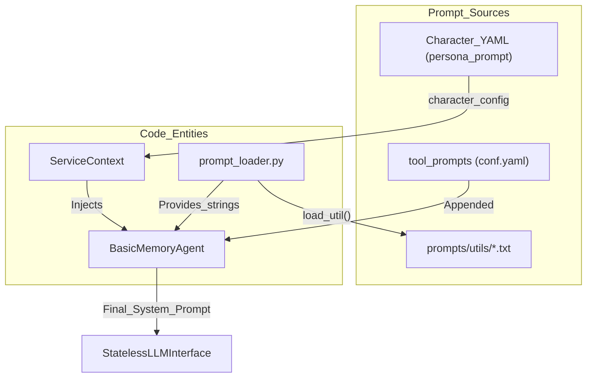
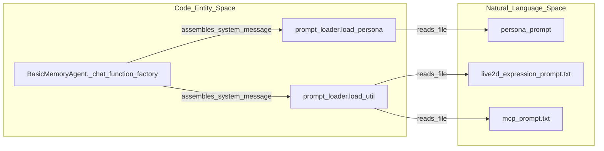

<!-- source: DeepWiki mcp.deepwiki.com · repo Open-LLM-VTuber/Open-LLM-VTuber · page 2.3 Prompt System · fetched 2026-10-30 -->

# Prompt System

Relevant source files

The following files were used as context for generating this wiki page:

- [avatars/mao.png](avatars/mao.png)
- [avatars/shizuku.png](avatars/shizuku.png)
- [characters/en_unhelpful_ai.yaml](characters/en_unhelpful_ai.yaml)
- [prompts/prompt_loader.py](prompts/prompt_loader.py)
- [prompts/utils/group_conversation_prompt.txt](prompts/utils/group_conversation_prompt.txt)
- [prompts/utils/live2d_expression_prompt.txt](prompts/utils/live2d_expression_prompt.txt)
- [prompts/utils/mcp_prompt.txt](prompts/utils/mcp_prompt.txt)
- [prompts/utils/proactive_speak_prompt.txt](prompts/utils/proactive_speak_prompt.txt)
- [prompts/utils/think_tag_prompt.txt](prompts/utils/think_tag_prompt.txt)
- [prompts/utils/tool_guidance_prompt.txt](prompts/utils/tool_guidance_prompt.txt)

The Prompt System in Open-LLM-VTuber is a modular architecture designed to separate a character's core persona from operational instructions. It utilizes a layered approach where a base system prompt is dynamically augmented with utility prompts (e.g., Live2D expressions, tool usage instructions, or group chat logic) before being sent to the LLM.

## Prompt Architecture Overview

The system distinguishes between **Persona Prompts** (who the character is) and **Utility Prompts** (how the character functions technically). 

1.  **Persona Prompts**: Defined in character-specific YAML files (e.g., `persona_prompt`) within the `characters/` directory [[characters/en_unhelpful_ai.yaml:8-9]]().
2.  **Utility Prompts**: Stored as `.txt` files in `prompts/utils/`. These provide instructions for specific capabilities like Live2D animations, MCP tool usage, and thought tags [[prompts/prompt_loader.py:9]]().

### Prompt Data Flow

The following diagram illustrates how the system components interact to load and assemble the final system message.

**System Prompt Assembly Pipeline**

Sources: [[prompts/prompt_loader.py:1-75]](), [[characters/en_unhelpful_ai.yaml:3-9]]()

---

## Utility Prompts

Utility prompts are managed by `prompts/prompt_loader.py`, which includes robust encoding detection (supporting UTF-8, GBK, ASCII, etc.) to handle various text formats [[prompts/prompt_loader.py:29-54]]().

### Live2D Expression Prompt
**File**: `prompts/utils/live2d_expression_prompt.txt`
This prompt instructs the LLM to use specific keywords wrapped in brackets (e.g., `[expression1]`) to trigger facial expressions or Live2D body actions [[prompts/utils/live2d_expression_prompt.txt:1-4]](). The system replaces the `[<insert_emomap_keys>]` placeholder with actual keys defined in the character's model configuration [[prompts/utils/live2d_expression_prompt.txt:5]]().

### MCP (Model Context Protocol) Prompt
**File**: `prompts/utils/mcp_prompt.txt`
Used when MCP tools are enabled. It provides the LLM with:
*   A list of available servers and tools (replacing `[<insert_mcp_servers_with_tools>]`) [[prompts/utils/mcp_prompt.txt:9]]().
*   Strict JSON formatting rules for tool calls, requiring `mcp_server`, `tool`, and `arguments` fields [[prompts/utils/mcp_prompt.txt:18-26]]().
*   Instructions to perform a "dedicated response" containing only the JSON when calling a tool, avoiding conversational filler during the tool-triggering phase [[prompts/utils/mcp_prompt.txt:16]]().

### Think Tag Prompt
**File**: `prompts/utils/think_tag_prompt.txt`
Encourages the LLM to express inner thoughts, mental activities, and physical actions between `` tags [[prompts/utils/think_tag_prompt.txt:1]](). This provides a "Chain of Thought" layer that can be filtered or displayed differently in the UI [[prompts/utils/think_tag_prompt.txt:4-6]]().

### Proactive Speak Prompt
**File**: `prompts/utils/proactive_speak_prompt.txt`
A short instruction used when the system triggers the VTuber to speak without a direct user prompt, ensuring the output is engaging and context-appropriate [[prompts/utils/proactive_speak_prompt.txt:1]]().

### Group Conversation Prompt
**File**: `prompts/utils/group_conversation_prompt.txt`
Injected when the VTuber is part of a multi-participant chat. It identifies the human participant and other AI agents, instructing the AI to avoid using prefixes like `Name:` and to vary response lengths to facilitate interaction [[prompts/utils/group_conversation_prompt.txt:1-7]]().

### Tool Guidance Prompt
**File**: `prompts/utils/tool_guidance_prompt.txt`
Provides logic for tool usage, instructing the agent to use tools proactively without asking and limiting pre-tool speech to at most one sentence [[prompts/utils/tool_guidance_prompt.txt:1]]().

---

## Tool Prompt Injection

The system handles tool-use instructions through the `tool_prompts` configuration. These are typically appended to the system prompt to ensure high instruction following.

**Prompt Injection Logic**
| Component | Implementation | Description |
| :--- | :--- | :--- |
| `prompt_loader.py` | `load_util(util_name)` | Loads text files from `prompts/utils/` using `_load_file_content` [[prompts/prompt_loader.py:67-75]](). |
| `BasicMemoryAgent` | System Message Construction | Concatenates the persona, utility prompts, and tool schemas into the system message. |
| `Live2dModel` | `extract_emotion` | Parses the LLM output for keywords defined in the `live2d_expression_prompt`. |

**Natural Language to Code Mapping**

Sources: [[prompts/prompt_loader.py:57-75]](), [[prompts/utils/mcp_prompt.txt:1-37]](), [[prompts/utils/live2d_expression_prompt.txt:1-15]]()

Sources:
- `prompts/prompt_loader.py`
- `prompts/utils/mcp_prompt.txt`
- `prompts/utils/live2d_expression_prompt.txt`
- `prompts/utils/think_tag_prompt.txt`
- `prompts/utils/group_conversation_prompt.txt`
- `prompts/utils/tool_guidance_prompt.txt`
- `prompts/utils/proactive_speak_prompt.txt`
- `characters/en_unhelpful_ai.yaml`

---

