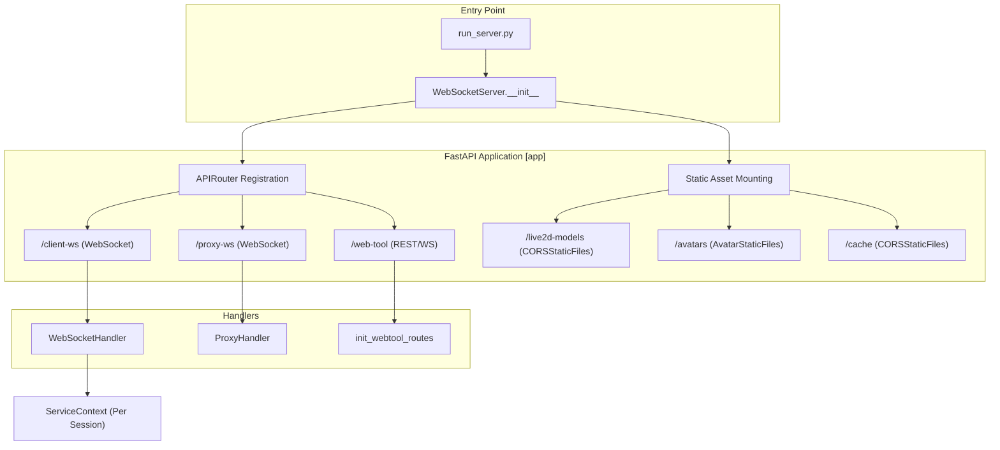
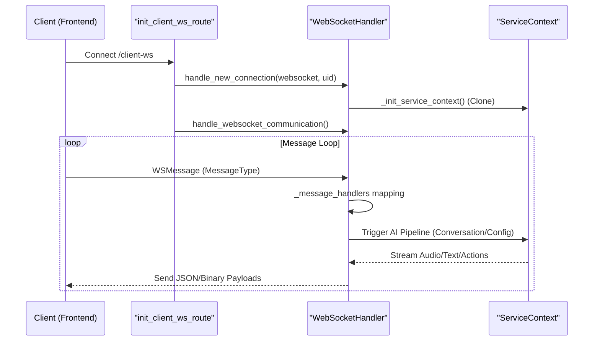

<!-- source: DeepWiki mcp.deepwiki.com · repo Open-LLM-VTuber/Open-LLM-VTuber · page 3 Server & WebSocket Architecture · fetched 2026-10-30 -->

# Server & WebSocket Architecture

Relevant source files

The following files were used as context for generating this wiki page:

- [run_server.py](run_server.py)
- [src/open_llm_vtuber/server.py](src/open_llm_vtuber/server.py)
- [src/open_llm_vtuber/websocket_handler.py](src/open_llm_vtuber/websocket_handler.py)

The **Open-LLM-VTuber** server is built on **FastAPI** and provides a high-concurrency, asynchronous communication layer for VTuber clients. It manages the lifecycle of WebSocket connections, serves static assets (Live2D models, backgrounds, avatars), and provides REST endpoints for utility functions like ASR transcription and web-based tools.

The server architecture is designed to support multiple concurrent users by cloning a base `ServiceContext` for each session, ensuring that stateful components like chat history and conversation buffers remain isolated.

## System Component Overview

The server's entry point is `run_server.py`, which initializes the `WebSocketServer` class [run_server.py:146](). This class configures the FastAPI application, mounts specialized static file handlers, and registers the routing logic.

### Server Core Components

| Component | Code Entity | Responsibility |
| :--- | :--- | :--- |
| **Main Server** | `WebSocketServer` | Configures FastAPI, middleware, and mounts static directories [src/open_llm_vtuber/server.py:56-150](). |
| **Connection Handler** | `WebSocketHandler` | Manages client lifecycle, session context, and message routing [src/open_llm_vtuber/websocket_handler.py:61-98](). |
| **Proxy Layer** | `ProxyHandler` | Handles multi-client multiplexing and platform integrations [src/open_llm_vtuber/routes.py:108-109](). |
| **Service Context** | `ServiceContext` | Dependency container for ASR, TTS, LLM, and VAD engines [src/open_llm_vtuber/service_context.py:1-20](). |

**Diagram: Server Initialization & Routing Architecture**

Sources: [src/open_llm_vtuber/server.py:56-149](), [src/open_llm_vtuber/routes.py:17-109](), [run_server.py:145-164]()

---

## Server Startup & Static Asset Serving

The server utilizes `uvicorn` to run the FastAPI application [run_server.py:159-164](). During startup, it performs critical checks, such as verifying the presence of the `frontend` submodule [run_server.py:50-108]() and synchronizing user configurations via the `UpgradeManager` [run_server.py:132]().

A key feature of the server is its specialized static file handling. `CORSStaticFiles` ensures that web-based Live2D renderers can access model files across origins [src/open_llm_vtuber/server.py:23-41](), while `AvatarStaticFiles` implements security checks to restrict file types to images only [src/open_llm_vtuber/server.py:43-54]().

For details, see [Server Startup & Static Asset Serving](#3.1).

Sources: [src/open_llm_vtuber/server.py:23-54](), [run_server.py:50-108](), [run_server.py:159-164]()

---

## WebSocket Handler & Message Routing

The `WebSocketHandler` is the primary engine for real-time interaction. When a client connects to `/client-ws`, the handler assigns a unique `client_uid` and clones the `default_context_cache` to create a session-specific environment [src/open_llm_vtuber/websocket_handler.py:178-193]().

Communication is driven by a `MessageType` system [src/open_llm_vtuber/websocket_handler.py:32-45](), which routes incoming JSON payloads to specific logic branches via a handler mapping [src/open_llm_vtuber/websocket_handler.py:76-98](), such as starting a conversation, updating character configurations, or fetching chat history.

For details, see [WebSocket Handler & Message Routing](#3.2).

**Diagram: WebSocket Communication Flow**

Sources: [src/open_llm_vtuber/websocket_handler.py:32-98](), [src/open_llm_vtuber/websocket_handler.py:100-134](), [src/open_llm_vtuber/websocket_handler.py:178-193]()

---

## REST API Endpoints & Web Tool

In addition to WebSockets, the server exposes RESTful endpoints for utility operations. This includes:
*   **ASR Transcription**: A `POST /asr` endpoint for processing audio uploads.
*   **Model Discovery**: `GET /live2d-models/info` which provides metadata for available models.
*   **Web Tool**: A browser-based utility located at `/web-tool` for testing TTS and ASR engines independently of the main VTuber interface [src/open_llm_vtuber/server.py:138-142]().

For details, see [REST API Endpoints & Web Tool](#3.3).

Sources: [src/open_llm_vtuber/server.py:97-98](), [src/open_llm_vtuber/server.py:138-142]()

---

## Proxy Handler & Bilibili Live Integration

The `ProxyHandler` acts as a middleman, allowing external platforms (like Bilibili Live) or specialized clients to interact with the VTuber. When `enable_proxy` is set in the configuration, the `/proxy-ws` endpoint becomes available [run_server.py:142-143](). This enables the VTuber to respond to live audiences by forwarding platform-specific events into the main conversation pipeline.

For details, see [Proxy Handler & Bilibili Live Integration](#3.4).

Sources: [src/open_llm_vtuber/server.py:101-109](), [run_server.py:142-143]()

---

