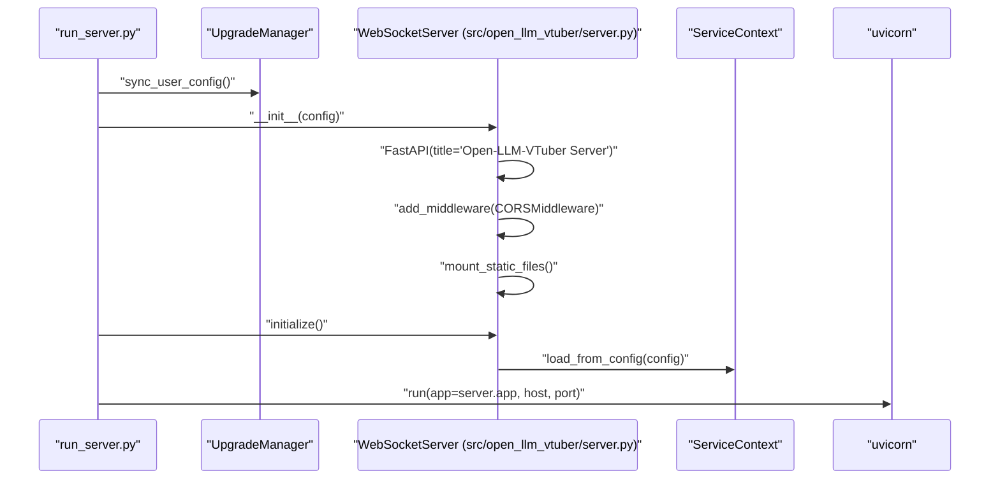
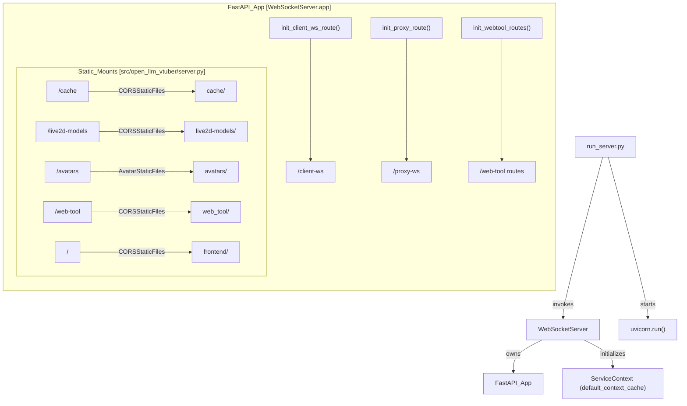

<!-- source: DeepWiki mcp.deepwiki.com · repo Open-LLM-VTuber/Open-LLM-VTuber · page 3.1 Server Startup & Static Asset Serving · fetched 2026-10-30 -->

# Server Startup & Static Asset Serving

Relevant source files

The following files were used as context for generating this wiki page:

- [.gitmodules](.gitmodules)
- [prompts/utils/live_prompt.txt](prompts/utils/live_prompt.txt)
- [run_server.py](run_server.py)
- [src/open_llm_vtuber/server.py](src/open_llm_vtuber/server.py)

The `WebSocketServer` is the central entry point for the Open-LLM-VTuber backend. It leverages **FastAPI** to coordinate WebSocket communication, RESTful utility endpoints, and the serving of static assets (Live2D models, backgrounds, and frontend files).

## Server Lifecycle and Initialization

The server startup process is managed by `run_server.py`, which handles environment setup, configuration validation, and the Uvicorn execution loop.

### 1. Environment & Pre-startup
Before the server starts, the system performs several checks:
- **Environment Variables**: Sets `HF_HOME` and `MODELSCOPE_CACHE` to a local `models/` directory to ensure model weights are stored within the project [run_server.py:16-17](). It also supports the `--hf_mirror` flag to set `HF_ENDPOINT` to `https://hf-mirror.com` [run_server.py:176-177]().
- **Frontend Check**: Verifies if the `frontend/index.html` exists. If missing, it attempts to initialize the Git submodule pointing to the `Open-LLM-VTuber-Web` repository [run_server.py:50-108](), [.gitmodules:1-4]().
- **Config Sync**: The `UpgradeManager` synchronizes the user's `conf.yaml` with the latest template to ensure all required fields are present [run_server.py:131-135]().

### 2. Initialization Sequence
The `WebSocketServer` class is initialized in two stages:
1.  **Synchronous Init**: The `__init__` method sets up the FastAPI app, configures `CORSMiddleware`, registers routers, and mounts static directories [src/open_llm_vtuber/server.py:74-149]().
2.  **Asynchronous Init**: The `initialize()` method is called via `asyncio.run()` to load the `ServiceContext`, which instantiates the AI engines (ASR, TTS, LLM) based on the configuration [run_server.py:151](), [src/open_llm_vtuber/server.py:151-154]().

### 3. Shutdown & Cleanup
Upon server termination, `atexit` triggers `WebSocketServer.clean_cache()`, which deletes and recreates the `cache/` directory to remove temporary audio files generated during the session [run_server.py:136](), [src/open_llm_vtuber/server.py:157-163]().

### Server Startup Flow
The following diagram illustrates the relationship between the startup script and the server class entities.

"Server Startup Sequence"

Sources: [run_server.py:120-164](), [src/open_llm_vtuber/server.py:74-154]()

---

## Static Asset Serving

Open-LLM-VTuber serves various static assets required by the frontend. To ensure these assets are accessible across different origins (e.g., when running the frontend on a different port), the server uses custom static file handlers.

### CORSStaticFiles & AvatarStaticFiles
Standard FastAPI/Starlette `StaticFiles` can sometimes bypass middleware. To guarantee CORS headers are present, the project implements:
- **`CORSStaticFiles`**: Overrides `get_response` to inject `Access-Control-Allow-Origin: *` and sets correct `Content-Type` for Javascript files [src/open_llm_vtuber/server.py:23-41]().
- **`AvatarStaticFiles`**: Inherits from `CORSStaticFiles` but adds a security check to only allow specific image extensions (`.jpg`, `.jpeg`, `.png`, `.gif`, `.svg`), returning a `403 Forbidden` for other types [src/open_llm_vtuber/server.py:43-53]().

### Endpoint Mount Points
The server mounts several directories to specific URL prefixes:

| URL Path | Local Directory | Handler Class | Purpose |
| :--- | :--- | :--- | :--- |
| `/cache` | `cache/` | `CORSStaticFiles` | Temporary TTS audio files |
| `/live2d-models` | `live2d-models/` | `CORSStaticFiles` | Live2D model assets (.model3.json, textures) |
| `/bg` | `backgrounds/` | `CORSStaticFiles` | Background images for the VTuber room |
| `/avatars` | `avatars/` | `AvatarStaticFiles` | Character/User profile icons |
| `/web-tool` | `web_tool/` | `CORSStaticFiles` | The browser-based ASR/TTS utility (with `html=True`) |
| `/` | `frontend/` | `CORSStaticFiles` | The main VTuber frontend application (catch-all) |

Sources: [src/open_llm_vtuber/server.py:111-149]()

---

## Routing Architecture

The server logic is split into several routers initialized via factory functions and included in the main FastAPI app.

### Route Initialization
- **`init_client_ws_route`**: Registers the primary WebSocket endpoint for the VTuber client [src/open_llm_vtuber/server.py:93-95]().
- **`init_webtool_routes`**: Registers REST endpoints and WebSocket routes for system utilities, such as the web-based configuration and testing tools [src/open_llm_vtuber/server.py:96-98]().
- **`init_proxy_route`**: If `enable_proxy` is true in `system_config`, it registers routes to allow external platform integrations to tunnel messages to the internal client. The server constructs a `server_url` using the configured host and port [src/open_llm_vtuber/server.py:101-109]().

### Entity Association Diagram
This diagram maps the logical server components to their implementation classes and route definitions.

"Server Routing & Entity Map"

Sources: [src/open_llm_vtuber/server.py:74-149](), [run_server.py:146-164]()

---

