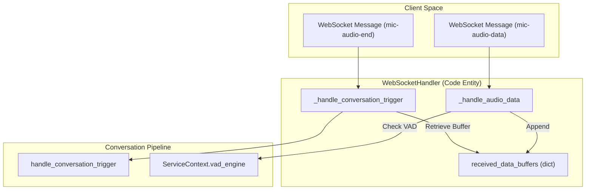
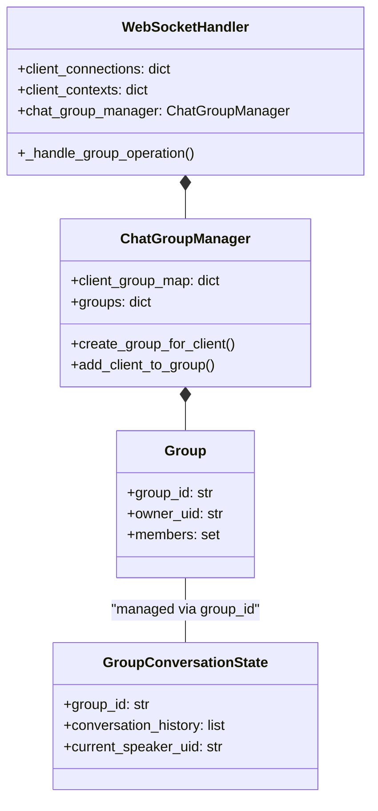

<!-- source: DeepWiki mcp.deepwiki.com · repo Open-LLM-VTuber/Open-LLM-VTuber · page 3.2 WebSocket Handler & Message Routing · fetched 2026-10-30 -->

# WebSocket Handler & Message Routing

Relevant source files

The following files were used as context for generating this wiki page:

- [src/open_llm_vtuber/chat_group.py](src/open_llm_vtuber/chat_group.py)
- [src/open_llm_vtuber/conversations/types.py](src/open_llm_vtuber/conversations/types.py)
- [src/open_llm_vtuber/message_handler.py](src/open_llm_vtuber/message_handler.py)
- [src/open_llm_vtuber/websocket_handler.py](src/open_llm_vtuber/websocket_handler.py)

The `WebSocketHandler` serves as the central orchestrator for real-time communication between the client and the server. It manages the connection lifecycle, routes incoming messages to appropriate service logic based on their type, and ensures that each client maintains its own isolated service context while supporting collaborative group features.

## WebSocketHandler Overview

The `WebSocketHandler` class manages multiple concurrent client connections, each identified by a unique `client_uid` [src/open_llm_vtuber/websocket_handler.py:61-71](). It maintains a mapping of active WebSockets and their corresponding `ServiceContext` instances.

### Context Cloning per Client
To ensure thread safety and individual user experiences, the handler performs "context cloning" for every new connection. Instead of sharing a global state, it deep-copies the default configuration and engines into a session-specific `ServiceContext` [src/open_llm_vtuber/websocket_handler.py:178-202](). This allows one user to switch characters or LLM settings without affecting other connected clients.

### Connection Lifecycle
1.  **New Connection**: `handle_new_connection` initializes the session-specific `ServiceContext` [src/open_llm_vtuber/websocket_handler.py:100-116]().
2.  **Data Storage**: Client data, buffers, and initial group status are registered in `_store_client_data` [src/open_llm_vtuber/websocket_handler.py:135-148]().
3.  **Initial Handshake**: The server sends initial model information, configuration details, and a command to start the microphone via `_send_initial_messages` [src/open_llm_vtuber/websocket_handler.py:149-176]().
4.  **Message Loop**: The handler enters a continuous loop, receiving JSON messages and dispatching them via `_message_handlers` [src/open_llm_vtuber/websocket_handler.py:214-233]().
5.  **Disconnection**: Upon disconnect, `handle_disconnection` cleans up buffers, cancels active conversation tasks, and notifies group members [src/open_llm_vtuber/websocket_handler.py:235-252]().

**Sources:**
- [src/open_llm_vtuber/websocket_handler.py:61-252]()

---

## Message Routing & MessageType Enum

Incoming messages are categorized using the `MessageType` enum, which groups specific actions into functional domains [src/open_llm_vtuber/websocket_handler.py:32-45]().

### Routing Table
The handler uses a dispatch table initialized in `_init_message_handlers` to map `action` or `type` strings to internal methods [src/open_llm_vtuber/websocket_handler.py:76-98]().

| Message Category | Actions / Types | Handler Method |
| :--- | :--- | :--- |
| **GROUP** | `add-client-to-group`, `remove-client-from-group`, `request-group-info` | `_handle_group_operation`, `_handle_group_info` |
| **HISTORY** | `fetch-history-list`, `fetch-and-set-history`, `create-new-history`, `delete-history` | `_handle_history_list_request`, `_handle_fetch_history`, `_handle_create_history`, `_handle_delete_history` |
| **CONVERSATION** | `mic-audio-end`, `text-input`, `ai-speak-signal` | `_handle_conversation_trigger` |
| **CONFIG** | `fetch-configs`, `switch-config`, `request-init-config` | `_handle_fetch_configs`, `_handle_config_switch`, `_handle_init_config_request` |
| **CONTROL** | `interrupt-signal`, `audio-play-start`, `heartbeat` | `_handle_interrupt`, `_handle_audio_play_start`, `_handle_heartbeat` |
| **DATA** | `mic-audio-data`, `raw-audio-data` | `_handle_audio_data`, `_handle_raw_audio_data` |

**Sources:**
- [src/open_llm_vtuber/websocket_handler.py:32-45]()
- [src/open_llm_vtuber/websocket_handler.py:76-98]()

---

## Audio Streaming & VAD Integration

The system supports real-time audio streaming from the client. Audio data is handled differently depending on whether the Voice Activity Detection (VAD) is processed on the client or server.

### VAD-Based Routing
1.  **Audio Buffering**: Binary or list-based audio chunks received via `mic-audio-data` are appended to `received_data_buffers` [src/open_llm_vtuber/websocket_handler.py:438-444]().
2.  **Triggering**: When the client signals the end of speech (`mic-audio-end`), the handler retrieves the full buffer and triggers the conversation pipeline [src/open_llm_vtuber/websocket_handler.py:417-436]().
3.  **VAD Processing**: If server-side VAD is enabled, `_handle_audio_data` passes the chunks to `session_service_context.vad_engine` to detect speech boundaries [src/open_llm_vtuber/websocket_handler.py:446-456]().

### Data Flow: Audio to Conversation
The following diagram bridges the WebSocket messages to the internal code entities responsible for processing.

Title: Audio Data Routing Flow

**Sources:**
- [src/open_llm_vtuber/websocket_handler.py:417-456]()
- [src/open_llm_vtuber/conversations/conversation_handler.py:26-29]()

---

## Multi-Client Synchronization & Chat Groups

The `ChatGroupManager` allows multiple clients to join a single conversation session, enabling a "group chat" experience where one AI interacts with multiple users.

### Group Operations
- **Creation**: A group is automatically created when a client invites another or via `create_group_for_client` [src/open_llm_vtuber/chat_group.py:20-26]().
- **Joining**: `add_client_to_group` links a `target_uid` to the inviter's `group_id` [src/open_llm_vtuber/chat_group.py:28-62]().
- **Broadcasting**: Messages like AI responses or interruptions are broadcast to all members of the group using `broadcast_to_group` [src/open_llm_vtuber/chat_group.py:199-215]().

### Synchronization Logic
When a client in a group triggers a conversation, the `handle_conversation_trigger` logic accounts for `GroupConversationState` to manage the turn-taking and shared history [src/open_llm_vtuber/conversations/types.py:43-55]().

Title: Chat Group Management Entity Relationship

**Sources:**
- [src/open_llm_vtuber/chat_group.py:9-26]()
- [src/open_llm_vtuber/chat_group.py:28-62]()
- [src/open_llm_vtuber/chat_group.py:199-215]()
- [src/open_llm_vtuber/conversations/types.py:43-55]()

---

## Response Waiting Mechanism

The `MessageHandler` utility provides a way for the server to send a request to a client and wait asynchronously for a specific response [src/open_llm_vtuber/message_handler.py:7-15]().

- **`wait_for_response`**: Creates an `asyncio.Event` and blocks until the client sends a message with a matching `response_type` and `request_id` [src/open_llm_vtuber/message_handler.py:16-54]().
- **`handle_message`**: Called by the `WebSocketHandler` for every incoming message. If the message matches a waiting event, it sets the event and stores the data [src/open_llm_vtuber/message_handler.py:56-76]().

This is primarily used for complex interactions where the server needs confirmation or data from the frontend before proceeding with the conversation pipeline.

**Sources:**
- [src/open_llm_vtuber/message_handler.py:7-76]()
- [src/open_llm_vtuber/websocket_handler.py:221-224]()

---

