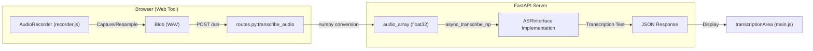
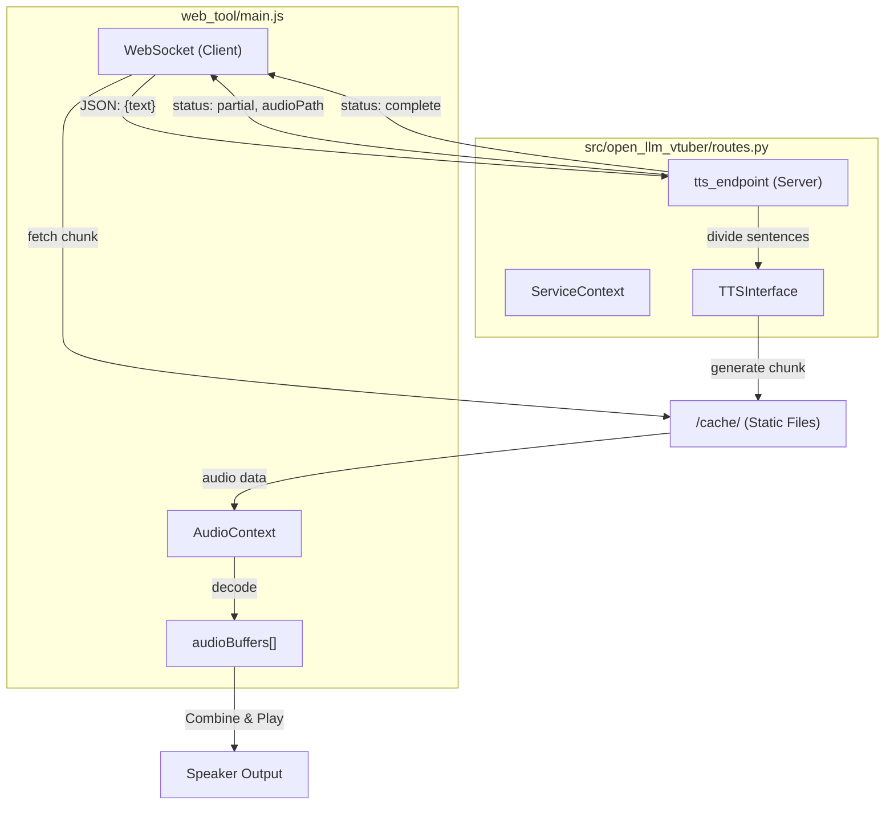

<!-- source: DeepWiki mcp.deepwiki.com · repo Open-LLM-VTuber/Open-LLM-VTuber · page 3.3 REST API Endpoints & Web Tool · fetched 2026-10-30 -->

# REST API Endpoints & Web Tool

Relevant source files

The following files were used as context for generating this wiki page:

- [src/open_llm_vtuber/chat_history_manager.py](src/open_llm_vtuber/chat_history_manager.py)
- [src/open_llm_vtuber/routes.py](src/open_llm_vtuber/routes.py)
- [web_tool/README.md](web_tool/README.md)
- [web_tool/index.html](web_tool/index.html)
- [web_tool/main.js](web_tool/main.js)
- [web_tool/recorder.js](web_tool/recorder.js)

This page documents the RESTful API endpoints and the built-in browser-based utility tool provided by the Open-LLM-VTuber server. While the primary communication with the VTuber occurs over a stateful WebSocket, these REST endpoints provide stateless access to the ASR/TTS engines and metadata about available Live2D assets.

## Overview

The server exposes several specialized routes to support frontend initialization and utility functions. These are primarily defined and initialized in `src/open_llm_vtuber/routes.py` [src/open_llm_vtuber/routes.py:1-13]() and mounted to the FastAPI application during startup.

### Key Components
- **Live2D Info**: Scans the filesystem to provide a list of available models.
- **ASR Endpoint**: Allows uploading WAV files for one-off transcriptions.
- **Web Tool**: A browser-based frontend for testing configured ASR/TTS engines.
- **TTS WebSocket**: A dedicated streaming endpoint for the Web Tool's speech generation.
- **Chat History**: (Handled by `chat_history_manager.py`) Manages persistence for sessions, though primarily accessed via the main WebSocket.

## REST API Reference

### 1. Live2D Model Information
**Endpoint:** `GET /live2d-models/info`

This endpoint scans the `live2d-models/` directory for valid Cubism models. A model is considered valid if it contains a folder named `FolderName` with a corresponding `FolderName.model3.json` file inside [src/open_llm_vtuber/routes.py:108-115]().

**Response Structure:**
| Field | Type | Description |
| :--- | :--- | :--- |
| `type` | string | Constant: `"live2d-models/info"` |
| `count` | integer | Number of valid models found. |
| `characters` | list | Objects containing `name`, `avatar` (path), and `model_path`. |

**Sources:** [src/open_llm_vtuber/routes.py:96-139]()

### 2. Audio Transcription (ASR)
**Endpoint:** `POST /asr`

Accepts a 16-bit PCM WAV file and returns the transcribed text using the currently active ASR engine defined in the `ServiceContext` [src/open_llm_vtuber/routes.py:141-145]().

**Implementation Details:**
- **Validation**: The server checks for a minimum file size (44 bytes for WAV header) [src/open_llm_vtuber/routes.py:152-153]().
- **Processing**: It strips the 44-byte header and converts the remaining 16-bit PCM data into a `float32` numpy array normalized to the range `[-1.0, 1.0]` [src/open_llm_vtuber/routes.py:156-168]().
- **Execution**: The array is passed to `asr_engine.async_transcribe_np()` [src/open_llm_vtuber/routes.py:178-180]().

**Sources:** [src/open_llm_vtuber/routes.py:141-200]()

### 3. Web Tool Redirects
**Endpoints:** `GET /web-tool` and `GET /web_tool`

These endpoints serve as aliases that redirect the browser to `/web-tool/index.html` [src/open_llm_vtuber/routes.py:86-94](). The actual files are served from the `web_tool/` directory.

## Web Tool Utility

The Web Tool is a built-in frontend utility that allows users to utilize the VTuber's ASR and TTS capabilities independently of the companion interface [web_tool/README.md:9-11](). It is accessible at `http://localhost:12393/web-tool` [web_tool/README.md:13]().

### Speech Recognition (ASR)
The tool provides two methods for transcription:
1.  **Live Recording**: Uses the `AudioRecorder` class to capture mono audio at 16kHz [web_tool/recorder.js:11-16](). It resamples the audio and generates a valid WAV header in the browser before uploading to `/asr` [web_tool/recorder.js:55-92]().
2.  **File Upload**: Users can upload existing audio files. The tool uses the browser's `AudioContext` to decode the file and convert it to the required 16kHz mono WAV format before sending it to the server [web_tool/main.js:37-47]().

### Text-to-Speech (TTS)
**Endpoint:** `WS /tts-ws`

The Web Tool uses a dedicated WebSocket for TTS to handle streaming responses.
- **Request**: Sends a JSON object: `{"text": "..."}` [web_tool/main.js:220-222]().
- **Response**: The server streams `partial` messages containing paths to cached audio chunks [web_tool/main.js:136-141]().
- **Assembly**: The frontend fetches these chunks, decodes them, and combines them into a single `AudioBuffer` for playback and download [web_tool/main.js:173-195]().

**Sources:** [web_tool/main.js:115-225](), [web_tool/recorder.js:1-132](), [web_tool/index.html:112-137]()

## Data Flow Diagrams

### ASR Request Pipeline
The following diagram illustrates the flow of audio data from the Web Tool frontend to the backend ASR engine.

Title: ASR Data Flow (Frontend to Code Entities)

**Sources:** [src/open_llm_vtuber/routes.py:141-182](), [web_tool/main.js:84-112](), [web_tool/recorder.js:33-53]()

### TTS Streaming Architecture
This diagram maps the interaction between the Web Tool's WebSocket client and the server's TTS streaming logic.

Title: TTS Streaming Flow (Web Tool)

**Sources:** [src/open_llm_vtuber/routes.py:201-230](), [web_tool/main.js:115-165](), [web_tool/main.js:215-225]()

## Implementation Details

### Live2D Model Discovery
The discovery logic in `init_webtool_routes` is responsible for mapping the filesystem to the API. It looks for:
1.  **Folder Name**: The primary identifier [src/open_llm_vtuber/routes.py:110]().
2.  **Model File**: Must be `folder_name.model3.json` [src/open_llm_vtuber/routes.py:112-113]().
3.  **Avatar**: Searches for `.png`, `.jpg`, or `.jpeg` files matching the folder name to use as a preview [src/open_llm_vtuber/routes.py:118-124]().

### WAV Header Construction (Frontend)
The `AudioRecorder` class manually constructs the 44-byte RIFF/WAVE header to ensure compatibility with the backend's expectations of a 16kHz, 16-bit PCM mono file [web_tool/recorder.js:55-92](). This involves writing specific offsets for `SampleRate` (24), `ByteRate` (28), and `BlockAlign` (32) [web_tool/recorder.js:82-85]().

### Chat History Management
While primarily a backend utility, the `chat_history_manager.py` ensures that sessions are isolated and safe.
- **Path Sanitization**: The `_sanitize_path_component` and `_is_safe_filename` functions prevent path traversal attacks by validating filenames against a regex [src/open_llm_vtuber/chat_history_manager.py:19-38]().
- **Unique Identifiers**: History files are named using a combination of a timestamp and a UUID: `YYYY-MM-DD_HH-MM-SS_UUID` [src/open_llm_vtuber/chat_history_manager.py:70-71]().
- **Storage**: Messages are stored as JSON arrays with `role`, `timestamp`, and `content` fields [src/open_llm_vtuber/chat_history_manager.py:131-135]().

**Sources:** [src/open_llm_vtuber/routes.py:96-139](), [web_tool/recorder.js:55-92](), [src/open_llm_vtuber/chat_history_manager.py:19-147]()

---

