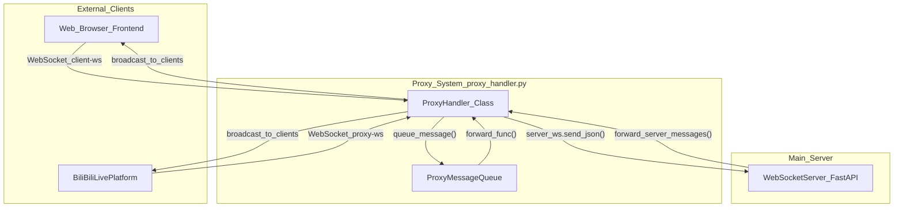
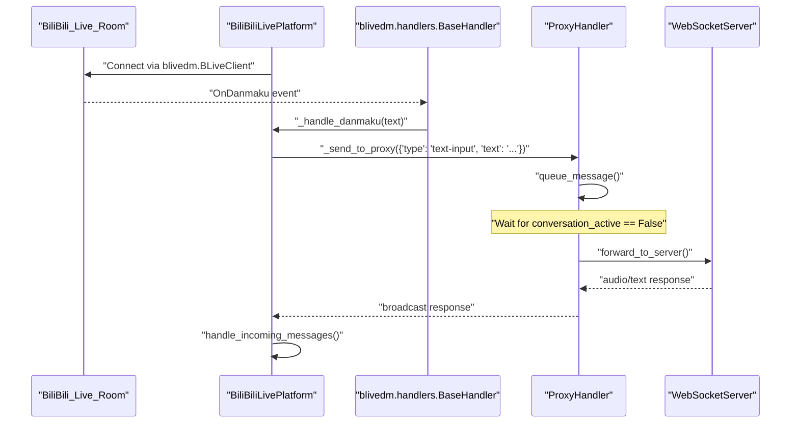

<!-- source: DeepWiki mcp.deepwiki.com · repo Open-LLM-VTuber/Open-LLM-VTuber · page 3.4 Proxy Handler & Bilibili Live Integration · fetched 2026-10-30 -->

# Proxy Handler & Bilibili Live Integration

Relevant source files

The following files were used as context for generating this wiki page:

- [scripts/run_bilibili_live.py](scripts/run_bilibili_live.py)
- [src/open_llm_vtuber/agent/agents/letta_agent.py](src/open_llm_vtuber/agent/agents/letta_agent.py)
- [src/open_llm_vtuber/config_manager/live.py](src/open_llm_vtuber/config_manager/live.py)
- [src/open_llm_vtuber/live/bilibili_live.py](src/open_llm_vtuber/live/bilibili_live.py)
- [src/open_llm_vtuber/live/live_interface.py](src/open_llm_vtuber/live/live_interface.py)
- [src/open_llm_vtuber/proxy_handler.py](src/open_llm_vtuber/proxy_handler.py)
- [src/open_llm_vtuber/proxy_message_queue.py](src/open_llm_vtuber/proxy_message_queue.py)

The `ProxyHandler` and its associated components allow multiple clients (such as a web browser and a live platform scraper) to connect to a single VTuber server instance. This architecture ensures that live stream comments (danmaku) can be processed and responded to by the VTuber while the streamer still maintains control via a web interface.

## Proxy Handler Architecture

The `ProxyHandler` acts as a middleman that manages multiple client WebSocket connections and multiplexes them into a single upstream connection to the `WebSocketHandler` on the main server [src/open_llm_vtuber/proxy_handler.py:13-17]().

### Key Responsibilities
- **Multiplexing**: Manages a dictionary of `clients` [src/open_llm_vtuber/proxy_handler.py:28]() and assigns each a unique `client_id` [src/open_llm_vtuber/proxy_handler.py:102]().
- **Upstream Connection**: Maintains a persistent connection to the main server at `server_url` [src/open_llm_vtuber/proxy_handler.py:26]().
- **Message Queuing**: Uses `ProxyMessageQueue` to ensure that messages from different clients do not collide or interrupt active AI generations [src/open_llm_vtuber/proxy_handler.py:34]().
- **Heartbeat & Reconnection**: Implements `_maintain_connection` to ensure the proxy stays connected to the server via `heartbeat` messages every 30 seconds [src/open_llm_vtuber/proxy_handler.py:71-90]().

### Proxy Data Flow Diagram
This diagram shows how the `ProxyHandler` bridges external clients to the `WebSocketServer`.

**Sources:** [src/open_llm_vtuber/proxy_handler.py:13-63](), [src/open_llm_vtuber/proxy_message_queue.py:7-22]()

---

## Proxy Message Queue

The `ProxyMessageQueue` implements a producer-consumer pattern specifically designed for the VTuber's sequential conversation flow [src/open_llm_vtuber/proxy_message_queue.py:7-11]().

### Conversation State Awareness
The queue tracks the `_conversation_active` state [src/open_llm_vtuber/proxy_message_queue.py:16]().
1. **Queuing**: When a `text-input` message arrives, it is appended to a `deque` along with its `sender_id` [src/open_llm_vtuber/proxy_message_queue.py:41-45]().
2. **Consumption**: The `_consume_loop` only pops the next message if `_conversation_active` is `False` [src/open_llm_vtuber/proxy_message_queue.py:100]().
3. **Automatic Flow**: When a response finishes, the proxy marks the conversation as inactive, triggering the consumer to process the next item in the queue [src/open_llm_vtuber/proxy_message_queue.py:68-69]().

### Message Handling Logic
| Message Type | Handling Logic | Code Reference |
| :--- | :--- | :--- |
| `text-input` | Added to `ProxyMessageQueue` for sequential processing. | [src/open_llm_vtuber/proxy_handler.py:125-127]() |
| `interrupt-signal` | Bypasses queue, sets `conversation_active = False` immediately to stop current generation. | [src/open_llm_vtuber/proxy_handler.py:129-136]() |
| `request-init-config` | Sent upon new client connection to synchronize state. | [src/open_llm_vtuber/proxy_handler.py:114-115]() |
| Others | Forwarded directly to server via `forward_to_server`. | [src/open_llm_vtuber/proxy_handler.py:138-139]() |

**Sources:** [src/open_llm_vtuber/proxy_message_queue.py:91-132](), [src/open_llm_vtuber/proxy_handler.py:121-140]()

---

## Bilibili Live Integration

The Bilibili integration allows the VTuber to read and respond to live danmaku (chat messages). It uses the `blivedm` library to scrape the live room and communicates with the server through the `ProxyHandler`.

### BiliBiliLivePlatform Class
This class implements the `LivePlatformInterface` [src/open_llm_vtuber/live/live_interface.py:6]() to handle the lifecycle of a live session.

- **Room Monitoring**: Can monitor multiple `room_ids` simultaneously [src/open_llm_vtuber/live/bilibili_live.py:52]().
- **Authentication**: Supports `sessdata` for authenticated requests [src/open_llm_vtuber/live/bilibili_live.py:53]().
- **Danmaku Processing**: The `_handle_danmaku` method receives raw text and wraps it in a `text-input` JSON structure before sending it to the proxy [src/open_llm_vtuber/live/bilibili_live.py:170-199]().

### Integration Component Diagram
This diagram maps the Bilibili scraper components to the code entities.

**Sources:** [src/open_llm_vtuber/live/bilibili_live.py:33-60](), [src/open_llm_vtuber/live/bilibili_live.py:170-206](), [scripts/run_bilibili_live.py:14-44]()

### Configuration
The Bilibili integration is configured via the `live_config` section in `conf.yaml`, which is parsed into `BiliBiliLiveConfig` [src/open_llm_vtuber/config_manager/live.py:6-28]().

| Config Field | Type | Description |
| :--- | :--- | :--- |
| `room_ids` | `List[int]` | List of Bilibili room IDs to scrape. |
| `sessdata` | `str` | SESSDATA cookie for authenticated scraper access. |

**Sources:** [src/open_llm_vtuber/config_manager/live.py:6-21]()

### Execution
The Bilibili client is run as a separate process using the script `scripts/run_bilibili_live.py` [scripts/run_bilibili_live.py:14](). It validates the configuration using `validate_config` and initializes the `BiliBiliLivePlatform` before entering an async loop via `platform.run()` [scripts/run_bilibili_live.py:23-44]().

**Sources:** [scripts/run_bilibili_live.py:56-62]()

---

