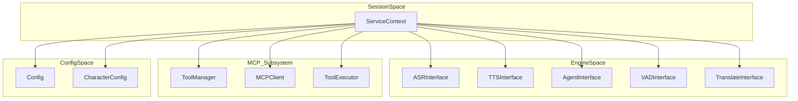
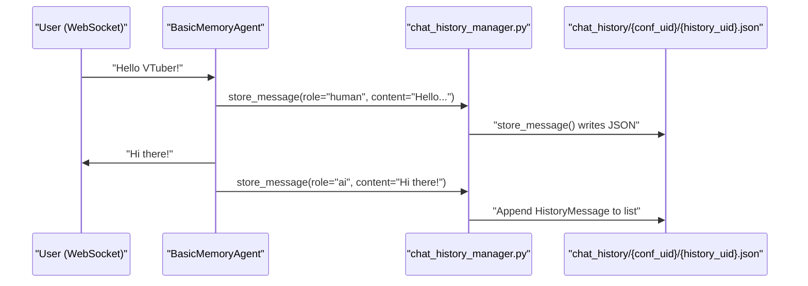

<!-- source: DeepWiki mcp.deepwiki.com · repo Open-LLM-VTuber/Open-LLM-VTuber · page 4 Service Context & Session Management · fetched 2026-10-30 -->

# Service Context & Session Management

Relevant source files

The following files were used as context for generating this wiki page:

- [src/open_llm_vtuber/agent/agents/basic_memory_agent.py](src/open_llm_vtuber/agent/agents/basic_memory_agent.py)
- [src/open_llm_vtuber/chat_history_manager.py](src/open_llm_vtuber/chat_history_manager.py)
- [src/open_llm_vtuber/routes.py](src/open_llm_vtuber/routes.py)
- [src/open_llm_vtuber/service_context.py](src/open_llm_vtuber/service_context.py)

The `ServiceContext` acts as the primary dependency injection container and state manager for every client session in Open-LLM-VTuber. It encapsulates all AI engine instances (ASR, TTS, LLM, VAD) and their associated configurations, ensuring that each connected user has an isolated environment. Complementing this, the session management system handles persistent chat history, allowing the VTuber to maintain context across interactions.

### ServiceContext Overview

A `ServiceContext` instance is created for every unique connection. It holds the active instances of all engines and the current configuration state. When a client connects via the `/client-ws` endpoint, the `WebSocketHandler` initializes a context that follows the client throughout the session lifecycle [src/open_llm_vtuber/routes.py:29-37]().

**Key Responsibilities:**
*   **Engine Storage:** Holds references to the `asr_engine`, `tts_engine`, `agent_engine`, `vad_engine`, and `translate_engine` [src/open_llm_vtuber/service_context.py:51-56]().
*   **Configuration Management:** Stores the `SystemConfig` and `CharacterConfig` specific to the session [src/open_llm_vtuber/service_context.py:46-48]().
*   **Prompt Assembly:** Combines persona prompts with Live2D expression instructions and MCP tool descriptions into a final `system_prompt` [src/open_llm_vtuber/service_context.py:64-68]().
*   **MCP Integration:** Manages the lifecycle of Model Context Protocol (MCP) components like the `ToolManager`, `MCPClient`, and `ToolExecutor` [src/open_llm_vtuber/service_context.py:58-62]().

#### Service Context Entity Map
This diagram shows how the `ServiceContext` aggregates various code entities to form a complete VTuber session.

**Sources:** [src/open_llm_vtuber/service_context.py:41-74](), [src/open_llm_vtuber/config_manager.py:27-38]()

---

### ServiceContext Lifecycle

The lifecycle of a `ServiceContext` begins at connection and can be dynamically updated during runtime. The `load_from_config` method is the central entry point for initializing all sub-engines using their respective factories (e.g., `ASRFactory`, `TTSFactory`, `AgentFactory`) [src/open_llm_vtuber/service_context.py:21-25]().

If a user changes their character or settings via the frontend, the `handle_config_switch` method allows the context to re-initialize specific engines without dropping the WebSocket connection. This ensures a seamless transition between different VTuber personas or AI models.

For details on initialization, factory patterns, and runtime reconfiguration, see **[ServiceContext Lifecycle (#4.1)]**.

**Sources:** [src/open_llm_vtuber/service_context.py:240-250](), [src/open_llm_vtuber/service_context.py:430-445]()

---

### Chat History Management

Chat history is managed as a file-based JSON system located in the `chat_history/` directory. Each session is identified by a `conf_uid` (representing the character/configuration) and a `history_uid` (representing the specific conversation session) [src/open_llm_vtuber/chat_history_manager.py:41-47]().

The system automatically persists messages from both the "human" (user) and the "ai" (VTuber). These records are used by the `AgentInterface` to populate the LLM's short-term memory during the `set_memory_from_history` call [src/open_llm_vtuber/agent/agents/basic_memory_agent.py:176-180]().

#### Data Flow: Natural Language to History Storage
This diagram illustrates how spoken or typed input becomes a persistent code entity in the history system.

For details on storage structure, path sanitization, and session cleanup, see **[Chat History Management (#4.2)]**.

**Sources:** [src/open_llm_vtuber/chat_history_manager.py:93-110](), [src/open_llm_vtuber/agent/agents/basic_memory_agent.py:128-135]()

---

### Relationship Summary

| Component | Role | Persistence |
| :--- | :--- | :--- |
| **`ServiceContext`** | Dependency container for active engines. | Transient (In-memory per session) |
| **`BasicMemoryAgent._memory`** | Active context window for the LLM. | Transient (In-memory per session) |
| **`chat_history/*.json`** | JSON records of past interactions. | Persistent (Disk-based) |

**Sources:** [src/open_llm_vtuber/service_context.py:41-45](), [src/open_llm_vtuber/chat_history_manager.py:1-13](), [src/open_llm_vtuber/agent/agents/basic_memory_agent.py:55-55]()

---

