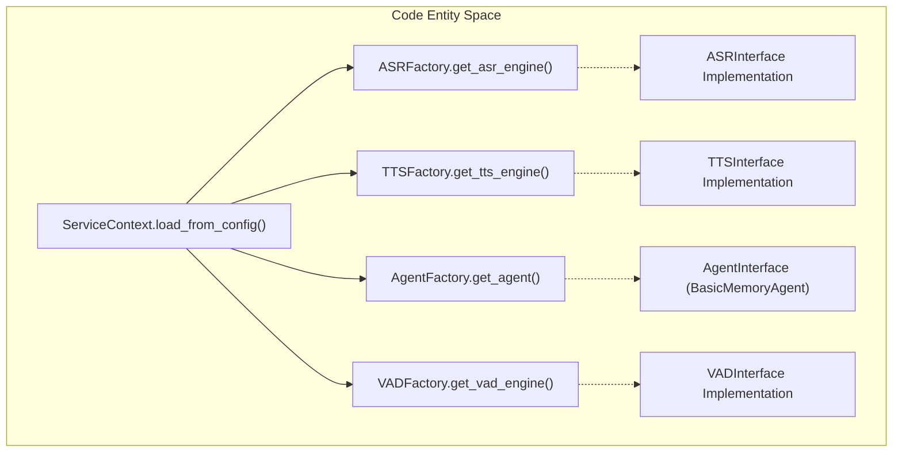
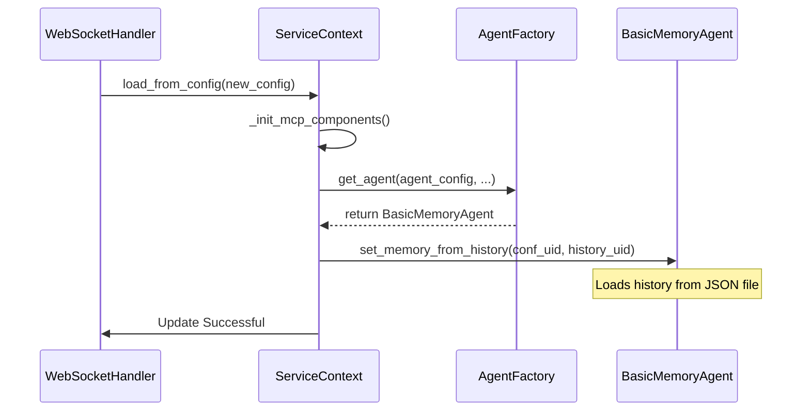

<!-- source: DeepWiki mcp.deepwiki.com · repo Open-LLM-VTuber/Open-LLM-VTuber · page 4.1 ServiceContext Lifecycle · fetched 2026-10-30 -->

# ServiceContext Lifecycle

Relevant source files

The following files were used as context for generating this wiki page:

- [src/open_llm_vtuber/agent/agents/basic_memory_agent.py](src/open_llm_vtuber/agent/agents/basic_memory_agent.py)
- [src/open_llm_vtuber/service_context.py](src/open_llm_vtuber/service_context.py)

The `ServiceContext` class acts as the central dependency injection container and state manager for a client session. It encapsulates all AI engines (ASR, TTS, VAD, Agent), configuration states, and the Model Context Protocol (MCP) infrastructure required to run the VTuber pipeline.

## Overview and Initialization

`ServiceContext` is initialized per connection and stores instances of all necessary engines. The primary entry point for populating a `ServiceContext` is the `load_from_config` method, which utilizes a factory pattern to instantiate specific engine implementations based on the provided YAML configuration.

### Initialization Flow
The initialization process follows a strict sequence:
1.  **Configuration Loading**: Reads and validates the YAML files [src/open_llm_vtuber/service_context.py:204-206]().
2.  **Engine Instantiation**: Uses factories (`ASRFactory`, `TTSFactory`, etc.) to create engine objects [src/open_llm_vtuber/service_context.py:223-268]().
3.  **Prompt Construction**: Combines persona prompts with functional prompts like Live2D expressions [src/open_llm_vtuber/service_context.py:276-281]().
4.  **MCP Setup**: Dynamically discovers tools and initializes the MCP client if enabled [src/open_llm_vtuber/service_context.py:95-174]().

### ServiceContext Structure
| Component | Type | Responsibility |
| :--- | :--- | :--- |
| `asr_engine` | `ASRInterface` | Handles speech-to-text transcription [src/open_llm_vtuber/service_context.py:51](). |
| `tts_engine` | `TTSInterface` | Handles text-to-speech synthesis [src/open_llm_vtuber/service_context.py:52](). |
| `agent_engine` | `AgentInterface` | Manages LLM interaction and memory [src/open_llm_vtuber/service_context.py:53](). |
| `vad_engine` | `VADInterface` | Detects voice activity in audio streams [src/open_llm_vtuber/service_context.py:55](). |
| `live2d_model` | `Live2dModel` | Manages Live2D assets and animations [src/open_llm_vtuber/service_context.py:50](). |
| `mcp_client` | `MCPClient` | Manages connections to external MCP tool servers [src/open_llm_vtuber/service_context.py:61](). |

**Sources:** [src/open_llm_vtuber/service_context.py:41-73]()

## Component Factory Pattern

`ServiceContext` does not instantiate engines directly. Instead, it delegates this to specialized factory classes that return implementations adhering to standard interfaces.

### Engine Initialization Diagram
This diagram shows how `load_from_config` in `service_context.py` maps configuration data to specific class instances.

**Sources:** [src/open_llm_vtuber/service_context.py:220-275](), [src/open_llm_vtuber/asr/asr_factory.py:20-25](), [src/open_llm_vtuber/tts/tts_factory.py:100-105](), [src/open_llm_vtuber/agent/agent_factory.py:28-33]()

## MCP Component Initialization

The Model Context Protocol (MCP) components are initialized via `_init_mcp_components` [src/open_llm_vtuber/service_context.py:95](). This process is dynamic: it fetches tool definitions from servers at runtime to build the system prompt.

1.  **ServerRegistry**: Discovers available MCP servers defined in `mcp_servers.json` [src/open_llm_vtuber/service_context.py:111]().
2.  **ToolAdapter**: Fetches tool schemas and formats them for specific LLMs (OpenAI or Claude) using `get_tools` [src/open_llm_vtuber/service_context.py:127]().
3.  **ToolManager**: Stores the formatted tools and raw dictionary for the agent [src/open_llm_vtuber/service_context.py:142]().
4.  **MCPClient**: Manages the lifecycle of the `stdio` or `http` transport sessions [src/open_llm_vtuber/service_context.py:159]().

**Sources:** [src/open_llm_vtuber/service_context.py:95-174](), [src/open_llm_vtuber/mcpp/tool_adapter.py:38-45]()

## Runtime Reconfiguration

The system supports switching character configurations without restarting the server. This is handled by `load_from_config` which can be triggered by configuration update events.

### Configuration Switch Workflow
When a configuration change is requested:
1.  `ServiceContext.load_from_config` is called with the new `Config` object [src/open_llm_vtuber/service_context.py:202]().
2.  Existing engines are replaced by new instances from the factories [src/open_llm_vtuber/service_context.py:223-268]().
3.  If the `conf_uid` has changed, the system prepares for a fresh chat session [src/open_llm_vtuber/service_context.py:214-218]().
4.  The `AgentInterface` is re-initialized with the new persona and system prompts [src/open_llm_vtuber/agent/agents/basic_memory_agent.py:119]().

**Sources:** [src/open_llm_vtuber/service_context.py:202-284](), [src/open_llm_vtuber/agent/agents/basic_memory_agent.py:176-194]()

## Resource Cleanup

To prevent memory leaks and dangling processes (especially for local model providers or MCP servers using `stdio`), `ServiceContext` implements a `close` method [src/open_llm_vtuber/service_context.py:192]().

### Cleanup Tasks:
*   **MCP Client**: Calls `self.mcp_client.stop_all_servers()` to terminate child processes [src/open_llm_vtuber/service_context.py:196]().
*   **TTS Engine**: Triggers cleanup if the engine requires it [src/open_llm_vtuber/service_context.py:198]().
*   **VAD Engine**: Releases hardware descriptors or background threads [src/open_llm_vtuber/service_context.py:199]().

**Sources:** [src/open_llm_vtuber/service_context.py:192-200]()

---

