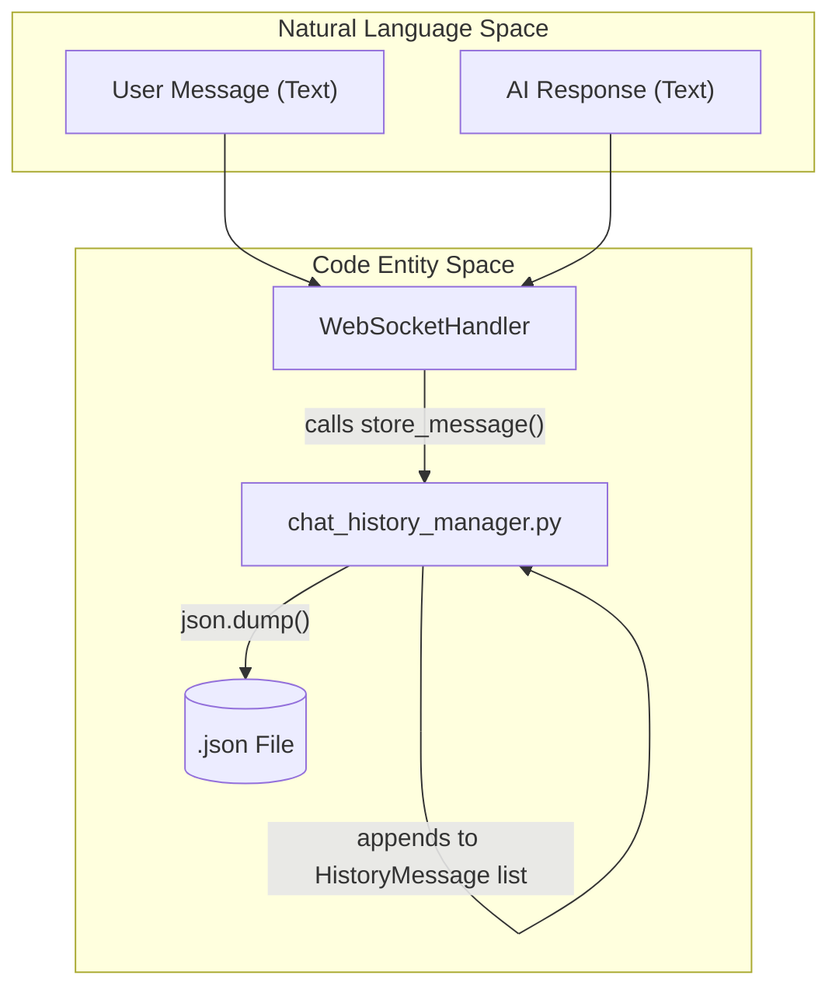
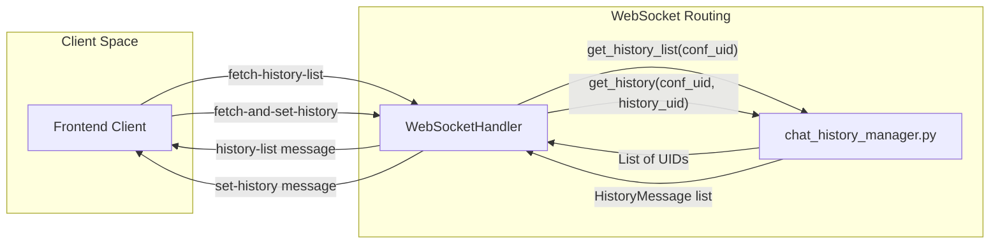

<!-- source: DeepWiki mcp.deepwiki.com · repo Open-LLM-VTuber/Open-LLM-VTuber · page 4.2 Chat History Management · fetched 2026-10-30 -->

# Chat History Management

<details>
<summary>Relevant source files</summary>

The following files were used as context for generating this wiki page:

- [src/open_llm_vtuber/chat_history_manager.py](src/open_llm_vtuber/chat_history_manager.py)
- [src/open_llm_vtuber/routes.py](src/open_llm_vtuber/routes.py)

</details>


The chat history management system provides a file-based JSON storage mechanism for persisting conversations between users and VTuber characters. Histories are organized by configuration unique identifiers (`conf_uid`) and individual session identifiers (`history_uid`), allowing for multi-character and multi-session isolation.

## Storage Architecture

Chat histories are stored in the `chat_history/` directory. The system uses a hierarchical structure to separate histories by character configuration.

- **Root Directory**: `chat_history/` [src/open_llm_vtuber/chat_history_manager.py:47]()
- **Character Subdirectory**: `chat_history/{conf_uid}/` [src/open_llm_vtuber/chat_history_manager.py:47]()
- **Session File**: `{history_uid}.json` [src/open_llm_vtuber/chat_history_manager.py:57]()

### Data Flow: WebSocket to File System

This diagram illustrates how a user message moves from the `WebSocketHandler` into the persistent JSON storage.

**Message Persistence Flow**

Sources: [src/open_llm_vtuber/websocket_handler.py:76-98](), [src/open_llm_vtuber/chat_history_manager.py:93-110]()

## Key Functions and Implementation

### Session Lifecycle Management

| Function | Purpose | Implementation Detail |
| :--- | :--- | :--- |
| `create_new_history` | Initializes a new session. | Generates a UID format: `YYYY-MM-DD_HH-MM-SS_UUID`. [src/open_llm_vtuber/chat_history_manager.py:71]() |
| `store_message` | Appends a message to the JSON array. | Supports `human` and `ai` roles with optional `name` and `avatar`. [src/open_llm_vtuber/chat_history_manager.py:131-143]() |
| `get_history` | Retrieves all messages for a session. | Filters out the internal `metadata` entry before returning. [src/open_llm_vtuber/chat_history_manager.py:228-232]() |
| `modify_latest_message` | Updates the content of the last message. | Used for real-time updates or corrections in history. [src/open_llm_vtuber/chat_history_manager.py:284-306]() |
| `delete_history` | Removes a specific session file. | Uses `os.remove` on the sanitized path. [src/open_llm_vtuber/chat_history_manager.py:328]() |
| `cleanup_empty_histories` | Automatic maintenance. | Deletes files that only contain the initial `metadata` entry. [src/open_llm_vtuber/chat_history_manager.py:346-368]() |

Sources: [src/open_llm_vtuber/chat_history_manager.py:63-368]()

### Security and Path Sanitization

To prevent path traversal attacks, the system strictly validates all identifiers before performing file operations.

1.  **Filename Validation**: `_is_safe_filename` checks if the UID is under 255 characters and matches a regex of allowed alphanumeric and common Unicode characters. [src/open_llm_vtuber/chat_history_manager.py:19-27]()
2.  **Path Sanitization**: `_sanitize_path_component` uses `os.path.basename` to strip any directory traversal attempts like `../`. [src/open_llm_vtuber/chat_history_manager.py:30-38]()
3.  **Final Path Verification**: `_get_safe_history_path` uses `os.path.normpath` and verifies that the resulting path still starts with the intended base directory. [src/open_llm_vtuber/chat_history_manager.py:52-60]()

Sources: [src/open_llm_vtuber/chat_history_manager.py:19-60]()

## Data Structures

### HistoryMessage
The core data structure for a single chat turn.
```python
class HistoryMessage(TypedDict):
    role: Literal["human", "ai"]
    timestamp: str
    content: str
    # Optional display information for the message
    name: Optional[str]
    avatar: Optional[str]
```
Sources: [src/open_llm_vtuber/chat_history_manager.py:10-17]()

### File Structure Example
Each `.json` file starts with a `metadata` object followed by conversation turns.
```json
[
  {
    "role": "metadata",
    "timestamp": "2023-10-27T10:00:00"
  },
  {
    "role": "human",
    "timestamp": "2023-10-27T10:00:05",
    "content": "Hello!",
    "name": "User",
    "avatar": "user_avatar.png"
  },
  {
    "role": "ai",
    "timestamp": "2023-10-27T10:00:10",
    "content": "Hello! How can I help you today?"
  }
]
```
Sources: [src/open_llm_vtuber/chat_history_manager.py:77-84](), [src/open_llm_vtuber/chat_history_manager.py:131-143]()

## Integration with WebSocketHandler

The `WebSocketHandler` routes history-related requests from the frontend to the manager functions.

**History Request Handling**

Sources: [src/open_llm_vtuber/websocket_handler.py:82-85](), [src/open_llm_vtuber/websocket_handler.py:381-435]()

### Automatic Session Management
When a new connection is established via the `/client-ws` route [src/open_llm_vtuber/routes.py:29-37](), the `WebSocketHandler` calls `create_new_history` to initialize a fresh session for the client [src/open_llm_vtuber/websocket_handler.py:417](). 

Conversely, when a client disconnects, `cleanup_empty_histories` is invoked within `handle_disconnect` to remove any session files that never received a message, keeping the storage clean [src/open_llm_vtuber/websocket_handler.py:228]().

Sources: [src/open_llm_vtuber/websocket_handler.py:228-417](), [src/open_llm_vtuber/chat_history_manager.py:346-368](), [src/open_llm_vtuber/routes.py:29-37]()

---

