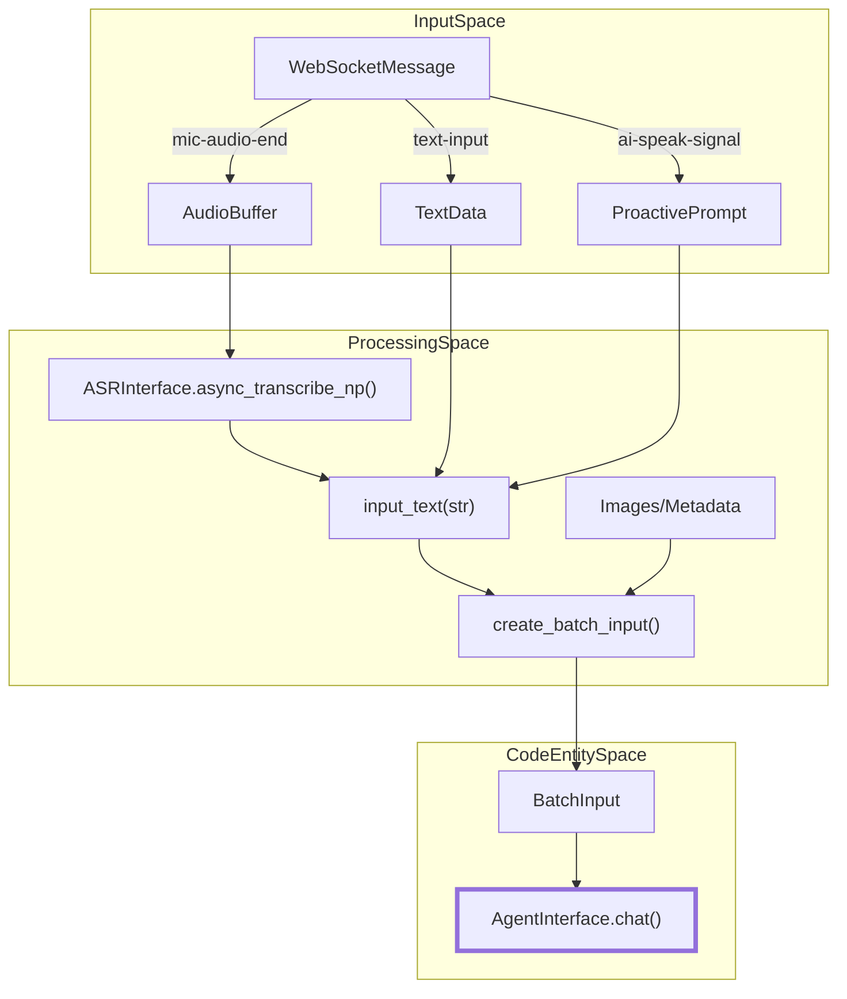
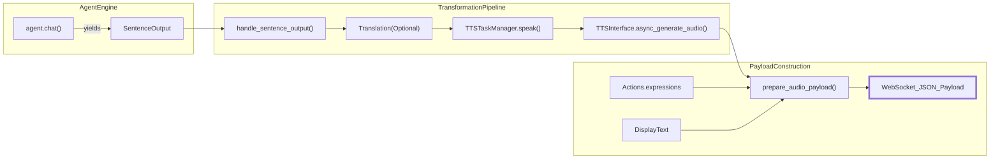

<!-- source: DeepWiki mcp.deepwiki.com · repo Open-LLM-VTuber/Open-LLM-VTuber · page 5 Conversation Pipeline · fetched 2026-10-30 -->

# Conversation Pipeline

Relevant source files

The following files were used as context for generating this wiki page:

- [src/open_llm_vtuber/agent/output_types.py](src/open_llm_vtuber/agent/output_types.py)
- [src/open_llm_vtuber/agent/transformers.py](src/open_llm_vtuber/agent/transformers.py)
- [src/open_llm_vtuber/conversations/conversation_handler.py](src/open_llm_vtuber/conversations/conversation_handler.py)
- [src/open_llm_vtuber/conversations/conversation_utils.py](src/open_llm_vtuber/conversations/conversation_utils.py)
- [src/open_llm_vtuber/conversations/group_conversation.py](src/open_llm_vtuber/conversations/group_conversation.py)
- [src/open_llm_vtuber/conversations/single_conversation.py](src/open_llm_vtuber/conversations/single_conversation.py)
- [src/open_llm_vtuber/utils/stream_audio.py](src/open_llm_vtuber/utils/stream_audio.py)

The conversation pipeline is the core engine of Open-LLM-VTuber, responsible for transforming user triggers (voice or text) into a coordinated multi-modal response involving text, Live2D animations, and synchronized audio. The pipeline manages the lifecycle of a conversation "turn," ensuring that ASR, LLM generation, TTS synthesis, and client-side playback happen in the correct sequence while maximizing parallelism.

## High-Level Flow

The pipeline is triggered by the `handle_conversation_trigger` function, which determines whether to initiate a single-user or group conversation.

### Data Flow Diagram: Trigger to Agent
The following diagram illustrates how various input types are normalized into a `BatchInput` for the agent engines.

**Sources:**
- `handle_conversation_trigger` logic: [src/open_llm_vtuber/conversations/conversation_handler.py:19-110]()
- `BatchInput` construction: [src/open_llm_vtuber/conversations/conversation_utils.py:20-42]()
- ASR transcription call: [src/open_llm_vtuber/conversations/conversation_utils.py:146-160]()

---

## Single & Group Conversation Handling

The system distinguishes between private interactions and multi-agent group chats.

*   **Single Conversation:** Managed by `process_single_conversation`. It handles a linear flow: User Input -> Agent Stream -> TTS -> Finalize. It uses `TTSTaskManager` to handle audio queuing for a single client.
*   **Group Conversation:** Managed by `process_group_conversation`. It implements a round-robin or queue-based logic using `GroupConversationState`. It manages multiple `TTSTaskManager` instances (one per AI participant) and broadcasts messages to all members of the `ChatGroup`.

For details on round-robin logic and interruption handling, see **[Single & Group Conversation Handling](#5.1)**.

**Sources:**
- `process_single_conversation`: [src/open_llm_vtuber/conversations/single_conversation.py:25-162]()
- `process_group_conversation`: [src/open_llm_vtuber/conversations/group_conversation.py:29-154]()
- `GroupConversationState`: [src/open_llm_vtuber/conversations/types.py:20-20]() (referenced in [src/open_llm_vtuber/conversations/group_conversation.py:60-67]())

---

## TTS Task Management & Sentence Divider

To provide a low-latency experience, the system does not wait for the entire LLM response to finish before starting TTS.

1.  **Sentence Divider:** The LLM stream is processed by the `sentence_divider` decorator, which utilizes `SentenceDivider` to segment text into complete sentences with associated tags (like `<think>`) as they arrive.
2.  **Parallel Synthesis:** Each sentence is dispatched to the `TTSTaskManager.speak()` method.
3.  **Ordered Delivery:** Even though sentences are synthesized in parallel (and may finish out of order), `TTSTaskManager` ensures they are sent to the frontend in the correct original sequence.

For details on the streaming segmentation and sequence management, see **[TTS Task Manager & Sentence Divider](#5.2)**.

**Sources:**
- `TTSTaskManager` class: [src/open_llm_vtuber/conversations/tts_manager.py:16-183]()
- `sentence_divider` decorator: [src/open_llm_vtuber/agent/transformers.py:12-55]()
- `SentenceDivider` logic: [src/open_llm_vtuber/utils/sentence_divider.py:1-1]()

---

## Output Processing & Audio Payloads

Before a sentence reaches the client, it passes through a transformation pipeline typically implemented via decorators like `actions_extractor`, `display_processor`, and `tts_filter`.

### Pipeline Diagram: Agent Output to WebSocket
This diagram shows how `SentenceOutput` is transformed into the final JSON payload sent over the wire.

The `prepare_audio_payload` utility calculates audio metadata (like RMS volume for lip-sync) and bundles it with the base64 audio and animation triggers.

For details on data models and the transformer pipeline, see **[Output Transformers & Audio Payload](#5.3)**.

**Sources:**
- `handle_sentence_output`: [src/open_llm_vtuber/conversations/conversation_utils.py:84-113]()
- `prepare_audio_payload`: [src/open_llm_vtuber/utils/stream_audio.py:27-82]()
- `process_agent_output`: [src/open_llm_vtuber/conversations/conversation_utils.py:45-81]()
- `transformers` pipeline: [src/open_llm_vtuber/agent/transformers.py:1-200]()

---

## Translation Pipeline

The system supports an optional translation layer that sits between the LLM and the TTS engine. If a `translate_engine` is present in the `ServiceContext`, the `handle_sentence_output` function will route the `tts_text` through the translator before synthesis. This allows the VTuber to "think" in one language (e.g., English) but "speak" in another (e.g., Japanese).

For details on supported providers like DeepLX and Tencent Cloud, see **[Translation Pipeline](#5.4)**.

**Sources:**
- Translation insertion point: [src/open_llm_vtuber/conversations/conversation_utils.py:97-102]()
- `process_agent_output` translation parameter: [src/open_llm_vtuber/conversations/conversation_utils.py:52-52]()

---

