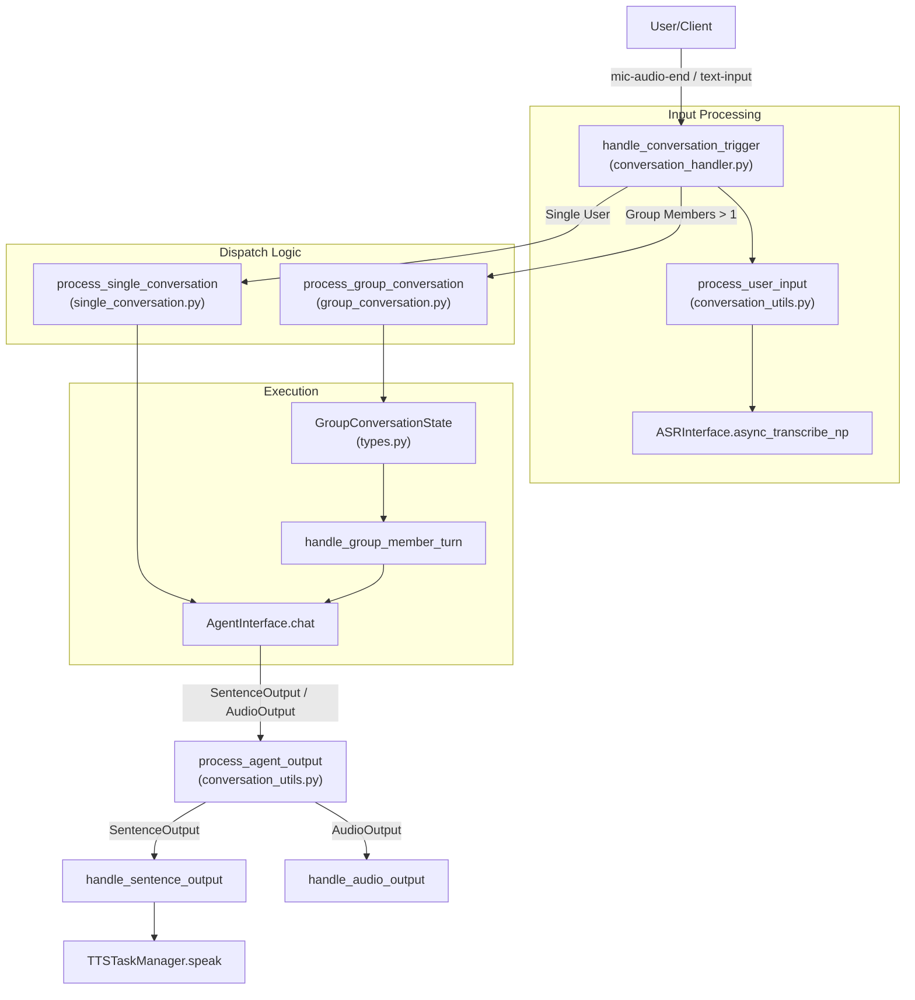
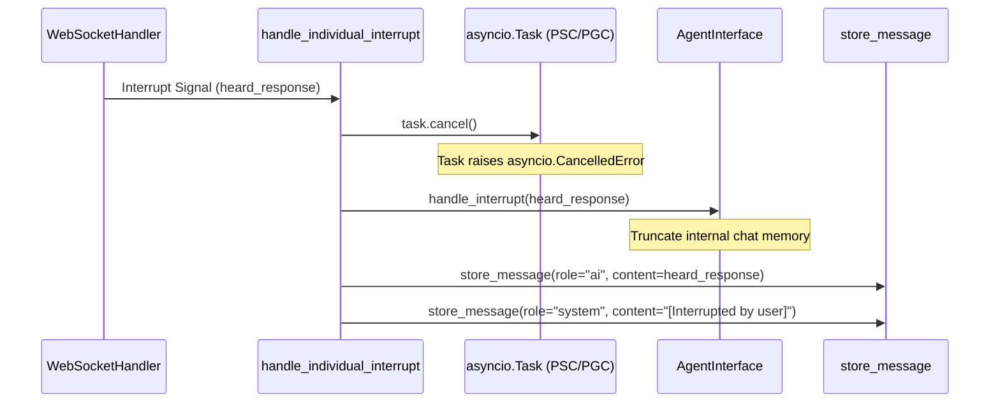

<!-- source: DeepWiki mcp.deepwiki.com · repo Open-LLM-VTuber/Open-LLM-VTuber · page 5.1 Single & Group Conversation Handling · fetched 2026-10-30 -->

# Single & Group Conversation Handling

Relevant source files

The following files were used as context for generating this wiki page:

- [src/open_llm_vtuber/chat_group.py](src/open_llm_vtuber/chat_group.py)
- [src/open_llm_vtuber/conversations/conversation_handler.py](src/open_llm_vtuber/conversations/conversation_handler.py)
- [src/open_llm_vtuber/conversations/conversation_utils.py](src/open_llm_vtuber/conversations/conversation_utils.py)
- [src/open_llm_vtuber/conversations/group_conversation.py](src/open_llm_vtuber/conversations/group_conversation.py)
- [src/open_llm_vtuber/conversations/single_conversation.py](src/open_llm_vtuber/conversations/single_conversation.py)
- [src/open_llm_vtuber/conversations/types.py](src/open_llm_vtuber/conversations/types.py)
- [src/open_llm_vtuber/message_handler.py](src/open_llm_vtuber/message_handler.py)

The conversation handling system is responsible for orchestrating the flow of data between the user, the ASR engine, the LLM agent, and the TTS engine. It manages two primary modes: individual interactions and multi-agent group discussions, ensuring that responses are processed, streamed, and finalized correctly while supporting real-time interruptions.

## Conversation Triggering

All conversations start with `handle_conversation_trigger` in `src/open_llm_vtuber/conversations/conversation_handler.py`. This function acts as a dispatcher that determines the input source (text, audio, or proactive AI signal) and decides whether to launch a single-user or group-based processing task.

### Input Types and Pre-processing
- **Text Input**: Directly uses the provided string from the `data` dictionary [src/open_llm_vtuber/conversations/conversation_handler.py:65-66]().
- **Audio Input**: Retrieves the accumulated audio buffer from `received_data_buffers` for the client and prepares it for ASR transcription [src/open_llm_vtuber/conversations/conversation_handler.py:67-69]().
- **AI Proactive Speak**: Triggered by an `ai-speak-signal`. It loads a specialized prompt (e.g., `proactive_speak_prompt`) from `prompt_loader` to force the AI to initiate conversation [src/open_llm_vtuber/conversations/conversation_handler.py:35-44](). It also sets `metadata` flags to skip storing this trigger in memory or history [src/open_llm_vtuber/conversations/conversation_handler.py:51-55]().

### Dispatch Logic
The handler checks the `ChatGroupManager` to see if the client is part of a multi-member group.
- If the client is in a group with more than one member, it creates an `asyncio.Task` for `process_group_conversation` using the `group_id` as the task key [src/open_llm_vtuber/conversations/conversation_handler.py:75-96]().
- Otherwise, it creates a task for `process_single_conversation` using the `client_uid` as the key [src/open_llm_vtuber/conversations/conversation_handler.py:98-109]().

**Sources:**
- `src/open_llm_vtuber/conversations/conversation_handler.py` [19-110]()
- `src/open_llm_vtuber/chat_group.py` [144-150]()

## Single Conversation Pipeline

The `process_single_conversation` function manages the lifecycle of a standard interaction. It coordinates transcription, LLM streaming, and TTS synthesis.

### Data Flow and Implementation
1.  **Signals**: Sends `conversation-chain-start` and a "Thinking..." status to the frontend via `send_conversation_start_signals` [src/open_llm_vtuber/conversations/single_conversation.py:54-55]() [src/open_llm_vtuber/conversations/conversation_utils.py:133-144]().
2.  **ASR**: If the input is audio (`np.ndarray`), `process_user_input` calls `asr_engine.async_transcribe_np` and sends the transcription back to the client [src/open_llm_vtuber/conversations/conversation_utils.py:146-159]().
3.  **Batch Construction**: Wraps text and optional images into a `BatchInput` object using `create_batch_input` [src/open_llm_vtuber/conversations/conversation_utils.py:20-42]().
4.  **Agent Streaming**: Iterates over `context.agent_engine.chat(batch_input)`. It handles two main output types:
    - `SentenceOutput` / `AudioOutput`: Passed to `process_agent_output` for TTS and Live2D processing [src/open_llm_vtuber/conversations/single_conversation.py:105-113]().
    - `tool_call_status`: Sent directly to the frontend to show tool execution progress [src/open_llm_vtuber/conversations/single_conversation.py:93-101]().
5.  **Finalization**: Waits for all TTS tasks in `TTSTaskManager` to finish, sends a `backend-synth-complete` signal, and waits for the frontend to confirm playback completion via `message_handler.wait_for_response` [src/open_llm_vtuber/conversations/conversation_utils.py:162-181]().

**Sources:**
- `src/open_llm_vtuber/conversations/single_conversation.py` [25-174]()
- `src/open_llm_vtuber/conversations/conversation_utils.py` [133-191]()
- `src/open_llm_vtuber/message_handler.py` [16-52]()

## Group Conversation Handling

Group conversations involve multiple `ServiceContext` instances (one per character) and a round-robin turn-taking logic managed by `GroupConversationState`.

### Group State Management
The `GroupConversationState` class tracks the conversation history, the queue of characters yet to speak, and the current speaker. It uses a class-level dictionary `_states` to manage active group sessions [src/open_llm_vtuber/conversations/types.py:43-69]().

### Processing Logic
- **Initialization**: Every AI agent in the group is initialized with the names of other participants via `agent.start_group_conversation` [src/open_llm_vtuber/conversations/group_conversation.py:168-189]().
- **Turn Handling**: The system pops the next member from `state.group_queue` and calls `handle_group_member_turn` [src/open_llm_vtuber/conversations/group_conversation.py:110-130]().
- **Round-Robin**: Characters respond sequentially. The `conversation_history` is updated after every turn, ensuring subsequent speakers have context of what previous AIs said [src/open_llm_vtuber/conversations/group_conversation.py:106-107]().
- **Cleanup**: TTS managers for all members are cleaned up in the `finally` block [src/open_llm_vtuber/conversations/group_conversation.py:148-154]().

**Sources:**
- `src/open_llm_vtuber/conversations/group_conversation.py` [29-154]()
- `src/open_llm_vtuber/conversations/types.py` [43-69]()

## Interruption Handling

Interruption allows the user to stop the AI mid-sentence. This is handled by cancelling the asynchronous task and notifying the agent engine to truncate its internal memory.

### Implementation Details
- **Task Cancellation**: The `current_conversation_tasks` dictionary stores the active `asyncio.Task`. When an interrupt is received, `task.cancel()` is called [src/open_llm_vtuber/conversations/conversation_handler.py:118-121]().
- **Agent Notification**: The `agent_engine.handle_interrupt(heard_response)` method is called, passing the text the user actually heard before interrupting, allowing the LLM to know where it was cut off [src/open_llm_vtuber/conversations/conversation_handler.py:125]() [src/open_llm_vtuber/conversations/conversation_handler.py:189]().
- **History Sync**: The system stores the partial response in the chat history followed by a `[Interrupted by user]` system message via `store_message` [src/open_llm_vtuber/conversations/conversation_handler.py:130-143]().
- **Group Interrupt**: For groups, the state is retrieved via `GroupConversationState.get_state(group_id)` to identify the current speaker before cancellation [src/open_llm_vtuber/conversations/conversation_handler.py:160-161]().

**Sources:**
- `src/open_llm_vtuber/conversations/conversation_handler.py` [112-144]() (Individual)
- `src/open_llm_vtuber/conversations/conversation_handler.py` [146-198]() (Group)

## Technical Diagrams

### Conversation Dispatch and Flow
This diagram illustrates how the `handle_conversation_trigger` function maps user actions to specific code entities and processing loops.

**Sources:** 
- `src/open_llm_vtuber/conversations/conversation_handler.py` [19-110]()
- `src/open_llm_vtuber/conversations/conversation_utils.py` [45-130]()
- `src/open_llm_vtuber/conversations/single_conversation.py` [89-113]()

### Interruption Mechanism
This diagram shows the relationship between the `asyncio.Task` management and the `AgentInterface` during an interruption event.

**Sources:**
- `src/open_llm_vtuber/conversations/conversation_handler.py` [112-144]()
- `src/open_llm_vtuber/chat_history_manager.py` [25]()

## Key Classes and Functions

| Entity | Location | Role |
| :--- | :--- | :--- |
| `handle_conversation_trigger` | `conversation_handler.py` | Main entry point for starting any conversation task. |
| `process_single_conversation` | `single_conversation.py` | Orchestrates the linear pipeline for one character. |
| `process_group_conversation` | `group_conversation.py` | Orchestrates the round-robin pipeline for multiple characters. |
| `GroupConversationState` | `types.py` | Stores group history and turn-taking queue using a `_states` registry. |
| `TTSTaskManager` | `tts_manager.py` | Manages ordered execution and synchronization of TTS synthesis tasks. |
| `process_agent_output` | `conversation_utils.py` | Routes LLM outputs to TTS (`handle_sentence_output`) or direct audio (`handle_audio_output`). |
| `message_handler` | `message_handler.py` | Singleton `MessageHandler` used to wait for `frontend-playback-complete` events. |

**Sources:**
- `src/open_llm_vtuber/conversations/conversation_handler.py` [19]()
- `src/open_llm_vtuber/conversations/single_conversation.py` [25]()
- `src/open_llm_vtuber/conversations/group_conversation.py` [29]()
- `src/open_llm_vtuber/conversations/types.py` [43]()
- `src/open_llm_vtuber/message_handler.py` [7-92]()

---

