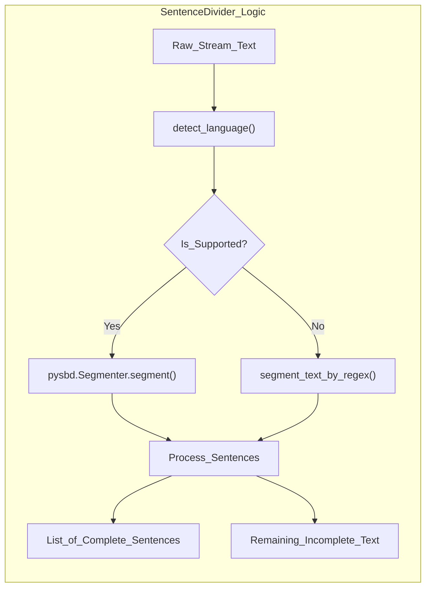
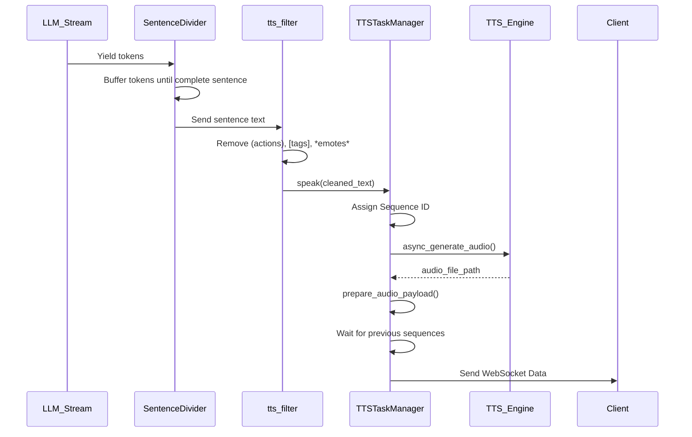

<!-- source: DeepWiki mcp.deepwiki.com · repo Open-LLM-VTuber/Open-LLM-VTuber · page 5.2 TTS Task Manager & Sentence Divider · fetched 2026-10-30 -->

# TTS Task Manager & Sentence Divider

Relevant source files

The following files were used as context for generating this wiki page:

- [src/open_llm_vtuber/conversations/tts_manager.py](src/open_llm_vtuber/conversations/tts_manager.py)
- [src/open_llm_vtuber/translate/tencent.py](src/open_llm_vtuber/translate/tencent.py)
- [src/open_llm_vtuber/utils/sentence_divider.py](src/open_llm_vtuber/utils/sentence_divider.py)

The **TTS Task Manager** and **Sentence Divider** form the backbone of the streaming audio pipeline in Open-LLM-VTuber. Their primary responsibility is to bridge the gap between the streaming nature of Large Language Models (LLMs) and the atomic nature of Text-to-Speech (TTS) synthesis, ensuring that audio is generated in parallel for performance while being delivered to the frontend in the correct sequence.

## TTSTaskManager: Ordered Parallel Synthesis

The `TTSTaskManager` class in `src/open_llm_vtuber/conversations/tts_manager.py` manages the lifecycle of TTS requests. It allows multiple TTS synthesis tasks to run concurrently to minimize latency, but uses a sequence counter system to ensure the resulting audio payloads reach the client in the exact order they were generated by the LLM [src/open_llm_vtuber/conversations/tts_manager.py:16-28]().

### Key Mechanisms
*   **Sequence Counters**: Every text segment passed to `speak()` is assigned a `_sequence_counter` [src/open_llm_vtuber/conversations/tts_manager.py:69-71]().
*   **Payload Queue**: An `asyncio.Queue` stores the generated audio payloads along with their sequence numbers [src/open_llm_vtuber/conversations/tts_manager.py:23]().
*   **Buffered Sender**: The `_process_payload_queue` method maintains a `buffered_payloads` dictionary. It only sends a payload over the WebSocket if its sequence number matches `_next_sequence_to_send`, effectively re-ordering parallel results [src/open_llm_vtuber/conversations/tts_manager.py:92-111]().
*   **Silent Fallback**: If a segment contains only punctuation or whitespace, the manager sends a "silent payload" to the frontend via `_send_silent_payload` to ensure the UI (subtitles/actions) still updates without triggering the TTS engine [src/open_llm_vtuber/conversations/tts_manager.py:50-63]().

### TTS Task Flow Diagram
This diagram illustrates how the `TTSTaskManager` coordinates between the `TTSInterface` and the `WebSocketSend` function.

```mermaid
graph TD
    subgraph "TTSTaskManager_Entity_Space"
        A["TTSTaskManager.speak()"] --> B{"Is_Text_Empty?"}
        B -- "Yes" --> C["TTSTaskManager._send_silent_payload()"]
        B -- "No" --> D["Increment_sequence_counter"]
        D --> E["asyncio.create_task(_process_tts)"]
        
        subgraph "Parallel_Synthesis"
            E --> F["TTSTaskManager._generate_audio()"]
            F --> G["TTSInterface.async_generate_audio()"]
            G --> H["prepare_audio_payload()"]
            H --> I["_payload_queue.put(payload, seq)"]
        end

        subgraph "Ordered_Delivery"
            J["TTSTaskManager._process_payload_queue()"]
            I -.-> J
            J --> K{"seq == _next_sequence_to_send?"}
            K -- "No" --> L["Buffer_in_buffered_payloads"]
            K -- "Yes" --> M["WebSocketSend(json_payload)"]
            M --> N["Increment_next_sequence_to_send"]
            N --> K
        end
    end
```

**Sources:** [src/open_llm_vtuber/conversations/tts_manager.py:16-115](), [src/open_llm_vtuber/tts/tts_interface.py:1-20]()

---

## Sentence Divider: Streaming Segmentation

The `SentenceDivider` (and its utility functions in `src/open_llm_vtuber/utils/sentence_divider.py`) is responsible for breaking down a continuous stream of LLM tokens into meaningful units for TTS.

### Segmentation Strategies
1.  **pysbd (Python Sentence Boundary Disambiguation)**: The primary engine for high-accuracy segmentation. It supports 22+ languages including English, Chinese, and Japanese [src/open_llm_vtuber/utils/sentence_divider.py:49-73]().
2.  **Regex Fallback**: For unsupported languages or as a safety measure, `segment_text_by_regex` splits text based on `END_PUNCTUATIONS` (e.g., `.`, `!`, `?`, `。`, `！`) [src/open_llm_vtuber/utils/sentence_divider.py:173-210]().
3.  **Faster First Response**: To reduce the "Time to First Audio," the system can split at the first comma encountered using `comma_splitter` if the segment is getting too long, allowing audio to start playing before a full sentence is completed [src/open_llm_vtuber/utils/sentence_divider.py:122-141]().

### Handling Tags and Incomplete Text
The divider maintains a `TagState` to avoid splitting sentences inside XML-like tags (e.g., `<thought>...</thought>`) which are common in LLM outputs [src/open_llm_vtuber/utils/sentence_divider.py:269-277](). It also identifies abbreviations in `ABBREVIATIONS` (e.g., `Mr.`, `Dr.`) to prevent premature splitting at the period [src/open_llm_vtuber/utils/sentence_divider.py:31-46]().

### Segmentation Data Flow
This diagram shows how the `segment_text_by_pysbd` function interacts with language detection and the fallback mechanism.

**Sources:** [src/open_llm_vtuber/utils/sentence_divider.py:76-106](), [src/open_llm_vtuber/utils/sentence_divider.py:213-261]()

---

## TTS Preprocessor & Filter

Before text is sent to the TTS engine, it passes through the `tts_filter` pipeline. This ensures that the character does not "speak" metadata or structural characters that are only intended for display or internal processing.

### Filter Operations
| Operation | Description | Implementation |
| :--- | :--- | :--- |
| **Ignore Brackets** | Removes text inside `[...]` (often used for stage directions). | `filter_brackets` |
| **Ignore Asterisks** | Removes text inside `*...*` (often used for actions/emotes). | `filter_asterisks` |
| **Remove Special Chars** | Strips non-alphanumeric characters while preserving punctuation. | `remove_special_characters` |
| **Translation** | If enabled, translates the text to a target language before synthesis. | `TranslateInterface.translate` [src/open_llm_vtuber/translate/tencent.py:96-122]() |

### Data Flow: From LLM to Audio Payload

**Sources:** [src/open_llm_vtuber/conversations/tts_manager.py:30-49](), [src/open_llm_vtuber/utils/stream_audio.py:12-12]() (prepare_audio_payload reference)

---

