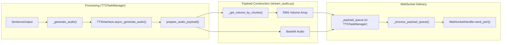

<!-- source: DeepWiki mcp.deepwiki.com · repo Open-LLM-VTuber/Open-LLM-VTuber · page 5.3 Output Transformers & Audio Payload · fetched 2026-10-30 -->

# Output Transformers & Audio Payload

<details>
<summary>Relevant source files</summary>

The following files were used as context for generating this wiki page:

- [src/open_llm_vtuber/agent/output_types.py](src/open_llm_vtuber/agent/output_types.py)
- [src/open_llm_vtuber/agent/transformers.py](src/open_llm_vtuber/agent/transformers.py)
- [src/open_llm_vtuber/utils/stream_audio.py](src/open_llm_vtuber/utils/stream_audio.py)

</details>


The conversation pipeline utilizes a decorator-based transformer system to process raw token streams from LLM agents into structured data suitable for frontend display, Live2D animation, and Text-to-Speech (TTS) synthesis. This system ensures that complex outputs—such as internal thought processes (` Hello!'"]
    end

    subgraph "Code Entity Space (transformers.py)"
        B --> C["sentence_divider()"]
        C --> D["SentenceWithTags"]
        D --> E["actions_extractor()"]
        E --> F["Actions (expressions)"]
        F --> G["display_processor()"]
        G --> H["DisplayText ('(I should be happy) Hello!')"]
        H --> I["tts_filter()"]
        I --> J["SentenceOutput (tts_text: 'Hello!')"]
    end

    subgraph "Output Space"
        J --> K["TTSTaskManager"]
    end
```
Sources: `src/open_llm_vtuber/agent/transformers.py` [12-203](), `src/open_llm_vtuber/utils/sentence_divider.py` [37-51]()

## Audio Payload & Lip-Sync

Once text is processed, it is sent to the `TTSTaskManager`. This manager handles parallel TTS generation while ensuring that audio segments are delivered to the frontend in the correct sequence using a sequence counter.

### prepare_audio_payload
The `prepare_audio_payload` function in `stream_audio.py` converts synthesized audio files into a format the frontend can consume for lip-syncing.
1.  **Audio Conversion:** Converts the audio to WAV format using `pydub`.
2.  **Base64 Encoding:** Encodes the raw bytes to a Base64 string for WebSocket transmission.
3.  **RMS Volume Calculation:** Splits the audio into small chunks (default 20ms) via `_get_volume_by_chunks` and calculates the Root Mean Square (RMS) volume for each. These `volumes` are used by the frontend to drive the Live2D model's mouth opening (lip-sync).

### Payload Delivery Diagram

"Audio Payload Generation and Delivery"

Sources: `src/open_llm_vtuber/utils/stream_audio.py` [27-82](), `src/open_llm_vtuber/agent/output_types.py` [66-78]()

### Silent Payloads
If the LLM generates non-vocal content (like just a picture or a thought), the system returns a payload where the `audio` field is `None`. This allows the frontend to update the display text and perform actions (like changing expressions) without playing sound.
*   **Source:** `src/open_llm_vtuber/utils/stream_audio.py` [50-60]()

## Key Implementation Details

### Parallelism and Ordering
The `TTSTaskManager` ensures that while multiple sentences can be synthesized by the TTS engine simultaneously to reduce latency, they are sent to the WebSocket in the exact order they were generated by the LLM by managing a task queue and sequence identifiers.

### Volume Normalization
To ensure consistent lip-syncing regardless of the TTS engine's output volume, `_get_volume_by_chunks` normalizes the RMS values against the maximum volume found in that specific audio segment.
*   **Source:** `src/open_llm_vtuber/utils/stream_audio.py` [8-24]()

Sources: `src/open_llm_vtuber/agent/transformers.py`, `src/open_llm_vtuber/utils/stream_audio.py`, `src/open_llm_vtuber/agent/output_types.py`, `src/open_llm_vtuber/utils/sentence_divider.py`

---

