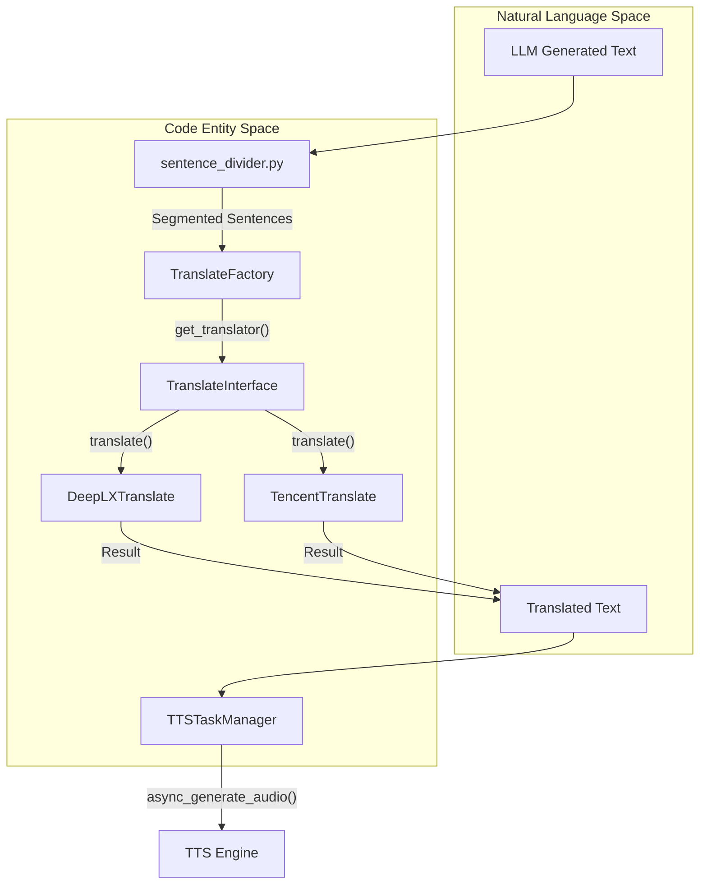
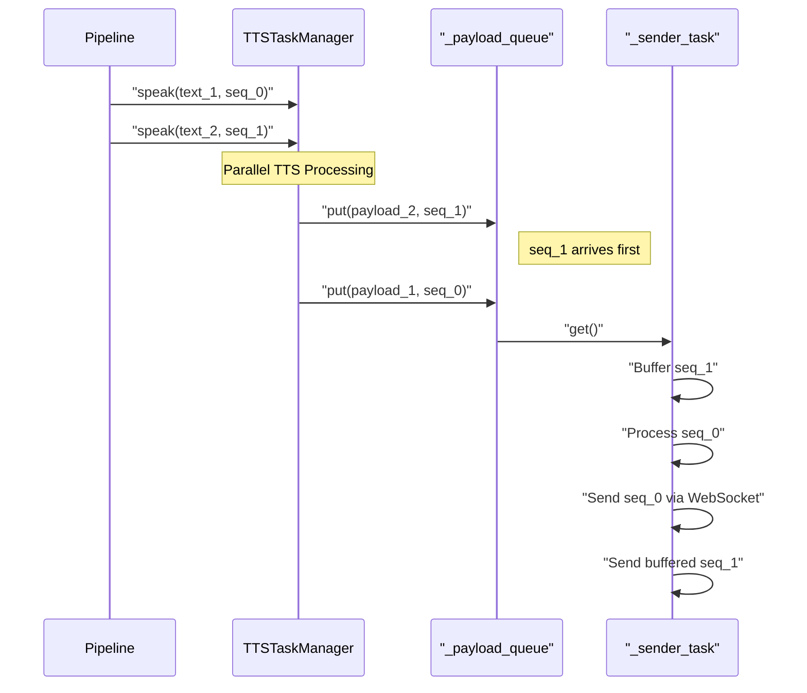

<!-- source: DeepWiki mcp.deepwiki.com · repo Open-LLM-VTuber/Open-LLM-VTuber · page 5.4 Translation Pipeline · fetched 2026-10-30 -->

# Translation Pipeline

Relevant source files

The following files were used as context for generating this wiki page:

- [src/open_llm_vtuber/conversations/tts_manager.py](src/open_llm_vtuber/conversations/tts_manager.py)
- [src/open_llm_vtuber/translate/deeplx.py](src/open_llm_vtuber/translate/deeplx.py)
- [src/open_llm_vtuber/translate/tencent.py](src/open_llm_vtuber/translate/tencent.py)
- [src/open_llm_vtuber/translate/translate_factory.py](src/open_llm_vtuber/translate/translate_factory.py)
- [src/open_llm_vtuber/translate/translate_interface.py](src/open_llm_vtuber/translate/translate_interface.py)
- [src/open_llm_vtuber/tts/bark_tts.py](src/open_llm_vtuber/tts/bark_tts.py)
- [src/open_llm_vtuber/tts/edge_tts.py](src/open_llm_vtuber/tts/edge_tts.py)
- [src/open_llm_vtuber/tts/pyttsx3_tts.py](src/open_llm_vtuber/tts/pyttsx3_tts.py)
- [src/open_llm_vtuber/utils/install_utils.py](src/open_llm_vtuber/utils/install_utils.py)
- [src/open_llm_vtuber/utils/sentence_divider.py](src/open_llm_vtuber/utils/sentence_divider.py)

The Translation Pipeline is an optional architectural component designed to bridge the gap between the language of the Large Language Model (LLM) output and the language requirements of the Text-to-Speech (TTS) engine. It allows the VTuber to process thoughts or logic in one language while speaking to the audience in another.

## Overview and Integration

The translation logic is encapsulated within the `TranslateInterface` [src/open_llm_vtuber/translate/translate_interface.py:4-10](). This pipeline is typically invoked within the conversation flow, positioned after the LLM generates text and before that text is sent to the `TTSTaskManager` [src/open_llm_vtuber/conversations/tts_manager.py:16-19]() for synthesis.

### Data Flow Architecture

The following diagram illustrates how translation fits into the broader output processing sequence:

**Translation Pipeline Integration**

Sources: [src/open_llm_vtuber/translate/translate_factory.py:6-27](), [src/open_llm_vtuber/conversations/tts_manager.py:30-49](), [src/open_llm_vtuber/utils/sentence_divider.py:213-223]()

## Translation Implementations

The system provides a factory pattern to instantiate specific translation providers based on the configuration.

### TranslateFactory
The `TranslateFactory` class contains a static method `get_translator` [src/open_llm_vtuber/translate/translate_factory.py:8-10]() that routes requests to specific implementations based on the `translate_provider` string:
- **DeepLX**: Targeted for users running local or third-party DeepLX instances [src/open_llm_vtuber/translate/translate_factory.py:12-16]().
- **Tencent**: Targeted for users utilizing Tencent Cloud TMT services [src/open_llm_vtuber/translate/translate_factory.py:17-24]().

### Provider Implementations

| Provider | Class Name | Key Parameters | Implementation Detail |
| :--- | :--- | :--- | :--- |
| **DeepLX** | `DeepLXTranslate` | `api_endpoint`, `target_lang` | Uses `httpx.post` to send JSON payloads to a DeepLX v2 endpoint [src/open_llm_vtuber/translate/deeplx.py:7-28](). |
| **Tencent** | `TencentTranslate` | `secret_id`, `secret_key`, `region` | Implements the `TC3-HMAC-SHA256` signature algorithm for secure Tencent Cloud API calls [src/open_llm_vtuber/translate/tencent.py:18-39](). |

Sources: [src/open_llm_vtuber/translate/translate_factory.py:6-27](), [src/open_llm_vtuber/translate/deeplx.py:7-28](), [src/open_llm_vtuber/translate/tencent.py:18-39]()

## Technical Implementation Detail

### Signature Generation (Tencent Cloud)
The `TencentTranslate` implementation requires complex request signing to satisfy Tencent's API security. It calculates a `credential_scope` and a `string_to_sign` using HMAC-SHA256 [src/open_llm_vtuber/translate/tencent.py:47-80](). This process ensures that the `Authorization` header is valid for the specific timestamp and payload being sent [src/open_llm_vtuber/translate/tencent.py:98-110]().

### Ordered Processing in TTSTaskManager
While translation happens per sentence, the `TTSTaskManager` ensures that even if translation or TTS generation for sentence B finishes before sentence A, they are delivered to the frontend in the correct sequence using a `_sequence_counter` [src/open_llm_vtuber/conversations/tts_manager.py:27-28]().

**Ordered Delivery Sequence**

Sources: [src/open_llm_vtuber/conversations/tts_manager.py:92-115](), [src/open_llm_vtuber/conversations/tts_manager.py:130-160]()

## Sentence Segmentation Fallback
Translation is performed on segmented text to reduce latency and improve accuracy. The `segment_text_by_pysbd` function attempts to use the `pysbd` library for language-aware segmentation [src/open_llm_vtuber/utils/sentence_divider.py:213-234](). If the language is unsupported, it falls back to `segment_text_by_regex` [src/open_llm_vtuber/utils/sentence_divider.py:254-256](), which uses defined `END_PUNCTUATIONS` like `.`, `!`, `?`, `。`, `！`, and `？` [src/open_llm_vtuber/utils/sentence_divider.py:30]().

Sources: [src/open_llm_vtuber/utils/sentence_divider.py:173-210](), [src/open_llm_vtuber/utils/sentence_divider.py:213-267]()

---

