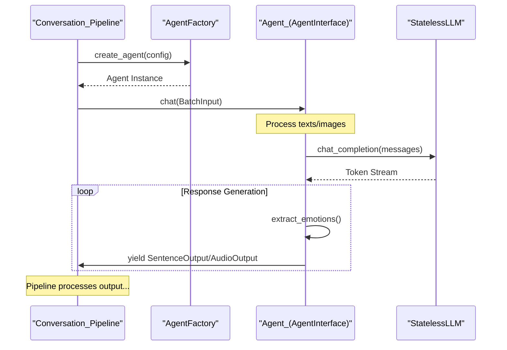

<!-- source: DeepWiki mcp.deepwiki.com · repo Open-LLM-VTuber/Open-LLM-VTuber · page 6 Agent System · fetched 2026-10-30 -->

# Agent System

<details>
<summary>Relevant source files</summary>

The following files were used as context for generating this wiki page:

- [src/open_llm_vtuber/agent/agent_factory.py](src/open_llm_vtuber/agent/agent_factory.py)
- [src/open_llm_vtuber/agent/agents/agent_interface.py](src/open_llm_vtuber/agent/agents/agent_interface.py)
- [src/open_llm_vtuber/agent/agents/hume_ai.py](src/open_llm_vtuber/agent/agents/hume_ai.py)
- [src/open_llm_vtuber/agent/agents/mem0_llm.py](src/open_llm_vtuber/agent/agents/mem0_llm.py)
- [src/open_llm_vtuber/agent/input_types.py](src/open_llm_vtuber/agent/input_types.py)
- [src/open_llm_vtuber/agent/stateless_llm/llama_cpp_llm.py](src/open_llm_vtuber/agent/stateless_llm/llama_cpp_llm.py)

</details>


The **Agent System** serves as the core intelligence layer of Open-LLM-VTuber. It abstracts the complexities of different Large Language Models (LLMs) and specialized AI services into a unified interface. This system is responsible for maintaining conversational state, processing multi-modal inputs, handling interruptions, and generating structured responses that include text, audio, and Live2D animations.

### System Architecture

The agent system is built on a hierarchy of abstractions that separate the "Agent" (which manages memory and logic) from the "Stateless LLM" (which performs the raw inference).

#### Agent Entity Relationship
This diagram shows how the `AgentFactory` orchestrates the creation of agents and how they interact with underlying LLM backends and MCP tools.

```mermaid
graph TD
    subgraph "Agent_Factory_Space"
        AF["AgentFactory"]
        SF["StatelessLLMFactory"]
    end

    subgraph "Agent_Implementations"
        BMA["BasicMemoryAgent"]
        HA["HumeAIAgent"]
        LA["LettaAgent"]
        M0A["Mem0LLM"]
    end

    subgraph "LLM_Backends"
        SLLM["StatelessLLMInterface"]
        OAI["AsyncLLM_(OpenAI)"]
        CLD["ClaudeLLM"]
        LCP["LlamaCppLLM"]
    end

    AF -->|["create_agent"]| BMA
    AF -->|["create_agent"]| HA
    AF -->|["create_agent"]| LA
    AF -->|["create_agent"]| M0A
    
    BMA -->|["uses"]| SLLM
    SF -->|["create_llm"]| SLLM
    SLLM <|-- OAI
    SLLM <|-- CLD
    SLLM <|-- LCP

    BMA -->|["executes"]| TE["ToolExecutor_(MCP)"]
```
**Sources:** [src/open_llm_vtuber/agent/agent_factory.py:15-132](), [src/open_llm_vtuber/agent/agents/agent_interface.py:9-54]()

---

### Core Components

#### 1. AgentInterface
All agents must implement the `AgentInterface` abstract base class. This ensures the conversation pipeline can interact with any backend (whether it's a local LLM or a cloud-based voice AI) using a standardized set of methods.

- **`chat(input_data: BaseInput)`**: The primary entry point for processing user input. It returns an `AsyncIterator` of `BaseOutput` (either `SentenceOutput` or `AudioOutput`). [src/open_llm_vtuber/agent/agents/agent_interface.py:13-27]()
- **`handle_interrupt(heard_response: str)`**: Logic to manage cases where the user speaks while the VTuber is still talking. [src/open_llm_vtuber/agent/agents/agent_interface.py:31-43]()
- **`set_memory_from_history(conf_uid, history_uid)`**: Restores the agent's state (e.g., chat history or session IDs) from persistent storage. [src/open_llm_vtuber/agent/agents/agent_interface.py:45-54]()

**Sources:** [src/open_llm_vtuber/agent/agents/agent_interface.py:9-54]()

#### 2. AgentFactory
The `AgentFactory` is the central dispatcher that instantiates the correct agent class based on the `conversation_agent_choice` in the configuration. It handles the complex initialization of dependencies like `StatelessLLM`, `ToolManager`, and `Live2dModel`. [src/open_llm_vtuber/agent/agent_factory.py:15-132]()

**Sources:** [src/open_llm_vtuber/agent/agent_factory.py:15-132]()

---

### Input Data Models

The system uses a structured input hierarchy defined in `input_types.py` to support multi-modality (text, images, and files).

| Class | Description | Key Attributes |
| :--- | :--- | :--- |
| `BatchInput` | The standard container for a conversation turn. | `texts`, `images`, `files`, `metadata` |
| `TextData` | Represents text from ASR, clipboard, or system. | `source`, `content`, `from_name` |
| `ImageData` | Encapsulates visual information. | `source`, `data` (Base64/URL), `mime_type` |
| `ImageSource` | Enum for source types. | `CAMERA`, `SCREEN`, `CLIPBOARD`, `UPLOAD` |

**Sources:** [src/open_llm_vtuber/agent/input_types.py:6-95]()

---

### Agent Categories

#### BasicMemoryAgent & Tools
The `BasicMemoryAgent` is the default implementation. It manages a local list of messages (short-term memory) and supports advanced features like the **Model Context Protocol (MCP)** for tool use. It uses a `StatelessLLM` to generate responses and can detect tool calls within the stream. [src/open_llm_vtuber/agent/agent_factory.py:39-86]()

For details on memory management and tool loops, see **[AgentInterface & BasicMemoryAgent (#6.1)]**.

#### Stateless LLM Backends
The system supports a wide variety of LLM providers through the `StatelessLLMInterface`. These backends do not store history themselves; they simply take a list of messages and return a stream of tokens. Supported backends include:
- **OpenAI / OpenAI-Compatible**: Via `AsyncLLM`.
- **Anthropic**: Via `ClaudeLLM`.
- **Local GGUF**: Via `LlamaCppLLM`, which runs inference in a thread pool using `run_in_executor` to avoid blocking the event loop. [src/open_llm_vtuber/agent/stateless_llm/llama_cpp_llm.py:59-65]()
- **Ollama**: Via `OllamaLLM`.

For details on LLM implementations, see **[Stateless LLM Backends (#6.2)]**.

#### Specialized Agents
Beyond standard LLMs, the system integrates specialized platforms:
- **Hume AI**: Uses the Empathic Voice Interface (EVI) via WebSockets (`wss://api.hume.ai/v0/evi/chat`) to provide low-latency voice-to-voice interaction. It manages its own `chat_group_id` for session persistence. [src/open_llm_vtuber/agent/agents/hume_ai.py:69-101]()
- **Letta (MemGPT)**: Provides agents with "infinite" long-term memory. [src/open_llm_vtuber/agent/agent_factory.py:119-129]()
- **Mem0**: Integrates persistent user-based memory into the LLM flow. [src/open_llm_vtuber/agent/agent_factory.py:88-108]()

For details on these integrations, see **[Specialized Agents (Hume AI, Letta, Mem0) (#6.3)]**.

---

### Data Flow: From Input to Output

This diagram illustrates how data flows from the `BaseInput` provided by the pipeline into the `AgentInterface` and eventually back as `BaseOutput`.


**Sources:** [src/open_llm_vtuber/agent/agents/agent_interface.py:13-27](), [src/open_llm_vtuber/agent/agent_factory.py:71-86](), [src/open_llm_vtuber/agent/stateless_llm/llama_cpp_llm.py:34-77]()

---

