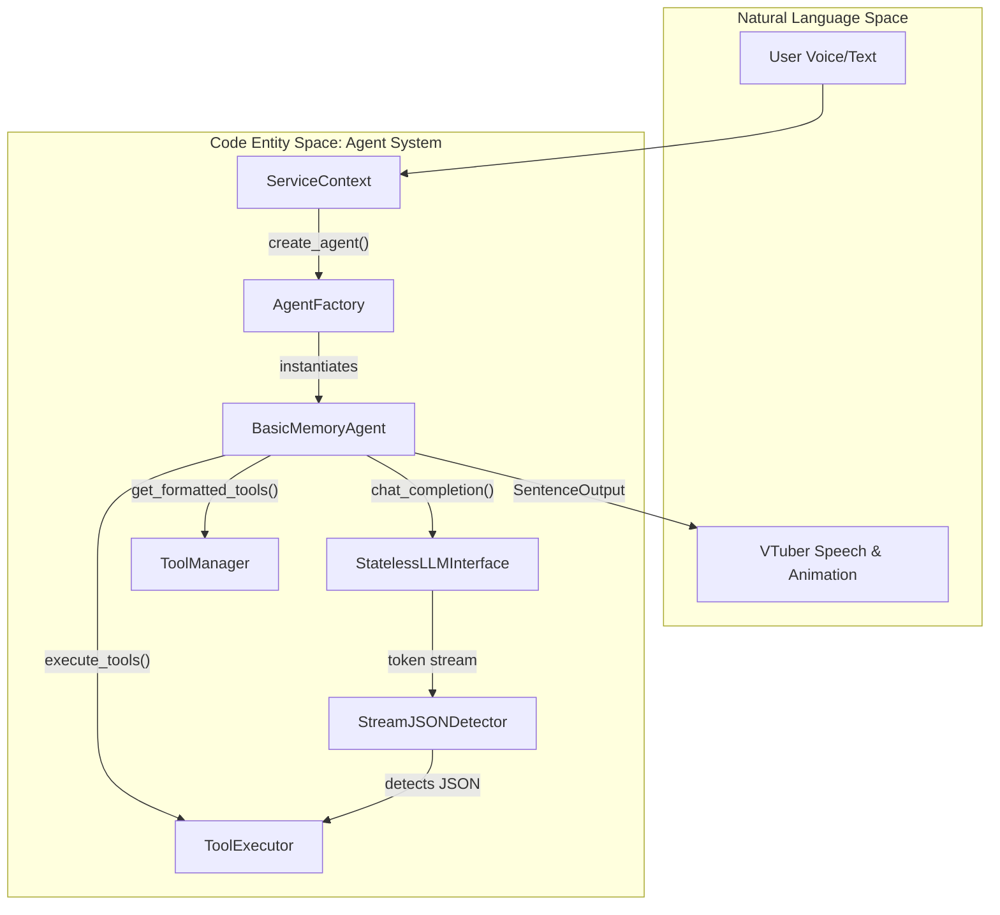
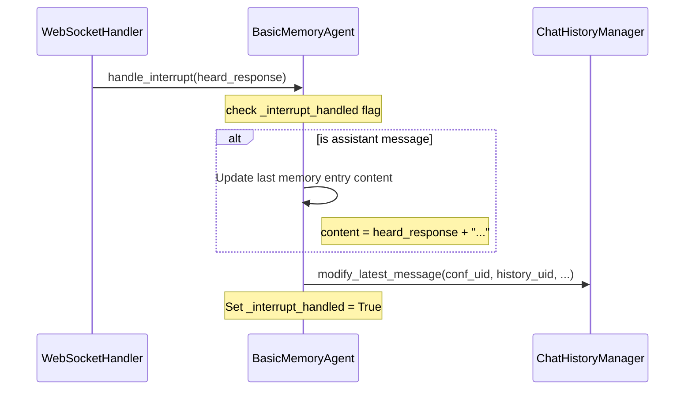

<!-- source: DeepWiki mcp.deepwiki.com · repo Open-LLM-VTuber/Open-LLM-VTuber · page 6.1 AgentInterface & BasicMemoryAgent · fetched 2026-10-30 -->

# AgentInterface & BasicMemoryAgent

Relevant source files

The following files were used as context for generating this wiki page:

- [src/open_llm_vtuber/agent/agents/agent_interface.py](src/open_llm_vtuber/agent/agents/agent_interface.py)
- [src/open_llm_vtuber/agent/agents/basic_memory_agent.py](src/open_llm_vtuber/agent/agents/basic_memory_agent.py)
- [src/open_llm_vtuber/agent/agents/hume_ai.py](src/open_llm_vtuber/agent/agents/hume_ai.py)
- [src/open_llm_vtuber/agent/input_types.py](src/open_llm_vtuber/agent/input_types.py)
- [src/open_llm_vtuber/mcpp/json_detector.py](src/open_llm_vtuber/mcpp/json_detector.py)
- [src/open_llm_vtuber/service_context.py](src/open_llm_vtuber/service_context.py)

The Agent System provides a unified abstraction for different Large Language Model (LLM) backends and interaction paradigms. It manages the conversation flow, maintains short-term memory, and facilitates tool execution via the Model Context Protocol (MCP).

## AgentInterface

`AgentInterface` is an abstract base class that defines the contract for all agent implementations within the system [src/open_llm_vtuber/agent/agents/agent_interface.py:9-54](). It ensures that every agent, regardless of its underlying backend (OpenAI, Claude, Hume AI, etc.), provides consistent methods for communication and state management.

### Key Abstract Methods
- **`chat(input_data: BaseInput)`**: The primary entry point for sending user input to the agent. It returns an `AsyncIterator` of `BaseOutput`, which can be `SentenceOutput` (text-based) or `AudioOutput` (for agents with built-in TTS like Hume AI) [src/open_llm_vtuber/agent/agents/agent_interface.py:13-30]().
- **`handle_interrupt(heard_response: str)`**: Triggered when a user interrupts the VTuber's speech. This allows the agent to update its memory with only the part of the response actually heard by the user [src/open_llm_vtuber/agent/agents/agent_interface.py:32-43]().
- **`set_memory_from_history(conf_uid: str, history_uid: str)`**: Synchronizes the agent's internal memory with the persistent JSON chat history [src/open_llm_vtuber/agent/agents/agent_interface.py:46-54]().

**Sources:** [src/open_llm_vtuber/agent/agents/agent_interface.py:9-54](), [src/open_llm_vtuber/agent/input_types.py:70-95]()

---

## BasicMemoryAgent

`BasicMemoryAgent` is the default implementation of `AgentInterface`. It manages a list-based memory and supports advanced features like multi-modal input, interruption handling, and tool calling via MCP [src/open_llm_vtuber/agent/agents/basic_memory_agent.py:33-112]().

### Memory Management
The agent maintains an internal `_memory` list of dictionaries containing `role` and `content` [src/open_llm_vtuber/agent/agents/basic_memory_agent.py:55]().
- **`_add_message`**: Appends new messages to the memory. It handles both string content and multi-modal lists (text/image) [src/open_llm_vtuber/agent/agents/basic_memory_agent.py:128-174]().
- **`set_memory_from_history`**: Loads previous messages from the history manager and converts them into the agent's internal format [src/open_llm_vtuber/agent/agents/basic_memory_agent.py:176-193]().
- **Interruption**: When `handle_interrupt` is called, the agent modifies the last assistant message in its memory by appending "..." to indicate it was cut off [src/open_llm_vtuber/agent/agents/basic_memory_agent.py:202-210](). It also notifies the `ChatHistoryManager` to update the persistent record [src/open_llm_vtuber/agent/agents/basic_memory_agent.py:214-219]().

### Chat Function Factory Pattern
The `BasicMemoryAgent` uses a decorator-style factory pattern `_chat_function_factory` to dynamically wrap the LLM's raw stream with output transformers [src/open_llm_vtuber/agent/agents/basic_memory_agent.py:236-281]().

**Data Flow: LLM Output to VTuber Response**
The following diagram illustrates how the raw LLM stream is processed through various code entities.

| Sequence | Entity | Role |
| :--- | :--- | :--- |
| 1 | `StatelessLLMInterface` | Generates raw token stream via `chat_completion` [src/open_llm_vtuber/agent/stateless_llm/stateless_llm_interface.py:9-21]() |
| 2 | `sentence_divider` | Segments tokens into complete sentences [src/open_llm_vtuber/agent/transformers.py:34-118]() |
| 3 | `actions_extractor` | Parses `(expression)` or `[action]` tags for Live2D [src/open_llm_vtuber/agent/transformers.py:121-179]() |
| 4 | `tts_filter` | Cleans text for speech synthesis (removes emojis/brackets) [src/open_llm_vtuber/agent/transformers.py:182-214]() |
| 5 | `display_processor` | Formats text for the frontend subtitle display [src/open_llm_vtuber/agent/transformers.py:217-241]() |

**Sources:** [src/open_llm_vtuber/agent/agents/basic_memory_agent.py:128-210](), [src/open_llm_vtuber/agent/agents/basic_memory_agent.py:236-281]()

---

## Tool Interaction Loops

`BasicMemoryAgent` supports two modes of tool interaction: **Native Tool Calling** (for OpenAI and Claude) and **Prompt-Mode Tool Calling** (for local models or models without native tool support).

### OpenAI and Claude Native Loops
For providers like OpenAI and Anthropic, the agent implements a recursive tool execution loop:
1. The agent calls the LLM with available tools defined in `ToolManager` [src/open_llm_vtuber/agent/agents/basic_memory_agent.py:66-82]().
2. If the LLM returns a tool call, `ToolExecutor` runs the requested functions [src/open_llm_vtuber/agent/agents/basic_memory_agent.py:461-468]().
3. The results are added to the conversation history, and the agent calls the LLM again to generate a final response [src/open_llm_vtuber/agent/agents/basic_memory_agent.py:470-475]().

### StreamJSONDetector (Prompt-Mode)
When `prompt_mode_flag` is active, the agent uses `StreamJSONDetector` to find JSON blocks within a standard text stream [src/open_llm_vtuber/agent/agents/basic_memory_agent.py:69-70](). 
- The `StreamJSONDetector` buffers incoming chunks and tracks potential JSON starting positions (`{`) [src/open_llm_vtuber/mcpp/json_detector.py:24-34]().
- It uses a stack-based approach to extract balanced JSON objects from the stream [src/open_llm_vtuber/mcpp/json_detector.py:90-121]().
- This allows models to trigger tools by simply outputting JSON in their response, which the agent intercepts and executes [src/open_llm_vtuber/agent/agents/basic_memory_agent.py:291-325]().

**Sources:** [src/open_llm_vtuber/agent/agents/basic_memory_agent.py:433-490](), [src/open_llm_vtuber/agent/agents/basic_memory_agent.py:291-325](), [src/open_llm_vtuber/mcpp/json_detector.py:6-138]()

---

## Agent Architecture Diagram

This diagram bridges the Natural Language interaction to the internal code components.

### Agent System Component Mapping

**Sources:** [src/open_llm_vtuber/service_context.py:53](), [src/open_llm_vtuber/agent/agent_factory.py:15-133](), [src/open_llm_vtuber/agent/agents/basic_memory_agent.py:33-112]()

---

## Interaction Flow: User Interruption

The following diagram illustrates the logic within `BasicMemoryAgent` when a `handle_interrupt` call is received from the `WebSocketHandler`.

### Interruption Handling Logic

**Sources:** [src/open_llm_vtuber/agent/agents/basic_memory_agent.py:195-219](), [src/open_llm_vtuber/chat_history_manager.py:115-140]()

---

