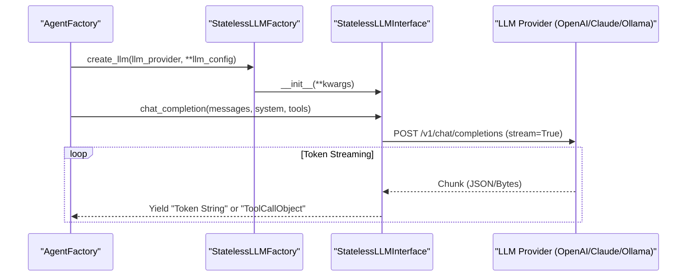

<!-- source: DeepWiki mcp.deepwiki.com · repo Open-LLM-VTuber/Open-LLM-VTuber · page 6.2 Stateless LLM Backends · fetched 2026-10-30 -->

# Stateless LLM Backends

<details>
<summary>Relevant source files</summary>

The following files were used as context for generating this wiki page:

- [src/open_llm_vtuber/agent/agent_factory.py](src/open_llm_vtuber/agent/agent_factory.py)
- [src/open_llm_vtuber/agent/agents/mem0_llm.py](src/open_llm_vtuber/agent/agents/mem0_llm.py)
- [src/open_llm_vtuber/agent/stateless_llm/claude_llm.py](src/open_llm_vtuber/agent/stateless_llm/claude_llm.py)
- [src/open_llm_vtuber/agent/stateless_llm/llama_cpp_llm.py](src/open_llm_vtuber/agent/stateless_llm/llama_cpp_llm.py)
- [src/open_llm_vtuber/agent/stateless_llm/ollama_llm.py](src/open_llm_vtuber/agent/stateless_llm/ollama_llm.py)
- [src/open_llm_vtuber/agent/stateless_llm/openai_compatible_llm.py](src/open_llm_vtuber/agent/stateless_llm/openai_compatible_llm.py)
- [src/open_llm_vtuber/agent/stateless_llm/stateless_llm_interface.py](src/open_llm_vtuber/agent/stateless_llm/stateless_llm_interface.py)
- [src/open_llm_vtuber/agent/stateless_llm/stateless_llm_with_template.py](src/open_llm_vtuber/agent/stateless_llm/stateless_llm_with_template.py)

</details>


The stateless LLM layer provides a unified abstraction for interacting with various Large Language Model providers. A "stateless" backend does not persist chat history or system prompts internally; instead, it accepts the full conversation context and system instructions for each request and returns an asynchronous stream of tokens or tool calls [src/open_llm_vtuber/agent/stateless_llm/stateless_llm_interface.py:7-12](). These backends are utilized by the `BasicMemoryAgent` to perform the actual language generation [src/open_llm_vtuber/agent/agent_factory.py:59-72]().

## StatelessLLMInterface

The `StatelessLLMInterface` is an abstract base class that defines the contract for all LLM implementations. Its primary responsibility is to provide an asynchronous iterator for chat completions.

*   **Key Method**: `chat_completion(messages, system, tools)` [src/open_llm_vtuber/agent/stateless_llm/stateless_llm_interface.py:21-27]().
*   **Data Flow**: It receives a list of message dictionaries (OpenAI format), an optional system prompt, and optional tool definitions, then yields content chunks (strings) or tool call objects [src/open_llm_vtuber/agent/stateless_llm/stateless_llm_interface.py:28-63]().

### LLM Implementation Hierarchy

The following diagram illustrates how different LLM providers implement the core interface.

**Stateless LLM Class Structure**
```mermaid
classDiagram
    class "StatelessLLMInterface" {
        <<interface>>
        +chat_completion(messages, system, tools) AsyncIterator
    }
    class "AsyncLLM" {
        +client: AsyncOpenAI
        +chat_completion()
    }
    class "ClaudeLLM" {
        +client: AsyncAnthropic
        +chat_completion()
    }
    class "OllamaLLM" {
        +keep_alive: float
        +cleanup()
    }
    class "LLM (llama_cpp)" {
        +llm: Llama
        +chat_completion()
    }
    class "AsyncLLMWithTemplate" {
        +template: Template
        +chat_completion()
    }

    "StatelessLLMInterface" <|.. "AsyncLLM" : "OpenAI Compatible"
    "StatelessLLMInterface" <|.. "ClaudeLLM" : "Anthropic"
    "StatelessLLMInterface" <|.. "LLM (llama_cpp)" : "Local GGUF"
    "StatelessLLMInterface" <|.. "AsyncLLMWithTemplate" : "Custom Templates"
    "AsyncLLM" <|-- "OllamaLLM" : "Inherits OpenAI logic"
```
**Sources:** [src/open_llm_vtuber/agent/stateless_llm/stateless_llm_interface.py:5-19](), [src/open_llm_vtuber/agent/stateless_llm/openai_compatible_llm.py:24-54](), [src/open_llm_vtuber/agent/stateless_llm/claude_llm.py:15-40](), [src/open_llm_vtuber/agent/stateless_llm/ollama_llm.py:7-29](), [src/open_llm_vtuber/agent/stateless_llm/llama_cpp_llm.py:13-32](), [src/open_llm_vtuber/agent/stateless_llm/stateless_llm_with_template.py:86-119]().

---

## Implementations

### AsyncLLM (OpenAI-Compatible)
The `AsyncLLM` class handles interactions with any OpenAI-compatible API (e.g., official OpenAI, Groq, DeepSeek).
*   **Initialization**: Uses `AsyncOpenAI` client with `base_url`, `api_key`, and `organization_id` [src/open_llm_vtuber/agent/stateless_llm/openai_compatible_llm.py:48-53]().
*   **Streaming**: Iterates over `AsyncStream[ChatCompletionChunk]` [src/open_llm_vtuber/agent/stateless_llm/openai_compatible_llm.py:100-113]().
*   **Tool Calling**: Detects `tool_calls` in chunks and accumulates them until the tool call is complete before yielding the result [src/open_llm_vtuber/agent/stateless_llm/openai_compatible_llm.py:118-176]().

### ClaudeLLM (Anthropic)
Specifically designed for Anthropic's Claude models.
*   **Message Conversion**: Includes `_convert_message_format` to translate OpenAI-style messages (including base64 images) into the Anthropic format [src/open_llm_vtuber/agent/stateless_llm/claude_llm.py:43-82]().
*   **Native Streaming**: Uses `self.client.messages.stream` to handle text deltas and tool use events like `tool_use_start` and `tool_input_delta` [src/open_llm_vtuber/agent/stateless_llm/claude_llm.py:122-165]().

### OllamaLLM
Extends `AsyncLLM` to support Ollama-specific features.
*   **Preloading**: Sends a POST request to `/api/chat` during initialization to ensure the model is loaded into memory [src/open_llm_vtuber/agent/stateless_llm/ollama_llm.py:31-42]().
*   **Lifecycle Management**: Registers a `cleanup` function via `atexit` to unload the model when the server shuts down if `unload_at_exit` is enabled [src/open_llm_vtuber/agent/stateless_llm/ollama_llm.py:51-73]().

### LlamaCppLLM (Local GGUF)
Provides a stateless interface for local models via the `llama-cpp-python` library.
*   **Thread Safety**: Since `llama-cpp` is synchronous and blocking, the `chat_completion` method runs the generation in a separate thread using `asyncio.get_event_loop().run_in_executor(None, ...)` to prevent blocking the FastAPI event loop [src/open_llm_vtuber/agent/stateless_llm/llama_cpp_llm.py:59-65]().

### AsyncLLMWithTemplate (Non-ChatML Backends)
Used for backends that require manual prompt templating (e.g., Llama 3, Alpaca) rather than structured ChatML messages.
*   **Templating**: Uses Jinja2 templates defined in `TEMPLATES` to wrap messages into a single prompt string [src/open_llm_vtuber/agent/stateless_llm/stateless_llm_with_template.py:16-83]().
*   **Manual Streaming**: Uses `requests.post(..., stream=True)` and manual line processing to extract tokens from the raw byte stream [src/open_llm_vtuber/agent/stateless_llm/stateless_llm_with_template.py:160-171]().

**Sources:** [src/open_llm_vtuber/agent/stateless_llm/openai_compatible_llm.py:60-82](), [src/open_llm_vtuber/agent/stateless_llm/claude_llm.py:84-110](), [src/open_llm_vtuber/agent/stateless_llm/ollama_llm.py:7-21](), [src/open_llm_vtuber/agent/stateless_llm/llama_cpp_llm.py:34-46](), [src/open_llm_vtuber/agent/stateless_llm/stateless_llm_with_template.py:109-159]().

---

## StatelessLLMFactory

The `StatelessLLMFactory` (aliased in `AgentFactory`) is responsible for instantiating the correct LLM backend based on the `llm_provider` string defined in the configuration.

| Provider Key | Implementation Class | Notes |
| :--- | :--- | :--- |
| `openai_compatible_llm` | `AsyncLLM` | Standard OpenAI API or compatible endpoints. |
| `claude_llm` | `AsyncLLM` (Claude) | Specific to Anthropic API. |
| `ollama_llm` | `OllamaLLM` | Includes preload/unload logic. |
| `llama_cpp_llm` | `LLM` (LlamaCpp) | Loads local `.gguf` files via thread pool. |
| `stateless_llm_with_template`| `AsyncLLMWithTemplate` | For backends requiring Jinja2 prompt templates. |

**Sources:** [src/open_llm_vtuber/agent/agent_factory.py:6-61](), [src/open_llm_vtuber/agent/stateless_llm/openai_compatible_llm.py:24](), [src/open_llm_vtuber/agent/stateless_llm/claude_llm.py:15](), [src/open_llm_vtuber/agent/stateless_llm/ollama_llm.py:7](), [src/open_llm_vtuber/agent/stateless_llm/llama_cpp_llm.py:13]().

---

## Token Streaming and Data Flow

The flow of data from the agent to the final token stream involves the `AgentFactory` delegating LLM creation to the factory.

**LLM Backend Data Flow**


**Bridge: Natural Language to Code Entities**
Configuration settings map directly to backend initialization parameters.

| Natural Language Concept | Code Entity / Class | File Path |
| :--- | :--- | :--- |
| LLM Provider Choice | `llm_provider` (Variable) | [src/open_llm_vtuber/agent/agent_factory.py:42]() |
| OpenAI Backend | `AsyncLLM` | [src/open_llm_vtuber/agent/stateless_llm/openai_compatible_llm.py:24]() |
| Local GGUF Backend | `LLM` (LlamaCpp) | [src/open_llm_vtuber/agent/stateless_llm/llama_cpp_llm.py:13]() |
| Backend Creation | `StatelessLLMFactory.create_llm` | [src/open_llm_vtuber/agent/agent_factory.py:59]() |
| Token Streaming | `chat_completion` | [src/open_llm_vtuber/agent/stateless_llm/stateless_llm_interface.py:22]() |
| Tool Call State | `accumulated_tool_calls` | [src/open_llm_vtuber/agent/stateless_llm/openai_compatible_llm.py:85]() |

**Sources:** [src/open_llm_vtuber/agent/agent_factory.py:39-61](), [src/open_llm_vtuber/agent/stateless_llm/openai_compatible_llm.py:24-85](), [src/open_llm_vtuber/agent/stateless_llm/stateless_llm_interface.py:21-27]().

---

