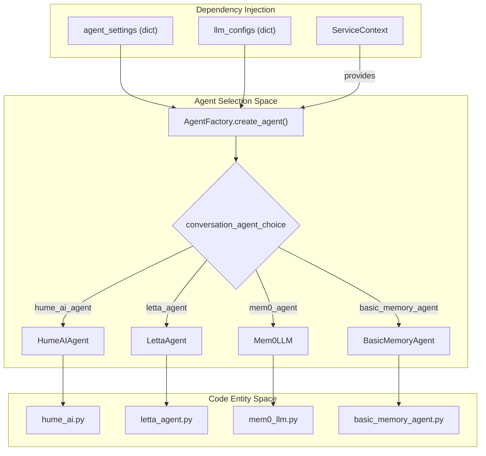
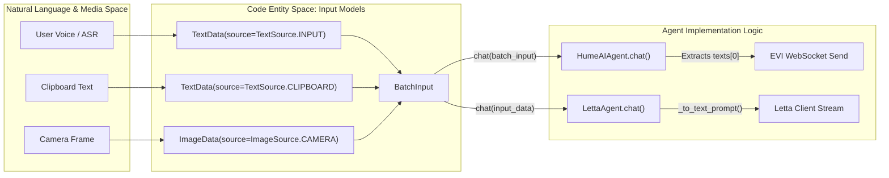

<!-- source: DeepWiki mcp.deepwiki.com · repo Open-LLM-VTuber/Open-LLM-VTuber · page 6.3 Specialized Agents (Hume AI, Letta, Mem0) · fetched 2026-10-30 -->

# Specialized Agents (Hume AI, Letta, Mem0)

Relevant source files

The following files were used as context for generating this wiki page:

- [scripts/run_bilibili_live.py](scripts/run_bilibili_live.py)
- [src/open_llm_vtuber/agent/agent_factory.py](src/open_llm_vtuber/agent/agent_factory.py)
- [src/open_llm_vtuber/agent/agents/agent_interface.py](src/open_llm_vtuber/agent/agents/agent_interface.py)
- [src/open_llm_vtuber/agent/agents/hume_ai.py](src/open_llm_vtuber/agent/agents/hume_ai.py)
- [src/open_llm_vtuber/agent/agents/letta_agent.py](src/open_llm_vtuber/agent/agents/letta_agent.py)
- [src/open_llm_vtuber/agent/agents/mem0_llm.py](src/open_llm_vtuber/agent/agents/mem0_llm.py)
- [src/open_llm_vtuber/agent/input_types.py](src/open_llm_vtuber/agent/input_types.py)
- [src/open_llm_vtuber/agent/stateless_llm/llama_cpp_llm.py](src/open_llm_vtuber/agent/stateless_llm/llama_cpp_llm.py)
- [src/open_llm_vtuber/config_manager/live.py](src/open_llm_vtuber/config_manager/live.py)
- [src/open_llm_vtuber/live/bilibili_live.py](src/open_llm_vtuber/live/bilibili_live.py)
- [src/open_llm_vtuber/live/live_interface.py](src/open_llm_vtuber/live/live_interface.py)
- [src/open_llm_vtuber/proxy_handler.py](src/open_llm_vtuber/proxy_handler.py)
- [src/open_llm_vtuber/proxy_message_queue.py](src/open_llm_vtuber/proxy_message_queue.py)

This section covers the specialized agent implementations in Open-LLM-VTuber that extend beyond standard stateless LLM interactions. These agents provide unique capabilities such as native expressive audio (Hume AI), long-term stateful memory (Letta/MemGPT), and persistent user-specific memory (Mem0).

## HumeAIAgent

The `HumeAIAgent` utilizes the Hume AI Empathic Voice Interface (EVI) over WebSockets. Unlike other agents that return text for a separate TTS engine, this agent handles both language processing and audio generation natively, providing high-quality expressive speech.

### Implementation Details
The agent maintains a persistent WebSocket connection to `api.hume.ai` [src/open_llm_vtuber/agent/agents/hume_ai.py:69](). It handles session persistence by storing and retrieving a `chat_group_id` (referred to as `resume_id` in metadata) within the chat history system [src/open_llm_vtuber/agent/agents/hume_ai.py:68-101]().

- **Session Persistence**: When `set_memory_from_history` is called, it retrieves the `resume_id` from the history metadata via `get_metadata` [src/open_llm_vtuber/agent/agents/hume_ai.py:133-150]().
- **Data Flow**: It receives `BatchInput` but only processes the text component, as Hume AI does not currently support image input in this implementation [src/open_llm_vtuber/agent/agents/hume_ai.py:171-179]().
- **Output**: It yields `AudioOutput` objects containing base64-encoded audio and the transcript provided by Hume [src/open_llm_vtuber/agent/agents/hume_ai.py:198-210]().

### Connection Lifecycle
Hume AI connections include an `idle_timeout` (default 15s) to manage resource usage [src/open_llm_vtuber/agent/agents/hume_ai.py:28](). The agent automatically reconnects and resumes the `chat_group_id` if the connection has timed out [src/open_llm_vtuber/agent/agents/hume_ai.py:103-120]().

**Sources:** [src/open_llm_vtuber/agent/agents/hume_ai.py:15-210](), [src/open_llm_vtuber/agent/agent_factory.py:110-117]()

---

## LettaAgent

The `LettaAgent` provides agents with long-term memory and "evolvable" personas. It interfaces with a Letta server via the `letta_client` library [src/open_llm_vtuber/agent/agents/letta_agent.py:12]().

### Key Characteristics
- **Memory Management**: Unlike basic agents that require manual history loading, Letta manages its own persistent state. `set_memory_from_history` is implemented as a no-op because the Letta server handles persistence [src/open_llm_vtuber/agent/agents/letta_agent.py:53-55]().
- **Transformation Pipeline**: The agent's `chat` method is wrapped in several decorators to process the output: `sentence_divider`, `actions_extractor`, `display_processor`, and `tts_filter` [src/open_llm_vtuber/agent/agents/letta_agent.py:41-51]().
- **Streaming**: It uses the `client.agents.messages.create_stream` to create a message stream, filtering out `reasoning_message` (internal thought process) and yielding only the `assistant_message` content to the VTuber pipeline [src/open_llm_vtuber/agent/agents/letta_agent.py:64-88]().

**Sources:** [src/open_llm_vtuber/agent/agents/letta_agent.py:15-128](), [src/open_llm_vtuber/agent/agent_factory.py:119-129]()

---

## Mem0LLM

`Mem0LLM` integrates the Mem0 memory layer, which provides a persistent, self-improving memory for LLMs. It tracks user preferences and past interactions across sessions using a unique `user_id`.

- **Initialization**: Requires `base_url`, `model`, and a specific `mem0_config` [src/open_llm_vtuber/agent/agent_factory.py:91-108]().
- **Persistence**: It uses the `user_id` (passed from the `ServiceContext` via `kwargs`) to ensure that the memory retrieved and stored is specific to the current user [src/open_llm_vtuber/agent/agent_factory.py:103-108]().

**Sources:** [src/open_llm_vtuber/agent/agent_factory.py:88-108]()

---

## Input Data Structures

Specialized agents receive data via the `BatchInput` class, which consolidates various input sources into a single object for processing [src/open_llm_vtuber/agent/input_types.py:77-95]().

| Class | Purpose | Key Attributes |
| :--- | :--- | :--- |
| `TextData` | Represents text from user or clipboard | `source` (`INPUT`/`CLIPBOARD`), `content` [src/open_llm_vtuber/agent/input_types.py:55-68]() |
| `ImageData` | Represents visual input | `source` (`CAMERA`/`SCREEN`/etc), `data` (Base64), `mime_type` [src/open_llm_vtuber/agent/input_types.py:23-36]() |
| `BatchInput` | Container for a full interaction | `texts` (List), `images` (Optional), `metadata` [src/open_llm_vtuber/agent/input_types.py:77-95]() |

**Sources:** [src/open_llm_vtuber/agent/input_types.py:6-95]()

---

## Agent System Data Flow

The following diagrams illustrate how the `AgentFactory` resolves different specialized agents and how data flows from the frontend/proxy through the input types into the specialized agent logic.

### Agent Initialization Logic
This diagram shows how `AgentFactory.create_agent` maps configuration choices to specific code entities.

**Sources:** [src/open_llm_vtuber/agent/agent_factory.py:15-132]()

### Specialized Agent Input Processing
This diagram maps the natural language input (e.g., a user speaking or pasting text) to the internal `BaseInput` types and their consumption by specialized agents.

**Sources:** [src/open_llm_vtuber/agent/input_types.py:6-95](), [src/open_llm_vtuber/agent/agents/hume_ai.py:157-184](), [src/open_llm_vtuber/agent/agents/letta_agent.py:64-110]()

### Comparison of Specialized Agent Features

| Feature | HumeAIAgent | LettaAgent | Mem0LLM |
| :--- | :--- | :--- | :--- |
| **Output Type** | `AudioOutput` [src/open_llm_vtuber/agent/agents/hume_ai.py:157]() | `SentenceOutput` [src/open_llm_vtuber/agent/agents/letta_agent.py:64]() | `SentenceOutput` |
| **Persistence** | `chat_group_id` [src/open_llm_vtuber/agent/agents/hume_ai.py:47]() | Letta Server Managed [src/open_llm_vtuber/agent/agents/letta_agent.py:53]() | `user_id` [src/open_llm_vtuber/agent/agent_factory.py:104]() |
| **Input Support** | Text only [src/open_llm_vtuber/agent/agents/hume_ai.py:175]() | Text + Images [src/open_llm_vtuber/agent/agents/letta_agent.py:118]() | Text + Images |
| **Protocol** | WebSockets (EVI) [src/open_llm_vtuber/agent/agents/hume_ai.py:69]() | REST/Stream [src/open_llm_vtuber/agent/agents/letta_agent.py:32]() | OpenAI-compatible + Mem0 |

**Sources:** [src/open_llm_vtuber/agent/agents/hume_ai.py](), [src/open_llm_vtuber/agent/agents/letta_agent.py](), [src/open_llm_vtuber/agent/agent_factory.py]()

---

