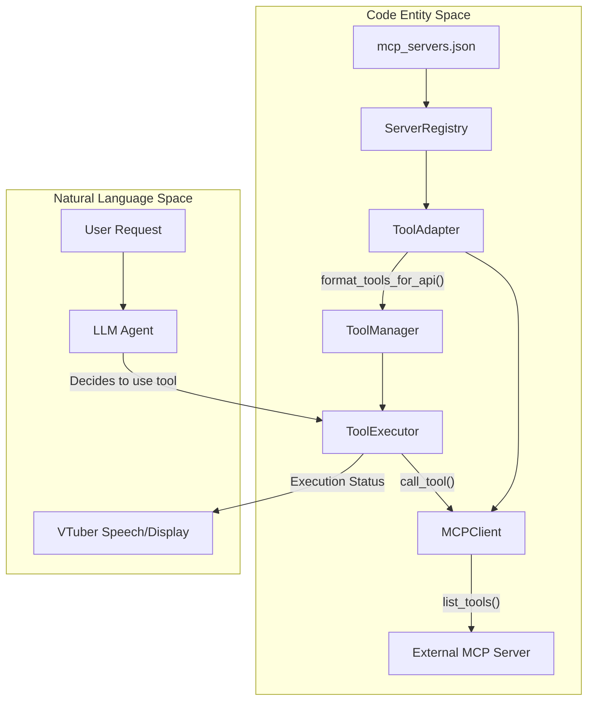
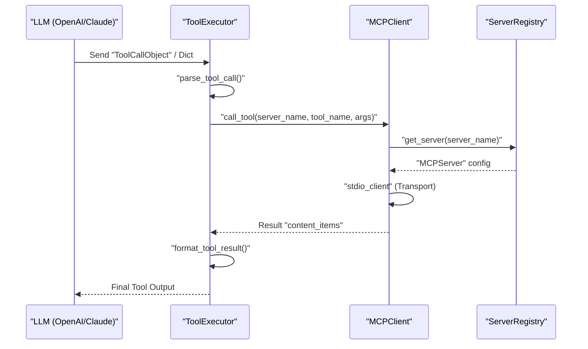

<!-- source: DeepWiki mcp.deepwiki.com · repo Open-LLM-VTuber/Open-LLM-VTuber · page 7 Model Context Protocol (MCP) Integration · fetched 2026-10-30 -->

# Model Context Protocol (MCP) Integration

Relevant source files

The following files were used as context for generating this wiki page:

- [.gitignore](.gitignore)
- [mcp_servers.json](mcp_servers.json)
- [src/open_llm_vtuber/mcpp/mcp_client.py](src/open_llm_vtuber/mcpp/mcp_client.py)
- [src/open_llm_vtuber/mcpp/server_registry.py](src/open_llm_vtuber/mcpp/server_registry.py)
- [src/open_llm_vtuber/mcpp/tool_adapter.py](src/open_llm_vtuber/mcpp/tool_adapter.py)
- [src/open_llm_vtuber/mcpp/tool_executor.py](src/open_llm_vtuber/mcpp/tool_executor.py)
- [src/open_llm_vtuber/mcpp/tool_manager.py](src/open_llm_vtuber/mcpp/tool_manager.py)
- [src/open_llm_vtuber/mcpp/types.py](src/open_llm_vtuber/mcpp/types.py)

The Model Context Protocol (MCP) integration enables the VTuber to interact with external tools and data sources. By implementing the `mcpp` subsystem, the application can dynamically connect to local or remote MCP servers, fetch tool definitions, and allow LLMs (like OpenAI or Claude) to execute functions such as web searches, time retrieval, or local file manipulation.

## Subsystem Architecture

The MCP integration is built on a modular architecture that separates server management, schema translation, and execution logic.

### MCP Component Interaction
This diagram shows how the `mcpp` components interact to transform external MCP server definitions into LLM-compatible tool calls.

**Sources:** [src/open_llm_vtuber/mcpp/server_registry.py:16-41](), [src/open_llm_vtuber/mcpp/tool_adapter.py:11-20](), [src/open_llm_vtuber/mcpp/tool_executor.py:18-25](), [src/open_llm_vtuber/mcpp/mcp_client.py:17-41]()

## Key Components

### Server Registry & Management
The `ServerRegistry` class is responsible for loading server configurations from `mcp_servers.json` [mcp_servers.json:1-12](). It detects available runtimes on the host system, such as `npx`, `uvx`, and `node`, to ensure the configured commands can be executed [src/open_llm_vtuber/mcpp/server_registry.py:37-46](). It maintains a mapping of server names to `MCPServer` dataclasses containing execution parameters like `command`, `args`, and `env` [src/open_llm_vtuber/mcpp/types.py:7-26]().

For details, see [MCP Server Registry & Client](#7.1).

### Tool Adaptation & Schema Translation
Since different LLM providers (OpenAI, Anthropic) require different JSON schemas for tool definitions, the `ToolAdapter` handles the conversion. It fetches raw tool definitions via the `MCPClient` and translates them into `FormattedTool` objects [src/open_llm_vtuber/mcpp/tool_adapter.py:55-62]().

*   **OpenAI Format:** Uses the `type: "function"` structure with a `parameters` field [src/open_llm_vtuber/mcpp/tool_adapter.py:157-164]().
*   **Claude Format:** Uses the `input_schema` structure required by the Anthropic API [src/open_llm_vtuber/mcpp/tool_adapter.py:165-171]().

For details, see [MCP Server Registry & Client](#7.1).

### Tool Execution Flow
The `ToolExecutor` manages the lifecycle of a tool call. It parses the LLM's response (which may be a `ToolCallObject` or a raw dict), invokes the corresponding server via `MCPClient.call_tool`, and yields status updates [src/open_llm_vtuber/mcpp/tool_executor.py:155-160](). It handles multi-modal results, extracting text, images, or data from the MCP server response [src/open_llm_vtuber/mcpp/mcp_client.py:126-150]().

### Tool Execution Data Flow
This diagram maps the internal data structures used during the execution of a tool.

**Sources:** [src/open_llm_vtuber/mcpp/tool_executor.py:27-76](), [src/open_llm_vtuber/mcpp/mcp_client.py:101-155](), [src/open_llm_vtuber/mcpp/types.py:61-77]()

## Data Models
The system uses several dataclasses to maintain type safety across the protocol:

| Class | Purpose | File |
| :--- | :--- | :--- |
| `MCPServer` | Defines command, args, env, and timeout for a server process. | [src/open_llm_vtuber/mcpp/types.py:7-26]() |
| `FormattedTool` | Stores the input schema and its originating server. | [src/open_llm_vtuber/mcpp/types.py:29-42]() |
| `ToolCallObject` | Mimics OpenAI's tool call structure for internal routing. | [src/open_llm_vtuber/mcpp/types.py:61-77]() |
| `ToolManager` | Holds the registry of tools pre-formatted for different LLM APIs. | [src/open_llm_vtuber/mcpp/tool_manager.py:7-30]() |

For details on execution and multi-modal handling, see [Tool Manager & Executor](#7.2).

## Related Pages
- [MCP Server Registry & Client](#7.1) — Deep dive into `mcp_servers.json`, `ServerRegistry` runtime detection, and `MCPClient` stdio transport logic.
- [Tool Manager & Executor](#7.2) — Detailed logic for `ToolManager` tool retrieval and `ToolExecutor` async iterator for execution status.

**Sources:**
- [src/open_llm_vtuber/mcpp/types.py:1-94]()
- [src/open_llm_vtuber/mcpp/tool_manager.py:7-51]()
- [src/open_llm_vtuber/mcpp/tool_executor.py:18-193]()
- [src/open_llm_vtuber/mcpp/mcp_client.py:17-156]()
- [src/open_llm_vtuber/mcpp/server_registry.py:16-104]()
- [src/open_llm_vtuber/mcpp/tool_adapter.py:11-175]()
- [mcp_servers.json:1-12]()

---

