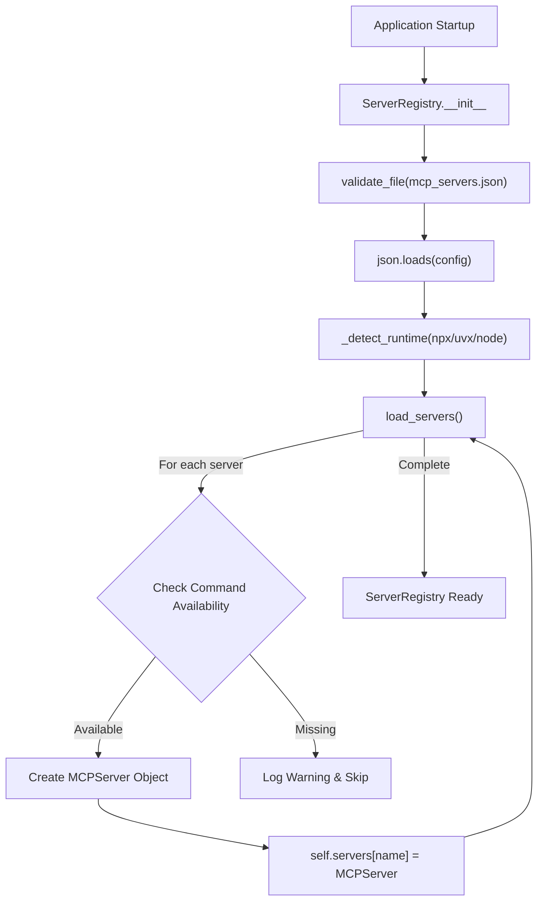
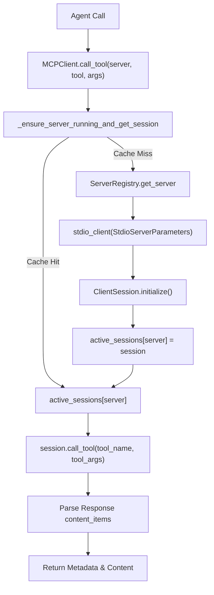

<!-- source: DeepWiki mcp.deepwiki.com · repo Open-LLM-VTuber/Open-LLM-VTuber · page 7.1 MCP Server Registry & Client · fetched 2026-10-30 -->

# MCP Server Registry & Client

<details>
<summary>Relevant source files</summary>

The following files were used as context for generating this wiki page:

- [.gitignore](.gitignore)
- [mcp_servers.json](mcp_servers.json)
- [src/open_llm_vtuber/mcpp/mcp_client.py](src/open_llm_vtuber/mcpp/mcp_client.py)
- [src/open_llm_vtuber/mcpp/server_registry.py](src/open_llm_vtuber/mcpp/server_registry.py)
- [src/open_llm_vtuber/mcpp/tool_adapter.py](src/open_llm_vtuber/mcpp/tool_adapter.py)
- [src/open_llm_vtuber/mcpp/tool_executor.py](src/open_llm_vtuber/mcpp/tool_executor.py)
- [src/open_llm_vtuber/mcpp/tool_manager.py](src/open_llm_vtuber/mcpp/tool_manager.py)
- [src/open_llm_vtuber/mcpp/types.py](src/open_llm_vtuber/mcpp/types.py)
- [src/open_llm_vtuber/mcpp/utils/path.py](src/open_llm_vtuber/mcpp/utils/path.py)

</details>


This page details the Model Context Protocol (MCP) server management within Open-LLM-VTuber. It covers how external tool servers are defined in `mcp_servers.json`, how the `ServerRegistry` detects and manages these servers, the `MCPClient`'s role in establishing stdio transport and session management, the caching of `list_tools` responses, and how `ToolAdapter` translates tool schemas for OpenAI and Claude APIs.

## MCP Server Definition: `mcp_servers.json`

External MCP tool servers are defined in the `mcp_servers.json` file [mcp_servers.json:1-12](). This JSON file specifies the configuration for each server, including the command to execute, arguments, environment variables, and working directory. This allows Open-LLM-VTuber to launch and interact with various external tools that adhere to the MCP specification.

An example `mcp_servers.json` structure:
```json
{
    "mcp_servers": {
      "time": {
        "command": "uvx",
        "args": ["mcp-server-time", "--local-timezone=Asia/Shanghai"]
      },
      "ddg-search": {
        "command": "uvx",
        "args": ["duckduckgo-mcp-server"]
      }
    }
}
```
Each entry under `"mcp_servers"` represents a distinct MCP server.
- `"time"` and `"ddg-search"` are examples of server names.
- `"command"` specifies the executable to run the server (e.g., `uvx`, `npx`, `node`).
- `"args"` is a list of command-line arguments passed to the executable.
- Optional fields include `"env"` for environment variables and `"cwd"` for the working directory [src/open_llm_vtuber/mcpp/types.py:22-23]().

Sources:
- [mcp_servers.json:1-12]()
- [src/open_llm_vtuber/mcpp/types.py:22-23]()

## Server Registry (`ServerRegistry`)

The `ServerRegistry` class [src/open_llm_vtuber/mcpp/server_registry.py:16-17]() is responsible for loading and managing the definitions of MCP servers from `mcp_servers.json`. It performs runtime detection of necessary executables like `npx`, `uvx`, and `node` to ensure that the specified server commands can be executed.

### Initialization and Runtime Detection
Upon initialization, `ServerRegistry` loads the `mcp_servers.json` file [src/open_llm_vtuber/mcpp/server_registry.py:31-33]() and populates its internal `servers` dictionary with `MCPServer` objects [src/open_llm_vtuber/mcpp/server_registry.py:35](). It also detects the availability of `npx`, `uvx`, and `node` using `shutil.which()` [src/open_llm_vtuber/mcpp/server_registry.py:37-39](), [src/open_llm_vtuber/mcpp/server_registry.py:43-46](). If a server's command relies on an unavailable runtime, a warning is logged, and that server is not loaded [src/open_llm_vtuber/mcpp/server_registry.py:63-81]().

### `MCPServer` Data Structure
The `MCPServer` dataclass [src/open_llm_vtuber/mcpp/types.py:7-26]() defines the structure for each server entry:
- `name` (str): The unique name of the server.
- `command` (str): The executable command (e.g., "uvx", "npx").
- `args` (list[str]): Arguments for the command.
- `env` (Optional[dict[str, str]]): Environment variables.
- `cwd` (Optional[str]): Working directory.
- `timeout` (Optional[timedelta]): Timeout for the command, defaults to 30 seconds [src/open_llm_vtuber/mcpp/types.py:24]().
- `description` (str): A brief description of the server.

### Server Management
- `load_servers()`: Reads `mcp_servers.json` and creates `MCPServer` instances [src/open_llm_vtuber/mcpp/server_registry.py:48-91]().
- `get_server(server_name: str)`: Retrieves an `MCPServer` object by its name [src/open_llm_vtuber/mcpp/server_registry.py:101-103]().

Title: ServerRegistry Initialization Flow


Sources:
- [src/open_llm_vtuber/mcpp/server_registry.py:16-17]()
- [src/open_llm_vtuber/mcpp/server_registry.py:31-41]()
- [src/open_llm_vtuber/mcpp/server_registry.py:43-46]()
- [src/open_llm_vtuber/mcpp/server_registry.py:48-91]()
- [src/open_llm_vtuber/mcpp/server_registry.py:101-103]()
- [src/open_llm_vtuber/mcpp/types.py:7-26]()

## MCP Client (`MCPClient`)

The `MCPClient` class [src/open_llm_vtuber/mcpp/mcp_client.py:17-18]() is the primary interface for interacting with external MCP servers. It manages persistent connections, handles stdio transport, and provides methods for listing and calling tools.

### Session Management and Stdio Transport
`MCPClient` uses `AsyncExitStack` [src/open_llm_vtuber/mcpp/mcp_client.py:29]() to manage the lifecycle of server processes and client sessions. When a tool call or `list_tools` request is made for a server, `_ensure_server_running_and_get_session()` [src/open_llm_vtuber/mcpp/mcp_client.py:43-45]() checks if an active session exists in `active_sessions` [src/open_llm_vtuber/mcpp/mcp_client.py:47-48](). If not, it retrieves the `MCPServer` details from `ServerRegistry` [src/open_llm_vtuber/mcpp/mcp_client.py:51-55](), constructs `StdioServerParameters` [src/open_llm_vtuber/mcpp/mcp_client.py:59-61](), and establishes a new `ClientSession` using `mcp.client.stdio.stdio_client` [src/open_llm_vtuber/mcpp/mcp_client.py:64-71](). This `ClientSession` handles the standard I/O (stdin/stdout) communication with the external MCP server process.

### `list_tools` Caching
To optimize performance and avoid redundant calls, `MCPClient` implements a cache for `list_tools` responses in `_list_tools_cache` [src/open_llm_vtuber/mcpp/mcp_client.py:31](). When `list_tools(server_name)` is called, it first checks the cache [src/open_llm_vtuber/mcpp/mcp_client.py:86-88](). If the tools for that server are already cached, they are returned immediately. Otherwise, the client connects to the server, fetches the tools via `session.list_tools()`, and stores them in the cache before returning [src/open_llm_vtuber/mcpp/mcp_client.py:90-99](). The cache is cleared when the client is closed via `aclose()` [src/open_llm_vtuber/mcpp/mcp_client.py:164]().

### `call_tool` Execution
The `call_tool` method [src/open_llm_vtuber/mcpp/mcp_client.py:101-103]() sends a tool execution request to the specified server. It ensures the server is running and a session is active, then calls `session.call_tool()` [src/open_llm_vtuber/mcpp/mcp_client.py:109-111](). The response is parsed into `content_items` (e.g., text, data, mimeType, url) [src/open_llm_vtuber/mcpp/mcp_client.py:126-142](). Error handling captures server-side errors and returns them within the standard structure [src/open_llm_vtuber/mcpp/mcp_client.py:113-124]().

Title: MCPClient Tool Call Flow


Sources:
- [src/open_llm_vtuber/mcpp/mcp_client.py:17-18]()
- [src/open_llm_vtuber/mcpp/mcp_client.py:29-31]()
- [src/open_llm_vtuber/mcpp/mcp_client.py:43-81]()
- [src/open_llm_vtuber/mcpp/mcp_client.py:83-99]()
- [src/open_llm_vtuber/mcpp/mcp_client.py:101-155]()
- [src/open_llm_vtuber/mcpp/mcp_client.py:157-166]()

## Tool Adapter (`ToolAdapter`)

The `ToolAdapter` class [src/open_llm_vtuber/mcpp/tool_adapter.py:11-12]() is responsible for fetching tool information from active MCP servers and translating their schemas into formats compatible with different LLM APIs, specifically OpenAI and Claude.

### Fetching Tool Information
The `get_server_and_tool_info()` method [src/open_llm_vtuber/mcpp/tool_adapter.py:18-20]() takes a list of `enabled_servers` and uses an `MCPClient` instance to call `list_tools()` on each server [src/open_llm_vtuber/mcpp/tool_adapter.py:34-44](). It extracts the tool's `description` and `inputSchema` (parameters and required fields) [src/open_llm_vtuber/mcpp/tool_adapter.py:51-53](). This information is stored in a `FormattedTool` object [src/open_llm_vtuber/mcpp/types.py:29-43]() which includes the `input_schema`, `related_server`, and `description` [src/open_llm_vtuber/mcpp/tool_adapter.py:56-62]().

### Schema Translation for OpenAI and Claude
The `format_tools_for_api()` method [src/open_llm_vtuber/mcpp/tool_adapter.py:137-139]() takes a dictionary of `FormattedTool` objects and converts them into the specific JSON schema formats required by OpenAI and Claude.

#### OpenAI Format
For OpenAI, tools are formatted as a dictionary with `type: "function"`, `function.name`, `function.description`, and `function.parameters` (the JSON schema of the tool's input) [src/open_llm_vtuber/mcpp/tool_adapter.py:160-168]().

#### Claude Format
For Claude, tools are formatted as a dictionary with `name`, `description`, and `input_schema` [src/open_llm_vtuber/mcpp/tool_adapter.py:170-175]().

Sources:
- [src/open_llm_vtuber/mcpp/tool_adapter.py:11-20]()
- [src/open_llm_vtuber/mcpp/tool_adapter.py:34-62]()
- [src/open_llm_vtuber/mcpp/tool_adapter.py:137-175]()
- [src/open_llm_vtuber/mcpp/types.py:29-43]()

## Tool Manager (`ToolManager`)

The `ToolManager` [src/open_llm_vtuber/mcpp/tool_manager.py:7-8]() acts as a runtime registry for the pre-formatted tools generated by the `ToolAdapter`. It stores lists of tools specifically for OpenAI and Claude [src/open_llm_vtuber/mcpp/tool_manager.py:21-26]().

### Key Functions
- `get_tool(tool_name: str)`: Retrieves the raw `FormattedTool` information by name [src/open_llm_vtuber/mcpp/tool_manager.py:32-40]().
- `get_formatted_tools(mode)`: Returns the list of tools formatted for the specified API (`OpenAI` or `Claude`) [src/open_llm_vtuber/mcpp/tool_manager.py:42-51]().

Sources:
- [src/open_llm_vtuber/mcpp/tool_manager.py:7-51]()

---

