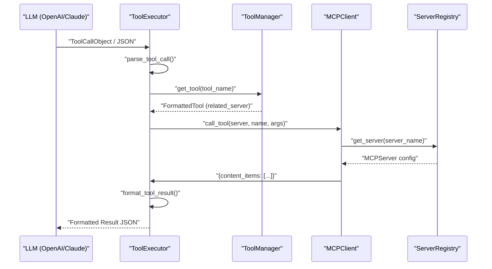
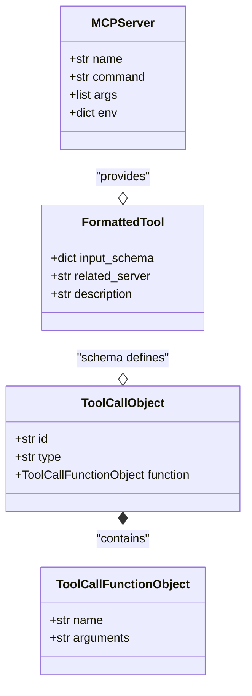

<!-- source: DeepWiki mcp.deepwiki.com · repo Open-LLM-VTuber/Open-LLM-VTuber · page 7.2 Tool Manager & Executor · fetched 2026-10-30 -->

# Tool Manager & Executor

<details>
<summary>Relevant source files</summary>

The following files were used as context for generating this wiki page:

- [.gitignore](.gitignore)
- [mcp_servers.json](mcp_servers.json)
- [src/open_llm_vtuber/mcpp/mcp_client.py](src/open_llm_vtuber/mcpp/mcp_client.py)
- [src/open_llm_vtuber/mcpp/server_registry.py](src/open_llm_vtuber/mcpp/server_registry.py)
- [src/open_llm_vtuber/mcpp/tool_adapter.py](src/open_llm_vtuber/mcpp/tool_adapter.py)
- [src/open_llm_vtuber/mcpp/tool_executor.py](src/open_llm_vtuber/mcpp/tool_executor.py)
- [src/open_llm_vtuber/mcpp/tool_manager.py](src/open_llm_vtuber/mcpp/tool_manager.py)
- [src/open_llm_vtuber/mcpp/types.py](src/open_llm_vtuber/mcpp/types.py)

</details>


The **Tool Manager** and **Tool Executor** components form the runtime layer of the Model Context Protocol (MCP) integration. While the `ServerRegistry` and `MCPClient` handle low-level process management and communication, these components manage the high-level registration of tool schemas and the asynchronous execution flow required for LLM interaction.

## ToolManager

The `ToolManager` serves as a centralized registry for tools that have been pre-formatted into specific schemas required by different LLM providers (e.g., OpenAI's function calling or Anthropic's tool use).

### Key Responsibilities
*   **Schema Storage**: Maintains separate lists of tool definitions for OpenAI and Claude formats `[src/open_llm_vtuber/mcpp/tool_manager.py:21-26]()`.
*   **Runtime Lookup**: Provides access to raw `FormattedTool` objects by name to retrieve metadata like the associated MCP server `[src/open_llm_vtuber/mcpp/tool_manager.py:32-40]()`.
*   **API Mode Switching**: Supplies the correct tool list based on the active LLM's required format (`OpenAI` vs `Claude`) `[src/open_llm_vtuber/mcpp/tool_manager.py:42-51]()`.

### Tool Registry Structure
The manager holds data in the `FormattedTool` structure:

| Field | Type | Description |
| :--- | :--- | :--- |
| `input_schema` | `dict` | The JSON schema for tool arguments. |
| `related_server`| `str` | The name of the MCP server providing this tool. |
| `description` | `str` | Human-readable description for the LLM. |

**Sources:** `[src/open_llm_vtuber/mcpp/tool_manager.py:7-51]()`, `[src/open_llm_vtuber/mcpp/types.py:29-42]()`

---

## ToolExecutor

The `ToolExecutor` is responsible for the lifecycle of a tool call, from parsing the LLM's output to executing the logic via the `MCPClient` and returning a formatted result.

### Execution Flow
1.  **Parsing**: Converts various tool call formats (OpenAI `ToolCallObject` or raw dictionaries) into a unified internal format `[src/open_llm_vtuber/mcpp/tool_executor.py:27-76]()`.
2.  **Execution**: Calls the `MCPClient.call_tool` method asynchronously `[src/open_llm_vtuber/mcpp/tool_executor.py:215-217]()`.
3.  **Status Updates**: Yields status updates (running, completed, error) to allow the frontend or conversation manager to track progress `[src/open_llm_vtuber/mcpp/tool_executor.py:180-192]()`.
4.  **Result Formatting**: Wraps the tool output back into the provider-specific format (OpenAI `tool` role or Claude `tool_result` type) `[src/open_llm_vtuber/mcpp/tool_executor.py:78-122]()`.

### Tool Execution Sequence
This diagram shows how a tool call moves from the LLM's response through the executor to the MCP server.

**LLM Tool Call to Code Execution**

**Sources:** `[src/open_llm_vtuber/mcpp/tool_executor.py:155-240]()`, `[src/open_llm_vtuber/mcpp/mcp_client.py:101-155]()`

---

## Data Structures

The system uses several specialized dataclasses to bridge the gap between "Natural Language Space" (LLM prompts) and "Code Entity Space" (Python objects).

### Mapping Data Structures


### Multi-modal Content Items
When a tool returns data, the `MCPClient` and `ToolExecutor` process it into a list of `content_items`. This allows tools to return more than just text, such as images or structured data.

*   **Text Items**: `{"type": "text", "text": "..."}`
*   **Image Items**: `{"type": "image", "data": "base64...", "mimeType": "image/png"}`
*   **Error Items**: `{"type": "error", "text": "..."}`
*   **Additional Metadata**: Support for `url` and `altText` for specific media types `[src/open_llm_vtuber/mcpp/mcp_client.py:134-142]()`.

**Sources:** `[src/open_llm_vtuber/mcpp/types.py:6-76]()`, `[src/open_llm_vtuber/mcpp/mcp_client.py:126-150]()`

---

## Prompt Mode (Fallback)

For LLMs that do not natively support function calling (stateless local models or older APIs), the system supports **Prompt Mode**.

1.  **Prompt Injection**: The `mcp_prompt.txt` (referenced in configuration) is used to instruct the LLM to output a specific JSON structure.
2.  **Detection**: The `StreamJSONDetector` (used in the Agent layer) identifies these JSON blocks in the text stream.
3.  **Parsing**: `ToolExecutor.process_tool_from_prompt_json` converts these custom JSON blocks into the standard tool call format used by the rest of the pipeline `[src/open_llm_vtuber/mcpp/tool_executor.py:124-153]()`.

### Prompt Mode JSON Processing
The `ToolExecutor` iterates through detected JSON items and validates the presence of `mcp_server`, `tool`, and `arguments` fields before creating an internal tool call structure `[src/open_llm_vtuber/mcpp/tool_executor.py:129-143]()`.

### Prompt Mode JSON Format
```json
{
    "mcp_server": "time",
    "tool": "get_current_time",
    "arguments": "{\"timezone\": \"Asia/Shanghai\"}"
}
```

**Sources:** `[src/open_llm_vtuber/mcpp/tool_executor.py:124-153]()`, `[mcp_servers.json:1-13]()`

---

