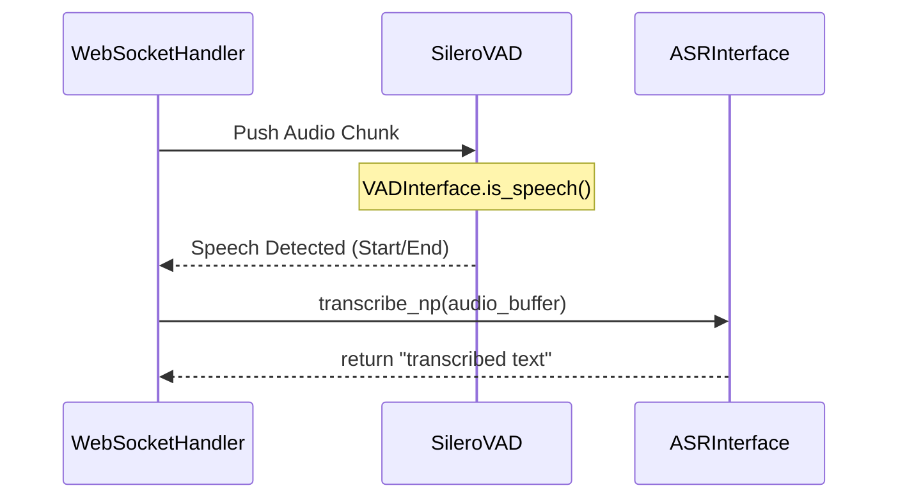

<!-- source: DeepWiki mcp.deepwiki.com · repo Open-LLM-VTuber/Open-LLM-VTuber · page 8 ASR (Automatic Speech Recognition) · fetched 2026-10-30 -->

# ASR (Automatic Speech Recognition)

<details>
<summary>Relevant source files</summary>

The following files were used as context for generating this wiki page:

- [src/open_llm_vtuber/asr/asr_factory.py](src/open_llm_vtuber/asr/asr_factory.py)
- [src/open_llm_vtuber/asr/asr_interface.py](src/open_llm_vtuber/asr/asr_interface.py)
- [src/open_llm_vtuber/asr/faster_whisper_asr.py](src/open_llm_vtuber/asr/faster_whisper_asr.py)
- [src/open_llm_vtuber/asr/fun_asr.py](src/open_llm_vtuber/asr/fun_asr.py)
- [src/open_llm_vtuber/asr/groq_whisper_asr.py](src/open_llm_vtuber/asr/groq_whisper_asr.py)
- [src/open_llm_vtuber/asr/whisper_cpp_asr.py](src/open_llm_vtuber/asr/whisper_cpp_asr.py)

</details>


The Automatic Speech Recognition (ASR) subsystem is responsible for converting user audio input into text. It acts as the primary entry point for the VTuber's perception, transforming raw PCM audio data into strings that can be processed by the LLM agent. The system supports a wide variety of backends, ranging from local ONNX-based models to high-performance cloud APIs.

## Architecture Overview

The ASR system is built on a provider-agnostic architecture using the Factory pattern. All ASR engines must implement a common interface, ensuring that the rest of the application (such as the conversation pipeline) can interact with any speech-to-text provider without knowing its internal implementation.

### ASR System Components

| Component | Role |
| :--- | :--- |
| `ASRInterface` | Abstract base class defining the contract for all ASR engines. |
| `ASRFactory` | Responsible for instantiating the correct ASR engine based on the user's configuration. |
| `ASRConfig` | Pydantic models that validate and provide documentation for backend-specific settings. |

### Data Flow and Entity Mapping

The following diagram illustrates how audio data flows from the WebSocket through the ASR subsystem and into the LLM space.

**ASR Logic and Entity Mapping**
```mermaid
graph TD
    subgraph "Natural Language Space (User Audio)"
        UserVoice["User Audio (PCM/WAV)"]
    end

    subgraph "Code Entity Space (ASR Subsystem)"
        WS["WebSocketHandler"] -- "audio data" --> SC["ServiceContext"]
        SC -- "calls" --> Factory["ASRFactory"]
        Factory -- "initializes" --> Interface["ASRInterface"]
        
        subgraph "Engines"
            Interface <|-- FW["VoiceRecognition (faster_whisper_asr.py)"]
            Interface <|-- GW["VoiceRecognition (groq_whisper_asr.py)"]
            Interface <|-- FA["VoiceRecognition (fun_asr.py)"]
            Interface <|-- WC["VoiceRecognition (whisper_cpp_asr.py)"]
        end
        
        Interface -- "transcribe_np()" --> Text["Transcription String"]
    end

    subgraph "LLM Space"
        Text --> Agent["AgentInterface (LLM)"]
    end
```
**Sources:** [src/open_llm_vtuber/asr/asr_interface.py:6-34](), [src/open_llm_vtuber/asr/asr_factory.py:5-63](), [src/open_llm_vtuber/asr/faster_whisper_asr.py:6-27]()

## The ASRInterface

The `ASRInterface` defines the standard expectations for any speech-to-text engine in the project. It mandates specific audio properties for compatibility across different backends.

*   **`SAMPLE_RATE`**: Hardcoded to `16000` Hz [src/open_llm_vtuber/asr/asr_interface.py:7]().
*   **`NUM_CHANNELS`**: Set to `1` (Mono) [src/open_llm_vtuber/asr/asr_interface.py:8]().
*   **`transcribe_np(audio: np.ndarray)`**: The core abstract method that takes a NumPy array of audio data and returns a string [src/open_llm_vtuber/asr/asr_interface.py:28-34]().
*   **`async_transcribe_np(audio: np.ndarray)`**: An asynchronous wrapper that ensures audio is `float32` and runs the transcription in a separate thread using `asyncio.to_thread` to avoid blocking the event loop [src/open_llm_vtuber/asr/asr_interface.py:11-25]().

**Sources:** [src/open_llm_vtuber/asr/asr_interface.py:1-58]()

## Supported Backends

The `ASRFactory` handles the instantiation of various backends based on the `system_name` provided in the configuration [src/open_llm_vtuber/asr/asr_factory.py:7-62]().

### Local ASR Engines
Local engines are preferred for privacy and low latency in environments with capable hardware.
*   **Faster-Whisper**: Optimized implementation using `WhisperModel` with support for `beam_size` and `compute_type` (e.g., `int8`) [src/open_llm_vtuber/asr/faster_whisper_asr.py:10-27]().
*   **FunASR**: Utilizes Alibaba's `AutoModel`. It supports `SenseVoiceSmall` and includes logic to strip specialized tags (like `<|zh|>`) from the output text [src/open_llm_vtuber/asr/fun_asr.py:40-124]().
*   **Whisper.cpp**: Uses `pywhispercpp.model.Model` for high-performance C++ based inference [src/open_llm_vtuber/asr/whisper_cpp_asr.py:8-24]().
*   **Sherpa-ONNX**: ONNX-based runtime for various ASR architectures [src/open_llm_vtuber/asr/asr_factory.py:57-60]().

For implementation details and configuration for these engines, see **[Local ASR Engines (#8.1)]**.

### Cloud ASR Engines
Cloud engines offer high accuracy and offload the computational burden.
*   **Groq Whisper**: Extremely low-latency transcription. The implementation converts NumPy arrays to in-memory WAV files using `io.BytesIO` before sending them to the Groq API [src/open_llm_vtuber/asr/groq_whisper_asr.py:20-56]().
*   **Azure ASR**: Microsoft's speech service supporting multi-language identification [src/open_llm_vtuber/asr/asr_factory.py:41-48]().
*   **OpenAI Whisper**: Standard API-based Whisper transcription [src/open_llm_vtuber/asr/asr_factory.py:23-26]().

For API setup and cloud-specific features, see **[Cloud ASR Engines & VAD (#8.2)]**.

## Voice Activity Detection (VAD)

Before audio is sent to an ASR engine, it is processed by a VAD engine to ensure that only segments containing human speech are transcribed. This prevents the LLM from responding to background noise and saves cloud API costs.

The system primarily uses **Silero VAD**, which is managed via `VADFactory`.

**ASR and VAD Interaction**


For VAD configuration (thresholds, hits, and misses), see **[Cloud ASR Engines & VAD (#8.2)]**.

**Sources:** [src/open_llm_vtuber/asr/asr_interface.py:1-58](), [src/open_llm_vtuber/asr/asr_factory.py:5-63](), [src/open_llm_vtuber/asr/fun_asr.py:39-72](), [src/open_llm_vtuber/asr/groq_whisper_asr.py:9-56]()

---

