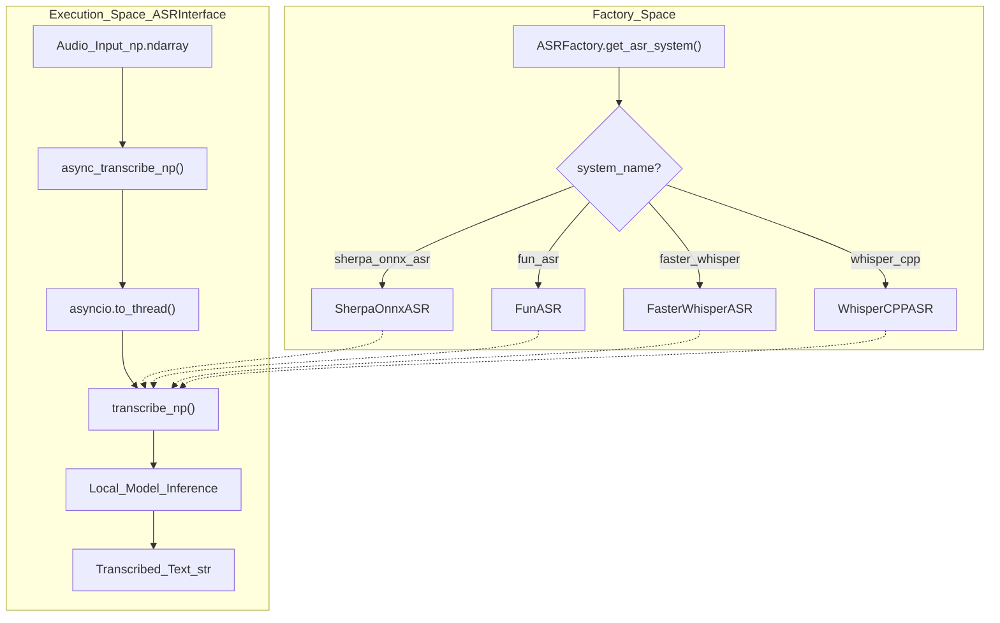
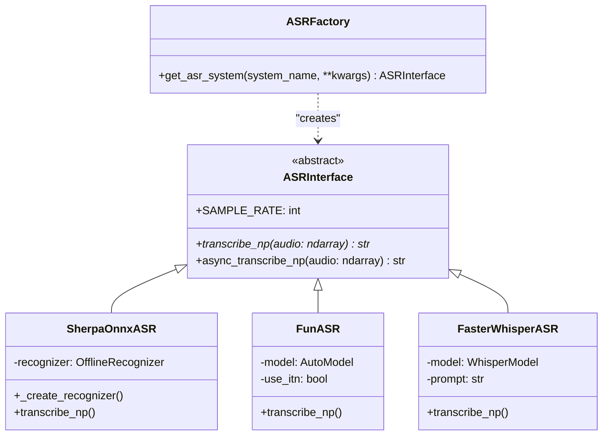

<!-- source: DeepWiki mcp.deepwiki.com · repo Open-LLM-VTuber/Open-LLM-VTuber · page 8.1 Local ASR Engines · fetched 2026-10-30 -->

# Local ASR Engines

Relevant source files

The following files were used as context for generating this wiki page:

- [doc/sample_conf/sherpaASRTTS_sense_voice_melo.yaml](doc/sample_conf/sherpaASRTTS_sense_voice_melo.yaml)
- [doc/sample_conf/sherpaASRTTS_sense_voice_piper_en.yaml](doc/sample_conf/sherpaASRTTS_sense_voice_piper_en.yaml)
- [doc/sample_conf/sherpaASRTTS_sense_voice_vits_zh.yaml](doc/sample_conf/sherpaASRTTS_sense_voice_vits_zh.yaml)
- [doc/sample_conf/sherpaASR_paraformer.yaml](doc/sample_conf/sherpaASR_paraformer.yaml)
- [doc/sample_conf/sherpaASR_sense_voice.yaml](doc/sample_conf/sherpaASR_sense_voice.yaml)
- [src/open_llm_vtuber/asr/asr_factory.py](src/open_llm_vtuber/asr/asr_factory.py)
- [src/open_llm_vtuber/asr/asr_interface.py](src/open_llm_vtuber/asr/asr_interface.py)
- [src/open_llm_vtuber/asr/faster_whisper_asr.py](src/open_llm_vtuber/asr/faster_whisper_asr.py)
- [src/open_llm_vtuber/asr/fun_asr.py](src/open_llm_vtuber/asr/fun_asr.py)
- [src/open_llm_vtuber/asr/groq_whisper_asr.py](src/open_llm_vtuber/asr/groq_whisper_asr.py)
- [src/open_llm_vtuber/asr/sherpa_onnx_asr.py](src/open_llm_vtuber/asr/sherpa_onnx_asr.py)
- [src/open_llm_vtuber/asr/utils.py](src/open_llm_vtuber/asr/utils.py)
- [src/open_llm_vtuber/asr/whisper_cpp_asr.py](src/open_llm_vtuber/asr/whisper_cpp_asr.py)

The Automatic Speech Recognition (ASR) subsystem in Open-LLM-VTuber provides a unified interface for converting user speech into text. Local engines are prioritized for low-latency interactions and privacy, allowing the VTuber to process audio without relying on external cloud APIs.

## ASR Interface Contract

All ASR engines must implement the `ASRInterface` abstract base class. This ensures consistency across different backends and allows the `ASRFactory` to swap implementations seamlessly based on configuration.

### Key Specifications
- **Sample Rate**: All local engines are standardized to **16000 Hz** [src/open_llm_vtuber/asr/asr_interface.py:7-7]().
- **Audio Format**: Engines receive audio as `numpy.ndarray` (typically `float32`).
- **Core Methods**:
    - `transcribe_np(audio: np.ndarray) -> str`: Synchronous transcription [src/open_llm_vtuber/asr/asr_interface.py:28-33]().
    - `async_transcribe_np(audio: np.ndarray) -> str`: Asynchronous wrapper that runs the transcription in a separate thread to avoid blocking the event loop using `asyncio.to_thread` [src/open_llm_vtuber/asr/asr_interface.py:11-25]().

### Data Flow: From Audio to Text
The following diagram illustrates how the `ASRFactory` produces an engine and how audio data flows through the `ASRInterface`.

**ASR Initialization and Execution Flow**

**Sources**: [src/open_llm_vtuber/asr/asr_factory.py:5-62](), [src/open_llm_vtuber/asr/asr_interface.py:6-34]().

---

## Supported Local Engines

### 1. Sherpa-ONNX ASR
The `SherpaOnnxASR` implementation leverages the `sherpa-onnx` framework, supporting multiple architectures including Transducer, Paraformer, and SenseVoice via the ONNX runtime.

- **Implementation**: `VoiceRecognition` class in `sherpa_onnx_asr.py` [src/open_llm_vtuber/asr/sherpa_onnx_asr.py:10-10]().
- **Capabilities**:
    - Supports `transducer`, `paraformer`, `nemo_ctc`, `wenet_ctc`, `whisper`, `tdnn_ctc`, `sense_voice`, and `fire_red_asr` model types [src/open_llm_vtuber/asr/sherpa_onnx_asr.py:13-25]().
    - Hardware Acceleration: Detects `CUDAExecutionProvider` via `onnxruntime` and falls back to `cpu` if unavailable [src/open_llm_vtuber/asr/sherpa_onnx_asr.py:75-84]().
    - Features: Support for hotwords, ITN (Inverse Text Normalization), and custom decoding methods (greedy vs beam search) [src/open_llm_vtuber/asr/sherpa_onnx_asr.py:27-40]().

**Sources**: [src/open_llm_vtuber/asr/sherpa_onnx_asr.py:89-155](), [doc/sample_conf/sherpaASR_sense_voice.yaml:18-53]().

### 2. FunASR (SenseVoice)
`FunASR` focuses on Alibaba's SenseVoiceSmall and Paraformer models. It includes robust handling for multilingual support and automatic tag stripping.

- **Implementation**: `VoiceRecognition` class in `fun_asr.py` [src/open_llm_vtuber/asr/fun_asr.py:39-39]().
- **Key Features**:
    - **Model Management**: Uses `MODEL_ALIAS_TO_FULL_ID_MAP` to map aliases to ModelScope IDs and handles local cache detection via `snapshot_download` [src/open_llm_vtuber/asr/fun_asr.py:21-32](), [src/open_llm_vtuber/asr/fun_asr.py:74-101]().
    - **Post-processing**: Specifically strips emotional/event tags (e.g., `<|NEUTRAL|>`, `<|Speech|>`) often generated by SenseVoice models using `re.sub` [src/open_llm_vtuber/asr/fun_asr.py:115-124]().
    - **ITN**: Optional Inverse Text Normalization for cleaner numeric output during `model.generate` [src/open_llm_vtuber/asr/fun_asr.py:109-109]().

**Sources**: [src/open_llm_vtuber/asr/fun_asr.py:60-72]().

### 3. Faster-Whisper
A high-performance implementation of OpenAI's Whisper model using CTranslate2.

- **Implementation**: `VoiceRecognition` class in `faster_whisper_asr.py` [src/open_llm_vtuber/asr/faster_whisper_asr.py:6-6]().
- **Optimization**: Supports various compute types (e.g., `int8`, `float16`) for balanced speed and accuracy via `WhisperModel` [src/open_llm_vtuber/asr/faster_whisper_asr.py:16-16](), [src/open_llm_vtuber/asr/faster_whisper_asr.py:22-27]().
- **Context**: Allows passing an `initial_prompt` to improve transcription of specific terminology or VTuber names [src/open_llm_vtuber/asr/faster_whisper_asr.py:30-37]().

**Sources**: [src/open_llm_vtuber/asr/faster_whisper_asr.py:10-27]().

### 4. Whisper.cpp
A C++ port of Whisper, utilized via the `pywhispercpp` bindings.

- **Implementation**: `VoiceRecognition` class in `whisper_cpp_asr.py` [src/open_llm_vtuber/asr/whisper_cpp_asr.py:8-8]().
- **Usage**: Loads GGUF/bin models from a local directory (defaulting to `asr/models`) [src/open_llm_vtuber/asr/whisper_cpp_asr.py:12-24]().

**Sources**: [src/open_llm_vtuber/asr/whisper_cpp_asr.py:27-37]().

---

## Engine Configuration and Mapping

The `ASRFactory` maps configuration strings to the corresponding implementation classes.

| System Name | Implementation Class | Primary Library |
| :--- | :--- | :--- |
| `sherpa_onnx_asr` | `SherpaOnnxASR` | `sherpa-onnx` |
| `fun_asr` | `FunASR` | `funasr` |
| `faster_whisper` | `FasterWhisperASR` | `faster-whisper` |
| `whisper_cpp` | `WhisperCPPASR` | `pywhispercpp` |

**Code Entity Mapping Diagram**

**Sources**: [src/open_llm_vtuber/asr/asr_factory.py:7-60](), [src/open_llm_vtuber/asr/asr_interface.py:6-10]().

## Model Utilities

The `utils.py` module provides helper functions for managing local model files, specifically for Sherpa-ONNX which often requires manual downloads or extraction.

- `download_and_extract(url, output_dir)`: Downloads `.tar.bz2` archives from URLs (like GitHub Releases) and extracts them to the local models folder [src/open_llm_vtuber/asr/utils.py:51-118]().
- `check_and_extract_local_file(url, output_dir)`: Checks if a model archive already exists locally before attempting a download, preventing redundant network traffic [src/open_llm_vtuber/asr/utils.py:121-161]().
- `get_github_asset_url(owner, repo, release_tag, filename_without_ext)`: Fetches the download URL of a GitHub release asset by its filename [src/open_llm_vtuber/asr/utils.py:9-48]().

**Sources**: [src/open_llm_vtuber/asr/utils.py:9-161]().

---

