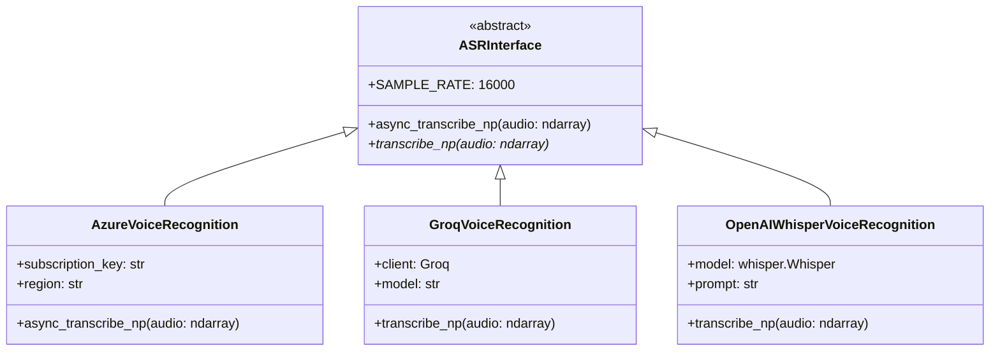
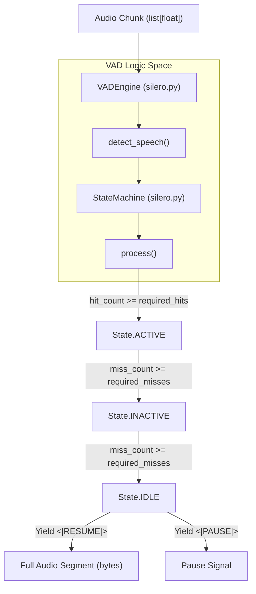

<!-- source: DeepWiki mcp.deepwiki.com · repo Open-LLM-VTuber/Open-LLM-VTuber · page 8.2 Cloud ASR Engines & VAD · fetched 2026-10-30 -->

# Cloud ASR Engines & VAD

Relevant source files

The following files were used as context for generating this wiki page:

- [prompts/utils/concise_style_prompt.txt](prompts/utils/concise_style_prompt.txt)
- [src/open_llm_vtuber/asr/asr_interface.py](src/open_llm_vtuber/asr/asr_interface.py)
- [src/open_llm_vtuber/asr/azure_asr.py](src/open_llm_vtuber/asr/azure_asr.py)
- [src/open_llm_vtuber/asr/fun_asr.py](src/open_llm_vtuber/asr/fun_asr.py)
- [src/open_llm_vtuber/asr/groq_whisper_asr.py](src/open_llm_vtuber/asr/groq_whisper_asr.py)
- [src/open_llm_vtuber/asr/openai_whisper_asr.py](src/open_llm_vtuber/asr/openai_whisper_asr.py)
- [src/open_llm_vtuber/config_manager/asr.py](src/open_llm_vtuber/config_manager/asr.py)
- [src/open_llm_vtuber/config_manager/i18n.py](src/open_llm_vtuber/config_manager/i18n.py)
- [src/open_llm_vtuber/config_manager/vad.py](src/open_llm_vtuber/config_manager/vad.py)
- [src/open_llm_vtuber/tts/siliconflow_tts.py](src/open_llm_vtuber/tts/siliconflow_tts.py)
- [src/open_llm_vtuber/vad/silero.py](src/open_llm_vtuber/vad/silero.py)
- [src/open_llm_vtuber/vad/vad_factory.py](src/open_llm_vtuber/vad/vad_factory.py)
- [src/open_llm_vtuber/vad/vad_interface.py](src/open_llm_vtuber/vad/vad_interface.py)

This section details the cloud-based Automatic Speech Recognition (ASR) implementations and the Voice Activity Detection (VAD) system used to process user voice input. The project utilizes a modular interface for ASR and a state-machine-based VAD to handle real-time audio streaming.

## Cloud ASR Engines

Cloud ASR engines implement the `ASRInterface` [src/open_llm_vtuber/asr/asr_interface.py:6-9](), providing remote transcription capabilities. These engines typically require API keys and network connectivity but offer high accuracy and multi-language support. All implementations are expected to handle audio at a `SAMPLE_RATE` of 16000Hz [src/open_llm_vtuber/asr/asr_interface.py:7-7]().

### Azure ASR
The `VoiceRecognition` class in `azure_asr.py` leverages the Azure Cognitive Services Speech SDK. It supports automatic language detection and asynchronous transcription.

*   **Initialization**: Requires `subscription_key` and `region` [src/open_llm_vtuber/asr/azure_asr.py:22-29]().
*   **Language Detection**: Configures `SpeechServiceConnection_AutoDetectSourceLanguages` with a list of target languages (e.g., `["en-US", "zh-CN"]`) [src/open_llm_vtuber/asr/azure_asr.py:38-41]().
*   **Data Flow**: Audio is written to a temporary `.wav` file in the `cache` directory before being sent to Azure [src/open_llm_vtuber/asr/azure_asr.py:80-86](). The class provides both `async_transcribe_np` and a synchronous wrapper `transcribe_np` [src/open_llm_vtuber/asr/azure_asr.py:67-148]().

### Groq Whisper ASR
The `VoiceRecognition` class in `groq_whisper_asr.py` uses the Groq API for high-speed Whisper-based transcription.

*   **Implementation**: It converts the input `np.ndarray` into a 16-bit PCM WAV format in-memory using `io.BytesIO` [src/open_llm_vtuber/asr/groq_whisper_asr.py:33-42]().
*   **API Call**: Sends the buffer to `client.audio.transcriptions.create` with the specified model (e.g., `whisper-large-v3-turbo`) [src/open_llm_vtuber/asr/groq_whisper_asr.py:47-54]().

### OpenAI Whisper ASR
The OpenAI implementation (locally loaded version) uses the `whisper` library. While often used locally, it follows the same interface.

*   **Transcription**: The `transcribe_np` method calls `self.model.transcribe` [src/open_llm_vtuber/asr/openai_whisper_asr.py:21-27]().
*   **Prompting**: Supports an `initial_prompt` to guide transcription or provide context [src/open_llm_vtuber/asr/openai_whisper_asr.py:22-25]().

### ASR System Architecture
The following diagram illustrates how the `ASRInterface` abstracts different cloud and local providers.

**ASR Cloud Engine Class Structure**

**Sources:** [src/open_llm_vtuber/asr/asr_interface.py:6-34](), [src/open_llm_vtuber/asr/azure_asr.py:14-153](), [src/open_llm_vtuber/asr/openai_whisper_asr.py:6-27]()

---

## Voice Activity Detection (VAD)

The VAD system identifies when a user starts and stops speaking. This is critical for streaming audio via WebSockets to prevent sending silence to the ASR engines.

### Silero VAD Implementation
The project uses `SileroVAD` via the `VADEngine` class [src/open_llm_vtuber/vad/silero.py:24](). It processes audio in windows (typically 512 samples for 16kHz, which is ~0.032s) and uses a state machine to track speech status [src/open_llm_vtuber/vad/silero.py:46-47]().

#### Key Configuration Parameters
The `SileroVADConfig` defines the sensitivity of the detection [src/open_llm_vtuber/config_manager/vad.py:7-16]():
*   `prob_threshold`: The probability (0.0 to 1.0) above which a frame is considered speech [src/open_llm_vtuber/vad/silero.py:38]().
*   `db_threshold`: The minimum decibel level required to trigger detection [src/open_llm_vtuber/vad/silero.py:106-108]().
*   `required_hits`: Number of consecutive speech frames needed to transition to `ACTIVE` (starts transcription) [src/open_llm_vtuber/vad/silero.py:142-146]().
*   `required_misses`: Number of consecutive silence frames needed to transition from `ACTIVE` to `IDLE` (ends transcription) [src/open_llm_vtuber/vad/silero.py:159-161]().

### VAD State Machine
The `StateMachine` class [src/open_llm_vtuber/vad/silero.py:85]() manages three states defined in the `State` Enum [src/open_llm_vtuber/vad/silero.py:79-82]():
1.  **IDLE**: Waiting for speech. Buffers a small amount of "pre-speech" audio in `pre_buffer` to ensure the start of the sentence isn't clipped [src/open_llm_vtuber/vad/silero.py:103, 136]().
2.  **ACTIVE**: User is currently speaking. Audio bytes are collected in `self.bytes` [src/open_llm_vtuber/vad/silero.py:150-151]().
3.  **INACTIVE**: User has likely stopped speaking, but the system waits for `required_misses` to confirm before finalizing the segment [src/open_llm_vtuber/vad/silero.py:163-180]().

**VAD Data Flow & State Transitions**

**Sources:** [src/open_llm_vtuber/vad/silero.py:79-188](), [src/open_llm_vtuber/config_manager/vad.py:7-38]()

---

## Factory & Configuration

### VADFactory
The `VADFactory` instantiates the engine based on the `engine_type` string in the configuration [src/open_llm_vtuber/vad/vad_factory.py:5-21](). It passes the `orig_sr`, `target_sr`, and thresholds from the YAML config to the `SileroVADEngine`.

### Configuration Schema
The configuration is validated using Pydantic in `config_manager/vad.py`. It supports a `vad_model` selection and nested configuration for `silero_vad` [src/open_llm_vtuber/config_manager/vad.py:41-45]().

| Parameter | Type | Default | Description |
| :--- | :--- | :--- | :--- |
| `vad_model` | Literal | `silero_vad` | The VAD backend to use [src/open_llm_vtuber/config_manager/vad.py:44](). |
| `prob_threshold` | float | `0.4` | Probability threshold for Silero [src/open_llm_vtuber/config_manager/vad.py:12](). |
| `db_threshold` | int | `60` | Minimum volume in dB to trigger [src/open_llm_vtuber/config_manager/vad.py:13](). |
| `required_hits` | int | `3` | Frames to start (approx 0.1s) [src/open_llm_vtuber/config_manager/vad.py:14](). |
| `required_misses`| int | `24` | Frames to stop (approx 0.8s) [src/open_llm_vtuber/config_manager/vad.py:15](). |

**Sources:** [src/open_llm_vtuber/vad/vad_factory.py:5-21](), [src/open_llm_vtuber/config_manager/vad.py:41-65](), [src/open_llm_vtuber/config_manager/asr.py:162-181]()

---

