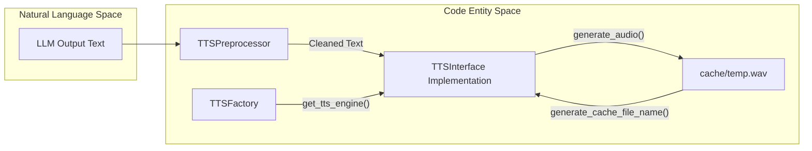

<!-- source: DeepWiki mcp.deepwiki.com · repo Open-LLM-VTuber/Open-LLM-VTuber · page 9 TTS (Text-to-Speech) · fetched 2026-10-30 -->

# TTS (Text-to-Speech)

<details>
<summary>Relevant source files</summary>

The following files were used as context for generating this wiki page:

- [src/open_llm_vtuber/config_manager/tts.py](src/open_llm_vtuber/config_manager/tts.py)
- [src/open_llm_vtuber/tts/cartesia_tts.py](src/open_llm_vtuber/tts/cartesia_tts.py)
- [src/open_llm_vtuber/tts/elevenlabs_tts.py](src/open_llm_vtuber/tts/elevenlabs_tts.py)
- [src/open_llm_vtuber/tts/minimax_tts.py](src/open_llm_vtuber/tts/minimax_tts.py)
- [src/open_llm_vtuber/tts/openai_tts.py](src/open_llm_vtuber/tts/openai_tts.py)
- [src/open_llm_vtuber/tts/spark_tts.py](src/open_llm_vtuber/tts/spark_tts.py)
- [src/open_llm_vtuber/tts/tts_factory.py](src/open_llm_vtuber/tts/tts_factory.py)
- [src/open_llm_vtuber/tts/tts_interface.py](src/open_llm_vtuber/tts/tts_interface.py)

</details>


The Text-to-Speech (TTS) subsystem is responsible for converting the LLM's text output into audible speech. It provides a unified interface for a wide variety of backends, ranging from high-quality cloud services to privacy-focused local models.

### TTS Architecture Overview

The TTS system is built around a factory pattern that abstracts the complexities of different providers. The `TTSFactory` instantiates specific engine implementations that all adhere to the `TTSInterface`. This allows the rest of the application to interact with any TTS provider using a consistent set of methods.

#### TTS System Class Relationship
This diagram shows how the `TTSFactory` bridges the configuration space to the specific engine implementations.

```mermaid
classDiagram
    class "TTSInterface" {
        <<abstract>>
        +generate_audio(text, file_name) str
        +async_generate_audio(text, file_name) str
        +remove_file(filepath) void
        +generate_cache_file_name(file_name, ext) str
    }
    class "TTSFactory" {
        +get_tts_engine(engine_type, **kwargs) TTSInterface
    }
    class "TTSEngine_ElevenLabs" {
        +client ElevenLabs
        +generate_audio(text) str
    }
    class "TTSEngine_Cartesia" {
        +client Cartesia
        +generate_audio(text) str
    }
    class "TTSEngine_OpenAI" {
        +client OpenAI
        +generate_audio(text) str
    }

    "TTSFactory" ..> "TTSInterface" : "creates"
    "TTSInterface" <|-- "TTSEngine_ElevenLabs"
    "TTSInterface" <|-- "TTSEngine_Cartesia"
    "TTSInterface" <|-- "TTSEngine_OpenAI"
```
**Sources:** [src/open_llm_vtuber/tts/tts_interface.py:8-60](), [src/open_llm_vtuber/tts/tts_factory.py:5-170]()

---

### TTS Interface and Factory

The `TTSInterface` defines the contract for all TTS engines. It requires the implementation of `generate_audio` and provides a default `async_generate_audio` wrapper using `asyncio.to_thread` for engines that do not natively support asynchronous operations.

The `TTSFactory` uses a "lazy import" pattern. It only imports the necessary dependencies for a specific engine when `get_tts_engine` is called, which significantly reduces the initial memory footprint and startup time of the server.

| Method | Description |
| :--- | :--- |
| `generate_audio` | Synchronously generates an audio file (usually WAV or MP3) from text. [src/open_llm_vtuber/tts/tts_interface.py:28-39]() |
| `async_generate_audio` | Asynchronous version of audio generation. [src/open_llm_vtuber/tts/tts_interface.py:9-25]() |
| `remove_file` | Utility to clean up temporary audio files from the `cache/` directory. [src/open_llm_vtuber/tts/tts_interface.py:42-59]() |
| `generate_cache_file_name` | Standardizes the naming convention for temporary audio files. [src/open_llm_vtuber/tts/tts_interface.py:61-81]() |

**Sources:** [src/open_llm_vtuber/tts/tts_interface.py:8-81](), [src/open_llm_vtuber/tts/tts_factory.py:7-170]()

---

### Cloud TTS Engines

Cloud-based engines offer high-quality synthesis and often support advanced features like emotional prosody and low-latency streaming. Supported providers include:

*   **ElevenLabs:** High-fidelity synthesis with `stability` and `similarity_boost` controls. [src/open_llm_vtuber/tts/elevenlabs_tts.py:11-131]()
*   **Cartesia:** Ultra-low latency "Sonic" models with emotional guidance via `CartesiaEmotions`. [src/open_llm_vtuber/tts/cartesia_tts.py:42-153]()
*   **OpenAI TTS:** Supports standard OpenAI voices and compatible local servers (e.g., Kokoro). [src/open_llm_vtuber/tts/openai_tts.py:16-118]()
*   **Edge TTS:** A free, high-quality alternative using Microsoft Edge's online synthesis. [src/open_llm_vtuber/tts/tts_factory.py:22-25]()
*   **Specialized APIs:** Minimax, SiliconFlow, Fish Audio, and SparkTTS. [src/open_llm_vtuber/tts/tts_factory.py:91-133]()

For configuration details and specific provider features, see [Cloud TTS Engines](#9.1).

**Sources:** [src/open_llm_vtuber/tts/elevenlabs_tts.py:11-131](), [src/open_llm_vtuber/tts/cartesia_tts.py:42-153](), [src/open_llm_vtuber/tts/openai_tts.py:16-118](), [src/open_llm_vtuber/tts/minimax_tts.py:7-89]()

---

### Local & Specialized TTS Engines

Local engines allow the VTuber to run entirely offline or on private infrastructure. These engines often support voice cloning and fine-grained control over the synthesis process.

*   **GPT-SoVITS & CosyVoice2:** Powerful few-shot voice cloning models. [src/open_llm_vtuber/tts/tts_factory.py:44-59](), [src/open_llm_vtuber/tts/tts_factory.py:77-90]()
*   **Sherpa-ONNX:** Highly optimized engines for CPU-based inference. [src/open_llm_vtuber/tts/tts_factory.py:134-137]()
*   **MeloTTS & Piper:** Fast, high-quality local synthesis. [src/open_llm_vtuber/tts/tts_factory.py:60-68]()
*   **Legacy/Utility:** `pyttsx3` for system-native TTS and `Bark` for experimental generative audio. [src/open_llm_vtuber/tts/tts_factory.py:18-21](), [src/open_llm_vtuber/tts/tts_factory.py:26-29]()

For implementation details and local setup guides, see [Local & Specialized TTS Engines](#9.2).

**Sources:** [src/open_llm_vtuber/tts/tts_factory.py:77-113](), [src/open_llm_vtuber/tts/tts_factory.py:134-137](), [src/open_llm_vtuber/config_manager/tts.py:235-242]()

---

### TTS Preprocessor

Before text is sent to the TTS engine, it passes through the `TTSPreprocessor`. This component cleans the LLM's raw output by removing artifacts that shouldn't be spoken, such as:
*   Special characters and emojis.
*   Text inside brackets or parentheses (often used for internal "thought" descriptions).
*   Code blocks or markdown syntax.

For details on cleaning rules and configuration, see [TTS Preprocessor](#9.3).

---

### Data Flow: From Text to Audio

This diagram illustrates how a string of text from the LLM is processed into a playable audio file path.



**Sources:** [src/open_llm_vtuber/tts/tts_interface.py:28-39](), [src/open_llm_vtuber/tts/tts_factory.py:5-10](), [src/open_llm_vtuber/tts/tts_interface.py:61-81]()

---

