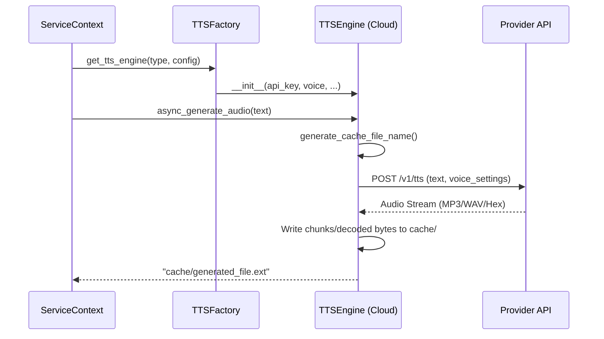

<!-- source: DeepWiki mcp.deepwiki.com · repo Open-LLM-VTuber/Open-LLM-VTuber · page 9.1 Cloud TTS Engines · fetched 2026-10-30 -->

# Cloud TTS Engines

<details>
<summary>Relevant source files</summary>

The following files were used as context for generating this wiki page:

- [src/open_llm_vtuber/config_manager/tts.py](src/open_llm_vtuber/config_manager/tts.py)
- [src/open_llm_vtuber/translate/deeplx.py](src/open_llm_vtuber/translate/deeplx.py)
- [src/open_llm_vtuber/tts/bark_tts.py](src/open_llm_vtuber/tts/bark_tts.py)
- [src/open_llm_vtuber/tts/cartesia_tts.py](src/open_llm_vtuber/tts/cartesia_tts.py)
- [src/open_llm_vtuber/tts/edge_tts.py](src/open_llm_vtuber/tts/edge_tts.py)
- [src/open_llm_vtuber/tts/elevenlabs_tts.py](src/open_llm_vtuber/tts/elevenlabs_tts.py)
- [src/open_llm_vtuber/tts/minimax_tts.py](src/open_llm_vtuber/tts/minimax_tts.py)
- [src/open_llm_vtuber/tts/openai_tts.py](src/open_llm_vtuber/tts/openai_tts.py)
- [src/open_llm_vtuber/tts/pyttsx3_tts.py](src/open_llm_vtuber/tts/pyttsx3_tts.py)
- [src/open_llm_vtuber/tts/spark_tts.py](src/open_llm_vtuber/tts/spark_tts.py)
- [src/open_llm_vtuber/tts/tts_factory.py](src/open_llm_vtuber/tts/tts_factory.py)

</details>


The Cloud TTS subsystem provides integration with various third-party Text-to-Speech providers. These engines typically offer high-quality, multilingual synthesis with minimal local resource usage, requiring an active internet connection and API credentials.

## TTSInterface Contract

All TTS engines, including cloud-based ones, must implement the `TTSInterface` abstract base class. This ensures a consistent internal API for the `TTSTaskManager` and `ServiceContext`.

### Key Methods
*   `generate_audio(text, file_name_no_ext)`: Synchronously generates an audio file and returns the path. [src/open_llm_vtuber/tts/tts_interface.py:27-40]()
*   `async_generate_audio(text, file_name_no_ext)`: Asynchronous wrapper. By default, it runs the synchronous method in a separate thread using `asyncio.to_thread`. [src/open_llm_vtuber/tts/tts_interface.py:9-25]()
*   `remove_file(filepath)`: Utility to clean up synthesized audio from the `cache/` directory. [src/open_llm_vtuber/tts/tts_interface.py:42-59]()
*   `generate_cache_file_name(...)`: Standardizes file naming and ensures the `cache/` directory exists. [src/open_llm_vtuber/tts/tts_interface.py:61-81]()

**Sources:**
- `src/open_llm_vtuber/tts/tts_interface.py`

## Architecture and Data Flow

The `TTSFactory` is responsible for instantiating the correct cloud engine based on the `engine_type` provided in the configuration.

### TTS Engine Resolution Diagram
This diagram maps the configuration keys to their respective implementation classes.

Title: Cloud TTS Engine Resolution
```mermaid
graph TD
    subgraph "Configuration Space"
        C["tts_config.type"]
    end

    subgraph "Code Entity Space (TTSFactory)"
        F["TTSFactory.get_tts_engine()"]
        E1["elevenlabs_tts.TTSEngine"]
        E2["cartesia_tts.TTSEngine"]
        E3["openai_tts.TTSEngine"]
        E4["azure_tts.TTSEngine"]
        E5["minimax_tts.TTSEngine"]
        E6["siliconflow_tts.SiliconFlowTTS"]
        E7["fish_api_tts.TTSEngine"]
        E8["spark_tts.TTSEngine"]
        E9["edge_tts.TTSEngine"]
    end

    C -->| "elevenlabs_tts" | F
    C -->| "cartesia_tts" | F
    C -->| "openai_tts" | F
    C -->| "siliconflow_tts" | F
    C -->| "fish_api_tts" | F
    
    F -->| "instantiates" | E1
    F -->| "instantiates" | E2
    F -->| "instantiates" | E3
    F -->| "instantiates" | E4
    F -->| "instantiates" | E5
    F -->| "instantiates" | E6
    F -->| "instantiates" | E7
    F -->| "instantiates" | E8
    F -->| "instantiates" | E9
```

**Sources:**
- `src/open_llm_vtuber/tts/tts_factory.py:5-175()`

## Supported Cloud Providers

### ElevenLabs
Uses the official `elevenlabs` Python SDK. It supports advanced parameters like stability, similarity boost, and style exaggeration.
*   **Default Model**: `eleven_multilingual_v2` [src/open_llm_vtuber/tts/elevenlabs_tts.py:21]()
*   **Format Handling**: Supports MP3 and PCM (wrapped in WAV). [src/open_llm_vtuber/tts/elevenlabs_tts.py:51-59]()
*   **Implementation**: Streams the response from `self.client.text_to_speech.convert` directly to a file. [src/open_llm_vtuber/tts/elevenlabs_tts.py:97-113]()

### Cartesia
Integrates the Cartesia "Sonic" models known for extremely low latency.
*   **Models**: `sonic-3`, `sonic-2`, `sonic-turbo`, etc. [src/open_llm_vtuber/tts/cartesia_tts.py:25-27]()
*   **Configuration**: Supports specific emotional guidance (e.g., "neutral", "happy", "sad") defined in `CartesiaEmotions`. [src/open_llm_vtuber/config_manager/tts.py:51-111]()
*   **Output**: Defaults to `wav` (pcm_f32le, 44100Hz) or `mp3`. [src/open_llm_vtuber/tts/cartesia_tts.py:30-39]()

### OpenAI TTS & Compatible Endpoints
This engine is designed to work with both the official OpenAI API and compatible local servers like `Kokoro-FastAPI`.
*   **Flexibility**: Allows overriding the `base_url` (defaults to `http://localhost:8880/v1`). [src/open_llm_vtuber/tts/openai_tts.py:28]()
*   **Streaming**: Uses `with_streaming_response` to pipe audio data directly to disk. [src/open_llm_vtuber/tts/openai_tts.py:91-100]()

### Minimax
A Chinese cloud TTS provider specializing in high-quality voice clones.
*   **API Protocol**: Uses standard `requests` with a JSON body, parsing hex-encoded audio chunks from the response stream. [src/open_llm_vtuber/tts/minimax_tts.py:68-81]()
*   **Pronunciation**: Supports a `pronunciation_dict` for fine-grained control over character tones. [src/open_llm_vtuber/tts/minimax_tts.py:38-47]()

### SiliconFlow
A cloud provider offering high-performance inference for models like Fish Speech.
*   **Implementation**: `SiliconFlowTTS` class handles the API interaction. [src/open_llm_vtuber/tts/siliconflow_tts.py]()
*   **Features**: Supports custom `gain`, `speed`, and `sample_rate` configuration. [src/open_llm_vtuber/tts/tts_factory.py:91-104]()

### Fish Audio (API)
Cloud-based synthesis using Fish Audio's infrastructure.
*   **Parameters**: Uses `reference_id` for voice cloning and `latency` settings to balance speed and quality. [src/open_llm_vtuber/tts/tts_factory.py:115-123]()

### Azure TTS
A robust enterprise solution from Microsoft.
*   **Config**: Requires `api_key`, `region`, and `voice`. [src/open_llm_vtuber/config_manager/tts.py:117-121]()
*   **Resolution**: Managed by `AzureTTSEngine` within `src/open_llm_vtuber/tts/azure_tts.py`.

### Edge TTS
A free alternative using Microsoft Edge's online TTS service.
*   **Implementation**: Uses the `edge_tts` library to generate MP3 files. [src/open_llm_vtuber/tts/edge_tts.py:16-50]()
*   **Voices**: Supports a wide variety of multilingual neural voices. [src/open_llm_vtuber/tts/edge_tts.py:53-56]()

### Specialized & Gradio-based (SparkTTS)
SparkTTS is implemented as a `Gradio-based` client, allowing integration with hosted HuggingFace spaces or local Gradio instances.
*   **Modes**: Supports `voice_clone` (via `prompt_wav_upload`) and `voice_creation` (via gender/pitch/speed parameters). [src/open_llm_vtuber/tts/spark_tts.py:29-57]()

**Sources:**
- `src/open_llm_vtuber/tts/elevenlabs_tts.py`
- `src/open_llm_vtuber/tts/cartesia_tts.py`
- `src/open_llm_vtuber/tts/openai_tts.py`
- `src/open_llm_vtuber/tts/minimax_tts.py`
- `src/open_llm_vtuber/tts/spark_tts.py`
- `src/open_llm_vtuber/tts/edge_tts.py`
- `src/open_llm_vtuber/tts/tts_factory.py`

## Implementation Details

### Audio Format and File Handling
Cloud engines vary in their output formats. The system handles this by determining the file extension during initialization.

| Engine | Default Extension | Configurable |
| :--- | :--- | :--- |
| ElevenLabs | `mp3` | Yes (`output_format`) [src/open_llm_vtuber/tts/elevenlabs_tts.py:51-59]() |
| Cartesia | `wav` | Yes (`wav` or `mp3`) [src/open_llm_vtuber/tts/cartesia_tts.py:53]() |
| OpenAI | `mp3` | Yes (`file_extension`) [src/open_llm_vtuber/tts/openai_tts.py:44]() |
| Minimax | `mp3` | No [src/open_llm_vtuber/tts/minimax_tts.py:21]() |
| SparkTTS | `wav` | No [src/open_llm_vtuber/tts/spark_tts.py:19]() |
| Edge TTS | `mp3` | No [src/open_llm_vtuber/tts/edge_tts.py:21]() |

### Error Handling and Cleanup
Every cloud implementation includes a `try-except` block during audio generation. If a network error occurs or the API returns an error:
1.  The error is logged as `CRITICAL` or `ERROR`. [src/open_llm_vtuber/tts/elevenlabs_tts.py:120](), [src/open_llm_vtuber/tts/minimax_tts.py:88]()
2.  Any partially written files are removed to prevent the playback of corrupted audio. [src/open_llm_vtuber/tts/elevenlabs_tts.py:122-128]()
3.  The exception is raised or `None` is returned to the `TTSTaskManager` to trigger appropriate fallback or error signaling.

Title: Cloud TTS Synthesis Flow


**Sources:**
- `src/open_llm_vtuber/tts/tts_interface.py:61-81()`
- `src/open_llm_vtuber/tts/elevenlabs_tts.py:70-131()`
- `src/open_llm_vtuber/tts/cartesia_tts.py:94-153()`
- `src/open_llm_vtuber/tts/minimax_tts.py:26-89()`

---

