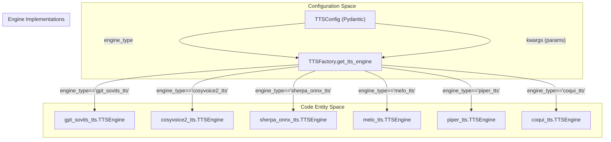
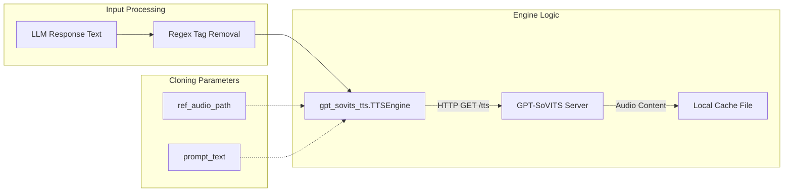

<!-- source: DeepWiki mcp.deepwiki.com · repo Open-LLM-VTuber/Open-LLM-VTuber · page 9.2 Local & Specialized TTS Engines · fetched 2026-10-30 -->

# Local & Specialized TTS Engines

Relevant source files

The following files were used as context for generating this wiki page:

- [src/open_llm_vtuber/live2d_model.py](src/open_llm_vtuber/live2d_model.py)
- [src/open_llm_vtuber/tts/azure_tts.py](src/open_llm_vtuber/tts/azure_tts.py)
- [src/open_llm_vtuber/tts/coqui_tts.py](src/open_llm_vtuber/tts/coqui_tts.py)
- [src/open_llm_vtuber/tts/cosyvoice2_tts.py](src/open_llm_vtuber/tts/cosyvoice2_tts.py)
- [src/open_llm_vtuber/tts/cosyvoice_tts.py](src/open_llm_vtuber/tts/cosyvoice_tts.py)
- [src/open_llm_vtuber/tts/fish_api_tts.py](src/open_llm_vtuber/tts/fish_api_tts.py)
- [src/open_llm_vtuber/tts/gpt_sovits_tts.py](src/open_llm_vtuber/tts/gpt_sovits_tts.py)
- [src/open_llm_vtuber/tts/melo_tts.py](src/open_llm_vtuber/tts/melo_tts.py)
- [src/open_llm_vtuber/tts/piper_tts.py](src/open_llm_vtuber/tts/piper_tts.py)
- [src/open_llm_vtuber/tts/sherpa_onnx_tts.py](src/open_llm_vtuber/tts/sherpa_onnx_tts.py)
- [src/open_llm_vtuber/tts/x_tts.py](src/open_llm_vtuber/tts/x_tts.py)

This page details the implementation of local and specialized Text-to-Speech (TTS) engines within the Open-LLM-VTuber framework. These engines range from high-performance local inference models (like Piper and MeloTTS) to specialized API wrappers for voice cloning (like GPT-SoVITS and CosyVoice2).

## Implementation Overview

All TTS engines implement the `TTSInterface` abstract base class. The `TTSFactory` handles the instantiation of these engines using a lazy-import pattern to minimize startup time and dependency conflicts.

### Data Flow and Engine Selection

The following diagram illustrates how configuration data flows from the `TTSConfig` model into specific engine implementations via the `TTSFactory`.

**TTS Engine Initialization Flow**

**Sources:** `src/open_llm_vtuber/tts/gpt_sovits_tts.py:11-32`(), `src/open_llm_vtuber/tts/piper_tts.py:27-50`(), `src/open_llm_vtuber/tts/melo_tts.py:12-29`(), `src/open_llm_vtuber/tts/sherpa_onnx_tts.py:13-48`()

---

## Local Inference Engines

These engines run locally on the user's hardware, utilizing ONNX, PyTorch, or specialized Python runtimes.

### Piper TTS
A fast, local neural TTS system that uses ONNX models.
- **Key Class:** `TTSEngine` in `src/open_llm_vtuber/tts/piper_tts.py:27-117`().
- **Implementation:** Uses the `piper-tts` Python library to load `.onnx` models [src/open_llm_vtuber/tts/piper_tts.py:77]().
- **Features:** Supports `length_scale` for speed, `noise_scale`, and `speaker_id` for multi-speaker models [src/open_llm_vtuber/tts/piper_tts.py:84-91]().

### Sherpa-ONNX TTS
Integrates the `sherpa-onnx` framework, supporting high-speed local inference with models like Piper or VITS.
- **Key Class:** `TTSEngine` in `src/open_llm_vtuber/tts/sherpa_onnx_tts.py:13-113`().
- **Initialization:** Configures `OfflineTtsConfig` with model paths, lexicon, and tokens [src/open_llm_vtuber/tts/sherpa_onnx_tts.py:55-70]().
- **Performance:** Supports `num_threads` and hardware `provider` (e.g., "cpu", "cuda") [src/open_llm_vtuber/tts/sherpa_onnx_tts.py:24-25]().

### MeloTTS
A high-quality multi-lingual TTS library.
- **Key Class:** `TTSEngine` in `src/open_llm_vtuber/tts/melo_tts.py:12-74`().
- **Parameters:** Configures `speaker`, `language`, `device` (auto/cpu/cuda/mps), and `speed` [src/open_llm_vtuber/tts/melo_tts.py:14-19]().

### Coqui TTS
A flexible engine supporting a wide range of pre-trained models and voice cloning.
- **Key Class:** `TTSEngine` in `src/open_llm_vtuber/tts/coqui_tts.py:9-91`().
- **Functionality:** Supports both single-speaker and multi-speaker modes with voice cloning via `speaker_wav` [src/open_llm_vtuber/tts/coqui_tts.py:74-84]().

---

## Voice Cloning & Specialized APIs

These engines often connect to local or remote API servers specialized in voice cloning and zero-shot synthesis.

### GPT-SoVITS
A powerful few-shot voice conversion and TTS engine.
- **Implementation:** Connects via HTTP GET requests to a GPT-SoVITS API server [src/open_llm_vtuber/tts/gpt_sovits_tts.py:51]().
- **Features:** Supports `ref_audio_path` for voice cloning, `prompt_text` for context, and various text splitting methods [src/open_llm_vtuber/tts/gpt_sovits_tts.py:24-32]().
- **Data Handling:** Cleans emotion tags (e.g., `[joy]`) from text before synthesis using regex [src/open_llm_vtuber/tts/gpt_sovits_tts.py:36]().

### CosyVoice2
Alibaba's advanced speech generation model.
- **Implementation:** Uses `gradio_client` to interface with a CosyVoice web UI [src/open_llm_vtuber/tts/cosyvoice2_tts.py:21]().
- **Functionality:** Supports SFT (Supervised Fine-Tuning) and zero-shot cloning via `prompt_wav_upload_url` [src/open_llm_vtuber/tts/cosyvoice2_tts.py:40-52]().

### X-TTS (API Wrapper)
Wrapper for the XTTSv2 model server.
- **Implementation:** Sends POST requests containing `text`, `speaker_wav`, and `language` to the API endpoint [src/open_llm_vtuber/tts/x_tts.py:23-30]().

**Voice Cloning Pipeline Mapping**

**Sources:** `src/open_llm_vtuber/tts/gpt_sovits_tts.py:34-64`(), `src/open_llm_vtuber/tts/x_tts.py:19-43`(), `src/open_llm_vtuber/tts/cosyvoice2_tts.py:34-54`()

---

## Configuration & Integration Details

### Audio Format Handling
Most local engines generate WAV files using standard libraries like `wave` or `soundfile`.
- **Piper:** Uses `wave.open` to synthesize WAV files [src/open_llm_vtuber/tts/piper_tts.py:109-110]().
- **Sherpa-ONNX:** Uses `soundfile.write` with `subtype="PCM_16"` [src/open_llm_vtuber/tts/sherpa_onnx_tts.py:101-106]().

### Emotion Keyword Removal
Engines like GPT-SoVITS or the `Live2dModel` class include logic to strip emotion markers (e.g., `[happy]`) from the text so they are not spoken by the TTS engine.
- **GPT-SoVITS:** `re.sub(r"\[.*?\]", "", text)` [src/open_llm_vtuber/tts/gpt_sovits_tts.py:36]().
- **Live2D Helper:** `remove_emotion_keywords` removes keys defined in the model's `emo_map` [src/open_llm_vtuber/live2d_model.py:174-192]().

### Fish Audio API
A cloud-based specialized engine that provides high-quality synthesis with low latency.
- **Implementation:** Uses `fish_audio_sdk` and supports `latency` settings ("normal" vs "balanced") [src/open_llm_vtuber/tts/fish_api_tts.py:18-54]().

**Sources:** `src/open_llm_vtuber/tts/piper_tts.py:109-113`(), `src/open_llm_vtuber/tts/sherpa_onnx_tts.py:101-108`(), `src/open_llm_vtuber/live2d_model.py:174-192`(), `src/open_llm_vtuber/tts/fish_api_tts.py:44-60`()

---

