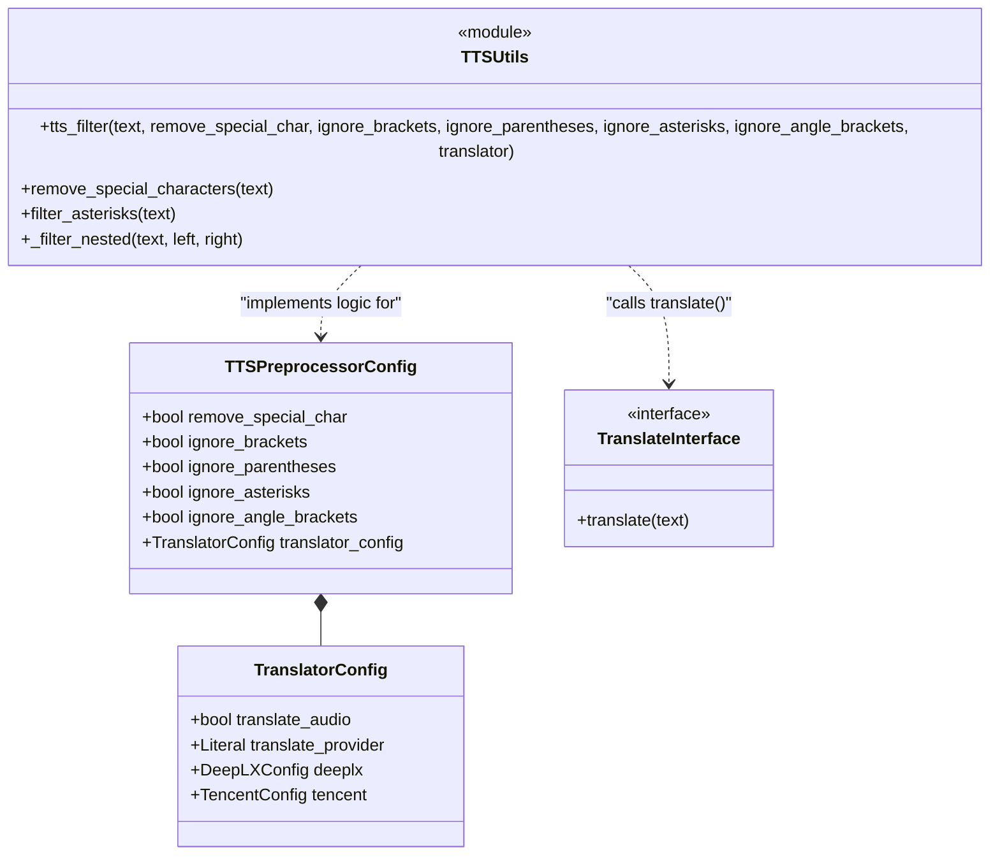

<!-- source: DeepWiki mcp.deepwiki.com · repo Open-LLM-VTuber/Open-LLM-VTuber · page 9.3 TTS Preprocessor · fetched 2026-10-30 -->

# TTS Preprocessor

<details>
<summary>Relevant source files</summary>

The following files were used as context for generating this wiki page:

- [src/open_llm_vtuber/config_manager/tts_preprocessor.py](src/open_llm_vtuber/config_manager/tts_preprocessor.py)
- [src/open_llm_vtuber/utils/tts_preprocessor.py](src/open_llm_vtuber/utils/tts_preprocessor.py)

</details>


The `TTSPreprocessor` is a critical utility layer in the conversation pipeline that sanitizes and modifies text generated by the LLM before it is sent to the Text-to-Speech (TTS) engine. Its primary purpose is to ensure that non-verbal cues, metadata, or formatting characters—which are useful for the frontend or LLM reasoning—are not spoken aloud by the VTuber.

## Purpose and Functionality

The preprocessor acts as a filter that transforms "LLM Raw Output" into "Speech-Ready Text". It handles several key tasks:
- **Cleaning**: Removing artifacts like emojis, asterisks, or system-specific symbols.
- **Selective Ignoring**: Stripping out text within brackets or parentheses (often used by LLMs for stage directions or internal thoughts).
- **Translation**: Optionally routing the text through a translation service before synthesis.
- **Normalization**: Standardizing text encoding to prevent TTS engine errors.

Crucially, changes made by the `TTSPreprocessor` only affect the generated audio; the original text (including brackets and special characters) is preserved for subtitles and the LLM's chat memory [src/open_llm_vtuber/utils/tts_preprocessor.py:18-19]().

## Configuration Schema

The behavior of the preprocessor is governed by the `TTSPreprocessorConfig` class. This schema defines which filters are active during the session.

### TTSPreprocessorConfig
Defined in [src/open_llm_vtuber/config_manager/tts_preprocessor.py:100-118](), the configuration includes:

| Option | Type | Default | Description |
| :--- | :--- | :--- | :--- |
| `remove_special_char` | `bool` | Required | Removes all non-letter, non-number, and non-punctuation characters (including emojis). |
| `ignore_brackets` | `bool` | `True` | Removes text enclosed in `[...]`. |
| `ignore_parentheses` | `bool` | `True` | Removes text enclosed in `(...)`. |
| `ignore_asterisks` | `bool` | `True` | Removes text enclosed in `*...*` (common for actions/emotes). |
| `ignore_angle_brackets` | `bool` | `True` | Removes text enclosed in `<...>`. |
| `translator_config` | `TranslatorConfig` | Required | Nested configuration for `deeplx` or `tencent` translation services. |

**Sources:**
- [src/open_llm_vtuber/config_manager/tts_preprocessor.py:100-118]()
- [src/open_llm_vtuber/utils/tts_preprocessor.py:7-15]()

## Implementation Details

The core logic resides in the `tts_filter` function, which applies a series of transformation steps to the input string.

### Filtering Logic Flow
The preprocessor follows a specific order of operations to ensure clean output.

Title: TTS Filtering Sequence
```mermaid
graph TD
    Input["LLM Text Output"] --> Asterisks["filter_asterisks()"]
    Asterisks --> Brackets["filter_brackets()"]
    Brackets --> Parentheses["filter_parentheses()"]
    Parentheses --> Angle["filter_angle_brackets()"]
    Angle --> Special["remove_special_characters()"]
    Special --> TransCheck{ "translator is not None?" }
    TransCheck -- "Yes" --> Translate["TranslateInterface.translate()"]
    TransCheck -- "No" --> Output["Speech-Ready Text"]
    Translate --> Output
```
**Sources:**
- [src/open_llm_vtuber/utils/tts_preprocessor.py:33-80]()

### Key Functions

#### 1. Nested Content Removal
The functions `filter_brackets`, `filter_parentheses`, and `filter_angle_brackets` utilize a generic helper `_filter_nested` [src/open_llm_vtuber/utils/tts_preprocessor.py:108-138](). This helper uses a depth-tracking algorithm rather than simple RegEx to correctly handle nested structures like `(text (nested text) more text)`. It also collapses multiple spaces into one and strips leading/trailing whitespace [src/open_llm_vtuber/utils/tts_preprocessor.py:137-138]().

#### 2. Asterisk Removal
`filter_asterisks` uses a regular expression `r"\*{1,}((?!\*).)*?\*{1,}"` to match text enclosed in single, double, or triple asterisks [src/open_llm_vtuber/utils/tts_preprocessor.py:180-196](). This is specifically designed to strip "roleplay" actions (e.g., `*waves hand*`) from the audio.

#### 3. Special Character Stripping
The `remove_special_characters` function performs Unicode normalization (`NFKC`) and then filters characters based on their Unicode category [src/open_llm_vtuber/utils/tts_preprocessor.py:83-105]().
- **Keeps**: Letters (`L`), Numbers (`N`), Punctuation (`P`), and Whitespace.
- **Removes**: Symbols (`S`), Emojis, and other non-standard characters.

## Integration in Pipeline

The `tts_filter` is invoked as a text transformation step before the text reaches the TTS synthesis engine. It optionally integrates with the translation pipeline if a `TranslateInterface` is provided [src/open_llm_vtuber/utils/tts_preprocessor.py:69-77]().

Title: Code Entity Relationship - Preprocessor Integration


### Translation Integration
If `translator_config.translate_audio` is enabled, the preprocessor uses the `TranslateInterface` (implemented by providers like `deeplx` or `tencent`) to translate the cleaned text into the target language immediately before TTS synthesis [src/open_llm_vtuber/utils/tts_preprocessor.py:69-77](). The `TranslatorConfig` ensures that the necessary provider-specific sub-configurations (`DeepLXConfig` or `TencentConfig`) are present via a Pydantic `model_validator` [src/open_llm_vtuber/config_manager/tts_preprocessor.py:82-97]().

**Sources:**
- [src/open_llm_vtuber/utils/tts_preprocessor.py:7-80]()
- [src/open_llm_vtuber/config_manager/tts_preprocessor.py:56-108]()

---

