# Page: Project Overview

# Project Overview

<details>
<summary>Relevant source files</summary>

The following files were used as context for generating this wiki page:

- [README.CN.md](README.CN.md)
- [README.JP.md](README.JP.md)
- [README.KR.md](README.KR.md)
- [README.md](README.md)
- [assets/banner.cn.jpg](assets/banner.cn.jpg)
- [pyproject.toml](pyproject.toml)
- [uv.lock](uv.lock)

</details>


Open-LLM-VTuber is a cross-platform, voice-interactive AI companion system that integrates Large Language Models (LLMs), Automatic Speech Recognition (ASR), Text-to-Speech (TTS), and Live2D animation [README.md:44-47](). It is designed to run entirely offline or leverage cloud APIs, providing a modular framework for creating virtual personalities with visual perception and real-time interaction capabilities [README.md:65-68]().

The project was initially inspired by the goal of recreating the interaction style of AI Vtubers like `neuro-sama` using open-source, cross-platform solutions [README.md:55-56]().

## Core Pipeline Architecture

The application operates as a real-time processing pipeline that bridges user audio/text input to an animated Live2D avatar with synchronized voice output. The pipeline is managed by a `ServiceContext`, which acts as a dependency injection container for all AI engines [README.md:87-91]().

### High-Level Data Flow

The following diagram illustrates the transition from Natural Language Space (User Input) to Code Entity Space (System Components).

**System Data Flow and Entity Mapping**
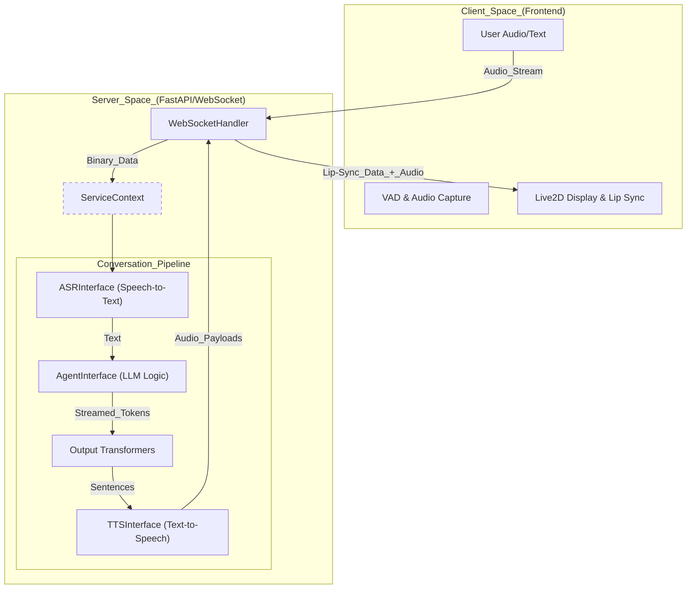
**Sources:** [README.md:71-80](), [pyproject.toml:7-43]()

## Key Features

- **Multi-Modal Interaction**: Supports visual perception via camera, screen recording, and screenshots, allowing the AI to "see" the user's environment [README.md:71-73]().
- **Real-Time Voice Interruption**: Users can interrupt the AI without headphones (using echo cancellation/logic to ignore its own voice); the system manages interruption signals across the agent and TTS queues [README.md:73-74]().
- **Live2D Emotional Mapping**: Extracts emotional cues and expressions from LLM responses to trigger specific Live2D animations and motions [README.md:75-76]().
- **Modular Backend**: Pluggable architecture for LLMs (Ollama, OpenAI, Claude, Gemini, DeepSeek), ASR (Sherpa-ONNX, Faster-Whisper, FunASR), and TTS (GPT-SoVITS, CosyVoice, ElevenLabs) [README.md:82-86]().
- **Persistent Memory**: Chat logs are stored locally to maintain conversation continuity across sessions even after restarts [README.md:79-80]().
- **Desktop Pet Mode**: Special support for transparent backgrounds and "always-on-top" windowing for the desktop client [README.md:76-77]().

## Code Entity Space: Core Interfaces

The project relies on abstract base classes (Interfaces) to ensure modularity. Developers can extend these to add new model providers or custom logic [README.md:89-91]().

**Interface Hierarchy and Implementation Examples**
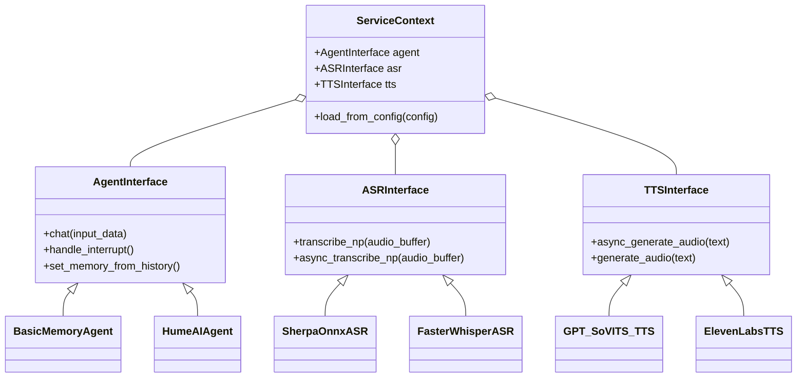
**Sources:** [README.md:87-91](), [pyproject.toml:7-43]()

## Wiki Navigation

This documentation is organized into sections covering the setup, configuration, and internal mechanics of the system.

### 1. Installation and Deployment
- **[Getting Started & Installation](#1.1)**: Step-by-step guide for local setup using `uv`, managing environment variables like `HF_HOME` or `MODELSCOPE_CACHE`, and initializing the frontend submodule [README.md:100-101]().
- **[Docker Deployment](#1.2)**: Guide for containerized deployment, including the Dockerfile structure and automated builds via GitHub Actions.
- **[Upgrade & Maintenance](#1.3)**: Details on the `upgrade.py` script and `UpgradeManager` for migrating configurations and updating the `model_dict.json` [README.md:107-108]().

### 2. Configuration and Personality
- **Configuration System**: Overview of how `conf.yaml` and the Pydantic-based `config_manager` control application behavior.
- **Character Configuration**: How to create and manage character YAML files in the `characters/` directory, including persona prompts and Live2D model assignments.
- **Prompt System**: Details on how `prompt_loader` assembles system prompts, including Live2D expression instructions and tool-calling definitions.

### 3. Technical Architecture
- **Server & WebSocket**: Deep dive into the FastAPI server, the `WebSocketHandler` message routing, and the static asset serving for Live2D models.
- **Conversation Pipeline**: Analysis of how the pipeline orchestrates ASR, LLM streaming, and the `TTSTaskManager` for ordered audio delivery and interruption handling.
- **Agent & MCP**: How the system handles tool use through the Model Context Protocol (MCP) and manages different LLM backends like OpenAI, Claude, and local GGUF models.

**Sources:** [README.md:104-108](), [pyproject.toml:1-43]()

---

# Page: Getting Started & Installation

# Getting Started & Installation

<details>
<summary>Relevant source files</summary>

The following files were used as context for generating this wiki page:

- [.github/workflows/update-requirements.yml](.github/workflows/update-requirements.yml)
- [pyproject.toml](pyproject.toml)
- [requirements-bilibili.txt](requirements-bilibili.txt)
- [requirements.txt](requirements.txt)
- [run_server.py](run_server.py)
- [src/open_llm_vtuber/server.py](src/open_llm_vtuber/server.py)
- [uv.lock](uv.lock)

</details>


This page provides a technical guide for setting up the Open-LLM-VTuber environment. It covers dependency management using `uv`, environment configuration, server initialization, and frontend submodule management.

## System Requirements

The project requires **Python 3.10 to 3.12** [pyproject.toml:6-6](). It leverages `uv` for high-performance dependency resolution and `torch` for local AI inference [pyproject.toml:35-37]().

### Core Dependencies
The application relies on several key libraries:
*   **FastAPI & Uvicorn**: For the WebSocket and REST server [pyproject.toml:14-39]().
*   **Onnxruntime & Sherpa-ONNX**: For local ASR and VAD [pyproject.toml:21-32]().
*   **Loguru**: For structured logging [pyproject.toml:18-18]().
*   **Pydantic**: For configuration validation [src/open_llm_vtuber/server.py:14-14](), [src/open_llm_vtuber/config_manager/utils.py:1-20]().

## Installation Steps

### 1. Clone and Submodule Initialization
The frontend is maintained as a separate Git submodule. The server script `run_server.py` includes a `check_frontend_submodule` function to ensure `frontend/index.html` exists before starting [run_server.py:50-59]().

```bash
git clone https://github.com/Open-LLM-VTuber/Open-LLM-VTuber.git
cd Open-LLM-VTuber
git submodule update --init --recursive
```

### 2. Dependency Management with `uv`
The project uses `uv` for managing virtual environments and locking dependencies [uv.lock:1-3]().

**Standard Installation:**
```bash
uv sync
```

**Bilibili Integration (Optional):**
To enable Bilibili Live support, install the optional dependency group defined in `pyproject.toml` [pyproject.toml:45-50]():
```bash
uv sync --extra bilibili
```

### 3. Environment Variables
The application sets specific environment variables for model caching during startup in `run_server.py` [run_server.py:16-17]().

| Variable | Default Value | Description |
| :--- | :--- | :--- |
| `HF_HOME` | `./models` | Directory for Hugging Face model downloads [run_server.py:16-16](). |
| `MODELSCOPE_CACHE` | `./models` | Directory for ModelScope model downloads [run_server.py:17-17](). |
| `HF_ENDPOINT` | `https://hf-mirror.com` | Set if `--hf_mirror` flag is used [run_server.py:176-177](). |

## Running the Server

The server is launched via `run_server.py`, which handles configuration validation via `validate_config` and asynchronous service initialization [run_server.py:120-164]().

### CLI Arguments
The `parse_args()` function defines the following command-line interface [run_server.py:110-116]():

*   `--verbose`: Enables `DEBUG` level logging [run_server.py:169-170]().
*   `--hf_mirror`: Routes Hugging Face requests through `hf-mirror.com` by setting the `HF_ENDPOINT` environment variable [run_server.py:176-177]().

### Initialization Data Flow
The following diagram illustrates the startup sequence and how `run_server.py` interacts with the `WebSocketServer` and `UpgradeManager`.

**Server Startup Sequence**
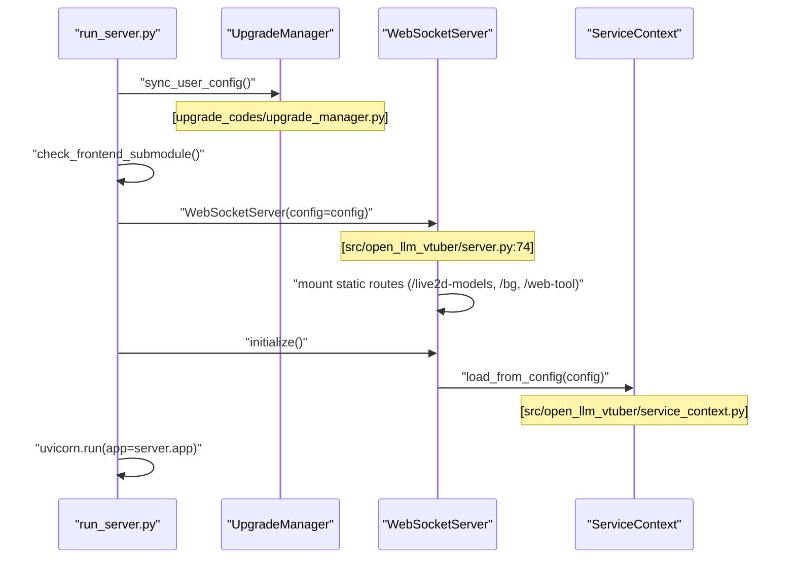
Sources: [run_server.py:120-164](), [src/open_llm_vtuber/server.py:74-150](), [src/open_llm_vtuber/server.py:151-154]()

## Static Asset Serving

The `WebSocketServer` class uses `CORSStaticFiles` (a subclass of Starlette's `StaticFiles`) to serve assets. This custom class ensures `Access-Control-Allow-Origin: *` headers are present [src/open_llm_vtuber/server.py:23-40]().

**Asset Mapping Table**
| Endpoint | Local Directory | Entity/Purpose |
| :--- | :--- | :--- |
| `/cache` | `cache/` | Temporary audio files for TTS output [src/open_llm_vtuber/server.py:112-118](). |
| `/live2d-models` | `live2d-models/` | Live2D model files and `model_dict.json` [src/open_llm_vtuber/server.py:122-125](). |
| `/bg` | `backgrounds/` | Background images for the VTuber stage [src/open_llm_vtuber/server.py:127-130](). |
| `/avatars` | `avatars/` | Character profile pictures (via `AvatarStaticFiles`) [src/open_llm_vtuber/server.py:131-135](). |
| `/web-tool` | `web_tool/` | Browser-based ASR/TTS diagnostic tools [src/open_llm_vtuber/server.py:138-142](). |
| `/` | `frontend/` | The main frontend application [src/open_llm_vtuber/server.py:145-149](). |

## Code Architecture: Startup & Context

The server relies on `ServiceContext` to manage the lifecycle of AI engines (LLM, TTS, ASR).

**Code Entity Relationship**
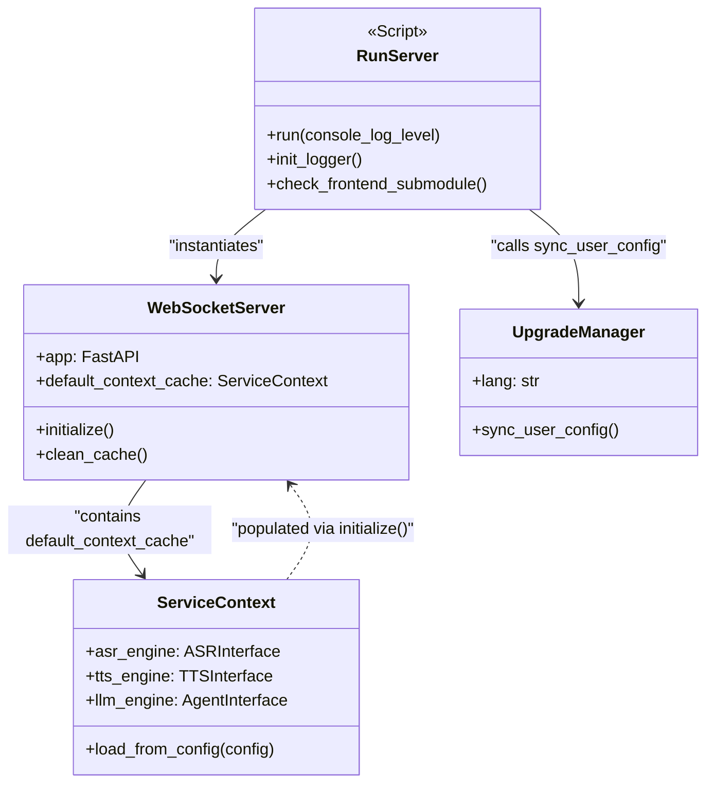
Sources: [run_server.py:19-19](), [run_server.py:139-146](), [src/open_llm_vtuber/server.py:74-80](), [src/open_llm_vtuber/server.py:151-154]()

## Troubleshooting Submodules

If the frontend is missing, `run_server.py` attempts to run `git submodule update --init --recursive` [run_server.py:68-70](). If this fails (e.g., due to network issues), the server will log a `CRITICAL` error, and the root URL (`/`) will return a `404 Not Found` error [run_server.py:90-92]().

Manual restoration:
```bash
git restore frontend
git submodule update --init --recursive
```
Sources: [run_server.py:50-108]()

---

# Page: Docker Deployment

# Docker Deployment

<details>
<summary>Relevant source files</summary>

The following files were used as context for generating this wiki page:

- [.dockerignore](.dockerignore)
- [.github/workflows/docker-blacksmith.yml](.github/workflows/docker-blacksmith.yml)
- [dockerfile](dockerfile)

</details>


The Open-LLM-VTuber application is containerized using Docker to ensure consistent environments across different platforms and to simplify the deployment of its complex dependency tree (including system-level libraries like `ffmpeg`). The deployment architecture leverages `uv` for high-performance dependency management and a multi-stage-like approach to minimize image size while providing flexibility for user configurations.

## Dockerfile Architecture

The `dockerfile` uses `python:3.10-slim` as the base image to reduce the final footprint [[dockerfile:1]](). It employs a series of environment variables to optimize Python performance and ensure the `uv` package manager operates correctly within the container [[dockerfile:3-8]]().

### Build Stages and Dependency Management

The build process is divided into logical steps to maximize layer caching:

1.  **System Dependencies**: Installs `ffmpeg`, `git`, `curl`, and `ca-certificates` via `apt-get` [[dockerfile:13-16]]().
2.  **UV Installation**: Copies the `uv` and `uvx` binaries directly from the official `ghcr.io/astral-sh/uv` image [[dockerfile:19]]().
3.  **Dependency Sync**: Copies `pyproject.toml` and `uv.lock` first. It uses a cache mount for `/root/.cache/uv` to speed up subsequent builds and runs `uv sync --frozen --no-dev` to install exactly what is defined in the lockfile [[dockerfile:22-24]]().
4.  **Project Installation**: Copies the source code and installs the project itself using `uv pip install --no-deps .` to ensure the package is registered in the environment [[dockerfile:27-28]]().

### Startup Orchestration

The container uses a custom shell script, `start-app`, generated during the build process [[dockerfile:31-74]](). This script acts as an entrypoint manager that handles the mapping between the persistent host volume `/app/conf` and the application's expected internal directory structure.

**Filesystem Mapping Logic:**

| Source (Host Mount `/app/conf/`) | Destination (App Directory) | Status |
| :--- | :--- | :--- |
| `conf.yaml` | `/app/conf.yaml` | **Required** [[dockerfile:38-45]]() |
| `model_dict.json` | `/app/model_dict.json` | Optional [[dockerfile:48-50]]() |
| `live2d-models/` | `/app/live2d-models` | Optional (Symlinked) [[dockerfile:53-55]]() |
| `characters/` | `/app/characters` | Optional (Symlinked) [[dockerfile:58-60]]() |
| `avatars/` | `/app/avatars` | Optional (Symlinked) [[dockerfile:63-65]]() |
| `backgrounds/` | `/app/backgrounds` | Optional (Symlinked) [[dockerfile:68-70]]() |

**Sources:**
- [[dockerfile:1-82]]()

---

## Data Flow: Volume Mounting and Startup

The following diagram illustrates how the `start-app` script bridges the "Natural Language Space" of user-provided configuration files to the "Code Entity Space" of the running server.

### Container Initialization Flow
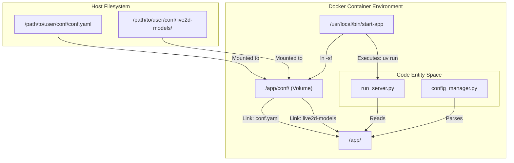

**Sources:**
- [[dockerfile:31-74]]()
- [[dockerfile:77-81]]()

---

## .dockerignore Implementation

The `.dockerignore` file is strictly configured to prevent local environment leaks (like API keys and virtual environments) and to ensure that the image remains lightweight by excluding local model caches and chat histories.

Key exclusions include:
*   **Secrets**: `.env`, `api_keys.py`, and `user_credentials.json` [[.dockerignore:41-43]]().
*   **Local Caches**: `__pycache__`, `.venv`, and `.cache/` [[.dockerignore:28-38, 79]]().
*   **Data Persistence**: `chat_history/`, `memory.db*`, and `logs/` [[.dockerignore:46-51, 67]]().
*   **Heavy Assets**: Most models are excluded except for essential defaults like `silero_vad.onnx` and `piper_voice` templates [[.dockerignore:56-61]]().
*   **Live2D Models**: All models except `mao_pro` and `shizuku` are ignored to keep the base image slim [[.dockerignore:14-16]]().

**Sources:**
- [[.dockerignore:1-80]]()

---

## Automated Build Workflow (GitHub Actions)

The project uses a sophisticated CI/CD pipeline defined in `.github/workflows/docker-blacksmith.yml` to build and push multi-arch images (AMD64 and ARM64) to both Docker Hub and GitHub Container Registry (GHCR).

### Build Pipeline Architecture

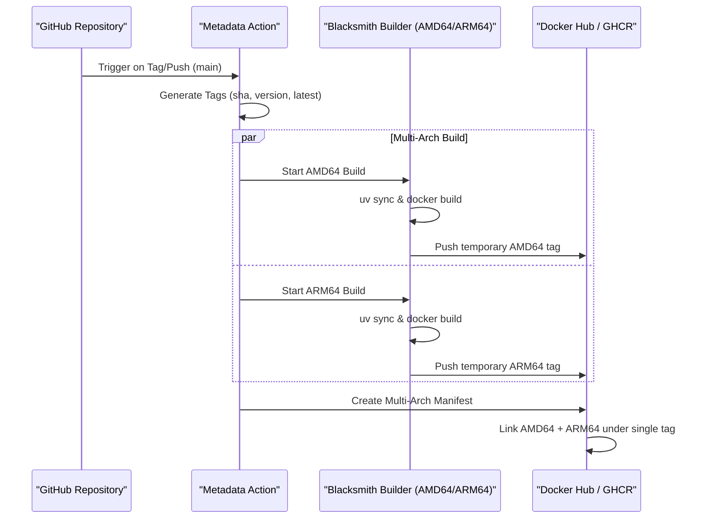

### Workflow Details

1.  **Metadata Generation**: The `meta` job calculates image tags based on Git refs, semver patterns, and SHA shorts [[.github/workflows/docker-blacksmith.yml:30-66]]().
2.  **Blacksmith Infrastructure**: Uses `useblacksmith/setup-docker-builder` for high-performance builds on specialized 8-vCPU runners [[.github/workflows/docker-blacksmith.yml:75-85]]().
3.  **Multi-Platform Matrix**: A strategy matrix builds for `linux/amd64` and `linux/arm64` in parallel [[.github/workflows/docker-blacksmith.yml:70-79]]().
4.  **Manifest Creation**: Since images are built on separate runners, a final `manifest` job uses `docker buildx imagetools create` to combine the architecture-specific images into a single multi-arch manifest [[.github/workflows/docker-blacksmith.yml:193-207]]().

**Sources:**
- [[.github/workflows/docker-blacksmith.yml:1-208]]()

---

# Page: Upgrade & Maintenance

# Upgrade & Maintenance

<details>
<summary>Relevant source files</summary>

The following files were used as context for generating this wiki page:

- [.pre-commit-config.yaml](.pre-commit-config.yaml)
- [CLAUDE.md](CLAUDE.md)
- [upgrade.py](upgrade.py)
- [upgrade_codes/compare_yaml.py](upgrade_codes/compare_yaml.py)
- [upgrade_codes/config_sync.py](upgrade_codes/config_sync.py)
- [upgrade_codes/from_version/v_1_1_1.py](upgrade_codes/from_version/v_1_1_1.py)
- [upgrade_codes/upgrade_core/constants.py](upgrade_codes/upgrade_core/constants.py)
- [upgrade_codes/upgrade_core/upgrade_utils.py](upgrade_codes/upgrade_core/upgrade_utils.py)
- [upgrade_codes/upgrade_manager.py](upgrade_codes/upgrade_manager.py)
- [upgrade_codes/version_manager.py](upgrade_codes/version_manager.py)

</details>


The Open-LLM-VTuber project includes a robust maintenance system designed to keep local installations up to date with the remote repository while preserving user customizations. This is achieved through a dedicated upgrade pipeline that manages Git operations, configuration migrations, and dependency synchronization.

## Upgrade System Overview

The upgrade process is primarily driven by `upgrade.py`, which utilizes the `UpgradeManager` class to orchestrate a multi-stage update sequence. The system ensures that local changes are stashed, new code is pulled, and configuration files are migrated to the latest schema version without losing user settings.

### Core Components

| Component | File Path | Responsibility |
|:---|:---|:---|
| **Upgrade Script** | [upgrade.py:1-171]() | The entry point for manual updates, handling user interaction and the main execution loop. |
| **UpgradeManager** | [upgrade_codes/upgrade_manager.py:11-68]() | High-level orchestrator for language selection, logging initialization, and tool invocation. |
| **ConfigSynchronizer** | [upgrade_codes/config_sync.py:22-185]() | Manages YAML field merging, comment preservation, and version detection. |
| **VersionUpgradeManager** | [upgrade_codes/version_manager.py:8-94]() | Executes specific logic for migrating data (e.g., `model_dict.json`) between version ranges. |
| **UpgradeUtility** | [upgrade_codes/upgrade_core/upgrade_utils.py:10-148]() | Low-level wrappers for subprocess Git commands and system information logging. |

Sources: [upgrade.py:5-6](), [upgrade_codes/upgrade_manager.py:11-18](), [upgrade_codes/config_sync.py:22-35]()

## The Upgrade Pipeline

When a user runs `uv run upgrade.py`, the system follows a strict pipeline to prevent data loss and ensure a consistent state.

### Upgrade Process Data Flow
This diagram illustrates how the `UpgradeManager` interacts with Git and the local filesystem to perform an update.

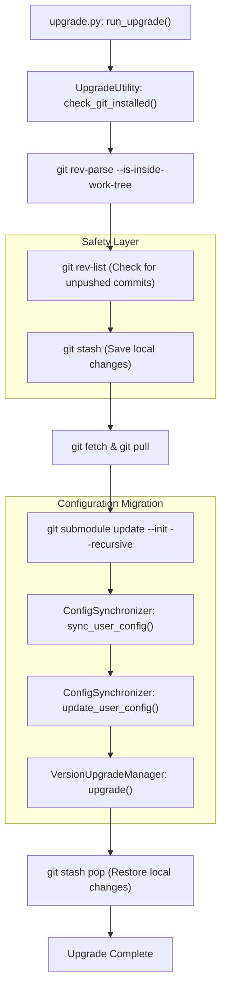
Sources: [upgrade.py:9-168](), [upgrade_codes/upgrade_manager.py:45-68](), [upgrade_codes/config_sync.py:36-58](), [upgrade_codes/upgrade_core/upgrade_utils.py:17-36]()

## Configuration Migration & Synchronization

The system distinguishes between "Syncing" (ensuring files exist) and "Updating" (merging new fields and migrating logic).

### ConfigSynchronizer Logic
The `ConfigSynchronizer` performs three primary tasks during `update_user_config`:
1.  **Field Merging**: It identifies keys present in the default templates (e.g., `config_templates/conf.default.yaml`) that are missing in the user's `conf.yaml` and adds them while preserving existing values [upgrade_codes/config_sync.py:108-145]().
2.  **Comment Synchronization**: Using `CommentSynchronizer`, it attempts to keep the explanatory comments in `conf.yaml` aligned with the latest documentation in the templates [upgrade_codes/config_sync.py:66-75]().
3.  **Version Migration**: It detects the `conf_version` in `system_config` and triggers version-specific migration scripts via the `VersionUpgradeManager` [upgrade_codes/config_sync.py:79-92]().

### Version-Specific Tasks
Specific migration logic is encapsulated in classes like `to_v_1_2_1`. These classes handle breaking changes and data structure updates:
*   **Model Dict Updates**: Updating the `model_dict.json` file to reflect new Live2D model paths or parameters [upgrade_codes/version_manager.py:74-85]().
*   **Live2D Deprecation**: Removing deprecated models or updating `kScale` and `url` for existing ones [upgrade_codes/from_version/v_1_1_1.py:48-75]().
*   **Schema Refactoring**: Renaming fields or updating default values for specific components like VAD and ASR [upgrade_codes/from_version/v_1_1_1.py:86-105]().
*   **Translation/I18n**: Migrating values based on the user's selected language using a `migration_map` [upgrade_codes/from_version/v_1_1_1.py:17-37]().

Sources: [upgrade_codes/config_sync.py:52-97](), [upgrade_codes/version_manager.py:40-94](), [upgrade_codes/from_version/v_1_1_1.py:5-46]()

## Maintenance Entities & Implementation

The following diagram bridges the high-level maintenance concepts to the specific Python classes and methods that implement them.

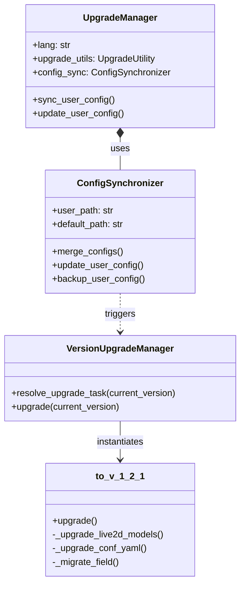
Sources: [upgrade_codes/upgrade_manager.py:11-18](), [upgrade_codes/config_sync.py:22-35](), [upgrade_codes/version_manager.py:8-15](), [upgrade_codes/from_version/v_1_1_1.py:5-14]()

## Safety and Pre-checks

The upgrade system includes several safety checks to prevent code conflicts or data loss:
*   **Git Check**: Verifies Git is installed and the project is a valid repository [upgrade.py:20-34]().
*   **Unpushed Commits**: Blocks the upgrade if local commits exist on the `main` branch that haven't been pushed to the remote, providing backup suggestions [upgrade.py:37-48]().
*   **Uncommitted Changes**: Automatically uses `git stash` to save local modifications before pulling updates and `git stash pop` to restore them afterward [upgrade.py:51-75, 142-158]().
*   **Config Backup**: Creates a `conf.yaml.backup` before any configuration modification [upgrade_codes/config_sync.py:98-106]().

Sources: [upgrade.py:37-75](), [upgrade_codes/config_sync.py:98-106](), [upgrade_codes/upgrade_core/constants.py:8]()

---

# Page: Configuration System

# Configuration System

<details>
<summary>Relevant source files</summary>

The following files were used as context for generating this wiki page:

- [config_templates/conf.ZH.default.yaml](config_templates/conf.ZH.default.yaml)
- [config_templates/conf.default.yaml](config_templates/conf.default.yaml)
- [src/open_llm_vtuber/config_manager/__init__.py](src/open_llm_vtuber/config_manager/__init__.py)
- [src/open_llm_vtuber/config_manager/character.py](src/open_llm_vtuber/config_manager/character.py)
- [src/open_llm_vtuber/config_manager/main.py](src/open_llm_vtuber/config_manager/main.py)
- [src/open_llm_vtuber/config_manager/system.py](src/open_llm_vtuber/config_manager/system.py)
- [src/open_llm_vtuber/config_manager/utils.py](src/open_llm_vtuber/config_manager/utils.py)

</details>


The Open-LLM-VTuber configuration system is a modular, type-safe framework built on **Pydantic** and **YAML**. It manages everything from server network settings to individual character personalities and AI engine credentials. The system supports environment variable substitution, multi-language descriptions (i18n), and runtime switching between different character profiles.

## System Overview

The configuration is managed by the `config_manager` package, which serves as the central authority for loading, validating, and saving application settings [src/open_llm_vtuber/config_manager/__init__.py:1-6](). The primary entry point is the `Config` class, which aggregates sub-configurations into a single object tree [src/open_llm_vtuber/config_manager/main.py:11-19]().

### Core Components

| Component | Code Entity | Responsibility |
|:---|:---|:---|
| **Main Config** | `Config` | Root model containing system, character, and live settings [src/open_llm_vtuber/config_manager/main.py:11-19](). |
| **System Settings** | `SystemConfig` | Server host/port, proxy settings, and tool prompt registration [src/open_llm_vtuber/config_manager/system.py:7-15](). |
| **Character Profile** | `CharacterConfig` | Persona, Live2D model name, and engine-specific overrides [src/open_llm_vtuber/config_manager/character.py:13-29](). |
| **Utility Functions** | `utils.py` | YAML reading, environment variable injection, and directory scanning [src/open_llm_vtuber/config_manager/utils.py:16-65](). |

### Configuration Data Flow

The following diagram illustrates how raw YAML files are transformed into validated Python objects used by the server.

**Config Loading & Validation Pipeline**
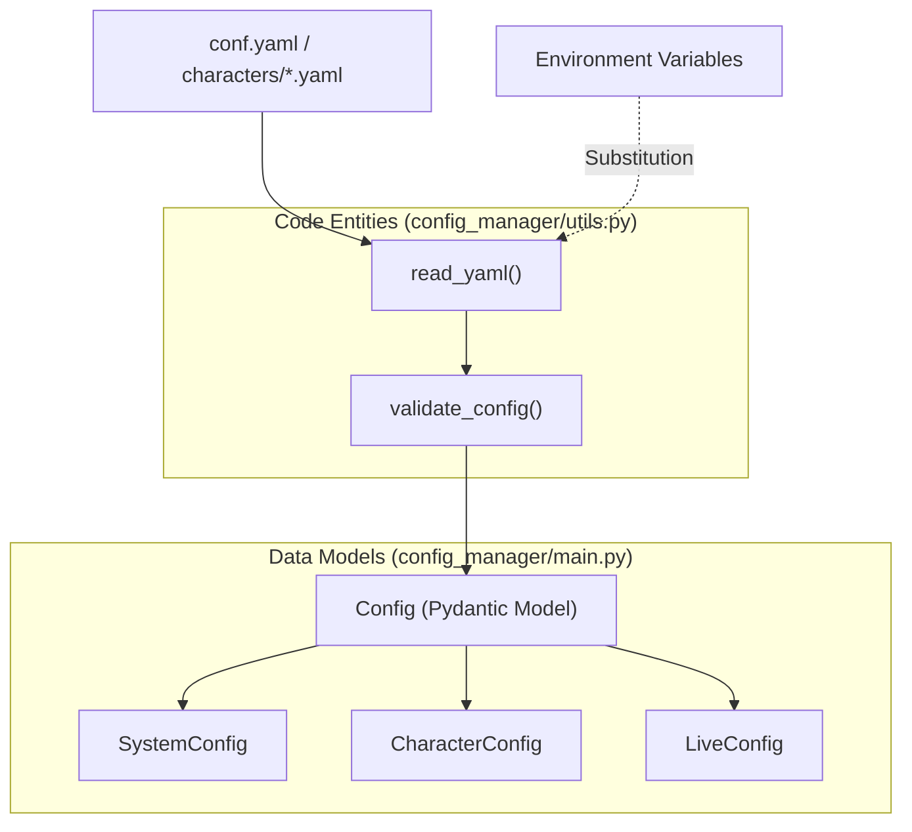
Sources: [src/open_llm_vtuber/config_manager/utils.py:16-75](), [src/open_llm_vtuber/config_manager/main.py:11-19]()

## Configuration Hierarchy

The system distinguishes between global server settings and character-specific settings. While `conf.yaml` provides the default state, files in the `characters/` directory allow for modular character definitions.

### System Configuration
Defined in the `system_config` section, these settings control the FastAPI server lifecycle and global prompt behavior [config_templates/conf.default.yaml:2-26]().
*   **Networking**: `host` and `port` for the web server [src/open_llm_vtuber/config_manager/system.py:11-12]().
*   **Tool Prompts**: References to utility prompts (e.g., `live2d_expression_prompt`, `mcp_prompt`) that are dynamically injected into the character's persona [src/open_llm_vtuber/config_manager/system.py:14]().
*   **Alternative Configs**: `config_alts_dir` defines where the system looks for additional character YAML files [config_templates/conf.default.yaml:7]().

For a full field reference, see **[Configuration Schema Reference](#2.1)**.

### Character Configuration
The `character_config` section defines the identity of the VTuber [src/open_llm_vtuber/config_manager/character.py:13-29]().
*   **Identity**: `character_name`, `avatar`, and `persona_prompt` [src/open_llm_vtuber/config_manager/character.py:19-22]().
*   **Engines**: Nested configurations for ASR, TTS, VAD, and the LLM Agent [src/open_llm_vtuber/config_manager/character.py:23-26]().
*   **Validation**: The `CharacterConfig` class uses Pydantic validators to ensure `persona_prompt` is not empty and defaults `character_name` to the configuration name if missing [src/open_llm_vtuber/config_manager/character.py:72-85]().

For details on managing multiple characters, see **[Character Configuration & Multi-Character Support](#2.2)**.

## Dynamic Features

### Environment Variable Substitution
The `read_yaml` function automatically replaces patterns like `${VAR_NAME}` in YAML files with values from the system environment [src/open_llm_vtuber/config_manager/utils.py:39-46](). This is particularly useful for securing API keys without hardcoding them in config files.

### Runtime Character Switching
The system can scan the `config_alts_dir` (usually `characters/`) to find alternative profiles using `scan_config_alts_directory` [src/open_llm_vtuber/config_manager/utils.py:127-171](). These can be swapped at runtime via WebSocket commands, allowing the VTuber to change persona, voice, and model without restarting the server.

### Multi-language Support (i18n)
Models inherit from `I18nMixin`, allowing the UI to display configuration descriptions in multiple languages (English and Chinese) using the `DESCRIPTIONS` class variable [src/open_llm_vtuber/config_manager/character.py:31-70](). This is supported by the `MultiLingualString` and `Description` types [src/open_llm_vtuber/config_manager/i18n.py]().

**Configuration Model Mapping**
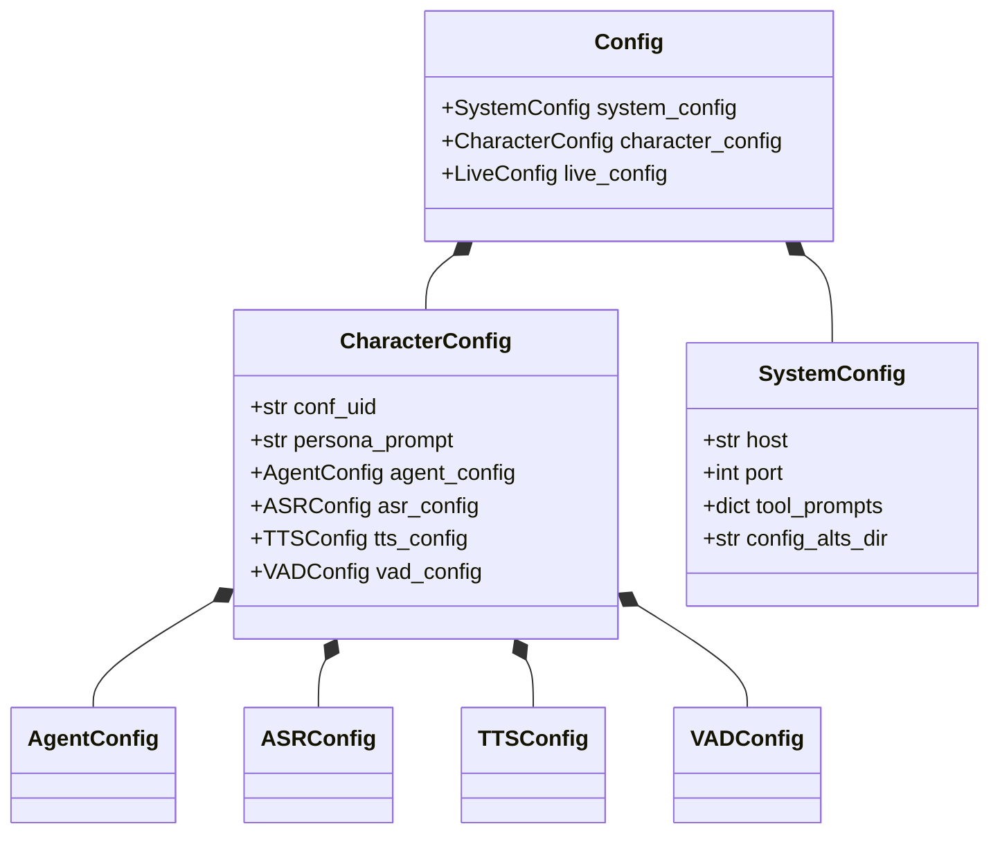
Sources: [src/open_llm_vtuber/config_manager/main.py:11-19](), [src/open_llm_vtuber/config_manager/character.py:13-29](), [src/open_llm_vtuber/config_manager/system.py:7-15]()

## Child Pages

*   **[Configuration Schema Reference](#2.1)**: Detailed breakdown of every key in `conf.yaml`, including validation rules and engine-specific parameters for ASR, TTS, and LLM backends.
*   **[Character Configuration & Multi-Character Support](#2.2)**: Guide on creating `.yaml` files in the `characters/` folder and how the system handles unique IDs (`conf_uid`) for session persistence.
*   **[Prompt System](#2.3)**: Explanation of how `tool_prompts` and the `persona_prompt` are merged by the `prompt_loader` to create the final system instruction for the AI agent.

Sources: [src/open_llm_vtuber/config_manager/__init__.py:1-125](), [src/open_llm_vtuber/config_manager/utils.py:1-182](), [config_templates/conf.default.yaml:1-91]()

---

# Page: Configuration Schema Reference

# Configuration Schema Reference

<details>
<summary>Relevant source files</summary>

The following files were used as context for generating this wiki page:

- [config_templates/conf.ZH.default.yaml](config_templates/conf.ZH.default.yaml)
- [config_templates/conf.default.yaml](config_templates/conf.default.yaml)
- [src/open_llm_vtuber/agent/stateless_llm_factory.py](src/open_llm_vtuber/agent/stateless_llm_factory.py)
- [src/open_llm_vtuber/asr/openai_whisper_asr.py](src/open_llm_vtuber/asr/openai_whisper_asr.py)
- [src/open_llm_vtuber/config_manager/__init__.py](src/open_llm_vtuber/config_manager/__init__.py)
- [src/open_llm_vtuber/config_manager/agent.py](src/open_llm_vtuber/config_manager/agent.py)
- [src/open_llm_vtuber/config_manager/asr.py](src/open_llm_vtuber/config_manager/asr.py)
- [src/open_llm_vtuber/config_manager/character.py](src/open_llm_vtuber/config_manager/character.py)
- [src/open_llm_vtuber/config_manager/i18n.py](src/open_llm_vtuber/config_manager/i18n.py)
- [src/open_llm_vtuber/config_manager/main.py](src/open_llm_vtuber/config_manager/main.py)
- [src/open_llm_vtuber/config_manager/stateless_llm.py](src/open_llm_vtuber/config_manager/stateless_llm.py)
- [src/open_llm_vtuber/config_manager/system.py](src/open_llm_vtuber/config_manager/system.py)
- [src/open_llm_vtuber/config_manager/utils.py](src/open_llm_vtuber/config_manager/utils.py)
- [src/open_llm_vtuber/tts/siliconflow_tts.py](src/open_llm_vtuber/tts/siliconflow_tts.py)

</details>


The configuration system in Open-LLM-VTuber is built upon **Pydantic** models, ensuring strict type validation and schema consistency. The primary configuration file is `conf.yaml`, which is parsed, validated, and transformed into a central `Config` object at runtime.

## Configuration Loading Architecture

The system uses a layered approach to load settings. It supports environment variable substitution using the `${VAR_NAME}` syntax and handles multiple character configurations via a dedicated directory.

### Data Flow and Code Entities

The following diagram illustrates how raw YAML files are transformed into the `ServiceContext` used by the application.

**Config to Code Entity Mapping**
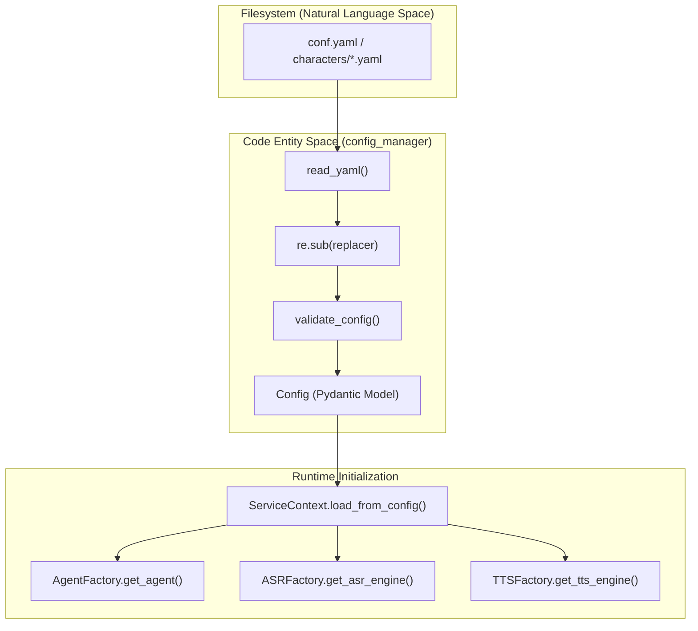

- **Environment Variable Substitution**: Performed in `read_yaml` using a regex pattern `\$\{(\w+)\}` [src/open_llm_vtuber/config_manager/utils.py:40-46]().
- **Validation**: The `validate_config` function instantiates the `Config` Pydantic model, which triggers recursive validation across all sub-configs [src/open_llm_vtuber/config_manager/utils.py:55-74]().
- **i18n Support**: Most configuration models inherit from `I18nMixin`, providing multilingual descriptions for UI rendering [src/open_llm_vtuber/config_manager/i18n.py:79-86]().

**Sources:** [src/open_llm_vtuber/config_manager/utils.py:16-74](), [src/open_llm_vtuber/config_manager/main.py:1-20](), [src/open_llm_vtuber/config_manager/i18n.py:79-140]()

---

## Configuration Sections

### 1. System Config (`system_config`)
Defines the server's network settings and the directory structure for alternative character configurations.

| Key | Type | Description |
|:---|:---|:---|
| `conf_version` | `str` | Version of the configuration schema [config_templates/conf.default.yaml:3](). |
| `host` | `str` | Network interface to bind to (e.g., `localhost` or `0.0.0.0`) [config_templates/conf.default.yaml:4](). |
| `port` | `int` | Port number for the FastAPI server [config_templates/conf.default.yaml:5](). |
| `config_alts_dir` | `str` | Directory where character-specific YAML files are stored [config_templates/conf.default.yaml:7](). |
| `enable_proxy` | `bool` | Enables proxy mode for multiple clients sharing one connection [src/open_llm_vtuber/config_manager/system.py:15](). |

**Sources:** [src/open_llm_vtuber/config_manager/system.py:7-40](), [config_templates/conf.default.yaml:1-26]()

### 2. Character Config (`character_config`)
Defines the identity, visual representation, and persona of the VTuber.

- **Persona**: The `persona_prompt` field contains core instructions for the LLM. It is validated to ensure it is not empty [src/open_llm_vtuber/config_manager/character.py:22-78]().
- **Live2D**: `live2d_model_name` must match an entry in `model_dict.json` [config_templates/conf.default.yaml:32]().
- **Visuals**: `avatar` points to a file in the `avatars/` directory [config_templates/conf.default.yaml:34]().
- **Identity**: Includes `character_name` and `human_name` for conversational context [src/open_llm_vtuber/config_manager/character.py:19-20]().

**Sources:** [src/open_llm_vtuber/config_manager/character.py:13-85](), [config_templates/conf.default.yaml:29-46]()

### 3. Agent Config (`agent_config`)
Controls the high-level logic of the AI, including memory management and tool usage.

- **`conversation_agent_choice`**: Selects the agent implementation (e.g., `basic_memory_agent`, `letta_agent`, `hume_ai_agent`) [src/open_llm_vtuber/config_manager/agent.py:202-207]().
- **`basic_memory_agent`**:
    - `llm_provider`: References a key in `llm_configs` [src/open_llm_vtuber/config_manager/agent.py:17-30]().
    - `faster_first_response`: If true, the system streams audio as soon as the first sentence segment is ready [src/open_llm_vtuber/config_manager/agent.py:32]().
    - `use_mcpp`: Enables Model Context Protocol for tool use [src/open_llm_vtuber/config_manager/agent.py:34]().
    - `mcp_enabled_servers`: List of active MCP tool servers [src/open_llm_vtuber/config_manager/agent.py:35]().

**Sources:** [src/open_llm_vtuber/config_manager/agent.py:14-207](), [config_templates/conf.default.yaml:49-90]()

### 4. LLM Configs (`llm_configs`)
A pool of credentials and connection details for stateless LLM providers.

The system supports various backends, mostly standardizing on OpenAI-compatible APIs:
- **`OpenAICompatibleConfig`**: Base for `Ollama`, `LMStudio`, `OpenAI`, `Groq`, etc. [src/open_llm_vtuber/config_manager/stateless_llm.py:58-88]().
- **`OllamaConfig`**: Adds `keep_alive` and `unload_at_exit` parameters [src/open_llm_vtuber/config_manager/stateless_llm.py:93-118]().
- **`ClaudeConfig`**: Specifically for Anthropic's API [src/open_llm_vtuber/config_manager/stateless_llm.py:186-192]().
- **`LlamaCppConfig`**: For local GGUF execution via `model_path` [src/open_llm_vtuber/config_manager/stateless_llm.py:203-207]().

**Sources:** [src/open_llm_vtuber/config_manager/stateless_llm.py:7-210](), [src/open_llm_vtuber/agent/stateless_llm_factory.py:14-78]()

---

## Engine Configurations (ASR, TTS, VAD)

### ASR Config (`asr_config`)
Configures Automatic Speech Recognition. The `asr_model` field determines which backend is used.

| Provider | Config Class | Key Settings |
|:---|:---|:---|
| **Sherpa-ONNX** | `SherpaOnnxASRConfig` | `encoder_path`, `tokens_path`, `model_type` [src/open_llm_vtuber/config_manager/asr.py:184-216]() |
| **Faster-Whisper** | `FasterWhisperConfig` | `model_path`, `compute_type`, `device` [src/open_llm_vtuber/config_manager/asr.py:28-38]() |
| **FunASR** | `FunASRConfig` | `model_name`, `vad_model`, `use_itn` [src/open_llm_vtuber/config_manager/asr.py:119-130]() |
| **Azure ASR** | `AzureASRConfig` | `api_key`, `region`, `languages` [src/open_llm_vtuber/config_manager/asr.py:7-12]() |

**Sources:** [src/open_llm_vtuber/config_manager/asr.py:7-228](), [config_templates/conf.default.yaml:173-240]()

### TTS Config (`tts_config`)
Configures Text-to-Speech. The `tts_engine` field selects the provider.

The `TTSFactory` uses these configs to instantiate engine classes that implement `TTSInterface`.

**TTS Engine Abstraction**
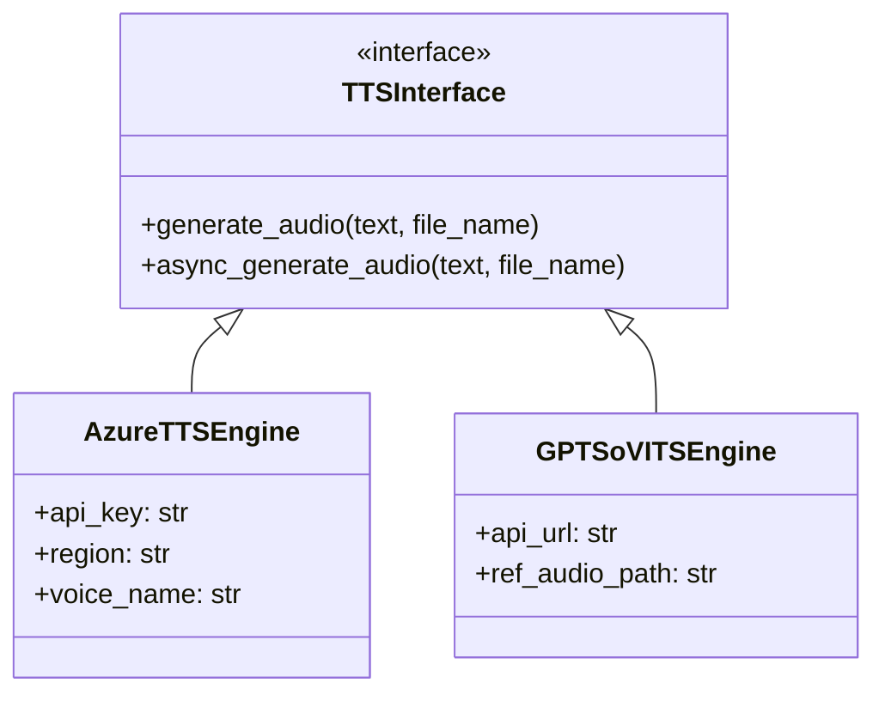

**Sources:** [src/open_llm_vtuber/config_manager/tts.py:28-563](), [src/open_llm_vtuber/config_manager/__init__.py:28-40]()

### VAD Config (`vad_config`)
Voice Activity Detection settings. Primarily uses `SileroVAD` for detecting when a user starts and stops speaking.

- **`threshold`**: Probability threshold for speech detection [src/open_llm_vtuber/config_manager/vad.py:11]().
- **`min_silence_duration_ms`**: Minimum silence to consider speech finished [src/open_llm_vtuber/config_manager/vad.py:13]().

**Sources:** [src/open_llm_vtuber/config_manager/vad.py:7-45]()

---

## Tool Prompts (`tool_prompts`)

Tool prompts are modular system prompt snippets injected into the LLM's context. They are defined in `system_config.tool_prompts` and loaded from the `prompts/` directory.

- **`live2d_expression_prompt`**: Provides instructions for outputting expression tags like `[happy]`. Keywords are automatically loaded into `[<insert_emomap_keys>]` [config_templates/conf.default.yaml:12]().
- **`mcp_prompt`**: Injected when `use_mcpp` is enabled to guide the LLM on how to interact with Model Context Protocol tools [config_templates/conf.default.yaml:20]().
- **`think_tag_prompt`**: Encourages the LLM to use `<think>` tags for internal reasoning that is not synthesized into speech [config_templates/conf.default.yaml:14]().
- **`group_conversation_prompt`**: Added to the memory of AI participants during multi-agent conversations [config_templates/conf.default.yaml:17]().

**Sources:** [config_templates/conf.default.yaml:9-26](), [src/open_llm_vtuber/config_manager/system.py:14-30]()

---

# Page: Character Configuration & Multi-Character Support

# Character Configuration & Multi-Character Support

<details>
<summary>Relevant source files</summary>

The following files were used as context for generating this wiki page:

- [backgrounds/README.md](backgrounds/README.md)
- [characters/README.md](characters/README.md)
- [characters/en_nuke_debate.yaml](characters/en_nuke_debate.yaml)
- [prompts/README.md](prompts/README.md)
- [src/open_llm_vtuber/config_manager/__init__.py](src/open_llm_vtuber/config_manager/__init__.py)
- [src/open_llm_vtuber/config_manager/character.py](src/open_llm_vtuber/config_manager/character.py)
- [src/open_llm_vtuber/config_manager/main.py](src/open_llm_vtuber/config_manager/main.py)
- [src/open_llm_vtuber/config_manager/system.py](src/open_llm_vtuber/config_manager/system.py)
- [src/open_llm_vtuber/config_manager/utils.py](src/open_llm_vtuber/config_manager/utils.py)

</details>


The character configuration system allows for the creation, management, and runtime switching of distinct AI personas. Each character is defined by a YAML file in the `characters/` directory, which can override global settings for LLM agents, TTS voices, ASR engines, and Live2D models.

## Character Configuration Schema

Character configurations are managed via the `CharacterConfig` Pydantic model [src/open_llm_vtuber/config_manager/character.py:13-29](). This model defines the identity and behavior of a specific VTuber persona.

| Field | Type | Description |
| :--- | :--- | :--- |
| `conf_name` | `str` | Display name in the frontend UI [characters/README.md:75-78](). |
| `conf_uid` | `str` | Unique identifier used for history tracking and internal logic [characters/README.md:80-83](). |
| `live2d_model_name` | `str` | Must match a name entry in `model_dict.json` [characters/README.md:85-87](). |
| `character_name` | `str` | The name the AI uses to refer to itself in chat [src/open_llm_vtuber/config_manager/character.py:19-19](). |
| `human_name` | `str` | The name of the user in conversation [src/open_llm_vtuber/config_manager/character.py:20-20](). |
| `avatar` | `str` | Filename of the image located in the `/avatars` folder [characters/README.md:97-100](). |
| `persona_prompt` | `str` | The core system prompt defining the character's soul [characters/README.md:102-104](). |
| `agent_config` | `AgentConfig` | Overrides for the LLM agent and provider settings [src/open_llm_vtuber/config_manager/character.py:23-23](). |
| `asr_config` | `ASRConfig` | Overrides for the Automatic Speech Recognition engine [src/open_llm_vtuber/config_manager/character.py:24-24](). |
| `tts_config` | `TTSConfig` | Overrides for the Text-to-Speech engine and voice [src/open_llm_vtuber/config_manager/character.py:25-25](). |
| `vad_config` | `VADConfig` | Overrides for Voice Activity Detection [src/open_llm_vtuber/config_manager/character.py:26-26](). |
| `tts_preprocessor_config` | `TTSPreprocessorConfig` | Settings for text cleaning before synthesis [src/open_llm_vtuber/config_manager/character.py:27-29](). |

**Sources:** [src/open_llm_vtuber/config_manager/character.py:13-70](), [characters/README.md:71-109]()

## Inheritance and Override Mechanism

The system uses a "Base + Override" approach. The `conf.yaml` in the project root acts as the base configuration [characters/README.md:7-8](). When a character is selected, the application loads the specific YAML from the `characters/` directory and merges it with the base settings.

### Configuration Loading Flow
The system utilizes `read_yaml` to parse files with environment variable substitution [src/open_llm_vtuber/config_manager/utils.py:16-53]() and `validate_config` to instantiate the Pydantic `Config` model [src/open_llm_vtuber/config_manager/utils.py:55-74]().

**Character Configuration Data Flow**
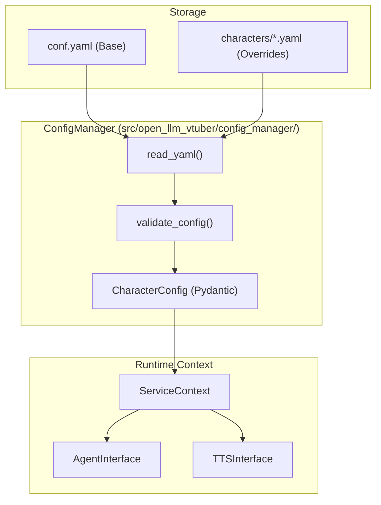
**Sources:** [src/open_llm_vtuber/config_manager/utils.py:16-74](), [characters/README.md:7-13]()

## Multi-Character Support & Discovery

The server automatically discovers available characters by scanning the directory defined in `system_config.config_alts_dir` [src/open_llm_vtuber/config_manager/system.py:13-13]().

- **Discovery:** The function `scan_config_alts_directory` walks the specified folder, reading each `.yaml` to extract the `conf_name` for UI display [src/open_llm_vtuber/config_manager/utils.py:127-171]().
- **Isolation:** Each character is isolated by its `conf_uid`. This UID is used to manage distinct chat histories and prevents conflicts between different personas [characters/README.md:80-83]().
- **Backgrounds:** Similarly, `scan_bg_directory` scans the `backgrounds/` folder for images available for switching in the UI [src/open_llm_vtuber/config_manager/utils.py:174-181]().

**Sources:** [src/open_llm_vtuber/config_manager/utils.py:127-181](), [src/open_llm_vtuber/config_manager/system.py:7-23]()

## Runtime Configuration Switching

Switching characters occurs over the WebSocket connection without restarting the server. When a client requests a configuration change:

1.  **Request:** The client sends a message containing the new configuration filename.
2.  **Validation:** The system validates the new configuration against the `Config` model [src/open_llm_vtuber/config_manager/utils.py:55-74]().
3.  **Re-initialization:** The runtime environment (often managed by `ServiceContext`) reloads engines based on the overrides found in the character-specific YAML [characters/README.md:106-109]().
4.  **Prompt Reconstruction:** The system prompt is updated using the new `persona_prompt` [src/open_llm_vtuber/config_manager/character.py:22-22]().

### Code Entity Association
This diagram maps the conceptual "Switch" to the actual classes and functions involved in the configuration lifecycle.

**Switching Logic Entity Map**
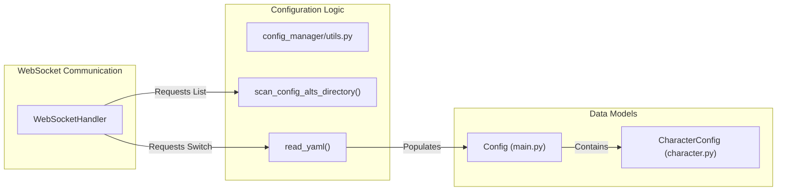
**Sources:** [src/open_llm_vtuber/config_manager/utils.py:127-171](), [src/open_llm_vtuber/config_manager/main.py:11-19](), [src/open_llm_vtuber/config_manager/character.py:13-29]()

## Implementation Details

### Environment Variable Substitution
The `read_yaml` utility supports substituting environment variables using the `${VAR_NAME}` syntax [src/open_llm_vtuber/config_manager/utils.py:39-46](). This allows sensitive keys (like API keys) to be kept out of character YAML files.

### Validation Logic
- **Persona Check:** `persona_prompt` cannot be empty [src/open_llm_vtuber/config_manager/character.py:72-78]().
- **Default Naming:** If `character_name` is omitted, it defaults to the `conf_name` [src/open_llm_vtuber/config_manager/character.py:80-84]().
- **Encoding:** The system attempts multiple encodings (`utf-8`, `gbk`, etc.) when reading character files to ensure cross-platform compatibility [src/open_llm_vtuber/config_manager/utils.py:87-104]().
- **Persistence:** Configurations can be saved back to disk using `save_config`, which dumps the Pydantic model to YAML [src/open_llm_vtuber/config_manager/utils.py:107-125]().

**Sources:** [src/open_llm_vtuber/config_manager/utils.py:39-125](), [src/open_llm_vtuber/config_manager/character.py:72-85]()

---

# Page: Prompt System

# Prompt System

<details>
<summary>Relevant source files</summary>

The following files were used as context for generating this wiki page:

- [avatars/mao.png](avatars/mao.png)
- [avatars/shizuku.png](avatars/shizuku.png)
- [characters/en_unhelpful_ai.yaml](characters/en_unhelpful_ai.yaml)
- [prompts/prompt_loader.py](prompts/prompt_loader.py)
- [prompts/utils/group_conversation_prompt.txt](prompts/utils/group_conversation_prompt.txt)
- [prompts/utils/live2d_expression_prompt.txt](prompts/utils/live2d_expression_prompt.txt)
- [prompts/utils/mcp_prompt.txt](prompts/utils/mcp_prompt.txt)
- [prompts/utils/proactive_speak_prompt.txt](prompts/utils/proactive_speak_prompt.txt)
- [prompts/utils/think_tag_prompt.txt](prompts/utils/think_tag_prompt.txt)
- [prompts/utils/tool_guidance_prompt.txt](prompts/utils/tool_guidance_prompt.txt)

</details>


The Prompt System in Open-LLM-VTuber is a modular architecture designed to separate a character's core persona from operational instructions. It utilizes a layered approach where a base system prompt is dynamically augmented with utility prompts (e.g., Live2D expressions, tool usage instructions, or group chat logic) before being sent to the LLM.

## Prompt Architecture Overview

The system distinguishes between **Persona Prompts** (who the character is) and **Utility Prompts** (how the character functions technically). 

1.  **Persona Prompts**: Defined in character-specific YAML files (e.g., `persona_prompt`) within the `characters/` directory [[characters/en_unhelpful_ai.yaml:8-9]]().
2.  **Utility Prompts**: Stored as `.txt` files in `prompts/utils/`. These provide instructions for specific capabilities like Live2D animations, MCP tool usage, and thought tags [[prompts/prompt_loader.py:9]]().

### Prompt Data Flow

The following diagram illustrates how the system components interact to load and assemble the final system message.

**System Prompt Assembly Pipeline**
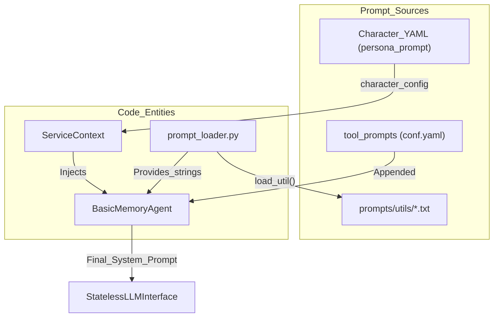
Sources: [[prompts/prompt_loader.py:1-75]](), [[characters/en_unhelpful_ai.yaml:3-9]]()

---

## Utility Prompts

Utility prompts are managed by `prompts/prompt_loader.py`, which includes robust encoding detection (supporting UTF-8, GBK, ASCII, etc.) to handle various text formats [[prompts/prompt_loader.py:29-54]]().

### Live2D Expression Prompt
**File**: `prompts/utils/live2d_expression_prompt.txt`
This prompt instructs the LLM to use specific keywords wrapped in brackets (e.g., `[expression1]`) to trigger facial expressions or Live2D body actions [[prompts/utils/live2d_expression_prompt.txt:1-4]](). The system replaces the `[<insert_emomap_keys>]` placeholder with actual keys defined in the character's model configuration [[prompts/utils/live2d_expression_prompt.txt:5]]().

### MCP (Model Context Protocol) Prompt
**File**: `prompts/utils/mcp_prompt.txt`
Used when MCP tools are enabled. It provides the LLM with:
*   A list of available servers and tools (replacing `[<insert_mcp_servers_with_tools>]`) [[prompts/utils/mcp_prompt.txt:9]]().
*   Strict JSON formatting rules for tool calls, requiring `mcp_server`, `tool`, and `arguments` fields [[prompts/utils/mcp_prompt.txt:18-26]]().
*   Instructions to perform a "dedicated response" containing only the JSON when calling a tool, avoiding conversational filler during the tool-triggering phase [[prompts/utils/mcp_prompt.txt:16]]().

### Think Tag Prompt
**File**: `prompts/utils/think_tag_prompt.txt`
Encourages the LLM to express inner thoughts, mental activities, and physical actions between `` tags [[prompts/utils/think_tag_prompt.txt:1]](). This provides a "Chain of Thought" layer that can be filtered or displayed differently in the UI [[prompts/utils/think_tag_prompt.txt:4-6]]().

### Proactive Speak Prompt
**File**: `prompts/utils/proactive_speak_prompt.txt`
A short instruction used when the system triggers the VTuber to speak without a direct user prompt, ensuring the output is engaging and context-appropriate [[prompts/utils/proactive_speak_prompt.txt:1]]().

### Group Conversation Prompt
**File**: `prompts/utils/group_conversation_prompt.txt`
Injected when the VTuber is part of a multi-participant chat. It identifies the human participant and other AI agents, instructing the AI to avoid using prefixes like `Name:` and to vary response lengths to facilitate interaction [[prompts/utils/group_conversation_prompt.txt:1-7]]().

### Tool Guidance Prompt
**File**: `prompts/utils/tool_guidance_prompt.txt`
Provides logic for tool usage, instructing the agent to use tools proactively without asking and limiting pre-tool speech to at most one sentence [[prompts/utils/tool_guidance_prompt.txt:1]]().

---

## Tool Prompt Injection

The system handles tool-use instructions through the `tool_prompts` configuration. These are typically appended to the system prompt to ensure high instruction following.

**Prompt Injection Logic**
| Component | Implementation | Description |
| :--- | :--- | :--- |
| `prompt_loader.py` | `load_util(util_name)` | Loads text files from `prompts/utils/` using `_load_file_content` [[prompts/prompt_loader.py:67-75]](). |
| `BasicMemoryAgent` | System Message Construction | Concatenates the persona, utility prompts, and tool schemas into the system message. |
| `Live2dModel` | `extract_emotion` | Parses the LLM output for keywords defined in the `live2d_expression_prompt`. |

**Natural Language to Code Mapping**
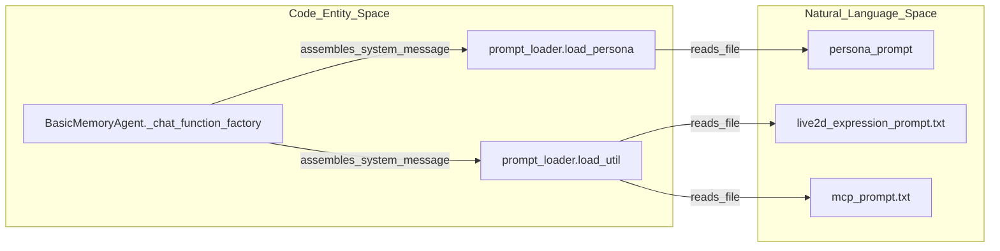
Sources: [[prompts/prompt_loader.py:57-75]](), [[prompts/utils/mcp_prompt.txt:1-37]](), [[prompts/utils/live2d_expression_prompt.txt:1-15]]()

Sources:
- `prompts/prompt_loader.py`
- `prompts/utils/mcp_prompt.txt`
- `prompts/utils/live2d_expression_prompt.txt`
- `prompts/utils/think_tag_prompt.txt`
- `prompts/utils/group_conversation_prompt.txt`
- `prompts/utils/tool_guidance_prompt.txt`
- `prompts/utils/proactive_speak_prompt.txt`
- `characters/en_unhelpful_ai.yaml`

---

# Page: Server & WebSocket Architecture

# Server & WebSocket Architecture

<details>
<summary>Relevant source files</summary>

The following files were used as context for generating this wiki page:

- [run_server.py](run_server.py)
- [src/open_llm_vtuber/server.py](src/open_llm_vtuber/server.py)
- [src/open_llm_vtuber/websocket_handler.py](src/open_llm_vtuber/websocket_handler.py)

</details>


The **Open-LLM-VTuber** server is built on **FastAPI** and provides a high-concurrency, asynchronous communication layer for VTuber clients. It manages the lifecycle of WebSocket connections, serves static assets (Live2D models, backgrounds, avatars), and provides REST endpoints for utility functions like ASR transcription and web-based tools.

The server architecture is designed to support multiple concurrent users by cloning a base `ServiceContext` for each session, ensuring that stateful components like chat history and conversation buffers remain isolated.

## System Component Overview

The server's entry point is `run_server.py`, which initializes the `WebSocketServer` class [run_server.py:146](). This class configures the FastAPI application, mounts specialized static file handlers, and registers the routing logic.

### Server Core Components

| Component | Code Entity | Responsibility |
| :--- | :--- | :--- |
| **Main Server** | `WebSocketServer` | Configures FastAPI, middleware, and mounts static directories [src/open_llm_vtuber/server.py:56-150](). |
| **Connection Handler** | `WebSocketHandler` | Manages client lifecycle, session context, and message routing [src/open_llm_vtuber/websocket_handler.py:61-98](). |
| **Proxy Layer** | `ProxyHandler` | Handles multi-client multiplexing and platform integrations [src/open_llm_vtuber/routes.py:108-109](). |
| **Service Context** | `ServiceContext` | Dependency container for ASR, TTS, LLM, and VAD engines [src/open_llm_vtuber/service_context.py:1-20](). |

**Diagram: Server Initialization & Routing Architecture**
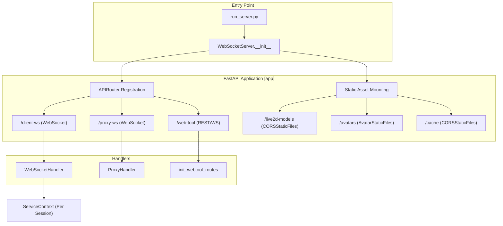
Sources: [src/open_llm_vtuber/server.py:56-149](), [src/open_llm_vtuber/routes.py:17-109](), [run_server.py:145-164]()

---

## Server Startup & Static Asset Serving

The server utilizes `uvicorn` to run the FastAPI application [run_server.py:159-164](). During startup, it performs critical checks, such as verifying the presence of the `frontend` submodule [run_server.py:50-108]() and synchronizing user configurations via the `UpgradeManager` [run_server.py:132]().

A key feature of the server is its specialized static file handling. `CORSStaticFiles` ensures that web-based Live2D renderers can access model files across origins [src/open_llm_vtuber/server.py:23-41](), while `AvatarStaticFiles` implements security checks to restrict file types to images only [src/open_llm_vtuber/server.py:43-54]().

For details, see [Server Startup & Static Asset Serving](#3.1).

Sources: [src/open_llm_vtuber/server.py:23-54](), [run_server.py:50-108](), [run_server.py:159-164]()

---

## WebSocket Handler & Message Routing

The `WebSocketHandler` is the primary engine for real-time interaction. When a client connects to `/client-ws`, the handler assigns a unique `client_uid` and clones the `default_context_cache` to create a session-specific environment [src/open_llm_vtuber/websocket_handler.py:178-193]().

Communication is driven by a `MessageType` system [src/open_llm_vtuber/websocket_handler.py:32-45](), which routes incoming JSON payloads to specific logic branches via a handler mapping [src/open_llm_vtuber/websocket_handler.py:76-98](), such as starting a conversation, updating character configurations, or fetching chat history.

For details, see [WebSocket Handler & Message Routing](#3.2).

**Diagram: WebSocket Communication Flow**
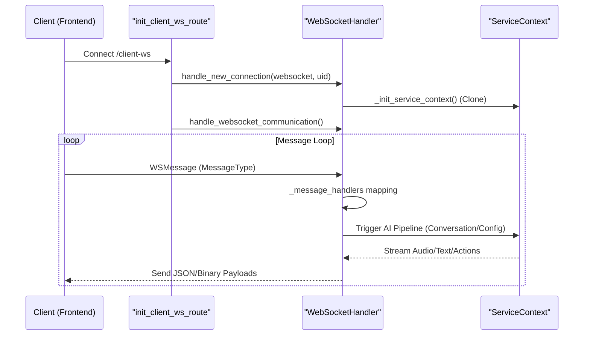
Sources: [src/open_llm_vtuber/websocket_handler.py:32-98](), [src/open_llm_vtuber/websocket_handler.py:100-134](), [src/open_llm_vtuber/websocket_handler.py:178-193]()

---

## REST API Endpoints & Web Tool

In addition to WebSockets, the server exposes RESTful endpoints for utility operations. This includes:
*   **ASR Transcription**: A `POST /asr` endpoint for processing audio uploads.
*   **Model Discovery**: `GET /live2d-models/info` which provides metadata for available models.
*   **Web Tool**: A browser-based utility located at `/web-tool` for testing TTS and ASR engines independently of the main VTuber interface [src/open_llm_vtuber/server.py:138-142]().

For details, see [REST API Endpoints & Web Tool](#3.3).

Sources: [src/open_llm_vtuber/server.py:97-98](), [src/open_llm_vtuber/server.py:138-142]()

---

## Proxy Handler & Bilibili Live Integration

The `ProxyHandler` acts as a middleman, allowing external platforms (like Bilibili Live) or specialized clients to interact with the VTuber. When `enable_proxy` is set in the configuration, the `/proxy-ws` endpoint becomes available [run_server.py:142-143](). This enables the VTuber to respond to live audiences by forwarding platform-specific events into the main conversation pipeline.

For details, see [Proxy Handler & Bilibili Live Integration](#3.4).

Sources: [src/open_llm_vtuber/server.py:101-109](), [run_server.py:142-143]()

---

# Page: Server Startup & Static Asset Serving

# Server Startup & Static Asset Serving

<details>
<summary>Relevant source files</summary>

The following files were used as context for generating this wiki page:

- [.gitmodules](.gitmodules)
- [prompts/utils/live_prompt.txt](prompts/utils/live_prompt.txt)
- [run_server.py](run_server.py)
- [src/open_llm_vtuber/server.py](src/open_llm_vtuber/server.py)

</details>


The `WebSocketServer` is the central entry point for the Open-LLM-VTuber backend. It leverages **FastAPI** to coordinate WebSocket communication, RESTful utility endpoints, and the serving of static assets (Live2D models, backgrounds, and frontend files).

## Server Lifecycle and Initialization

The server startup process is managed by `run_server.py`, which handles environment setup, configuration validation, and the Uvicorn execution loop.

### 1. Environment & Pre-startup
Before the server starts, the system performs several checks:
- **Environment Variables**: Sets `HF_HOME` and `MODELSCOPE_CACHE` to a local `models/` directory to ensure model weights are stored within the project [run_server.py:16-17](). It also supports the `--hf_mirror` flag to set `HF_ENDPOINT` to `https://hf-mirror.com` [run_server.py:176-177]().
- **Frontend Check**: Verifies if the `frontend/index.html` exists. If missing, it attempts to initialize the Git submodule pointing to the `Open-LLM-VTuber-Web` repository [run_server.py:50-108](), [.gitmodules:1-4]().
- **Config Sync**: The `UpgradeManager` synchronizes the user's `conf.yaml` with the latest template to ensure all required fields are present [run_server.py:131-135]().

### 2. Initialization Sequence
The `WebSocketServer` class is initialized in two stages:
1.  **Synchronous Init**: The `__init__` method sets up the FastAPI app, configures `CORSMiddleware`, registers routers, and mounts static directories [src/open_llm_vtuber/server.py:74-149]().
2.  **Asynchronous Init**: The `initialize()` method is called via `asyncio.run()` to load the `ServiceContext`, which instantiates the AI engines (ASR, TTS, LLM) based on the configuration [run_server.py:151](), [src/open_llm_vtuber/server.py:151-154]().

### 3. Shutdown & Cleanup
Upon server termination, `atexit` triggers `WebSocketServer.clean_cache()`, which deletes and recreates the `cache/` directory to remove temporary audio files generated during the session [run_server.py:136](), [src/open_llm_vtuber/server.py:157-163]().

### Server Startup Flow
The following diagram illustrates the relationship between the startup script and the server class entities.

"Server Startup Sequence"
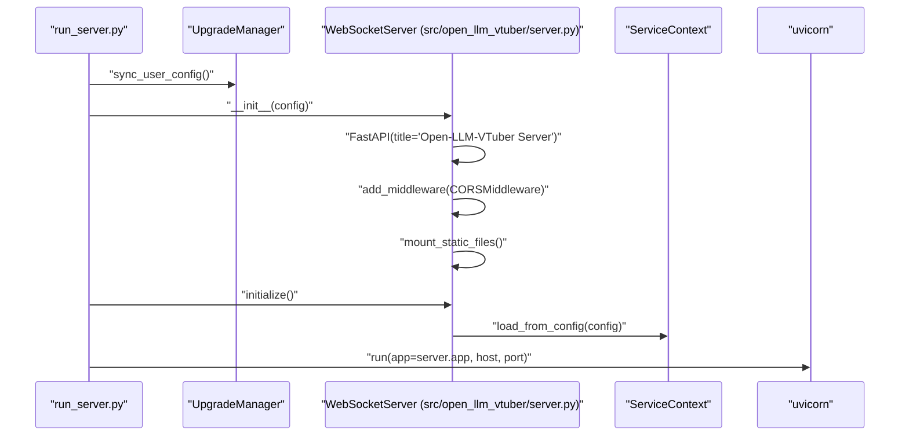
Sources: [run_server.py:120-164](), [src/open_llm_vtuber/server.py:74-154]()

---

## Static Asset Serving

Open-LLM-VTuber serves various static assets required by the frontend. To ensure these assets are accessible across different origins (e.g., when running the frontend on a different port), the server uses custom static file handlers.

### CORSStaticFiles & AvatarStaticFiles
Standard FastAPI/Starlette `StaticFiles` can sometimes bypass middleware. To guarantee CORS headers are present, the project implements:
- **`CORSStaticFiles`**: Overrides `get_response` to inject `Access-Control-Allow-Origin: *` and sets correct `Content-Type` for Javascript files [src/open_llm_vtuber/server.py:23-41]().
- **`AvatarStaticFiles`**: Inherits from `CORSStaticFiles` but adds a security check to only allow specific image extensions (`.jpg`, `.jpeg`, `.png`, `.gif`, `.svg`), returning a `403 Forbidden` for other types [src/open_llm_vtuber/server.py:43-53]().

### Endpoint Mount Points
The server mounts several directories to specific URL prefixes:

| URL Path | Local Directory | Handler Class | Purpose |
| :--- | :--- | :--- | :--- |
| `/cache` | `cache/` | `CORSStaticFiles` | Temporary TTS audio files |
| `/live2d-models` | `live2d-models/` | `CORSStaticFiles` | Live2D model assets (.model3.json, textures) |
| `/bg` | `backgrounds/` | `CORSStaticFiles` | Background images for the VTuber room |
| `/avatars` | `avatars/` | `AvatarStaticFiles` | Character/User profile icons |
| `/web-tool` | `web_tool/` | `CORSStaticFiles` | The browser-based ASR/TTS utility (with `html=True`) |
| `/` | `frontend/` | `CORSStaticFiles` | The main VTuber frontend application (catch-all) |

Sources: [src/open_llm_vtuber/server.py:111-149]()

---

## Routing Architecture

The server logic is split into several routers initialized via factory functions and included in the main FastAPI app.

### Route Initialization
- **`init_client_ws_route`**: Registers the primary WebSocket endpoint for the VTuber client [src/open_llm_vtuber/server.py:93-95]().
- **`init_webtool_routes`**: Registers REST endpoints and WebSocket routes for system utilities, such as the web-based configuration and testing tools [src/open_llm_vtuber/server.py:96-98]().
- **`init_proxy_route`**: If `enable_proxy` is true in `system_config`, it registers routes to allow external platform integrations to tunnel messages to the internal client. The server constructs a `server_url` using the configured host and port [src/open_llm_vtuber/server.py:101-109]().

### Entity Association Diagram
This diagram maps the logical server components to their implementation classes and route definitions.

"Server Routing & Entity Map"
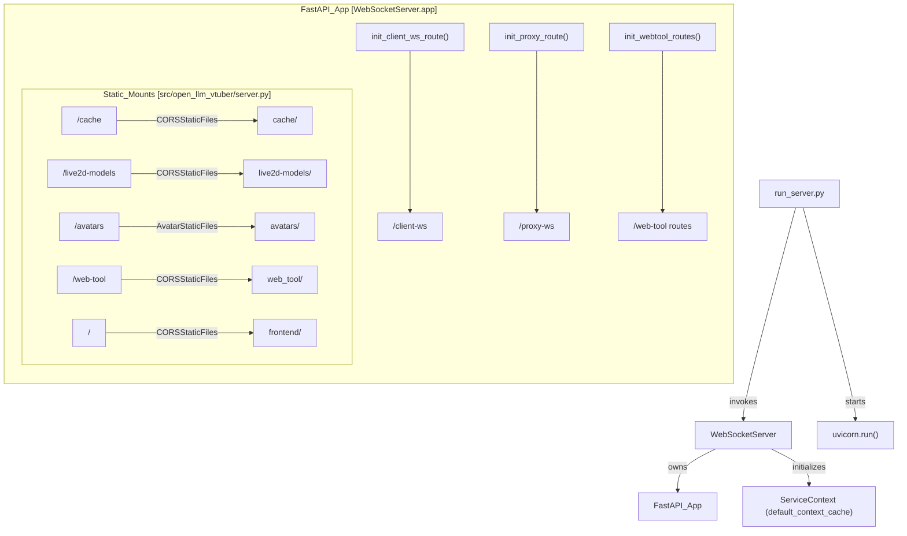
Sources: [src/open_llm_vtuber/server.py:74-149](), [run_server.py:146-164]()

---

# Page: WebSocket Handler & Message Routing

# WebSocket Handler & Message Routing

<details>
<summary>Relevant source files</summary>

The following files were used as context for generating this wiki page:

- [src/open_llm_vtuber/chat_group.py](src/open_llm_vtuber/chat_group.py)
- [src/open_llm_vtuber/conversations/types.py](src/open_llm_vtuber/conversations/types.py)
- [src/open_llm_vtuber/message_handler.py](src/open_llm_vtuber/message_handler.py)
- [src/open_llm_vtuber/websocket_handler.py](src/open_llm_vtuber/websocket_handler.py)

</details>


The `WebSocketHandler` serves as the central orchestrator for real-time communication between the client and the server. It manages the connection lifecycle, routes incoming messages to appropriate service logic based on their type, and ensures that each client maintains its own isolated service context while supporting collaborative group features.

## WebSocketHandler Overview

The `WebSocketHandler` class manages multiple concurrent client connections, each identified by a unique `client_uid` [src/open_llm_vtuber/websocket_handler.py:61-71](). It maintains a mapping of active WebSockets and their corresponding `ServiceContext` instances.

### Context Cloning per Client
To ensure thread safety and individual user experiences, the handler performs "context cloning" for every new connection. Instead of sharing a global state, it deep-copies the default configuration and engines into a session-specific `ServiceContext` [src/open_llm_vtuber/websocket_handler.py:178-202](). This allows one user to switch characters or LLM settings without affecting other connected clients.

### Connection Lifecycle
1.  **New Connection**: `handle_new_connection` initializes the session-specific `ServiceContext` [src/open_llm_vtuber/websocket_handler.py:100-116]().
2.  **Data Storage**: Client data, buffers, and initial group status are registered in `_store_client_data` [src/open_llm_vtuber/websocket_handler.py:135-148]().
3.  **Initial Handshake**: The server sends initial model information, configuration details, and a command to start the microphone via `_send_initial_messages` [src/open_llm_vtuber/websocket_handler.py:149-176]().
4.  **Message Loop**: The handler enters a continuous loop, receiving JSON messages and dispatching them via `_message_handlers` [src/open_llm_vtuber/websocket_handler.py:214-233]().
5.  **Disconnection**: Upon disconnect, `handle_disconnection` cleans up buffers, cancels active conversation tasks, and notifies group members [src/open_llm_vtuber/websocket_handler.py:235-252]().

**Sources:**
- [src/open_llm_vtuber/websocket_handler.py:61-252]()

---

## Message Routing & MessageType Enum

Incoming messages are categorized using the `MessageType` enum, which groups specific actions into functional domains [src/open_llm_vtuber/websocket_handler.py:32-45]().

### Routing Table
The handler uses a dispatch table initialized in `_init_message_handlers` to map `action` or `type` strings to internal methods [src/open_llm_vtuber/websocket_handler.py:76-98]().

| Message Category | Actions / Types | Handler Method |
| :--- | :--- | :--- |
| **GROUP** | `add-client-to-group`, `remove-client-from-group`, `request-group-info` | `_handle_group_operation`, `_handle_group_info` |
| **HISTORY** | `fetch-history-list`, `fetch-and-set-history`, `create-new-history`, `delete-history` | `_handle_history_list_request`, `_handle_fetch_history`, `_handle_create_history`, `_handle_delete_history` |
| **CONVERSATION** | `mic-audio-end`, `text-input`, `ai-speak-signal` | `_handle_conversation_trigger` |
| **CONFIG** | `fetch-configs`, `switch-config`, `request-init-config` | `_handle_fetch_configs`, `_handle_config_switch`, `_handle_init_config_request` |
| **CONTROL** | `interrupt-signal`, `audio-play-start`, `heartbeat` | `_handle_interrupt`, `_handle_audio_play_start`, `_handle_heartbeat` |
| **DATA** | `mic-audio-data`, `raw-audio-data` | `_handle_audio_data`, `_handle_raw_audio_data` |

**Sources:**
- [src/open_llm_vtuber/websocket_handler.py:32-45]()
- [src/open_llm_vtuber/websocket_handler.py:76-98]()

---

## Audio Streaming & VAD Integration

The system supports real-time audio streaming from the client. Audio data is handled differently depending on whether the Voice Activity Detection (VAD) is processed on the client or server.

### VAD-Based Routing
1.  **Audio Buffering**: Binary or list-based audio chunks received via `mic-audio-data` are appended to `received_data_buffers` [src/open_llm_vtuber/websocket_handler.py:438-444]().
2.  **Triggering**: When the client signals the end of speech (`mic-audio-end`), the handler retrieves the full buffer and triggers the conversation pipeline [src/open_llm_vtuber/websocket_handler.py:417-436]().
3.  **VAD Processing**: If server-side VAD is enabled, `_handle_audio_data` passes the chunks to `session_service_context.vad_engine` to detect speech boundaries [src/open_llm_vtuber/websocket_handler.py:446-456]().

### Data Flow: Audio to Conversation
The following diagram bridges the WebSocket messages to the internal code entities responsible for processing.

Title: Audio Data Routing Flow
```mermaid
graph TD
    subgraph "Client Space"
        A["WebSocket Message (mic-audio-data)"]
        B["WebSocket Message (mic-audio-end)"]
    end

    subgraph "WebSocketHandler (Code Entity)"
        C["_handle_audio_data"]
        D["_handle_conversation_trigger"]
        E["received_data_buffers (dict)"]
    end

    subgraph "Conversation Pipeline"
        F["handle_conversation_trigger"]
        G["ServiceContext.vad_engine"]
    end

    A --> C
    C -->|Append| E
    C -->|Check VAD| G
    B --> D
    D -->|Retrieve Buffer| E
    D --> F
```

**Sources:**
- [src/open_llm_vtuber/websocket_handler.py:417-456]()
- [src/open_llm_vtuber/conversations/conversation_handler.py:26-29]()

---

## Multi-Client Synchronization & Chat Groups

The `ChatGroupManager` allows multiple clients to join a single conversation session, enabling a "group chat" experience where one AI interacts with multiple users.

### Group Operations
- **Creation**: A group is automatically created when a client invites another or via `create_group_for_client` [src/open_llm_vtuber/chat_group.py:20-26]().
- **Joining**: `add_client_to_group` links a `target_uid` to the inviter's `group_id` [src/open_llm_vtuber/chat_group.py:28-62]().
- **Broadcasting**: Messages like AI responses or interruptions are broadcast to all members of the group using `broadcast_to_group` [src/open_llm_vtuber/chat_group.py:199-215]().

### Synchronization Logic
When a client in a group triggers a conversation, the `handle_conversation_trigger` logic accounts for `GroupConversationState` to manage the turn-taking and shared history [src/open_llm_vtuber/conversations/types.py:43-55]().

Title: Chat Group Management Entity Relationship
```mermaid
classDiagram
    class WebSocketHandler {
        +client_connections: dict
        +client_contexts: dict
        +chat_group_manager: ChatGroupManager
        +_handle_group_operation()
    }
    class ChatGroupManager {
        +client_group_map: dict
        +groups: dict
        +create_group_for_client()
        +add_client_to_group()
    }
    class Group {
        +group_id: str
        +owner_uid: str
        +members: set
    }
    class GroupConversationState {
        +group_id: str
        +conversation_history: list
        +current_speaker_uid: str
    }

    WebSocketHandler *-- ChatGroupManager
    ChatGroupManager *-- Group
    Group -- GroupConversationState : "managed via group_id"
```

**Sources:**
- [src/open_llm_vtuber/chat_group.py:9-26]()
- [src/open_llm_vtuber/chat_group.py:28-62]()
- [src/open_llm_vtuber/chat_group.py:199-215]()
- [src/open_llm_vtuber/conversations/types.py:43-55]()

---

## Response Waiting Mechanism

The `MessageHandler` utility provides a way for the server to send a request to a client and wait asynchronously for a specific response [src/open_llm_vtuber/message_handler.py:7-15]().

- **`wait_for_response`**: Creates an `asyncio.Event` and blocks until the client sends a message with a matching `response_type` and `request_id` [src/open_llm_vtuber/message_handler.py:16-54]().
- **`handle_message`**: Called by the `WebSocketHandler` for every incoming message. If the message matches a waiting event, it sets the event and stores the data [src/open_llm_vtuber/message_handler.py:56-76]().

This is primarily used for complex interactions where the server needs confirmation or data from the frontend before proceeding with the conversation pipeline.

**Sources:**
- [src/open_llm_vtuber/message_handler.py:7-76]()
- [src/open_llm_vtuber/websocket_handler.py:221-224]()

---

# Page: REST API Endpoints & Web Tool

# REST API Endpoints & Web Tool

<details>
<summary>Relevant source files</summary>

The following files were used as context for generating this wiki page:

- [src/open_llm_vtuber/chat_history_manager.py](src/open_llm_vtuber/chat_history_manager.py)
- [src/open_llm_vtuber/routes.py](src/open_llm_vtuber/routes.py)
- [web_tool/README.md](web_tool/README.md)
- [web_tool/index.html](web_tool/index.html)
- [web_tool/main.js](web_tool/main.js)
- [web_tool/recorder.js](web_tool/recorder.js)

</details>


This page documents the RESTful API endpoints and the built-in browser-based utility tool provided by the Open-LLM-VTuber server. While the primary communication with the VTuber occurs over a stateful WebSocket, these REST endpoints provide stateless access to the ASR/TTS engines and metadata about available Live2D assets.

## Overview

The server exposes several specialized routes to support frontend initialization and utility functions. These are primarily defined and initialized in `src/open_llm_vtuber/routes.py` [src/open_llm_vtuber/routes.py:1-13]() and mounted to the FastAPI application during startup.

### Key Components
- **Live2D Info**: Scans the filesystem to provide a list of available models.
- **ASR Endpoint**: Allows uploading WAV files for one-off transcriptions.
- **Web Tool**: A browser-based frontend for testing configured ASR/TTS engines.
- **TTS WebSocket**: A dedicated streaming endpoint for the Web Tool's speech generation.
- **Chat History**: (Handled by `chat_history_manager.py`) Manages persistence for sessions, though primarily accessed via the main WebSocket.

## REST API Reference

### 1. Live2D Model Information
**Endpoint:** `GET /live2d-models/info`

This endpoint scans the `live2d-models/` directory for valid Cubism models. A model is considered valid if it contains a folder named `FolderName` with a corresponding `FolderName.model3.json` file inside [src/open_llm_vtuber/routes.py:108-115]().

**Response Structure:**
| Field | Type | Description |
| :--- | :--- | :--- |
| `type` | string | Constant: `"live2d-models/info"` |
| `count` | integer | Number of valid models found. |
| `characters` | list | Objects containing `name`, `avatar` (path), and `model_path`. |

**Sources:** [src/open_llm_vtuber/routes.py:96-139]()

### 2. Audio Transcription (ASR)
**Endpoint:** `POST /asr`

Accepts a 16-bit PCM WAV file and returns the transcribed text using the currently active ASR engine defined in the `ServiceContext` [src/open_llm_vtuber/routes.py:141-145]().

**Implementation Details:**
- **Validation**: The server checks for a minimum file size (44 bytes for WAV header) [src/open_llm_vtuber/routes.py:152-153]().
- **Processing**: It strips the 44-byte header and converts the remaining 16-bit PCM data into a `float32` numpy array normalized to the range `[-1.0, 1.0]` [src/open_llm_vtuber/routes.py:156-168]().
- **Execution**: The array is passed to `asr_engine.async_transcribe_np()` [src/open_llm_vtuber/routes.py:178-180]().

**Sources:** [src/open_llm_vtuber/routes.py:141-200]()

### 3. Web Tool Redirects
**Endpoints:** `GET /web-tool` and `GET /web_tool`

These endpoints serve as aliases that redirect the browser to `/web-tool/index.html` [src/open_llm_vtuber/routes.py:86-94](). The actual files are served from the `web_tool/` directory.

## Web Tool Utility

The Web Tool is a built-in frontend utility that allows users to utilize the VTuber's ASR and TTS capabilities independently of the companion interface [web_tool/README.md:9-11](). It is accessible at `http://localhost:12393/web-tool` [web_tool/README.md:13]().

### Speech Recognition (ASR)
The tool provides two methods for transcription:
1.  **Live Recording**: Uses the `AudioRecorder` class to capture mono audio at 16kHz [web_tool/recorder.js:11-16](). It resamples the audio and generates a valid WAV header in the browser before uploading to `/asr` [web_tool/recorder.js:55-92]().
2.  **File Upload**: Users can upload existing audio files. The tool uses the browser's `AudioContext` to decode the file and convert it to the required 16kHz mono WAV format before sending it to the server [web_tool/main.js:37-47]().

### Text-to-Speech (TTS)
**Endpoint:** `WS /tts-ws`

The Web Tool uses a dedicated WebSocket for TTS to handle streaming responses.
- **Request**: Sends a JSON object: `{"text": "..."}` [web_tool/main.js:220-222]().
- **Response**: The server streams `partial` messages containing paths to cached audio chunks [web_tool/main.js:136-141]().
- **Assembly**: The frontend fetches these chunks, decodes them, and combines them into a single `AudioBuffer` for playback and download [web_tool/main.js:173-195]().

**Sources:** [web_tool/main.js:115-225](), [web_tool/recorder.js:1-132](), [web_tool/index.html:112-137]()

## Data Flow Diagrams

### ASR Request Pipeline
The following diagram illustrates the flow of audio data from the Web Tool frontend to the backend ASR engine.

Title: ASR Data Flow (Frontend to Code Entities)
```mermaid
graph LR
    subgraph "Browser (Web Tool)"
        A["AudioRecorder (recorder.js)"] -- "Capture/Resample" --> B["Blob (WAV)"]
        B -- "POST /asr" --> C["routes.py:transcribe_audio"]
    end

    subgraph "FastAPI Server"
        C -- "numpy conversion" --> D["audio_array (float32)"]
        D -- "async_transcribe_np" --> E["ASRInterface Implementation"]
        E -- "Transcription Text" --> F["JSON Response"]
    end

    F -- "Display" --> G["transcriptionArea (main.js)"]
```
**Sources:** [src/open_llm_vtuber/routes.py:141-182](), [web_tool/main.js:84-112](), [web_tool/recorder.js:33-53]()

### TTS Streaming Architecture
This diagram maps the interaction between the Web Tool's WebSocket client and the server's TTS streaming logic.

Title: TTS Streaming Flow (Web Tool)
```mermaid
graph TD
    subgraph "web_tool/main.js"
        WS_C["WebSocket (Client)"]
        AC["AudioContext"]
        BUF["audioBuffers[]"]
    end

    subgraph "src/open_llm_vtuber/routes.py"
        WS_S["tts_endpoint (Server)"]
        SC["ServiceContext"]
        TTS["TTSInterface"]
    end

    WS_C -- "JSON: {text}" --> WS_S
    WS_S -- "divide sentences" --> TTS
    TTS -- "generate chunk" --> CACHE["/cache/ (Static Files)"]
    WS_S -- "status: partial, audioPath" --> WS_C
    WS_C -- "fetch chunk" --> CACHE
    CACHE -- "audio data" --> AC
    AC -- "decode" --> BUF
    WS_S -- "status: complete" --> WS_C
    BUF -- "Combine & Play" --> SPK["Speaker Output"]
```
**Sources:** [src/open_llm_vtuber/routes.py:201-230](), [web_tool/main.js:115-165](), [web_tool/main.js:215-225]()

## Implementation Details

### Live2D Model Discovery
The discovery logic in `init_webtool_routes` is responsible for mapping the filesystem to the API. It looks for:
1.  **Folder Name**: The primary identifier [src/open_llm_vtuber/routes.py:110]().
2.  **Model File**: Must be `folder_name.model3.json` [src/open_llm_vtuber/routes.py:112-113]().
3.  **Avatar**: Searches for `.png`, `.jpg`, or `.jpeg` files matching the folder name to use as a preview [src/open_llm_vtuber/routes.py:118-124]().

### WAV Header Construction (Frontend)
The `AudioRecorder` class manually constructs the 44-byte RIFF/WAVE header to ensure compatibility with the backend's expectations of a 16kHz, 16-bit PCM mono file [web_tool/recorder.js:55-92](). This involves writing specific offsets for `SampleRate` (24), `ByteRate` (28), and `BlockAlign` (32) [web_tool/recorder.js:82-85]().

### Chat History Management
While primarily a backend utility, the `chat_history_manager.py` ensures that sessions are isolated and safe.
- **Path Sanitization**: The `_sanitize_path_component` and `_is_safe_filename` functions prevent path traversal attacks by validating filenames against a regex [src/open_llm_vtuber/chat_history_manager.py:19-38]().
- **Unique Identifiers**: History files are named using a combination of a timestamp and a UUID: `YYYY-MM-DD_HH-MM-SS_UUID` [src/open_llm_vtuber/chat_history_manager.py:70-71]().
- **Storage**: Messages are stored as JSON arrays with `role`, `timestamp`, and `content` fields [src/open_llm_vtuber/chat_history_manager.py:131-135]().

**Sources:** [src/open_llm_vtuber/routes.py:96-139](), [web_tool/recorder.js:55-92](), [src/open_llm_vtuber/chat_history_manager.py:19-147]()

---

# Page: Proxy Handler & Bilibili Live Integration

# Proxy Handler & Bilibili Live Integration

<details>
<summary>Relevant source files</summary>

The following files were used as context for generating this wiki page:

- [scripts/run_bilibili_live.py](scripts/run_bilibili_live.py)
- [src/open_llm_vtuber/agent/agents/letta_agent.py](src/open_llm_vtuber/agent/agents/letta_agent.py)
- [src/open_llm_vtuber/config_manager/live.py](src/open_llm_vtuber/config_manager/live.py)
- [src/open_llm_vtuber/live/bilibili_live.py](src/open_llm_vtuber/live/bilibili_live.py)
- [src/open_llm_vtuber/live/live_interface.py](src/open_llm_vtuber/live/live_interface.py)
- [src/open_llm_vtuber/proxy_handler.py](src/open_llm_vtuber/proxy_handler.py)
- [src/open_llm_vtuber/proxy_message_queue.py](src/open_llm_vtuber/proxy_message_queue.py)

</details>


The `ProxyHandler` and its associated components allow multiple clients (such as a web browser and a live platform scraper) to connect to a single VTuber server instance. This architecture ensures that live stream comments (danmaku) can be processed and responded to by the VTuber while the streamer still maintains control via a web interface.

## Proxy Handler Architecture

The `ProxyHandler` acts as a middleman that manages multiple client WebSocket connections and multiplexes them into a single upstream connection to the `WebSocketHandler` on the main server [src/open_llm_vtuber/proxy_handler.py:13-17]().

### Key Responsibilities
- **Multiplexing**: Manages a dictionary of `clients` [src/open_llm_vtuber/proxy_handler.py:28]() and assigns each a unique `client_id` [src/open_llm_vtuber/proxy_handler.py:102]().
- **Upstream Connection**: Maintains a persistent connection to the main server at `server_url` [src/open_llm_vtuber/proxy_handler.py:26]().
- **Message Queuing**: Uses `ProxyMessageQueue` to ensure that messages from different clients do not collide or interrupt active AI generations [src/open_llm_vtuber/proxy_handler.py:34]().
- **Heartbeat & Reconnection**: Implements `_maintain_connection` to ensure the proxy stays connected to the server via `heartbeat` messages every 30 seconds [src/open_llm_vtuber/proxy_handler.py:71-90]().

### Proxy Data Flow Diagram
This diagram shows how the `ProxyHandler` bridges external clients to the `WebSocketServer`.

```mermaid
graph TD
    subgraph "External_Clients"
        WEB["Web_Browser_Frontend"]
        BILI["BiliBiliLivePlatform"]
    end

    subgraph "Proxy_System_proxy_handler.py"
        PH["ProxyHandler_Class"]
        PMQ["ProxyMessageQueue"]
    end

    subgraph "Main_Server"
        WSS["WebSocketServer_FastAPI"]
    end

    WEB -- "WebSocket_client-ws" --> PH
    BILI -- "WebSocket_proxy-ws" --> PH
    PH -- "queue_message()" --> PMQ
    PMQ -- "forward_func()" --> PH
    PH -- "server_ws.send_json()" --> WSS
    WSS -- "forward_server_messages()" --> PH
    PH -- "broadcast_to_clients" --> WEB
    PH -- "broadcast_to_clients" --> BILI
```
**Sources:** [src/open_llm_vtuber/proxy_handler.py:13-63](), [src/open_llm_vtuber/proxy_message_queue.py:7-22]()

---

## Proxy Message Queue

The `ProxyMessageQueue` implements a producer-consumer pattern specifically designed for the VTuber's sequential conversation flow [src/open_llm_vtuber/proxy_message_queue.py:7-11]().

### Conversation State Awareness
The queue tracks the `_conversation_active` state [src/open_llm_vtuber/proxy_message_queue.py:16]().
1. **Queuing**: When a `text-input` message arrives, it is appended to a `deque` along with its `sender_id` [src/open_llm_vtuber/proxy_message_queue.py:41-45]().
2. **Consumption**: The `_consume_loop` only pops the next message if `_conversation_active` is `False` [src/open_llm_vtuber/proxy_message_queue.py:100]().
3. **Automatic Flow**: When a response finishes, the proxy marks the conversation as inactive, triggering the consumer to process the next item in the queue [src/open_llm_vtuber/proxy_message_queue.py:68-69]().

### Message Handling Logic
| Message Type | Handling Logic | Code Reference |
| :--- | :--- | :--- |
| `text-input` | Added to `ProxyMessageQueue` for sequential processing. | [src/open_llm_vtuber/proxy_handler.py:125-127]() |
| `interrupt-signal` | Bypasses queue, sets `conversation_active = False` immediately to stop current generation. | [src/open_llm_vtuber/proxy_handler.py:129-136]() |
| `request-init-config` | Sent upon new client connection to synchronize state. | [src/open_llm_vtuber/proxy_handler.py:114-115]() |
| Others | Forwarded directly to server via `forward_to_server`. | [src/open_llm_vtuber/proxy_handler.py:138-139]() |

**Sources:** [src/open_llm_vtuber/proxy_message_queue.py:91-132](), [src/open_llm_vtuber/proxy_handler.py:121-140]()

---

## Bilibili Live Integration

The Bilibili integration allows the VTuber to read and respond to live danmaku (chat messages). It uses the `blivedm` library to scrape the live room and communicates with the server through the `ProxyHandler`.

### BiliBiliLivePlatform Class
This class implements the `LivePlatformInterface` [src/open_llm_vtuber/live/live_interface.py:6]() to handle the lifecycle of a live session.

- **Room Monitoring**: Can monitor multiple `room_ids` simultaneously [src/open_llm_vtuber/live/bilibili_live.py:52]().
- **Authentication**: Supports `sessdata` for authenticated requests [src/open_llm_vtuber/live/bilibili_live.py:53]().
- **Danmaku Processing**: The `_handle_danmaku` method receives raw text and wraps it in a `text-input` JSON structure before sending it to the proxy [src/open_llm_vtuber/live/bilibili_live.py:170-199]().

### Integration Component Diagram
This diagram maps the Bilibili scraper components to the code entities.

```mermaid
sequenceDiagram
    participant B as "BiliBili_Live_Room"
    participant C as "BiliBiliLivePlatform"
    participant H as "blivedm.handlers.BaseHandler"
    participant P as "ProxyHandler"
    participant S as "WebSocketServer"

    C->>B: "Connect via blivedm.BLiveClient"
    B-->>H: "OnDanmaku event"
    H->>C: "_handle_danmaku(text)"
    C->>P: "_send_to_proxy({'type': 'text-input', 'text': '...'})"
    P->>P: "queue_message()"
    Note over P: "Wait for conversation_active == False"
    P->>S: "forward_to_server()"
    S-->>P: "audio/text response"
    P-->>C: "broadcast response"
    C->>C: "handle_incoming_messages()"
```
**Sources:** [src/open_llm_vtuber/live/bilibili_live.py:33-60](), [src/open_llm_vtuber/live/bilibili_live.py:170-206](), [scripts/run_bilibili_live.py:14-44]()

### Configuration
The Bilibili integration is configured via the `live_config` section in `conf.yaml`, which is parsed into `BiliBiliLiveConfig` [src/open_llm_vtuber/config_manager/live.py:6-28]().

| Config Field | Type | Description |
| :--- | :--- | :--- |
| `room_ids` | `List[int]` | List of Bilibili room IDs to scrape. |
| `sessdata` | `str` | SESSDATA cookie for authenticated scraper access. |

**Sources:** [src/open_llm_vtuber/config_manager/live.py:6-21]()

### Execution
The Bilibili client is run as a separate process using the script `scripts/run_bilibili_live.py` [scripts/run_bilibili_live.py:14](). It validates the configuration using `validate_config` and initializes the `BiliBiliLivePlatform` before entering an async loop via `platform.run()` [scripts/run_bilibili_live.py:23-44]().

**Sources:** [scripts/run_bilibili_live.py:56-62]()

---

# Page: Service Context & Session Management

# Service Context & Session Management

<details>
<summary>Relevant source files</summary>

The following files were used as context for generating this wiki page:

- [src/open_llm_vtuber/agent/agents/basic_memory_agent.py](src/open_llm_vtuber/agent/agents/basic_memory_agent.py)
- [src/open_llm_vtuber/chat_history_manager.py](src/open_llm_vtuber/chat_history_manager.py)
- [src/open_llm_vtuber/routes.py](src/open_llm_vtuber/routes.py)
- [src/open_llm_vtuber/service_context.py](src/open_llm_vtuber/service_context.py)

</details>


The `ServiceContext` acts as the primary dependency injection container and state manager for every client session in Open-LLM-VTuber. It encapsulates all AI engine instances (ASR, TTS, LLM, VAD) and their associated configurations, ensuring that each connected user has an isolated environment. Complementing this, the session management system handles persistent chat history, allowing the VTuber to maintain context across interactions.

### ServiceContext Overview

A `ServiceContext` instance is created for every unique connection. It holds the active instances of all engines and the current configuration state. When a client connects via the `/client-ws` endpoint, the `WebSocketHandler` initializes a context that follows the client throughout the session lifecycle [src/open_llm_vtuber/routes.py:29-37]().

**Key Responsibilities:**
*   **Engine Storage:** Holds references to the `asr_engine`, `tts_engine`, `agent_engine`, `vad_engine`, and `translate_engine` [src/open_llm_vtuber/service_context.py:51-56]().
*   **Configuration Management:** Stores the `SystemConfig` and `CharacterConfig` specific to the session [src/open_llm_vtuber/service_context.py:46-48]().
*   **Prompt Assembly:** Combines persona prompts with Live2D expression instructions and MCP tool descriptions into a final `system_prompt` [src/open_llm_vtuber/service_context.py:64-68]().
*   **MCP Integration:** Manages the lifecycle of Model Context Protocol (MCP) components like the `ToolManager`, `MCPClient`, and `ToolExecutor` [src/open_llm_vtuber/service_context.py:58-62]().

#### Service Context Entity Map
This diagram shows how the `ServiceContext` aggregates various code entities to form a complete VTuber session.

```mermaid
graph TD
    subgraph "SessionSpace"
        SC["ServiceContext"]
    end

    subgraph "EngineSpace"
        ASR["ASRInterface"]
        TTS["TTSInterface"]
        AGENT["AgentInterface"]
        VAD["VADInterface"]
        TRANS["TranslateInterface"]
    end

    subgraph "MCP_Subsystem"
        TM["ToolManager"]
        MC["MCPClient"]
        TE["ToolExecutor"]
    end

    subgraph "ConfigSpace"
        CONF["Config"]
        CHAR["CharacterConfig"]
    end

    SC --> ASR
    SC --> TTS
    SC --> AGENT
    SC --> VAD
    SC --> TRANS
    SC --> TM
    SC --> MC
    SC --> TE
    SC --> CONF
    SC --> CHAR
```
**Sources:** [src/open_llm_vtuber/service_context.py:41-74](), [src/open_llm_vtuber/config_manager.py:27-38]()

---

### ServiceContext Lifecycle

The lifecycle of a `ServiceContext` begins at connection and can be dynamically updated during runtime. The `load_from_config` method is the central entry point for initializing all sub-engines using their respective factories (e.g., `ASRFactory`, `TTSFactory`, `AgentFactory`) [src/open_llm_vtuber/service_context.py:21-25]().

If a user changes their character or settings via the frontend, the `handle_config_switch` method allows the context to re-initialize specific engines without dropping the WebSocket connection. This ensures a seamless transition between different VTuber personas or AI models.

For details on initialization, factory patterns, and runtime reconfiguration, see **[ServiceContext Lifecycle (#4.1)]**.

**Sources:** [src/open_llm_vtuber/service_context.py:240-250](), [src/open_llm_vtuber/service_context.py:430-445]()

---

### Chat History Management

Chat history is managed as a file-based JSON system located in the `chat_history/` directory. Each session is identified by a `conf_uid` (representing the character/configuration) and a `history_uid` (representing the specific conversation session) [src/open_llm_vtuber/chat_history_manager.py:41-47]().

The system automatically persists messages from both the "human" (user) and the "ai" (VTuber). These records are used by the `AgentInterface` to populate the LLM's short-term memory during the `set_memory_from_history` call [src/open_llm_vtuber/agent/agents/basic_memory_agent.py:176-180]().

#### Data Flow: Natural Language to History Storage
This diagram illustrates how spoken or typed input becomes a persistent code entity in the history system.

```mermaid
sequenceDiagram
    participant User as "User (WebSocket)"
    participant Agent as "BasicMemoryAgent"
    participant CHM as "chat_history_manager.py"
    participant Disk as "chat_history/{conf_uid}/{history_uid}.json"

    User->>Agent: "Hello VTuber!"
    Agent->>CHM: store_message(role="human", content="Hello...")
    CHM->>Disk: "store_message() writes JSON"
    Agent->>User: "Hi there!"
    Agent->>CHM: store_message(role="ai", content="Hi there!")
    CHM->>Disk: "Append HistoryMessage to list"
```

For details on storage structure, path sanitization, and session cleanup, see **[Chat History Management (#4.2)]**.

**Sources:** [src/open_llm_vtuber/chat_history_manager.py:93-110](), [src/open_llm_vtuber/agent/agents/basic_memory_agent.py:128-135]()

---

### Relationship Summary

| Component | Role | Persistence |
| :--- | :--- | :--- |
| **`ServiceContext`** | Dependency container for active engines. | Transient (In-memory per session) |
| **`BasicMemoryAgent._memory`** | Active context window for the LLM. | Transient (In-memory per session) |
| **`chat_history/*.json`** | JSON records of past interactions. | Persistent (Disk-based) |

**Sources:** [src/open_llm_vtuber/service_context.py:41-45](), [src/open_llm_vtuber/chat_history_manager.py:1-13](), [src/open_llm_vtuber/agent/agents/basic_memory_agent.py:55-55]()

---

# Page: ServiceContext Lifecycle

# ServiceContext Lifecycle

<details>
<summary>Relevant source files</summary>

The following files were used as context for generating this wiki page:

- [src/open_llm_vtuber/agent/agents/basic_memory_agent.py](src/open_llm_vtuber/agent/agents/basic_memory_agent.py)
- [src/open_llm_vtuber/service_context.py](src/open_llm_vtuber/service_context.py)

</details>


The `ServiceContext` class acts as the central dependency injection container and state manager for a client session. It encapsulates all AI engines (ASR, TTS, VAD, Agent), configuration states, and the Model Context Protocol (MCP) infrastructure required to run the VTuber pipeline.

## Overview and Initialization

`ServiceContext` is initialized per connection and stores instances of all necessary engines. The primary entry point for populating a `ServiceContext` is the `load_from_config` method, which utilizes a factory pattern to instantiate specific engine implementations based on the provided YAML configuration.

### Initialization Flow
The initialization process follows a strict sequence:
1.  **Configuration Loading**: Reads and validates the YAML files [src/open_llm_vtuber/service_context.py:204-206]().
2.  **Engine Instantiation**: Uses factories (`ASRFactory`, `TTSFactory`, etc.) to create engine objects [src/open_llm_vtuber/service_context.py:223-268]().
3.  **Prompt Construction**: Combines persona prompts with functional prompts like Live2D expressions [src/open_llm_vtuber/service_context.py:276-281]().
4.  **MCP Setup**: Dynamically discovers tools and initializes the MCP client if enabled [src/open_llm_vtuber/service_context.py:95-174]().

### ServiceContext Structure
| Component | Type | Responsibility |
| :--- | :--- | :--- |
| `asr_engine` | `ASRInterface` | Handles speech-to-text transcription [src/open_llm_vtuber/service_context.py:51](). |
| `tts_engine` | `TTSInterface` | Handles text-to-speech synthesis [src/open_llm_vtuber/service_context.py:52](). |
| `agent_engine` | `AgentInterface` | Manages LLM interaction and memory [src/open_llm_vtuber/service_context.py:53](). |
| `vad_engine` | `VADInterface` | Detects voice activity in audio streams [src/open_llm_vtuber/service_context.py:55](). |
| `live2d_model` | `Live2dModel` | Manages Live2D assets and animations [src/open_llm_vtuber/service_context.py:50](). |
| `mcp_client` | `MCPClient` | Manages connections to external MCP tool servers [src/open_llm_vtuber/service_context.py:61](). |

**Sources:** [src/open_llm_vtuber/service_context.py:41-73]()

## Component Factory Pattern

`ServiceContext` does not instantiate engines directly. Instead, it delegates this to specialized factory classes that return implementations adhering to standard interfaces.

### Engine Initialization Diagram
This diagram shows how `load_from_config` in `service_context.py` maps configuration data to specific class instances.

```mermaid
graph TD
    subgraph "Code Entity Space"
        SC["ServiceContext.load_from_config()"]
        AF["ASRFactory.get_asr_engine()"]
        TF["TTSFactory.get_tts_engine()"]
        AgF["AgentFactory.get_agent()"]
        VF["VADFactory.get_vad_engine()"]
        
        ASRI["ASRInterface Implementation"]
        TTSI["TTSInterface Implementation"]
        AgI["AgentInterface (BasicMemoryAgent)"]
        VADI["VADInterface Implementation"]
    end

    SC --> AF
    SC --> TF
    SC --> AgF
    SC --> VF

    AF -.-> ASRI
    TF -.-> TTSI
    AgF -.-> AgI
    VF -.-> VADI
```

**Sources:** [src/open_llm_vtuber/service_context.py:220-275](), [src/open_llm_vtuber/asr/asr_factory.py:20-25](), [src/open_llm_vtuber/tts/tts_factory.py:100-105](), [src/open_llm_vtuber/agent/agent_factory.py:28-33]()

## MCP Component Initialization

The Model Context Protocol (MCP) components are initialized via `_init_mcp_components` [src/open_llm_vtuber/service_context.py:95](). This process is dynamic: it fetches tool definitions from servers at runtime to build the system prompt.

1.  **ServerRegistry**: Discovers available MCP servers defined in `mcp_servers.json` [src/open_llm_vtuber/service_context.py:111]().
2.  **ToolAdapter**: Fetches tool schemas and formats them for specific LLMs (OpenAI or Claude) using `get_tools` [src/open_llm_vtuber/service_context.py:127]().
3.  **ToolManager**: Stores the formatted tools and raw dictionary for the agent [src/open_llm_vtuber/service_context.py:142]().
4.  **MCPClient**: Manages the lifecycle of the `stdio` or `http` transport sessions [src/open_llm_vtuber/service_context.py:159]().

**Sources:** [src/open_llm_vtuber/service_context.py:95-174](), [src/open_llm_vtuber/mcpp/tool_adapter.py:38-45]()

## Runtime Reconfiguration

The system supports switching character configurations without restarting the server. This is handled by `load_from_config` which can be triggered by configuration update events.

### Configuration Switch Workflow
When a configuration change is requested:
1.  `ServiceContext.load_from_config` is called with the new `Config` object [src/open_llm_vtuber/service_context.py:202]().
2.  Existing engines are replaced by new instances from the factories [src/open_llm_vtuber/service_context.py:223-268]().
3.  If the `conf_uid` has changed, the system prepares for a fresh chat session [src/open_llm_vtuber/service_context.py:214-218]().
4.  The `AgentInterface` is re-initialized with the new persona and system prompts [src/open_llm_vtuber/agent/agents/basic_memory_agent.py:119]().

```mermaid
sequenceDiagram
    participant W as WebSocketHandler
    participant SC as ServiceContext
    participant AF as AgentFactory
    participant BMA as BasicMemoryAgent

    W->>SC: load_from_config(new_config)
    SC->>SC: _init_mcp_components()
    SC->>AF: get_agent(agent_config, ...)
    AF-->>SC: return BasicMemoryAgent
    SC->>BMA: set_memory_from_history(conf_uid, history_uid)
    Note over BMA: Loads history from JSON file
    SC->>W: Update Successful
```

**Sources:** [src/open_llm_vtuber/service_context.py:202-284](), [src/open_llm_vtuber/agent/agents/basic_memory_agent.py:176-194]()

## Resource Cleanup

To prevent memory leaks and dangling processes (especially for local model providers or MCP servers using `stdio`), `ServiceContext` implements a `close` method [src/open_llm_vtuber/service_context.py:192]().

### Cleanup Tasks:
*   **MCP Client**: Calls `self.mcp_client.stop_all_servers()` to terminate child processes [src/open_llm_vtuber/service_context.py:196]().
*   **TTS Engine**: Triggers cleanup if the engine requires it [src/open_llm_vtuber/service_context.py:198]().
*   **VAD Engine**: Releases hardware descriptors or background threads [src/open_llm_vtuber/service_context.py:199]().

**Sources:** [src/open_llm_vtuber/service_context.py:192-200]()

---

# Page: Chat History Management

# Chat History Management

<details>
<summary>Relevant source files</summary>

The following files were used as context for generating this wiki page:

- [src/open_llm_vtuber/chat_history_manager.py](src/open_llm_vtuber/chat_history_manager.py)
- [src/open_llm_vtuber/routes.py](src/open_llm_vtuber/routes.py)

</details>


The chat history management system provides a file-based JSON storage mechanism for persisting conversations between users and VTuber characters. Histories are organized by configuration unique identifiers (`conf_uid`) and individual session identifiers (`history_uid`), allowing for multi-character and multi-session isolation.

## Storage Architecture

Chat histories are stored in the `chat_history/` directory. The system uses a hierarchical structure to separate histories by character configuration.

- **Root Directory**: `chat_history/` [src/open_llm_vtuber/chat_history_manager.py:47]()
- **Character Subdirectory**: `chat_history/{conf_uid}/` [src/open_llm_vtuber/chat_history_manager.py:47]()
- **Session File**: `{history_uid}.json` [src/open_llm_vtuber/chat_history_manager.py:57]()

### Data Flow: WebSocket to File System

This diagram illustrates how a user message moves from the `WebSocketHandler` into the persistent JSON storage.

**Message Persistence Flow**
```mermaid
graph TD
    subgraph "Natural Language Space"
        User["User Message (Text)"]
        AI["AI Response (Text)"]
    end

    subgraph "Code Entity Space"
        WS["WebSocketHandler"]
        CHM["chat_history_manager.py"]
        JSON[(".json File")]
        
        WS -- "calls store_message()" --> CHM
        CHM -- "appends to HistoryMessage list" --> CHM
        CHM -- "json.dump()" --> JSON
    end

    User --> WS
    AI --> WS
```
Sources: [src/open_llm_vtuber/websocket_handler.py:76-98](), [src/open_llm_vtuber/chat_history_manager.py:93-110]()

## Key Functions and Implementation

### Session Lifecycle Management

| Function | Purpose | Implementation Detail |
| :--- | :--- | :--- |
| `create_new_history` | Initializes a new session. | Generates a UID format: `YYYY-MM-DD_HH-MM-SS_UUID`. [src/open_llm_vtuber/chat_history_manager.py:71]() |
| `store_message` | Appends a message to the JSON array. | Supports `human` and `ai` roles with optional `name` and `avatar`. [src/open_llm_vtuber/chat_history_manager.py:131-143]() |
| `get_history` | Retrieves all messages for a session. | Filters out the internal `metadata` entry before returning. [src/open_llm_vtuber/chat_history_manager.py:228-232]() |
| `modify_latest_message` | Updates the content of the last message. | Used for real-time updates or corrections in history. [src/open_llm_vtuber/chat_history_manager.py:284-306]() |
| `delete_history` | Removes a specific session file. | Uses `os.remove` on the sanitized path. [src/open_llm_vtuber/chat_history_manager.py:328]() |
| `cleanup_empty_histories` | Automatic maintenance. | Deletes files that only contain the initial `metadata` entry. [src/open_llm_vtuber/chat_history_manager.py:346-368]() |

Sources: [src/open_llm_vtuber/chat_history_manager.py:63-368]()

### Security and Path Sanitization

To prevent path traversal attacks, the system strictly validates all identifiers before performing file operations.

1.  **Filename Validation**: `_is_safe_filename` checks if the UID is under 255 characters and matches a regex of allowed alphanumeric and common Unicode characters. [src/open_llm_vtuber/chat_history_manager.py:19-27]()
2.  **Path Sanitization**: `_sanitize_path_component` uses `os.path.basename` to strip any directory traversal attempts like `../`. [src/open_llm_vtuber/chat_history_manager.py:30-38]()
3.  **Final Path Verification**: `_get_safe_history_path` uses `os.path.normpath` and verifies that the resulting path still starts with the intended base directory. [src/open_llm_vtuber/chat_history_manager.py:52-60]()

Sources: [src/open_llm_vtuber/chat_history_manager.py:19-60]()

## Data Structures

### HistoryMessage
The core data structure for a single chat turn.
```python
class HistoryMessage(TypedDict):
    role: Literal["human", "ai"]
    timestamp: str
    content: str
    # Optional display information for the message
    name: Optional[str]
    avatar: Optional[str]
```
Sources: [src/open_llm_vtuber/chat_history_manager.py:10-17]()

### File Structure Example
Each `.json` file starts with a `metadata` object followed by conversation turns.
```json
[
  {
    "role": "metadata",
    "timestamp": "2023-10-27T10:00:00"
  },
  {
    "role": "human",
    "timestamp": "2023-10-27T10:00:05",
    "content": "Hello!",
    "name": "User",
    "avatar": "user_avatar.png"
  },
  {
    "role": "ai",
    "timestamp": "2023-10-27T10:00:10",
    "content": "Hello! How can I help you today?"
  }
]
```
Sources: [src/open_llm_vtuber/chat_history_manager.py:77-84](), [src/open_llm_vtuber/chat_history_manager.py:131-143]()

## Integration with WebSocketHandler

The `WebSocketHandler` routes history-related requests from the frontend to the manager functions.

**History Request Handling**
```mermaid
graph LR
    subgraph "Client Space"
        Client["Frontend Client"]
    end

    subgraph "WebSocket Routing"
        WS["WebSocketHandler"]
        CHM["chat_history_manager.py"]
    end

    Client -- "fetch-history-list" --> WS
    WS -- "get_history_list(conf_uid)" --> CHM
    CHM -- "List of UIDs" --> WS
    WS -- "history-list message" --> Client

    Client -- "fetch-and-set-history" --> WS
    WS -- "get_history(conf_uid, history_uid)" --> CHM
    CHM -- "HistoryMessage list" --> WS
    WS -- "set-history message" --> Client
```
Sources: [src/open_llm_vtuber/websocket_handler.py:82-85](), [src/open_llm_vtuber/websocket_handler.py:381-435]()

### Automatic Session Management
When a new connection is established via the `/client-ws` route [src/open_llm_vtuber/routes.py:29-37](), the `WebSocketHandler` calls `create_new_history` to initialize a fresh session for the client [src/open_llm_vtuber/websocket_handler.py:417](). 

Conversely, when a client disconnects, `cleanup_empty_histories` is invoked within `handle_disconnect` to remove any session files that never received a message, keeping the storage clean [src/open_llm_vtuber/websocket_handler.py:228]().

Sources: [src/open_llm_vtuber/websocket_handler.py:228-417](), [src/open_llm_vtuber/chat_history_manager.py:346-368](), [src/open_llm_vtuber/routes.py:29-37]()

---

# Page: Conversation Pipeline

# Conversation Pipeline

<details>
<summary>Relevant source files</summary>

The following files were used as context for generating this wiki page:

- [src/open_llm_vtuber/agent/output_types.py](src/open_llm_vtuber/agent/output_types.py)
- [src/open_llm_vtuber/agent/transformers.py](src/open_llm_vtuber/agent/transformers.py)
- [src/open_llm_vtuber/conversations/conversation_handler.py](src/open_llm_vtuber/conversations/conversation_handler.py)
- [src/open_llm_vtuber/conversations/conversation_utils.py](src/open_llm_vtuber/conversations/conversation_utils.py)
- [src/open_llm_vtuber/conversations/group_conversation.py](src/open_llm_vtuber/conversations/group_conversation.py)
- [src/open_llm_vtuber/conversations/single_conversation.py](src/open_llm_vtuber/conversations/single_conversation.py)
- [src/open_llm_vtuber/utils/stream_audio.py](src/open_llm_vtuber/utils/stream_audio.py)

</details>


The conversation pipeline is the core engine of Open-LLM-VTuber, responsible for transforming user triggers (voice or text) into a coordinated multi-modal response involving text, Live2D animations, and synchronized audio. The pipeline manages the lifecycle of a conversation "turn," ensuring that ASR, LLM generation, TTS synthesis, and client-side playback happen in the correct sequence while maximizing parallelism.

## High-Level Flow

The pipeline is triggered by the `handle_conversation_trigger` function, which determines whether to initiate a single-user or group conversation.

### Data Flow Diagram: Trigger to Agent
The following diagram illustrates how various input types are normalized into a `BatchInput` for the agent engines.

```mermaid
graph TD
    subgraph "InputSpace"
        A["WebSocketMessage"] -- "text-input" --> B["TextData"]
        A -- "mic-audio-end" --> C["AudioBuffer"]
        A -- "ai-speak-signal" --> D["ProactivePrompt"]
    end

    subgraph "ProcessingSpace"
        C --> E["ASRInterface.async_transcribe_np()"]
        E --> F["input_text(str)"]
        B --> F
        D --> F
        F --> G["create_batch_input()"]
        H["Images/Metadata"] --> G
    end

    subgraph "CodeEntitySpace"
        G --> I["BatchInput"]
        I --> J["AgentInterface.chat()"]
    end

    style J stroke-width:4px
```
**Sources:**
- `handle_conversation_trigger` logic: [src/open_llm_vtuber/conversations/conversation_handler.py:19-110]()
- `BatchInput` construction: [src/open_llm_vtuber/conversations/conversation_utils.py:20-42]()
- ASR transcription call: [src/open_llm_vtuber/conversations/conversation_utils.py:146-160]()

---

## Single & Group Conversation Handling

The system distinguishes between private interactions and multi-agent group chats.

*   **Single Conversation:** Managed by `process_single_conversation`. It handles a linear flow: User Input -> Agent Stream -> TTS -> Finalize. It uses `TTSTaskManager` to handle audio queuing for a single client.
*   **Group Conversation:** Managed by `process_group_conversation`. It implements a round-robin or queue-based logic using `GroupConversationState`. It manages multiple `TTSTaskManager` instances (one per AI participant) and broadcasts messages to all members of the `ChatGroup`.

For details on round-robin logic and interruption handling, see **[Single & Group Conversation Handling](#5.1)**.

**Sources:**
- `process_single_conversation`: [src/open_llm_vtuber/conversations/single_conversation.py:25-162]()
- `process_group_conversation`: [src/open_llm_vtuber/conversations/group_conversation.py:29-154]()
- `GroupConversationState`: [src/open_llm_vtuber/conversations/types.py:20-20]() (referenced in [src/open_llm_vtuber/conversations/group_conversation.py:60-67]())

---

## TTS Task Management & Sentence Divider

To provide a low-latency experience, the system does not wait for the entire LLM response to finish before starting TTS.

1.  **Sentence Divider:** The LLM stream is processed by the `sentence_divider` decorator, which utilizes `SentenceDivider` to segment text into complete sentences with associated tags (like `<think>`) as they arrive.
2.  **Parallel Synthesis:** Each sentence is dispatched to the `TTSTaskManager.speak()` method.
3.  **Ordered Delivery:** Even though sentences are synthesized in parallel (and may finish out of order), `TTSTaskManager` ensures they are sent to the frontend in the correct original sequence.

For details on the streaming segmentation and sequence management, see **[TTS Task Manager & Sentence Divider](#5.2)**.

**Sources:**
- `TTSTaskManager` class: [src/open_llm_vtuber/conversations/tts_manager.py:16-183]()
- `sentence_divider` decorator: [src/open_llm_vtuber/agent/transformers.py:12-55]()
- `SentenceDivider` logic: [src/open_llm_vtuber/utils/sentence_divider.py:1-1]()

---

## Output Processing & Audio Payloads

Before a sentence reaches the client, it passes through a transformation pipeline typically implemented via decorators like `actions_extractor`, `display_processor`, and `tts_filter`.

### Pipeline Diagram: Agent Output to WebSocket
This diagram shows how `SentenceOutput` is transformed into the final JSON payload sent over the wire.

```mermaid
graph LR
    subgraph "AgentEngine"
        A["agent.chat()"] -- "yields" --> B["SentenceOutput"]
    end

    subgraph "TransformationPipeline"
        B --> C["handle_sentence_output()"]
        C --> D["Translation(Optional)"]
        D --> E["TTSTaskManager.speak()"]
        E --> F["TTSInterface.async_generate_audio()"]
    end

    subgraph "PayloadConstruction"
        F --> G["prepare_audio_payload()"]
        H["Actions.expressions"] --> G
        I["DisplayText"] --> G
        G --> J["WebSocket_JSON_Payload"]
    end

    style J stroke-width:4px
```

The `prepare_audio_payload` utility calculates audio metadata (like RMS volume for lip-sync) and bundles it with the base64 audio and animation triggers.

For details on data models and the transformer pipeline, see **[Output Transformers & Audio Payload](#5.3)**.

**Sources:**
- `handle_sentence_output`: [src/open_llm_vtuber/conversations/conversation_utils.py:84-113]()
- `prepare_audio_payload`: [src/open_llm_vtuber/utils/stream_audio.py:27-82]()
- `process_agent_output`: [src/open_llm_vtuber/conversations/conversation_utils.py:45-81]()
- `transformers` pipeline: [src/open_llm_vtuber/agent/transformers.py:1-200]()

---

## Translation Pipeline

The system supports an optional translation layer that sits between the LLM and the TTS engine. If a `translate_engine` is present in the `ServiceContext`, the `handle_sentence_output` function will route the `tts_text` through the translator before synthesis. This allows the VTuber to "think" in one language (e.g., English) but "speak" in another (e.g., Japanese).

For details on supported providers like DeepLX and Tencent Cloud, see **[Translation Pipeline](#5.4)**.

**Sources:**
- Translation insertion point: [src/open_llm_vtuber/conversations/conversation_utils.py:97-102]()
- `process_agent_output` translation parameter: [src/open_llm_vtuber/conversations/conversation_utils.py:52-52]()

---

# Page: Single & Group Conversation Handling

# Single & Group Conversation Handling

<details>
<summary>Relevant source files</summary>

The following files were used as context for generating this wiki page:

- [src/open_llm_vtuber/chat_group.py](src/open_llm_vtuber/chat_group.py)
- [src/open_llm_vtuber/conversations/conversation_handler.py](src/open_llm_vtuber/conversations/conversation_handler.py)
- [src/open_llm_vtuber/conversations/conversation_utils.py](src/open_llm_vtuber/conversations/conversation_utils.py)
- [src/open_llm_vtuber/conversations/group_conversation.py](src/open_llm_vtuber/conversations/group_conversation.py)
- [src/open_llm_vtuber/conversations/single_conversation.py](src/open_llm_vtuber/conversations/single_conversation.py)
- [src/open_llm_vtuber/conversations/types.py](src/open_llm_vtuber/conversations/types.py)
- [src/open_llm_vtuber/message_handler.py](src/open_llm_vtuber/message_handler.py)

</details>


The conversation handling system is responsible for orchestrating the flow of data between the user, the ASR engine, the LLM agent, and the TTS engine. It manages two primary modes: individual interactions and multi-agent group discussions, ensuring that responses are processed, streamed, and finalized correctly while supporting real-time interruptions.

## Conversation Triggering

All conversations start with `handle_conversation_trigger` in `src/open_llm_vtuber/conversations/conversation_handler.py`. This function acts as a dispatcher that determines the input source (text, audio, or proactive AI signal) and decides whether to launch a single-user or group-based processing task.

### Input Types and Pre-processing
- **Text Input**: Directly uses the provided string from the `data` dictionary [src/open_llm_vtuber/conversations/conversation_handler.py:65-66]().
- **Audio Input**: Retrieves the accumulated audio buffer from `received_data_buffers` for the client and prepares it for ASR transcription [src/open_llm_vtuber/conversations/conversation_handler.py:67-69]().
- **AI Proactive Speak**: Triggered by an `ai-speak-signal`. It loads a specialized prompt (e.g., `proactive_speak_prompt`) from `prompt_loader` to force the AI to initiate conversation [src/open_llm_vtuber/conversations/conversation_handler.py:35-44](). It also sets `metadata` flags to skip storing this trigger in memory or history [src/open_llm_vtuber/conversations/conversation_handler.py:51-55]().

### Dispatch Logic
The handler checks the `ChatGroupManager` to see if the client is part of a multi-member group.
- If the client is in a group with more than one member, it creates an `asyncio.Task` for `process_group_conversation` using the `group_id` as the task key [src/open_llm_vtuber/conversations/conversation_handler.py:75-96]().
- Otherwise, it creates a task for `process_single_conversation` using the `client_uid` as the key [src/open_llm_vtuber/conversations/conversation_handler.py:98-109]().

**Sources:**
- `src/open_llm_vtuber/conversations/conversation_handler.py` [19-110]()
- `src/open_llm_vtuber/chat_group.py` [144-150]()

## Single Conversation Pipeline

The `process_single_conversation` function manages the lifecycle of a standard interaction. It coordinates transcription, LLM streaming, and TTS synthesis.

### Data Flow and Implementation
1.  **Signals**: Sends `conversation-chain-start` and a "Thinking..." status to the frontend via `send_conversation_start_signals` [src/open_llm_vtuber/conversations/single_conversation.py:54-55]() [src/open_llm_vtuber/conversations/conversation_utils.py:133-144]().
2.  **ASR**: If the input is audio (`np.ndarray`), `process_user_input` calls `asr_engine.async_transcribe_np` and sends the transcription back to the client [src/open_llm_vtuber/conversations/conversation_utils.py:146-159]().
3.  **Batch Construction**: Wraps text and optional images into a `BatchInput` object using `create_batch_input` [src/open_llm_vtuber/conversations/conversation_utils.py:20-42]().
4.  **Agent Streaming**: Iterates over `context.agent_engine.chat(batch_input)`. It handles two main output types:
    - `SentenceOutput` / `AudioOutput`: Passed to `process_agent_output` for TTS and Live2D processing [src/open_llm_vtuber/conversations/single_conversation.py:105-113]().
    - `tool_call_status`: Sent directly to the frontend to show tool execution progress [src/open_llm_vtuber/conversations/single_conversation.py:93-101]().
5.  **Finalization**: Waits for all TTS tasks in `TTSTaskManager` to finish, sends a `backend-synth-complete` signal, and waits for the frontend to confirm playback completion via `message_handler.wait_for_response` [src/open_llm_vtuber/conversations/conversation_utils.py:162-181]().

**Sources:**
- `src/open_llm_vtuber/conversations/single_conversation.py` [25-174]()
- `src/open_llm_vtuber/conversations/conversation_utils.py` [133-191]()
- `src/open_llm_vtuber/message_handler.py` [16-52]()

## Group Conversation Handling

Group conversations involve multiple `ServiceContext` instances (one per character) and a round-robin turn-taking logic managed by `GroupConversationState`.

### Group State Management
The `GroupConversationState` class tracks the conversation history, the queue of characters yet to speak, and the current speaker. It uses a class-level dictionary `_states` to manage active group sessions [src/open_llm_vtuber/conversations/types.py:43-69]().

### Processing Logic
- **Initialization**: Every AI agent in the group is initialized with the names of other participants via `agent.start_group_conversation` [src/open_llm_vtuber/conversations/group_conversation.py:168-189]().
- **Turn Handling**: The system pops the next member from `state.group_queue` and calls `handle_group_member_turn` [src/open_llm_vtuber/conversations/group_conversation.py:110-130]().
- **Round-Robin**: Characters respond sequentially. The `conversation_history` is updated after every turn, ensuring subsequent speakers have context of what previous AIs said [src/open_llm_vtuber/conversations/group_conversation.py:106-107]().
- **Cleanup**: TTS managers for all members are cleaned up in the `finally` block [src/open_llm_vtuber/conversations/group_conversation.py:148-154]().

**Sources:**
- `src/open_llm_vtuber/conversations/group_conversation.py` [29-154]()
- `src/open_llm_vtuber/conversations/types.py` [43-69]()

## Interruption Handling

Interruption allows the user to stop the AI mid-sentence. This is handled by cancelling the asynchronous task and notifying the agent engine to truncate its internal memory.

### Implementation Details
- **Task Cancellation**: The `current_conversation_tasks` dictionary stores the active `asyncio.Task`. When an interrupt is received, `task.cancel()` is called [src/open_llm_vtuber/conversations/conversation_handler.py:118-121]().
- **Agent Notification**: The `agent_engine.handle_interrupt(heard_response)` method is called, passing the text the user actually heard before interrupting, allowing the LLM to know where it was cut off [src/open_llm_vtuber/conversations/conversation_handler.py:125]() [src/open_llm_vtuber/conversations/conversation_handler.py:189]().
- **History Sync**: The system stores the partial response in the chat history followed by a `[Interrupted by user]` system message via `store_message` [src/open_llm_vtuber/conversations/conversation_handler.py:130-143]().
- **Group Interrupt**: For groups, the state is retrieved via `GroupConversationState.get_state(group_id)` to identify the current speaker before cancellation [src/open_llm_vtuber/conversations/conversation_handler.py:160-161]().

**Sources:**
- `src/open_llm_vtuber/conversations/conversation_handler.py` [112-144]() (Individual)
- `src/open_llm_vtuber/conversations/conversation_handler.py` [146-198]() (Group)

## Technical Diagrams

### Conversation Dispatch and Flow
This diagram illustrates how the `handle_conversation_trigger` function maps user actions to specific code entities and processing loops.

```mermaid
graph TD
    User["User/Client"] -- "mic-audio-end / text-input" --> CH["handle_conversation_trigger<br/>(conversation_handler.py)"]
    
    subgraph "Input Processing"
        CH --> ASR["process_user_input<br/>(conversation_utils.py)"]
        ASR --> AE["ASRInterface.async_transcribe_np"]
    end

    subgraph "Dispatch Logic"
        CH -- "Group Members > 1" --> PGC["process_group_conversation<br/>(group_conversation.py)"]
        CH -- "Single User" --> PSC["process_single_conversation<br/>(single_conversation.py)"]
    end

    subgraph "Execution"
        PSC --> AG["AgentInterface.chat"]
        PGC --> GCS["GroupConversationState<br/>(types.py)"]
        GCS --> HGMT["handle_group_member_turn"]
        HGMT --> AG
    end

    AG -- "SentenceOutput / AudioOutput" --> PAO["process_agent_output<br/>(conversation_utils.py)"]
    PAO -- "SentenceOutput" --> HSO["handle_sentence_output"]
    PAO -- "AudioOutput" --> HAO["handle_audio_output"]
    HSO --> TTM["TTSTaskManager.speak"]
```
**Sources:** 
- `src/open_llm_vtuber/conversations/conversation_handler.py` [19-110]()
- `src/open_llm_vtuber/conversations/conversation_utils.py` [45-130]()
- `src/open_llm_vtuber/conversations/single_conversation.py` [89-113]()

### Interruption Mechanism
This diagram shows the relationship between the `asyncio.Task` management and the `AgentInterface` during an interruption event.

```mermaid
sequenceDiagram
    participant W as WebSocketHandler
    participant CH as handle_individual_interrupt
    participant T as asyncio.Task (PSC/PGC)
    participant AG as AgentInterface
    participant HM as store_message

    W->>CH: Interrupt Signal (heard_response)
    CH->>T: task.cancel()
    Note over T: Task raises asyncio.CancelledError
    CH->>AG: handle_interrupt(heard_response)
    Note over AG: Truncate internal chat memory
    CH->>HM: store_message(role="ai", content=heard_response)
    CH->>HM: store_message(role="system", content="[Interrupted by user]")
```
**Sources:**
- `src/open_llm_vtuber/conversations/conversation_handler.py` [112-144]()
- `src/open_llm_vtuber/chat_history_manager.py` [25]()

## Key Classes and Functions

| Entity | Location | Role |
| :--- | :--- | :--- |
| `handle_conversation_trigger` | `conversation_handler.py` | Main entry point for starting any conversation task. |
| `process_single_conversation` | `single_conversation.py` | Orchestrates the linear pipeline for one character. |
| `process_group_conversation` | `group_conversation.py` | Orchestrates the round-robin pipeline for multiple characters. |
| `GroupConversationState` | `types.py` | Stores group history and turn-taking queue using a `_states` registry. |
| `TTSTaskManager` | `tts_manager.py` | Manages ordered execution and synchronization of TTS synthesis tasks. |
| `process_agent_output` | `conversation_utils.py` | Routes LLM outputs to TTS (`handle_sentence_output`) or direct audio (`handle_audio_output`). |
| `message_handler` | `message_handler.py` | Singleton `MessageHandler` used to wait for `frontend-playback-complete` events. |

**Sources:**
- `src/open_llm_vtuber/conversations/conversation_handler.py` [19]()
- `src/open_llm_vtuber/conversations/single_conversation.py` [25]()
- `src/open_llm_vtuber/conversations/group_conversation.py` [29]()
- `src/open_llm_vtuber/conversations/types.py` [43]()
- `src/open_llm_vtuber/message_handler.py` [7-92]()

---

# Page: TTS Task Manager & Sentence Divider

# TTS Task Manager & Sentence Divider

<details>
<summary>Relevant source files</summary>

The following files were used as context for generating this wiki page:

- [src/open_llm_vtuber/conversations/tts_manager.py](src/open_llm_vtuber/conversations/tts_manager.py)
- [src/open_llm_vtuber/translate/tencent.py](src/open_llm_vtuber/translate/tencent.py)
- [src/open_llm_vtuber/utils/sentence_divider.py](src/open_llm_vtuber/utils/sentence_divider.py)

</details>


The **TTS Task Manager** and **Sentence Divider** form the backbone of the streaming audio pipeline in Open-LLM-VTuber. Their primary responsibility is to bridge the gap between the streaming nature of Large Language Models (LLMs) and the atomic nature of Text-to-Speech (TTS) synthesis, ensuring that audio is generated in parallel for performance while being delivered to the frontend in the correct sequence.

## TTSTaskManager: Ordered Parallel Synthesis

The `TTSTaskManager` class in `src/open_llm_vtuber/conversations/tts_manager.py` manages the lifecycle of TTS requests. It allows multiple TTS synthesis tasks to run concurrently to minimize latency, but uses a sequence counter system to ensure the resulting audio payloads reach the client in the exact order they were generated by the LLM [src/open_llm_vtuber/conversations/tts_manager.py:16-28]().

### Key Mechanisms
*   **Sequence Counters**: Every text segment passed to `speak()` is assigned a `_sequence_counter` [src/open_llm_vtuber/conversations/tts_manager.py:69-71]().
*   **Payload Queue**: An `asyncio.Queue` stores the generated audio payloads along with their sequence numbers [src/open_llm_vtuber/conversations/tts_manager.py:23]().
*   **Buffered Sender**: The `_process_payload_queue` method maintains a `buffered_payloads` dictionary. It only sends a payload over the WebSocket if its sequence number matches `_next_sequence_to_send`, effectively re-ordering parallel results [src/open_llm_vtuber/conversations/tts_manager.py:92-111]().
*   **Silent Fallback**: If a segment contains only punctuation or whitespace, the manager sends a "silent payload" to the frontend via `_send_silent_payload` to ensure the UI (subtitles/actions) still updates without triggering the TTS engine [src/open_llm_vtuber/conversations/tts_manager.py:50-63]().

### TTS Task Flow Diagram
This diagram illustrates how the `TTSTaskManager` coordinates between the `TTSInterface` and the `WebSocketSend` function.

```mermaid
graph TD
    subgraph "TTSTaskManager_Entity_Space"
        A["TTSTaskManager.speak()"] --> B{"Is_Text_Empty?"}
        B -- "Yes" --> C["TTSTaskManager._send_silent_payload()"]
        B -- "No" --> D["Increment_sequence_counter"]
        D --> E["asyncio.create_task(_process_tts)"]
        
        subgraph "Parallel_Synthesis"
            E --> F["TTSTaskManager._generate_audio()"]
            F --> G["TTSInterface.async_generate_audio()"]
            G --> H["prepare_audio_payload()"]
            H --> I["_payload_queue.put(payload, seq)"]
        end

        subgraph "Ordered_Delivery"
            J["TTSTaskManager._process_payload_queue()"]
            I -.-> J
            J --> K{"seq == _next_sequence_to_send?"}
            K -- "No" --> L["Buffer_in_buffered_payloads"]
            K -- "Yes" --> M["WebSocketSend(json_payload)"]
            M --> N["Increment_next_sequence_to_send"]
            N --> K
        end
    end
```
**Sources:** [src/open_llm_vtuber/conversations/tts_manager.py:16-115](), [src/open_llm_vtuber/tts/tts_interface.py:1-20]()

---

## Sentence Divider: Streaming Segmentation

The `SentenceDivider` (and its utility functions in `src/open_llm_vtuber/utils/sentence_divider.py`) is responsible for breaking down a continuous stream of LLM tokens into meaningful units for TTS.

### Segmentation Strategies
1.  **pysbd (Python Sentence Boundary Disambiguation)**: The primary engine for high-accuracy segmentation. It supports 22+ languages including English, Chinese, and Japanese [src/open_llm_vtuber/utils/sentence_divider.py:49-73]().
2.  **Regex Fallback**: For unsupported languages or as a safety measure, `segment_text_by_regex` splits text based on `END_PUNCTUATIONS` (e.g., `.`, `!`, `?`, `。`, `！`) [src/open_llm_vtuber/utils/sentence_divider.py:173-210]().
3.  **Faster First Response**: To reduce the "Time to First Audio," the system can split at the first comma encountered using `comma_splitter` if the segment is getting too long, allowing audio to start playing before a full sentence is completed [src/open_llm_vtuber/utils/sentence_divider.py:122-141]().

### Handling Tags and Incomplete Text
The divider maintains a `TagState` to avoid splitting sentences inside XML-like tags (e.g., `<thought>...</thought>`) which are common in LLM outputs [src/open_llm_vtuber/utils/sentence_divider.py:269-277](). It also identifies abbreviations in `ABBREVIATIONS` (e.g., `Mr.`, `Dr.`) to prevent premature splitting at the period [src/open_llm_vtuber/utils/sentence_divider.py:31-46]().

### Segmentation Data Flow
This diagram shows how the `segment_text_by_pysbd` function interacts with language detection and the fallback mechanism.

```mermaid
graph LR
    subgraph "SentenceDivider_Logic"
        IN["Raw_Stream_Text"] --> LD["detect_language()"]
        LD --> LANG{"Is_Supported?"}
        LANG -- "Yes" --> SBD["pysbd.Segmenter.segment()"]
        LANG -- "No" --> REG["segment_text_by_regex()"]
        
        SBD --> PROC["Process_Sentences"]
        REG --> PROC
        
        PROC --> COMP["List_of_Complete_Sentences"]
        PROC --> REM["Remaining_Incomplete_Text"]
    end
```
**Sources:** [src/open_llm_vtuber/utils/sentence_divider.py:76-106](), [src/open_llm_vtuber/utils/sentence_divider.py:213-261]()

---

## TTS Preprocessor & Filter

Before text is sent to the TTS engine, it passes through the `tts_filter` pipeline. This ensures that the character does not "speak" metadata or structural characters that are only intended for display or internal processing.

### Filter Operations
| Operation | Description | Implementation |
| :--- | :--- | :--- |
| **Ignore Brackets** | Removes text inside `[...]` (often used for stage directions). | `filter_brackets` |
| **Ignore Asterisks** | Removes text inside `*...*` (often used for actions/emotes). | `filter_asterisks` |
| **Remove Special Chars** | Strips non-alphanumeric characters while preserving punctuation. | `remove_special_characters` |
| **Translation** | If enabled, translates the text to a target language before synthesis. | `TranslateInterface.translate` [src/open_llm_vtuber/translate/tencent.py:96-122]() |

### Data Flow: From LLM to Audio Payload
```mermaid
sequenceDiagram
    participant LLM as LLM_Stream
    participant SD as SentenceDivider
    participant TF as tts_filter
    participant TM as TTSTaskManager
    participant TTS as TTS_Engine

    LLM->>SD: Yield tokens
    SD->>SD: Buffer tokens until complete sentence
    SD->>TF: Send sentence text
    TF->>TF: Remove (actions), [tags], *emotes*
    TF->>TM: speak(cleaned_text)
    TM->>TM: Assign Sequence ID
    TM->>TTS: async_generate_audio()
    TTS-->>TM: audio_file_path
    TM->>TM: prepare_audio_payload()
    TM->>TM: Wait for previous sequences
    TM->>Client: Send WebSocket Data
```
**Sources:** [src/open_llm_vtuber/conversations/tts_manager.py:30-49](), [src/open_llm_vtuber/utils/stream_audio.py:12-12]() (prepare_audio_payload reference)

---

# Page: Output Transformers & Audio Payload

# Output Transformers & Audio Payload

<details>
<summary>Relevant source files</summary>

The following files were used as context for generating this wiki page:

- [src/open_llm_vtuber/agent/output_types.py](src/open_llm_vtuber/agent/output_types.py)
- [src/open_llm_vtuber/agent/transformers.py](src/open_llm_vtuber/agent/transformers.py)
- [src/open_llm_vtuber/utils/stream_audio.py](src/open_llm_vtuber/utils/stream_audio.py)

</details>


The conversation pipeline utilizes a decorator-based transformer system to process raw token streams from LLM agents into structured data suitable for frontend display, Live2D animation, and Text-to-Speech (TTS) synthesis. This system ensures that complex outputs—such as internal thought processes (` Hello!'"]
    end

    subgraph "Code Entity Space (transformers.py)"
        B --> C["sentence_divider()"]
        C --> D["SentenceWithTags"]
        D --> E["actions_extractor()"]
        E --> F["Actions (expressions)"]
        F --> G["display_processor()"]
        G --> H["DisplayText ('(I should be happy) Hello!')"]
        H --> I["tts_filter()"]
        I --> J["SentenceOutput (tts_text: 'Hello!')"]
    end

    subgraph "Output Space"
        J --> K["TTSTaskManager"]
    end
```
Sources: `src/open_llm_vtuber/agent/transformers.py` [12-203](), `src/open_llm_vtuber/utils/sentence_divider.py` [37-51]()

## Audio Payload & Lip-Sync

Once text is processed, it is sent to the `TTSTaskManager`. This manager handles parallel TTS generation while ensuring that audio segments are delivered to the frontend in the correct sequence using a sequence counter.

### prepare_audio_payload
The `prepare_audio_payload` function in `stream_audio.py` converts synthesized audio files into a format the frontend can consume for lip-syncing.
1.  **Audio Conversion:** Converts the audio to WAV format using `pydub`.
2.  **Base64 Encoding:** Encodes the raw bytes to a Base64 string for WebSocket transmission.
3.  **RMS Volume Calculation:** Splits the audio into small chunks (default 20ms) via `_get_volume_by_chunks` and calculates the Root Mean Square (RMS) volume for each. These `volumes` are used by the frontend to drive the Live2D model's mouth opening (lip-sync).

### Payload Delivery Diagram

"Audio Payload Generation and Delivery"
```mermaid
graph LR
    subgraph "Processing (TTSTaskManager)"
        A["SentenceOutput"] --> B["_generate_audio()"]
        B --> C["TTSInterface.async_generate_audio()"]
        C --> D["prepare_audio_payload()"]
    end

    subgraph "Payload Construction (stream_audio.py)"
        D --> E["_get_volume_by_chunks()"]
        E --> F["RMS Volume Array"]
        D --> G["Base64 Audio"]
    end

    subgraph "WebSocket Delivery"
        F & G --> H["_payload_queue (in TTSTaskManager)"]
        H --> I["_process_payload_queue()"]
        I --> J["WebSocketHandler.send_json()"]
    end
```
Sources: `src/open_llm_vtuber/utils/stream_audio.py` [27-82](), `src/open_llm_vtuber/agent/output_types.py` [66-78]()

### Silent Payloads
If the LLM generates non-vocal content (like just a picture or a thought), the system returns a payload where the `audio` field is `None`. This allows the frontend to update the display text and perform actions (like changing expressions) without playing sound.
*   **Source:** `src/open_llm_vtuber/utils/stream_audio.py` [50-60]()

## Key Implementation Details

### Parallelism and Ordering
The `TTSTaskManager` ensures that while multiple sentences can be synthesized by the TTS engine simultaneously to reduce latency, they are sent to the WebSocket in the exact order they were generated by the LLM by managing a task queue and sequence identifiers.

### Volume Normalization
To ensure consistent lip-syncing regardless of the TTS engine's output volume, `_get_volume_by_chunks` normalizes the RMS values against the maximum volume found in that specific audio segment.
*   **Source:** `src/open_llm_vtuber/utils/stream_audio.py` [8-24]()

Sources: `src/open_llm_vtuber/agent/transformers.py`, `src/open_llm_vtuber/utils/stream_audio.py`, `src/open_llm_vtuber/agent/output_types.py`, `src/open_llm_vtuber/utils/sentence_divider.py`

---

# Page: Translation Pipeline

# Translation Pipeline

<details>
<summary>Relevant source files</summary>

The following files were used as context for generating this wiki page:

- [src/open_llm_vtuber/conversations/tts_manager.py](src/open_llm_vtuber/conversations/tts_manager.py)
- [src/open_llm_vtuber/translate/deeplx.py](src/open_llm_vtuber/translate/deeplx.py)
- [src/open_llm_vtuber/translate/tencent.py](src/open_llm_vtuber/translate/tencent.py)
- [src/open_llm_vtuber/translate/translate_factory.py](src/open_llm_vtuber/translate/translate_factory.py)
- [src/open_llm_vtuber/translate/translate_interface.py](src/open_llm_vtuber/translate/translate_interface.py)
- [src/open_llm_vtuber/tts/bark_tts.py](src/open_llm_vtuber/tts/bark_tts.py)
- [src/open_llm_vtuber/tts/edge_tts.py](src/open_llm_vtuber/tts/edge_tts.py)
- [src/open_llm_vtuber/tts/pyttsx3_tts.py](src/open_llm_vtuber/tts/pyttsx3_tts.py)
- [src/open_llm_vtuber/utils/install_utils.py](src/open_llm_vtuber/utils/install_utils.py)
- [src/open_llm_vtuber/utils/sentence_divider.py](src/open_llm_vtuber/utils/sentence_divider.py)

</details>


The Translation Pipeline is an optional architectural component designed to bridge the gap between the language of the Large Language Model (LLM) output and the language requirements of the Text-to-Speech (TTS) engine. It allows the VTuber to process thoughts or logic in one language while speaking to the audience in another.

## Overview and Integration

The translation logic is encapsulated within the `TranslateInterface` [src/open_llm_vtuber/translate/translate_interface.py:4-10](). This pipeline is typically invoked within the conversation flow, positioned after the LLM generates text and before that text is sent to the `TTSTaskManager` [src/open_llm_vtuber/conversations/tts_manager.py:16-19]() for synthesis.

### Data Flow Architecture

The following diagram illustrates how translation fits into the broader output processing sequence:

**Translation Pipeline Integration**
```mermaid
graph TD
    subgraph "Natural Language Space"
        LLM_OUT["LLM Generated Text"]
        TRANS_TEXT["Translated Text"]
    end

    subgraph "Code Entity Space"
        SD["sentence_divider.py"]
        TF["TranslateFactory"]
        TI["TranslateInterface"]
        TTM["TTSTaskManager"]
        T_D["DeepLXTranslate"]
        T_T["TencentTranslate"]
    end

    LLM_OUT --> SD
    SD -- "Segmented Sentences" --> TF
    TF -- "get_translator()" --> TI
    TI -- "translate()" --> T_D
    TI -- "translate()" --> T_T
    T_D -- "Result" --> TRANS_TEXT
    T_T -- "Result" --> TRANS_TEXT
    TRANS_TEXT --> TTM
    TTM -- "async_generate_audio()" --> TTS["TTS Engine"]
```
Sources: [src/open_llm_vtuber/translate/translate_factory.py:6-27](), [src/open_llm_vtuber/conversations/tts_manager.py:30-49](), [src/open_llm_vtuber/utils/sentence_divider.py:213-223]()

## Translation Implementations

The system provides a factory pattern to instantiate specific translation providers based on the configuration.

### TranslateFactory
The `TranslateFactory` class contains a static method `get_translator` [src/open_llm_vtuber/translate/translate_factory.py:8-10]() that routes requests to specific implementations based on the `translate_provider` string:
- **DeepLX**: Targeted for users running local or third-party DeepLX instances [src/open_llm_vtuber/translate/translate_factory.py:12-16]().
- **Tencent**: Targeted for users utilizing Tencent Cloud TMT services [src/open_llm_vtuber/translate/translate_factory.py:17-24]().

### Provider Implementations

| Provider | Class Name | Key Parameters | Implementation Detail |
| :--- | :--- | :--- | :--- |
| **DeepLX** | `DeepLXTranslate` | `api_endpoint`, `target_lang` | Uses `httpx.post` to send JSON payloads to a DeepLX v2 endpoint [src/open_llm_vtuber/translate/deeplx.py:7-28](). |
| **Tencent** | `TencentTranslate` | `secret_id`, `secret_key`, `region` | Implements the `TC3-HMAC-SHA256` signature algorithm for secure Tencent Cloud API calls [src/open_llm_vtuber/translate/tencent.py:18-39](). |

Sources: [src/open_llm_vtuber/translate/translate_factory.py:6-27](), [src/open_llm_vtuber/translate/deeplx.py:7-28](), [src/open_llm_vtuber/translate/tencent.py:18-39]()

## Technical Implementation Detail

### Signature Generation (Tencent Cloud)
The `TencentTranslate` implementation requires complex request signing to satisfy Tencent's API security. It calculates a `credential_scope` and a `string_to_sign` using HMAC-SHA256 [src/open_llm_vtuber/translate/tencent.py:47-80](). This process ensures that the `Authorization` header is valid for the specific timestamp and payload being sent [src/open_llm_vtuber/translate/tencent.py:98-110]().

### Ordered Processing in TTSTaskManager
While translation happens per sentence, the `TTSTaskManager` ensures that even if translation or TTS generation for sentence B finishes before sentence A, they are delivered to the frontend in the correct sequence using a `_sequence_counter` [src/open_llm_vtuber/conversations/tts_manager.py:27-28]().

**Ordered Delivery Sequence**
```mermaid
sequenceDiagram
    participant P as Pipeline
    participant TTM as TTSTaskManager
    participant Q as "_payload_queue"
    participant S as "_sender_task"

    P->>TTM: "speak(text_1, seq_0)"
    P->>TTM: "speak(text_2, seq_1)"
    Note over TTM: Parallel TTS Processing
    TTM->>Q: "put(payload_2, seq_1)"
    Note right of Q: seq_1 arrives first
    TTM->>Q: "put(payload_1, seq_0)"
    Q->>S: "get()"
    S->>S: "Buffer seq_1"
    S->>S: "Process seq_0"
    S->>S: "Send seq_0 via WebSocket"
    S->>S: "Send buffered seq_1"
```
Sources: [src/open_llm_vtuber/conversations/tts_manager.py:92-115](), [src/open_llm_vtuber/conversations/tts_manager.py:130-160]()

## Sentence Segmentation Fallback
Translation is performed on segmented text to reduce latency and improve accuracy. The `segment_text_by_pysbd` function attempts to use the `pysbd` library for language-aware segmentation [src/open_llm_vtuber/utils/sentence_divider.py:213-234](). If the language is unsupported, it falls back to `segment_text_by_regex` [src/open_llm_vtuber/utils/sentence_divider.py:254-256](), which uses defined `END_PUNCTUATIONS` like `.`, `!`, `?`, `。`, `！`, and `？` [src/open_llm_vtuber/utils/sentence_divider.py:30]().

Sources: [src/open_llm_vtuber/utils/sentence_divider.py:173-210](), [src/open_llm_vtuber/utils/sentence_divider.py:213-267]()

---

# Page: Agent System

# Agent System

<details>
<summary>Relevant source files</summary>

The following files were used as context for generating this wiki page:

- [src/open_llm_vtuber/agent/agent_factory.py](src/open_llm_vtuber/agent/agent_factory.py)
- [src/open_llm_vtuber/agent/agents/agent_interface.py](src/open_llm_vtuber/agent/agents/agent_interface.py)
- [src/open_llm_vtuber/agent/agents/hume_ai.py](src/open_llm_vtuber/agent/agents/hume_ai.py)
- [src/open_llm_vtuber/agent/agents/mem0_llm.py](src/open_llm_vtuber/agent/agents/mem0_llm.py)
- [src/open_llm_vtuber/agent/input_types.py](src/open_llm_vtuber/agent/input_types.py)
- [src/open_llm_vtuber/agent/stateless_llm/llama_cpp_llm.py](src/open_llm_vtuber/agent/stateless_llm/llama_cpp_llm.py)

</details>


The **Agent System** serves as the core intelligence layer of Open-LLM-VTuber. It abstracts the complexities of different Large Language Models (LLMs) and specialized AI services into a unified interface. This system is responsible for maintaining conversational state, processing multi-modal inputs, handling interruptions, and generating structured responses that include text, audio, and Live2D animations.

### System Architecture

The agent system is built on a hierarchy of abstractions that separate the "Agent" (which manages memory and logic) from the "Stateless LLM" (which performs the raw inference).

#### Agent Entity Relationship
This diagram shows how the `AgentFactory` orchestrates the creation of agents and how they interact with underlying LLM backends and MCP tools.

```mermaid
graph TD
    subgraph "Agent_Factory_Space"
        AF["AgentFactory"]
        SF["StatelessLLMFactory"]
    end

    subgraph "Agent_Implementations"
        BMA["BasicMemoryAgent"]
        HA["HumeAIAgent"]
        LA["LettaAgent"]
        M0A["Mem0LLM"]
    end

    subgraph "LLM_Backends"
        SLLM["StatelessLLMInterface"]
        OAI["AsyncLLM_(OpenAI)"]
        CLD["ClaudeLLM"]
        LCP["LlamaCppLLM"]
    end

    AF -->|["create_agent"]| BMA
    AF -->|["create_agent"]| HA
    AF -->|["create_agent"]| LA
    AF -->|["create_agent"]| M0A
    
    BMA -->|["uses"]| SLLM
    SF -->|["create_llm"]| SLLM
    SLLM <|-- OAI
    SLLM <|-- CLD
    SLLM <|-- LCP

    BMA -->|["executes"]| TE["ToolExecutor_(MCP)"]
```
**Sources:** [src/open_llm_vtuber/agent/agent_factory.py:15-132](), [src/open_llm_vtuber/agent/agents/agent_interface.py:9-54]()

---

### Core Components

#### 1. AgentInterface
All agents must implement the `AgentInterface` abstract base class. This ensures the conversation pipeline can interact with any backend (whether it's a local LLM or a cloud-based voice AI) using a standardized set of methods.

- **`chat(input_data: BaseInput)`**: The primary entry point for processing user input. It returns an `AsyncIterator` of `BaseOutput` (either `SentenceOutput` or `AudioOutput`). [src/open_llm_vtuber/agent/agents/agent_interface.py:13-27]()
- **`handle_interrupt(heard_response: str)`**: Logic to manage cases where the user speaks while the VTuber is still talking. [src/open_llm_vtuber/agent/agents/agent_interface.py:31-43]()
- **`set_memory_from_history(conf_uid, history_uid)`**: Restores the agent's state (e.g., chat history or session IDs) from persistent storage. [src/open_llm_vtuber/agent/agents/agent_interface.py:45-54]()

**Sources:** [src/open_llm_vtuber/agent/agents/agent_interface.py:9-54]()

#### 2. AgentFactory
The `AgentFactory` is the central dispatcher that instantiates the correct agent class based on the `conversation_agent_choice` in the configuration. It handles the complex initialization of dependencies like `StatelessLLM`, `ToolManager`, and `Live2dModel`. [src/open_llm_vtuber/agent/agent_factory.py:15-132]()

**Sources:** [src/open_llm_vtuber/agent/agent_factory.py:15-132]()

---

### Input Data Models

The system uses a structured input hierarchy defined in `input_types.py` to support multi-modality (text, images, and files).

| Class | Description | Key Attributes |
| :--- | :--- | :--- |
| `BatchInput` | The standard container for a conversation turn. | `texts`, `images`, `files`, `metadata` |
| `TextData` | Represents text from ASR, clipboard, or system. | `source`, `content`, `from_name` |
| `ImageData` | Encapsulates visual information. | `source`, `data` (Base64/URL), `mime_type` |
| `ImageSource` | Enum for source types. | `CAMERA`, `SCREEN`, `CLIPBOARD`, `UPLOAD` |

**Sources:** [src/open_llm_vtuber/agent/input_types.py:6-95]()

---

### Agent Categories

#### BasicMemoryAgent & Tools
The `BasicMemoryAgent` is the default implementation. It manages a local list of messages (short-term memory) and supports advanced features like the **Model Context Protocol (MCP)** for tool use. It uses a `StatelessLLM` to generate responses and can detect tool calls within the stream. [src/open_llm_vtuber/agent/agent_factory.py:39-86]()

For details on memory management and tool loops, see **[AgentInterface & BasicMemoryAgent (#6.1)]**.

#### Stateless LLM Backends
The system supports a wide variety of LLM providers through the `StatelessLLMInterface`. These backends do not store history themselves; they simply take a list of messages and return a stream of tokens. Supported backends include:
- **OpenAI / OpenAI-Compatible**: Via `AsyncLLM`.
- **Anthropic**: Via `ClaudeLLM`.
- **Local GGUF**: Via `LlamaCppLLM`, which runs inference in a thread pool using `run_in_executor` to avoid blocking the event loop. [src/open_llm_vtuber/agent/stateless_llm/llama_cpp_llm.py:59-65]()
- **Ollama**: Via `OllamaLLM`.

For details on LLM implementations, see **[Stateless LLM Backends (#6.2)]**.

#### Specialized Agents
Beyond standard LLMs, the system integrates specialized platforms:
- **Hume AI**: Uses the Empathic Voice Interface (EVI) via WebSockets (`wss://api.hume.ai/v0/evi/chat`) to provide low-latency voice-to-voice interaction. It manages its own `chat_group_id` for session persistence. [src/open_llm_vtuber/agent/agents/hume_ai.py:69-101]()
- **Letta (MemGPT)**: Provides agents with "infinite" long-term memory. [src/open_llm_vtuber/agent/agent_factory.py:119-129]()
- **Mem0**: Integrates persistent user-based memory into the LLM flow. [src/open_llm_vtuber/agent/agent_factory.py:88-108]()

For details on these integrations, see **[Specialized Agents (Hume AI, Letta, Mem0) (#6.3)]**.

---

### Data Flow: From Input to Output

This diagram illustrates how data flows from the `BaseInput` provided by the pipeline into the `AgentInterface` and eventually back as `BaseOutput`.

```mermaid
sequenceDiagram
    participant P as "Conversation_Pipeline"
    participant AF as "AgentFactory"
    participant A as "Agent_(AgentInterface)"
    participant LLM as "StatelessLLM"

    P->>AF: create_agent(config)
    AF-->>P: Agent Instance
    P->>A: chat(BatchInput)
    Note over A: Process texts/images
    A->>LLM: chat_completion(messages)
    LLM-->>A: Token Stream
    loop Response Generation
        A->>A: extract_emotions()
        A->>P: yield SentenceOutput/AudioOutput
    end
    Note over P: Pipeline processes output...
```
**Sources:** [src/open_llm_vtuber/agent/agents/agent_interface.py:13-27](), [src/open_llm_vtuber/agent/agent_factory.py:71-86](), [src/open_llm_vtuber/agent/stateless_llm/llama_cpp_llm.py:34-77]()

---

# Page: AgentInterface & BasicMemoryAgent

# AgentInterface & BasicMemoryAgent

<details>
<summary>Relevant source files</summary>

The following files were used as context for generating this wiki page:

- [src/open_llm_vtuber/agent/agents/agent_interface.py](src/open_llm_vtuber/agent/agents/agent_interface.py)
- [src/open_llm_vtuber/agent/agents/basic_memory_agent.py](src/open_llm_vtuber/agent/agents/basic_memory_agent.py)
- [src/open_llm_vtuber/agent/agents/hume_ai.py](src/open_llm_vtuber/agent/agents/hume_ai.py)
- [src/open_llm_vtuber/agent/input_types.py](src/open_llm_vtuber/agent/input_types.py)
- [src/open_llm_vtuber/mcpp/json_detector.py](src/open_llm_vtuber/mcpp/json_detector.py)
- [src/open_llm_vtuber/service_context.py](src/open_llm_vtuber/service_context.py)

</details>


The Agent System provides a unified abstraction for different Large Language Model (LLM) backends and interaction paradigms. It manages the conversation flow, maintains short-term memory, and facilitates tool execution via the Model Context Protocol (MCP).

## AgentInterface

`AgentInterface` is an abstract base class that defines the contract for all agent implementations within the system [src/open_llm_vtuber/agent/agents/agent_interface.py:9-54](). It ensures that every agent, regardless of its underlying backend (OpenAI, Claude, Hume AI, etc.), provides consistent methods for communication and state management.

### Key Abstract Methods
- **`chat(input_data: BaseInput)`**: The primary entry point for sending user input to the agent. It returns an `AsyncIterator` of `BaseOutput`, which can be `SentenceOutput` (text-based) or `AudioOutput` (for agents with built-in TTS like Hume AI) [src/open_llm_vtuber/agent/agents/agent_interface.py:13-30]().
- **`handle_interrupt(heard_response: str)`**: Triggered when a user interrupts the VTuber's speech. This allows the agent to update its memory with only the part of the response actually heard by the user [src/open_llm_vtuber/agent/agents/agent_interface.py:32-43]().
- **`set_memory_from_history(conf_uid: str, history_uid: str)`**: Synchronizes the agent's internal memory with the persistent JSON chat history [src/open_llm_vtuber/agent/agents/agent_interface.py:46-54]().

**Sources:** [src/open_llm_vtuber/agent/agents/agent_interface.py:9-54](), [src/open_llm_vtuber/agent/input_types.py:70-95]()

---

## BasicMemoryAgent

`BasicMemoryAgent` is the default implementation of `AgentInterface`. It manages a list-based memory and supports advanced features like multi-modal input, interruption handling, and tool calling via MCP [src/open_llm_vtuber/agent/agents/basic_memory_agent.py:33-112]().

### Memory Management
The agent maintains an internal `_memory` list of dictionaries containing `role` and `content` [src/open_llm_vtuber/agent/agents/basic_memory_agent.py:55]().
- **`_add_message`**: Appends new messages to the memory. It handles both string content and multi-modal lists (text/image) [src/open_llm_vtuber/agent/agents/basic_memory_agent.py:128-174]().
- **`set_memory_from_history`**: Loads previous messages from the history manager and converts them into the agent's internal format [src/open_llm_vtuber/agent/agents/basic_memory_agent.py:176-193]().
- **Interruption**: When `handle_interrupt` is called, the agent modifies the last assistant message in its memory by appending "..." to indicate it was cut off [src/open_llm_vtuber/agent/agents/basic_memory_agent.py:202-210](). It also notifies the `ChatHistoryManager` to update the persistent record [src/open_llm_vtuber/agent/agents/basic_memory_agent.py:214-219]().

### Chat Function Factory Pattern
The `BasicMemoryAgent` uses a decorator-style factory pattern `_chat_function_factory` to dynamically wrap the LLM's raw stream with output transformers [src/open_llm_vtuber/agent/agents/basic_memory_agent.py:236-281]().

**Data Flow: LLM Output to VTuber Response**
The following diagram illustrates how the raw LLM stream is processed through various code entities.

| Sequence | Entity | Role |
| :--- | :--- | :--- |
| 1 | `StatelessLLMInterface` | Generates raw token stream via `chat_completion` [src/open_llm_vtuber/agent/stateless_llm/stateless_llm_interface.py:9-21]() |
| 2 | `sentence_divider` | Segments tokens into complete sentences [src/open_llm_vtuber/agent/transformers.py:34-118]() |
| 3 | `actions_extractor` | Parses `(expression)` or `[action]` tags for Live2D [src/open_llm_vtuber/agent/transformers.py:121-179]() |
| 4 | `tts_filter` | Cleans text for speech synthesis (removes emojis/brackets) [src/open_llm_vtuber/agent/transformers.py:182-214]() |
| 5 | `display_processor` | Formats text for the frontend subtitle display [src/open_llm_vtuber/agent/transformers.py:217-241]() |

**Sources:** [src/open_llm_vtuber/agent/agents/basic_memory_agent.py:128-210](), [src/open_llm_vtuber/agent/agents/basic_memory_agent.py:236-281]()

---

## Tool Interaction Loops

`BasicMemoryAgent` supports two modes of tool interaction: **Native Tool Calling** (for OpenAI and Claude) and **Prompt-Mode Tool Calling** (for local models or models without native tool support).

### OpenAI and Claude Native Loops
For providers like OpenAI and Anthropic, the agent implements a recursive tool execution loop:
1. The agent calls the LLM with available tools defined in `ToolManager` [src/open_llm_vtuber/agent/agents/basic_memory_agent.py:66-82]().
2. If the LLM returns a tool call, `ToolExecutor` runs the requested functions [src/open_llm_vtuber/agent/agents/basic_memory_agent.py:461-468]().
3. The results are added to the conversation history, and the agent calls the LLM again to generate a final response [src/open_llm_vtuber/agent/agents/basic_memory_agent.py:470-475]().

### StreamJSONDetector (Prompt-Mode)
When `prompt_mode_flag` is active, the agent uses `StreamJSONDetector` to find JSON blocks within a standard text stream [src/open_llm_vtuber/agent/agents/basic_memory_agent.py:69-70](). 
- The `StreamJSONDetector` buffers incoming chunks and tracks potential JSON starting positions (`{`) [src/open_llm_vtuber/mcpp/json_detector.py:24-34]().
- It uses a stack-based approach to extract balanced JSON objects from the stream [src/open_llm_vtuber/mcpp/json_detector.py:90-121]().
- This allows models to trigger tools by simply outputting JSON in their response, which the agent intercepts and executes [src/open_llm_vtuber/agent/agents/basic_memory_agent.py:291-325]().

**Sources:** [src/open_llm_vtuber/agent/agents/basic_memory_agent.py:433-490](), [src/open_llm_vtuber/agent/agents/basic_memory_agent.py:291-325](), [src/open_llm_vtuber/mcpp/json_detector.py:6-138]()

---

## Agent Architecture Diagram

This diagram bridges the Natural Language interaction to the internal code components.

### Agent System Component Mapping
```mermaid
graph TD
    subgraph "Natural Language Space"
        UserSpeech["User Voice/Text"]
        VTuberResponse["VTuber Speech & Animation"]
    end

    subgraph "Code Entity Space: Agent System"
        SC["ServiceContext"]
        AF["AgentFactory"]
        BMA["BasicMemoryAgent"]
        LLM["StatelessLLMInterface"]
        TM["ToolManager"]
        TE["ToolExecutor"]
        SJD["StreamJSONDetector"]
    end

    UserSpeech --> SC
    SC -- "create_agent()" --> AF
    AF -- "instantiates" --> BMA
    BMA -- "chat_completion()" --> LLM
    BMA -- "get_formatted_tools()" --> TM
    BMA -- "execute_tools()" --> TE
    LLM -- "token stream" --> SJD
    SJD -- "detects JSON" --> TE
    BMA -- "SentenceOutput" --> VTuberResponse
```
**Sources:** [src/open_llm_vtuber/service_context.py:53](), [src/open_llm_vtuber/agent/agent_factory.py:15-133](), [src/open_llm_vtuber/agent/agents/basic_memory_agent.py:33-112]()

---

## Interaction Flow: User Interruption

The following diagram illustrates the logic within `BasicMemoryAgent` when a `handle_interrupt` call is received from the `WebSocketHandler`.

### Interruption Handling Logic
```mermaid
sequenceDiagram
    participant W as WebSocketHandler
    participant A as BasicMemoryAgent
    participant H as ChatHistoryManager

    W->>A: handle_interrupt(heard_response)
    Note over A: check _interrupt_handled flag
    alt is assistant message
        A->>A: Update last memory entry content
        Note right of A: content = heard_response + "..."
    end
    A->>H: modify_latest_message(conf_uid, history_uid, ...)
    Note over A: Set _interrupt_handled = True
```
**Sources:** [src/open_llm_vtuber/agent/agents/basic_memory_agent.py:195-219](), [src/open_llm_vtuber/chat_history_manager.py:115-140]()

---

# Page: Stateless LLM Backends

# Stateless LLM Backends

<details>
<summary>Relevant source files</summary>

The following files were used as context for generating this wiki page:

- [src/open_llm_vtuber/agent/agent_factory.py](src/open_llm_vtuber/agent/agent_factory.py)
- [src/open_llm_vtuber/agent/agents/mem0_llm.py](src/open_llm_vtuber/agent/agents/mem0_llm.py)
- [src/open_llm_vtuber/agent/stateless_llm/claude_llm.py](src/open_llm_vtuber/agent/stateless_llm/claude_llm.py)
- [src/open_llm_vtuber/agent/stateless_llm/llama_cpp_llm.py](src/open_llm_vtuber/agent/stateless_llm/llama_cpp_llm.py)
- [src/open_llm_vtuber/agent/stateless_llm/ollama_llm.py](src/open_llm_vtuber/agent/stateless_llm/ollama_llm.py)
- [src/open_llm_vtuber/agent/stateless_llm/openai_compatible_llm.py](src/open_llm_vtuber/agent/stateless_llm/openai_compatible_llm.py)
- [src/open_llm_vtuber/agent/stateless_llm/stateless_llm_interface.py](src/open_llm_vtuber/agent/stateless_llm/stateless_llm_interface.py)
- [src/open_llm_vtuber/agent/stateless_llm/stateless_llm_with_template.py](src/open_llm_vtuber/agent/stateless_llm/stateless_llm_with_template.py)

</details>


The stateless LLM layer provides a unified abstraction for interacting with various Large Language Model providers. A "stateless" backend does not persist chat history or system prompts internally; instead, it accepts the full conversation context and system instructions for each request and returns an asynchronous stream of tokens or tool calls [src/open_llm_vtuber/agent/stateless_llm/stateless_llm_interface.py:7-12](). These backends are utilized by the `BasicMemoryAgent` to perform the actual language generation [src/open_llm_vtuber/agent/agent_factory.py:59-72]().

## StatelessLLMInterface

The `StatelessLLMInterface` is an abstract base class that defines the contract for all LLM implementations. Its primary responsibility is to provide an asynchronous iterator for chat completions.

*   **Key Method**: `chat_completion(messages, system, tools)` [src/open_llm_vtuber/agent/stateless_llm/stateless_llm_interface.py:21-27]().
*   **Data Flow**: It receives a list of message dictionaries (OpenAI format), an optional system prompt, and optional tool definitions, then yields content chunks (strings) or tool call objects [src/open_llm_vtuber/agent/stateless_llm/stateless_llm_interface.py:28-63]().

### LLM Implementation Hierarchy

The following diagram illustrates how different LLM providers implement the core interface.

**Stateless LLM Class Structure**
```mermaid
classDiagram
    class "StatelessLLMInterface" {
        <<interface>>
        +chat_completion(messages, system, tools) AsyncIterator
    }
    class "AsyncLLM" {
        +client: AsyncOpenAI
        +chat_completion()
    }
    class "ClaudeLLM" {
        +client: AsyncAnthropic
        +chat_completion()
    }
    class "OllamaLLM" {
        +keep_alive: float
        +cleanup()
    }
    class "LLM (llama_cpp)" {
        +llm: Llama
        +chat_completion()
    }
    class "AsyncLLMWithTemplate" {
        +template: Template
        +chat_completion()
    }

    "StatelessLLMInterface" <|.. "AsyncLLM" : "OpenAI Compatible"
    "StatelessLLMInterface" <|.. "ClaudeLLM" : "Anthropic"
    "StatelessLLMInterface" <|.. "LLM (llama_cpp)" : "Local GGUF"
    "StatelessLLMInterface" <|.. "AsyncLLMWithTemplate" : "Custom Templates"
    "AsyncLLM" <|-- "OllamaLLM" : "Inherits OpenAI logic"
```
**Sources:** [src/open_llm_vtuber/agent/stateless_llm/stateless_llm_interface.py:5-19](), [src/open_llm_vtuber/agent/stateless_llm/openai_compatible_llm.py:24-54](), [src/open_llm_vtuber/agent/stateless_llm/claude_llm.py:15-40](), [src/open_llm_vtuber/agent/stateless_llm/ollama_llm.py:7-29](), [src/open_llm_vtuber/agent/stateless_llm/llama_cpp_llm.py:13-32](), [src/open_llm_vtuber/agent/stateless_llm/stateless_llm_with_template.py:86-119]().

---

## Implementations

### AsyncLLM (OpenAI-Compatible)
The `AsyncLLM` class handles interactions with any OpenAI-compatible API (e.g., official OpenAI, Groq, DeepSeek).
*   **Initialization**: Uses `AsyncOpenAI` client with `base_url`, `api_key`, and `organization_id` [src/open_llm_vtuber/agent/stateless_llm/openai_compatible_llm.py:48-53]().
*   **Streaming**: Iterates over `AsyncStream[ChatCompletionChunk]` [src/open_llm_vtuber/agent/stateless_llm/openai_compatible_llm.py:100-113]().
*   **Tool Calling**: Detects `tool_calls` in chunks and accumulates them until the tool call is complete before yielding the result [src/open_llm_vtuber/agent/stateless_llm/openai_compatible_llm.py:118-176]().

### ClaudeLLM (Anthropic)
Specifically designed for Anthropic's Claude models.
*   **Message Conversion**: Includes `_convert_message_format` to translate OpenAI-style messages (including base64 images) into the Anthropic format [src/open_llm_vtuber/agent/stateless_llm/claude_llm.py:43-82]().
*   **Native Streaming**: Uses `self.client.messages.stream` to handle text deltas and tool use events like `tool_use_start` and `tool_input_delta` [src/open_llm_vtuber/agent/stateless_llm/claude_llm.py:122-165]().

### OllamaLLM
Extends `AsyncLLM` to support Ollama-specific features.
*   **Preloading**: Sends a POST request to `/api/chat` during initialization to ensure the model is loaded into memory [src/open_llm_vtuber/agent/stateless_llm/ollama_llm.py:31-42]().
*   **Lifecycle Management**: Registers a `cleanup` function via `atexit` to unload the model when the server shuts down if `unload_at_exit` is enabled [src/open_llm_vtuber/agent/stateless_llm/ollama_llm.py:51-73]().

### LlamaCppLLM (Local GGUF)
Provides a stateless interface for local models via the `llama-cpp-python` library.
*   **Thread Safety**: Since `llama-cpp` is synchronous and blocking, the `chat_completion` method runs the generation in a separate thread using `asyncio.get_event_loop().run_in_executor(None, ...)` to prevent blocking the FastAPI event loop [src/open_llm_vtuber/agent/stateless_llm/llama_cpp_llm.py:59-65]().

### AsyncLLMWithTemplate (Non-ChatML Backends)
Used for backends that require manual prompt templating (e.g., Llama 3, Alpaca) rather than structured ChatML messages.
*   **Templating**: Uses Jinja2 templates defined in `TEMPLATES` to wrap messages into a single prompt string [src/open_llm_vtuber/agent/stateless_llm/stateless_llm_with_template.py:16-83]().
*   **Manual Streaming**: Uses `requests.post(..., stream=True)` and manual line processing to extract tokens from the raw byte stream [src/open_llm_vtuber/agent/stateless_llm/stateless_llm_with_template.py:160-171]().

**Sources:** [src/open_llm_vtuber/agent/stateless_llm/openai_compatible_llm.py:60-82](), [src/open_llm_vtuber/agent/stateless_llm/claude_llm.py:84-110](), [src/open_llm_vtuber/agent/stateless_llm/ollama_llm.py:7-21](), [src/open_llm_vtuber/agent/stateless_llm/llama_cpp_llm.py:34-46](), [src/open_llm_vtuber/agent/stateless_llm/stateless_llm_with_template.py:109-159]().

---

## StatelessLLMFactory

The `StatelessLLMFactory` (aliased in `AgentFactory`) is responsible for instantiating the correct LLM backend based on the `llm_provider` string defined in the configuration.

| Provider Key | Implementation Class | Notes |
| :--- | :--- | :--- |
| `openai_compatible_llm` | `AsyncLLM` | Standard OpenAI API or compatible endpoints. |
| `claude_llm` | `AsyncLLM` (Claude) | Specific to Anthropic API. |
| `ollama_llm` | `OllamaLLM` | Includes preload/unload logic. |
| `llama_cpp_llm` | `LLM` (LlamaCpp) | Loads local `.gguf` files via thread pool. |
| `stateless_llm_with_template`| `AsyncLLMWithTemplate` | For backends requiring Jinja2 prompt templates. |

**Sources:** [src/open_llm_vtuber/agent/agent_factory.py:6-61](), [src/open_llm_vtuber/agent/stateless_llm/openai_compatible_llm.py:24](), [src/open_llm_vtuber/agent/stateless_llm/claude_llm.py:15](), [src/open_llm_vtuber/agent/stateless_llm/ollama_llm.py:7](), [src/open_llm_vtuber/agent/stateless_llm/llama_cpp_llm.py:13]().

---

## Token Streaming and Data Flow

The flow of data from the agent to the final token stream involves the `AgentFactory` delegating LLM creation to the factory.

**LLM Backend Data Flow**
```mermaid
sequenceDiagram
    participant AF as "AgentFactory"
    participant SF as "StatelessLLMFactory"
    participant LLM as "StatelessLLMInterface"
    participant API as "LLM Provider (OpenAI/Claude/Ollama)"

    AF->>SF: create_llm(llm_provider, **llm_config)
    SF->>LLM: __init__(**kwargs)
    AF->>LLM: chat_completion(messages, system, tools)
    LLM->>API: POST /v1/chat/completions (stream=True)
    loop Token Streaming
        API-->>LLM: Chunk (JSON/Bytes)
        LLM-->>AF: Yield "Token String" or "ToolCallObject"
    end
```

**Bridge: Natural Language to Code Entities**
Configuration settings map directly to backend initialization parameters.

| Natural Language Concept | Code Entity / Class | File Path |
| :--- | :--- | :--- |
| LLM Provider Choice | `llm_provider` (Variable) | [src/open_llm_vtuber/agent/agent_factory.py:42]() |
| OpenAI Backend | `AsyncLLM` | [src/open_llm_vtuber/agent/stateless_llm/openai_compatible_llm.py:24]() |
| Local GGUF Backend | `LLM` (LlamaCpp) | [src/open_llm_vtuber/agent/stateless_llm/llama_cpp_llm.py:13]() |
| Backend Creation | `StatelessLLMFactory.create_llm` | [src/open_llm_vtuber/agent/agent_factory.py:59]() |
| Token Streaming | `chat_completion` | [src/open_llm_vtuber/agent/stateless_llm/stateless_llm_interface.py:22]() |
| Tool Call State | `accumulated_tool_calls` | [src/open_llm_vtuber/agent/stateless_llm/openai_compatible_llm.py:85]() |

**Sources:** [src/open_llm_vtuber/agent/agent_factory.py:39-61](), [src/open_llm_vtuber/agent/stateless_llm/openai_compatible_llm.py:24-85](), [src/open_llm_vtuber/agent/stateless_llm/stateless_llm_interface.py:21-27]().

---

# Page: Specialized Agents (Hume AI, Letta, Mem0)

# Specialized Agents (Hume AI, Letta, Mem0)

<details>
<summary>Relevant source files</summary>

The following files were used as context for generating this wiki page:

- [scripts/run_bilibili_live.py](scripts/run_bilibili_live.py)
- [src/open_llm_vtuber/agent/agent_factory.py](src/open_llm_vtuber/agent/agent_factory.py)
- [src/open_llm_vtuber/agent/agents/agent_interface.py](src/open_llm_vtuber/agent/agents/agent_interface.py)
- [src/open_llm_vtuber/agent/agents/hume_ai.py](src/open_llm_vtuber/agent/agents/hume_ai.py)
- [src/open_llm_vtuber/agent/agents/letta_agent.py](src/open_llm_vtuber/agent/agents/letta_agent.py)
- [src/open_llm_vtuber/agent/agents/mem0_llm.py](src/open_llm_vtuber/agent/agents/mem0_llm.py)
- [src/open_llm_vtuber/agent/input_types.py](src/open_llm_vtuber/agent/input_types.py)
- [src/open_llm_vtuber/agent/stateless_llm/llama_cpp_llm.py](src/open_llm_vtuber/agent/stateless_llm/llama_cpp_llm.py)
- [src/open_llm_vtuber/config_manager/live.py](src/open_llm_vtuber/config_manager/live.py)
- [src/open_llm_vtuber/live/bilibili_live.py](src/open_llm_vtuber/live/bilibili_live.py)
- [src/open_llm_vtuber/live/live_interface.py](src/open_llm_vtuber/live/live_interface.py)
- [src/open_llm_vtuber/proxy_handler.py](src/open_llm_vtuber/proxy_handler.py)
- [src/open_llm_vtuber/proxy_message_queue.py](src/open_llm_vtuber/proxy_message_queue.py)

</details>


This section covers the specialized agent implementations in Open-LLM-VTuber that extend beyond standard stateless LLM interactions. These agents provide unique capabilities such as native expressive audio (Hume AI), long-term stateful memory (Letta/MemGPT), and persistent user-specific memory (Mem0).

## HumeAIAgent

The `HumeAIAgent` utilizes the Hume AI Empathic Voice Interface (EVI) over WebSockets. Unlike other agents that return text for a separate TTS engine, this agent handles both language processing and audio generation natively, providing high-quality expressive speech.

### Implementation Details
The agent maintains a persistent WebSocket connection to `api.hume.ai` [src/open_llm_vtuber/agent/agents/hume_ai.py:69](). It handles session persistence by storing and retrieving a `chat_group_id` (referred to as `resume_id` in metadata) within the chat history system [src/open_llm_vtuber/agent/agents/hume_ai.py:68-101]().

- **Session Persistence**: When `set_memory_from_history` is called, it retrieves the `resume_id` from the history metadata via `get_metadata` [src/open_llm_vtuber/agent/agents/hume_ai.py:133-150]().
- **Data Flow**: It receives `BatchInput` but only processes the text component, as Hume AI does not currently support image input in this implementation [src/open_llm_vtuber/agent/agents/hume_ai.py:171-179]().
- **Output**: It yields `AudioOutput` objects containing base64-encoded audio and the transcript provided by Hume [src/open_llm_vtuber/agent/agents/hume_ai.py:198-210]().

### Connection Lifecycle
Hume AI connections include an `idle_timeout` (default 15s) to manage resource usage [src/open_llm_vtuber/agent/agents/hume_ai.py:28](). The agent automatically reconnects and resumes the `chat_group_id` if the connection has timed out [src/open_llm_vtuber/agent/agents/hume_ai.py:103-120]().

**Sources:** [src/open_llm_vtuber/agent/agents/hume_ai.py:15-210](), [src/open_llm_vtuber/agent/agent_factory.py:110-117]()

---

## LettaAgent

The `LettaAgent` provides agents with long-term memory and "evolvable" personas. It interfaces with a Letta server via the `letta_client` library [src/open_llm_vtuber/agent/agents/letta_agent.py:12]().

### Key Characteristics
- **Memory Management**: Unlike basic agents that require manual history loading, Letta manages its own persistent state. `set_memory_from_history` is implemented as a no-op because the Letta server handles persistence [src/open_llm_vtuber/agent/agents/letta_agent.py:53-55]().
- **Transformation Pipeline**: The agent's `chat` method is wrapped in several decorators to process the output: `sentence_divider`, `actions_extractor`, `display_processor`, and `tts_filter` [src/open_llm_vtuber/agent/agents/letta_agent.py:41-51]().
- **Streaming**: It uses the `client.agents.messages.create_stream` to create a message stream, filtering out `reasoning_message` (internal thought process) and yielding only the `assistant_message` content to the VTuber pipeline [src/open_llm_vtuber/agent/agents/letta_agent.py:64-88]().

**Sources:** [src/open_llm_vtuber/agent/agents/letta_agent.py:15-128](), [src/open_llm_vtuber/agent/agent_factory.py:119-129]()

---

## Mem0LLM

`Mem0LLM` integrates the Mem0 memory layer, which provides a persistent, self-improving memory for LLMs. It tracks user preferences and past interactions across sessions using a unique `user_id`.

- **Initialization**: Requires `base_url`, `model`, and a specific `mem0_config` [src/open_llm_vtuber/agent/agent_factory.py:91-108]().
- **Persistence**: It uses the `user_id` (passed from the `ServiceContext` via `kwargs`) to ensure that the memory retrieved and stored is specific to the current user [src/open_llm_vtuber/agent/agent_factory.py:103-108]().

**Sources:** [src/open_llm_vtuber/agent/agent_factory.py:88-108]()

---

## Input Data Structures

Specialized agents receive data via the `BatchInput` class, which consolidates various input sources into a single object for processing [src/open_llm_vtuber/agent/input_types.py:77-95]().

| Class | Purpose | Key Attributes |
| :--- | :--- | :--- |
| `TextData` | Represents text from user or clipboard | `source` (`INPUT`/`CLIPBOARD`), `content` [src/open_llm_vtuber/agent/input_types.py:55-68]() |
| `ImageData` | Represents visual input | `source` (`CAMERA`/`SCREEN`/etc), `data` (Base64), `mime_type` [src/open_llm_vtuber/agent/input_types.py:23-36]() |
| `BatchInput` | Container for a full interaction | `texts` (List), `images` (Optional), `metadata` [src/open_llm_vtuber/agent/input_types.py:77-95]() |

**Sources:** [src/open_llm_vtuber/agent/input_types.py:6-95]()

---

## Agent System Data Flow

The following diagrams illustrate how the `AgentFactory` resolves different specialized agents and how data flows from the frontend/proxy through the input types into the specialized agent logic.

### Agent Initialization Logic
This diagram shows how `AgentFactory.create_agent` maps configuration choices to specific code entities.

```mermaid
graph TD
    subgraph "Agent Selection Space"
        A["AgentFactory.create_agent()"] --> B{"conversation_agent_choice"}
        B -- "hume_ai_agent" --> C["HumeAIAgent"]
        B -- "letta_agent" --> D["LettaAgent"]
        B -- "mem0_agent" --> E["Mem0LLM"]
        B -- "basic_memory_agent" --> F["BasicMemoryAgent"]
    end

    subgraph "Code Entity Space"
        C --> C1["hume_ai.py"]
        D --> D1["letta_agent.py"]
        E --> E1["mem0_llm.py"]
        F --> F1["basic_memory_agent.py"]
    end

    subgraph "Dependency Injection"
        G["agent_settings (dict)"] --> A
        H["llm_configs (dict)"] --> A
        I["ServiceContext"] -- "provides" --> A
    end
```
**Sources:** [src/open_llm_vtuber/agent/agent_factory.py:15-132]()

### Specialized Agent Input Processing
This diagram maps the natural language input (e.g., a user speaking or pasting text) to the internal `BaseInput` types and their consumption by specialized agents.

```mermaid
graph LR
    subgraph "Natural Language & Media Space"
        U["User Voice / ASR"] 
        CB["Clipboard Text"]
        CAM["Camera Frame"]
    end

    subgraph "Code Entity Space: Input Models"
        U --> T1["TextData(source=TextSource.INPUT)"]
        CB --> T2["TextData(source=TextSource.CLIPBOARD)"]
        CAM --> I1["ImageData(source=ImageSource.CAMERA)"]
        
        T1 --> BI["BatchInput"]
        T2 --> BI
        I1 --> BI
    end

    subgraph "Agent Implementation Logic"
        BI -- "chat(batch_input)" --> Hume["HumeAIAgent.chat()"]
        BI -- "chat(input_data)" --> Letta["LettaAgent.chat()"]
        
        Hume -- "Extracts texts[0]" --> HumeProc["EVI WebSocket Send"]
        Letta -- "_to_text_prompt()" --> LettaProc["Letta Client Stream"]
    end
```
**Sources:** [src/open_llm_vtuber/agent/input_types.py:6-95](), [src/open_llm_vtuber/agent/agents/hume_ai.py:157-184](), [src/open_llm_vtuber/agent/agents/letta_agent.py:64-110]()

### Comparison of Specialized Agent Features

| Feature | HumeAIAgent | LettaAgent | Mem0LLM |
| :--- | :--- | :--- | :--- |
| **Output Type** | `AudioOutput` [src/open_llm_vtuber/agent/agents/hume_ai.py:157]() | `SentenceOutput` [src/open_llm_vtuber/agent/agents/letta_agent.py:64]() | `SentenceOutput` |
| **Persistence** | `chat_group_id` [src/open_llm_vtuber/agent/agents/hume_ai.py:47]() | Letta Server Managed [src/open_llm_vtuber/agent/agents/letta_agent.py:53]() | `user_id` [src/open_llm_vtuber/agent/agent_factory.py:104]() |
| **Input Support** | Text only [src/open_llm_vtuber/agent/agents/hume_ai.py:175]() | Text + Images [src/open_llm_vtuber/agent/agents/letta_agent.py:118]() | Text + Images |
| **Protocol** | WebSockets (EVI) [src/open_llm_vtuber/agent/agents/hume_ai.py:69]() | REST/Stream [src/open_llm_vtuber/agent/agents/letta_agent.py:32]() | OpenAI-compatible + Mem0 |

**Sources:** [src/open_llm_vtuber/agent/agents/hume_ai.py](), [src/open_llm_vtuber/agent/agents/letta_agent.py](), [src/open_llm_vtuber/agent/agent_factory.py]()

---

# Page: Model Context Protocol (MCP) Integration

# Model Context Protocol (MCP) Integration

<details>
<summary>Relevant source files</summary>

The following files were used as context for generating this wiki page:

- [.gitignore](.gitignore)
- [mcp_servers.json](mcp_servers.json)
- [src/open_llm_vtuber/mcpp/mcp_client.py](src/open_llm_vtuber/mcpp/mcp_client.py)
- [src/open_llm_vtuber/mcpp/server_registry.py](src/open_llm_vtuber/mcpp/server_registry.py)
- [src/open_llm_vtuber/mcpp/tool_adapter.py](src/open_llm_vtuber/mcpp/tool_adapter.py)
- [src/open_llm_vtuber/mcpp/tool_executor.py](src/open_llm_vtuber/mcpp/tool_executor.py)
- [src/open_llm_vtuber/mcpp/tool_manager.py](src/open_llm_vtuber/mcpp/tool_manager.py)
- [src/open_llm_vtuber/mcpp/types.py](src/open_llm_vtuber/mcpp/types.py)

</details>


The Model Context Protocol (MCP) integration enables the VTuber to interact with external tools and data sources. By implementing the `mcpp` subsystem, the application can dynamically connect to local or remote MCP servers, fetch tool definitions, and allow LLMs (like OpenAI or Claude) to execute functions such as web searches, time retrieval, or local file manipulation.

## Subsystem Architecture

The MCP integration is built on a modular architecture that separates server management, schema translation, and execution logic.

### MCP Component Interaction
This diagram shows how the `mcpp` components interact to transform external MCP server definitions into LLM-compatible tool calls.

```mermaid
graph TD
    subgraph "Code Entity Space"
        A["mcp_servers.json"] --> B["ServerRegistry"]
        B --> C["ToolAdapter"]
        C --> D["MCPClient"]
        D -- "list_tools()" --> E["External MCP Server"]
        C -- "format_tools_for_api()" --> F["ToolManager"]
        F --> G["ToolExecutor"]
        G -- "call_tool()" --> D
    end

    subgraph "Natural Language Space"
        H["User Request"] --> I["LLM Agent"]
        I -- "Decides to use tool" --> G
        G -- "Execution Status" --> J["VTuber Speech/Display"]
    end
```
**Sources:** [src/open_llm_vtuber/mcpp/server_registry.py:16-41](), [src/open_llm_vtuber/mcpp/tool_adapter.py:11-20](), [src/open_llm_vtuber/mcpp/tool_executor.py:18-25](), [src/open_llm_vtuber/mcpp/mcp_client.py:17-41]()

## Key Components

### Server Registry & Management
The `ServerRegistry` class is responsible for loading server configurations from `mcp_servers.json` [mcp_servers.json:1-12](). It detects available runtimes on the host system, such as `npx`, `uvx`, and `node`, to ensure the configured commands can be executed [src/open_llm_vtuber/mcpp/server_registry.py:37-46](). It maintains a mapping of server names to `MCPServer` dataclasses containing execution parameters like `command`, `args`, and `env` [src/open_llm_vtuber/mcpp/types.py:7-26]().

For details, see [MCP Server Registry & Client](#7.1).

### Tool Adaptation & Schema Translation
Since different LLM providers (OpenAI, Anthropic) require different JSON schemas for tool definitions, the `ToolAdapter` handles the conversion. It fetches raw tool definitions via the `MCPClient` and translates them into `FormattedTool` objects [src/open_llm_vtuber/mcpp/tool_adapter.py:55-62]().

*   **OpenAI Format:** Uses the `type: "function"` structure with a `parameters` field [src/open_llm_vtuber/mcpp/tool_adapter.py:157-164]().
*   **Claude Format:** Uses the `input_schema` structure required by the Anthropic API [src/open_llm_vtuber/mcpp/tool_adapter.py:165-171]().

For details, see [MCP Server Registry & Client](#7.1).

### Tool Execution Flow
The `ToolExecutor` manages the lifecycle of a tool call. It parses the LLM's response (which may be a `ToolCallObject` or a raw dict), invokes the corresponding server via `MCPClient.call_tool`, and yields status updates [src/open_llm_vtuber/mcpp/tool_executor.py:155-160](). It handles multi-modal results, extracting text, images, or data from the MCP server response [src/open_llm_vtuber/mcpp/mcp_client.py:126-150]().

### Tool Execution Data Flow
This diagram maps the internal data structures used during the execution of a tool.

```mermaid
sequenceDiagram
    participant LLM as "LLM (OpenAI/Claude)"
    participant TE as "ToolExecutor"
    participant MC as "MCPClient"
    participant SR as "ServerRegistry"

    LLM->>TE: Send "ToolCallObject" / Dict
    TE->>TE: "parse_tool_call()"
    TE->>MC: "call_tool(server_name, tool_name, args)"
    MC->>SR: "get_server(server_name)"
    SR-->>MC: "MCPServer" config
    MC->>MC: "stdio_client" (Transport)
    MC-->>TE: Result "content_items"
    TE->>TE: "format_tool_result()"
    TE-->>LLM: Final Tool Output
```
**Sources:** [src/open_llm_vtuber/mcpp/tool_executor.py:27-76](), [src/open_llm_vtuber/mcpp/mcp_client.py:101-155](), [src/open_llm_vtuber/mcpp/types.py:61-77]()

## Data Models
The system uses several dataclasses to maintain type safety across the protocol:

| Class | Purpose | File |
| :--- | :--- | :--- |
| `MCPServer` | Defines command, args, env, and timeout for a server process. | [src/open_llm_vtuber/mcpp/types.py:7-26]() |
| `FormattedTool` | Stores the input schema and its originating server. | [src/open_llm_vtuber/mcpp/types.py:29-42]() |
| `ToolCallObject` | Mimics OpenAI's tool call structure for internal routing. | [src/open_llm_vtuber/mcpp/types.py:61-77]() |
| `ToolManager` | Holds the registry of tools pre-formatted for different LLM APIs. | [src/open_llm_vtuber/mcpp/tool_manager.py:7-30]() |

For details on execution and multi-modal handling, see [Tool Manager & Executor](#7.2).

## Related Pages
- [MCP Server Registry & Client](#7.1) — Deep dive into `mcp_servers.json`, `ServerRegistry` runtime detection, and `MCPClient` stdio transport logic.
- [Tool Manager & Executor](#7.2) — Detailed logic for `ToolManager` tool retrieval and `ToolExecutor` async iterator for execution status.

**Sources:**
- [src/open_llm_vtuber/mcpp/types.py:1-94]()
- [src/open_llm_vtuber/mcpp/tool_manager.py:7-51]()
- [src/open_llm_vtuber/mcpp/tool_executor.py:18-193]()
- [src/open_llm_vtuber/mcpp/mcp_client.py:17-156]()
- [src/open_llm_vtuber/mcpp/server_registry.py:16-104]()
- [src/open_llm_vtuber/mcpp/tool_adapter.py:11-175]()
- [mcp_servers.json:1-12]()

---

# Page: MCP Server Registry & Client

# MCP Server Registry & Client

<details>
<summary>Relevant source files</summary>

The following files were used as context for generating this wiki page:

- [.gitignore](.gitignore)
- [mcp_servers.json](mcp_servers.json)
- [src/open_llm_vtuber/mcpp/mcp_client.py](src/open_llm_vtuber/mcpp/mcp_client.py)
- [src/open_llm_vtuber/mcpp/server_registry.py](src/open_llm_vtuber/mcpp/server_registry.py)
- [src/open_llm_vtuber/mcpp/tool_adapter.py](src/open_llm_vtuber/mcpp/tool_adapter.py)
- [src/open_llm_vtuber/mcpp/tool_executor.py](src/open_llm_vtuber/mcpp/tool_executor.py)
- [src/open_llm_vtuber/mcpp/tool_manager.py](src/open_llm_vtuber/mcpp/tool_manager.py)
- [src/open_llm_vtuber/mcpp/types.py](src/open_llm_vtuber/mcpp/types.py)
- [src/open_llm_vtuber/mcpp/utils/path.py](src/open_llm_vtuber/mcpp/utils/path.py)

</details>


This page details the Model Context Protocol (MCP) server management within Open-LLM-VTuber. It covers how external tool servers are defined in `mcp_servers.json`, how the `ServerRegistry` detects and manages these servers, the `MCPClient`'s role in establishing stdio transport and session management, the caching of `list_tools` responses, and how `ToolAdapter` translates tool schemas for OpenAI and Claude APIs.

## MCP Server Definition: `mcp_servers.json`

External MCP tool servers are defined in the `mcp_servers.json` file [mcp_servers.json:1-12](). This JSON file specifies the configuration for each server, including the command to execute, arguments, environment variables, and working directory. This allows Open-LLM-VTuber to launch and interact with various external tools that adhere to the MCP specification.

An example `mcp_servers.json` structure:
```json
{
    "mcp_servers": {
      "time": {
        "command": "uvx",
        "args": ["mcp-server-time", "--local-timezone=Asia/Shanghai"]
      },
      "ddg-search": {
        "command": "uvx",
        "args": ["duckduckgo-mcp-server"]
      }
    }
}
```
Each entry under `"mcp_servers"` represents a distinct MCP server.
- `"time"` and `"ddg-search"` are examples of server names.
- `"command"` specifies the executable to run the server (e.g., `uvx`, `npx`, `node`).
- `"args"` is a list of command-line arguments passed to the executable.
- Optional fields include `"env"` for environment variables and `"cwd"` for the working directory [src/open_llm_vtuber/mcpp/types.py:22-23]().

Sources:
- [mcp_servers.json:1-12]()
- [src/open_llm_vtuber/mcpp/types.py:22-23]()

## Server Registry (`ServerRegistry`)

The `ServerRegistry` class [src/open_llm_vtuber/mcpp/server_registry.py:16-17]() is responsible for loading and managing the definitions of MCP servers from `mcp_servers.json`. It performs runtime detection of necessary executables like `npx`, `uvx`, and `node` to ensure that the specified server commands can be executed.

### Initialization and Runtime Detection
Upon initialization, `ServerRegistry` loads the `mcp_servers.json` file [src/open_llm_vtuber/mcpp/server_registry.py:31-33]() and populates its internal `servers` dictionary with `MCPServer` objects [src/open_llm_vtuber/mcpp/server_registry.py:35](). It also detects the availability of `npx`, `uvx`, and `node` using `shutil.which()` [src/open_llm_vtuber/mcpp/server_registry.py:37-39](), [src/open_llm_vtuber/mcpp/server_registry.py:43-46](). If a server's command relies on an unavailable runtime, a warning is logged, and that server is not loaded [src/open_llm_vtuber/mcpp/server_registry.py:63-81]().

### `MCPServer` Data Structure
The `MCPServer` dataclass [src/open_llm_vtuber/mcpp/types.py:7-26]() defines the structure for each server entry:
- `name` (str): The unique name of the server.
- `command` (str): The executable command (e.g., "uvx", "npx").
- `args` (list[str]): Arguments for the command.
- `env` (Optional[dict[str, str]]): Environment variables.
- `cwd` (Optional[str]): Working directory.
- `timeout` (Optional[timedelta]): Timeout for the command, defaults to 30 seconds [src/open_llm_vtuber/mcpp/types.py:24]().
- `description` (str): A brief description of the server.

### Server Management
- `load_servers()`: Reads `mcp_servers.json` and creates `MCPServer` instances [src/open_llm_vtuber/mcpp/server_registry.py:48-91]().
- `get_server(server_name: str)`: Retrieves an `MCPServer` object by its name [src/open_llm_vtuber/mcpp/server_registry.py:101-103]().

Title: ServerRegistry Initialization Flow
```mermaid
graph TD
    A["Application Startup"] --> B["ServerRegistry.__init__"]
    B --> C["validate_file(mcp_servers.json)"]
    C --> D["json.loads(config)"]
    D --> E["_detect_runtime(npx/uvx/node)"]
    E --> F["load_servers()"]
    F -- "For each server" --> G{"Check Command Availability"}
    G -- "Available" --> H["Create MCPServer Object"]
    G -- "Missing" --> I["Log Warning & Skip"]
    H --> J["self.servers[name] = MCPServer"]
    J --> F
    F -- "Complete" --> K["ServerRegistry Ready"]
```

Sources:
- [src/open_llm_vtuber/mcpp/server_registry.py:16-17]()
- [src/open_llm_vtuber/mcpp/server_registry.py:31-41]()
- [src/open_llm_vtuber/mcpp/server_registry.py:43-46]()
- [src/open_llm_vtuber/mcpp/server_registry.py:48-91]()
- [src/open_llm_vtuber/mcpp/server_registry.py:101-103]()
- [src/open_llm_vtuber/mcpp/types.py:7-26]()

## MCP Client (`MCPClient`)

The `MCPClient` class [src/open_llm_vtuber/mcpp/mcp_client.py:17-18]() is the primary interface for interacting with external MCP servers. It manages persistent connections, handles stdio transport, and provides methods for listing and calling tools.

### Session Management and Stdio Transport
`MCPClient` uses `AsyncExitStack` [src/open_llm_vtuber/mcpp/mcp_client.py:29]() to manage the lifecycle of server processes and client sessions. When a tool call or `list_tools` request is made for a server, `_ensure_server_running_and_get_session()` [src/open_llm_vtuber/mcpp/mcp_client.py:43-45]() checks if an active session exists in `active_sessions` [src/open_llm_vtuber/mcpp/mcp_client.py:47-48](). If not, it retrieves the `MCPServer` details from `ServerRegistry` [src/open_llm_vtuber/mcpp/mcp_client.py:51-55](), constructs `StdioServerParameters` [src/open_llm_vtuber/mcpp/mcp_client.py:59-61](), and establishes a new `ClientSession` using `mcp.client.stdio.stdio_client` [src/open_llm_vtuber/mcpp/mcp_client.py:64-71](). This `ClientSession` handles the standard I/O (stdin/stdout) communication with the external MCP server process.

### `list_tools` Caching
To optimize performance and avoid redundant calls, `MCPClient` implements a cache for `list_tools` responses in `_list_tools_cache` [src/open_llm_vtuber/mcpp/mcp_client.py:31](). When `list_tools(server_name)` is called, it first checks the cache [src/open_llm_vtuber/mcpp/mcp_client.py:86-88](). If the tools for that server are already cached, they are returned immediately. Otherwise, the client connects to the server, fetches the tools via `session.list_tools()`, and stores them in the cache before returning [src/open_llm_vtuber/mcpp/mcp_client.py:90-99](). The cache is cleared when the client is closed via `aclose()` [src/open_llm_vtuber/mcpp/mcp_client.py:164]().

### `call_tool` Execution
The `call_tool` method [src/open_llm_vtuber/mcpp/mcp_client.py:101-103]() sends a tool execution request to the specified server. It ensures the server is running and a session is active, then calls `session.call_tool()` [src/open_llm_vtuber/mcpp/mcp_client.py:109-111](). The response is parsed into `content_items` (e.g., text, data, mimeType, url) [src/open_llm_vtuber/mcpp/mcp_client.py:126-142](). Error handling captures server-side errors and returns them within the standard structure [src/open_llm_vtuber/mcpp/mcp_client.py:113-124]().

Title: MCPClient Tool Call Flow
```mermaid
graph TD
    A["Agent Call"] --> B["MCPClient.call_tool(server, tool, args)"]
    B --> C["_ensure_server_running_and_get_session"]
    C -- "Cache Hit" --> D["active_sessions[server]"]
    C -- "Cache Miss" --> E["ServerRegistry.get_server"]
    E --> F["stdio_client(StdioServerParameters)"]
    F --> G["ClientSession.initialize()"]
    G --> H["active_sessions[server] = session"]
    H --> D
    D --> I["session.call_tool(tool_name, tool_args)"]
    I --> J["Parse Response content_items"]
    J --> K["Return Metadata & Content"]
```

Sources:
- [src/open_llm_vtuber/mcpp/mcp_client.py:17-18]()
- [src/open_llm_vtuber/mcpp/mcp_client.py:29-31]()
- [src/open_llm_vtuber/mcpp/mcp_client.py:43-81]()
- [src/open_llm_vtuber/mcpp/mcp_client.py:83-99]()
- [src/open_llm_vtuber/mcpp/mcp_client.py:101-155]()
- [src/open_llm_vtuber/mcpp/mcp_client.py:157-166]()

## Tool Adapter (`ToolAdapter`)

The `ToolAdapter` class [src/open_llm_vtuber/mcpp/tool_adapter.py:11-12]() is responsible for fetching tool information from active MCP servers and translating their schemas into formats compatible with different LLM APIs, specifically OpenAI and Claude.

### Fetching Tool Information
The `get_server_and_tool_info()` method [src/open_llm_vtuber/mcpp/tool_adapter.py:18-20]() takes a list of `enabled_servers` and uses an `MCPClient` instance to call `list_tools()` on each server [src/open_llm_vtuber/mcpp/tool_adapter.py:34-44](). It extracts the tool's `description` and `inputSchema` (parameters and required fields) [src/open_llm_vtuber/mcpp/tool_adapter.py:51-53](). This information is stored in a `FormattedTool` object [src/open_llm_vtuber/mcpp/types.py:29-43]() which includes the `input_schema`, `related_server`, and `description` [src/open_llm_vtuber/mcpp/tool_adapter.py:56-62]().

### Schema Translation for OpenAI and Claude
The `format_tools_for_api()` method [src/open_llm_vtuber/mcpp/tool_adapter.py:137-139]() takes a dictionary of `FormattedTool` objects and converts them into the specific JSON schema formats required by OpenAI and Claude.

#### OpenAI Format
For OpenAI, tools are formatted as a dictionary with `type: "function"`, `function.name`, `function.description`, and `function.parameters` (the JSON schema of the tool's input) [src/open_llm_vtuber/mcpp/tool_adapter.py:160-168]().

#### Claude Format
For Claude, tools are formatted as a dictionary with `name`, `description`, and `input_schema` [src/open_llm_vtuber/mcpp/tool_adapter.py:170-175]().

Sources:
- [src/open_llm_vtuber/mcpp/tool_adapter.py:11-20]()
- [src/open_llm_vtuber/mcpp/tool_adapter.py:34-62]()
- [src/open_llm_vtuber/mcpp/tool_adapter.py:137-175]()
- [src/open_llm_vtuber/mcpp/types.py:29-43]()

## Tool Manager (`ToolManager`)

The `ToolManager` [src/open_llm_vtuber/mcpp/tool_manager.py:7-8]() acts as a runtime registry for the pre-formatted tools generated by the `ToolAdapter`. It stores lists of tools specifically for OpenAI and Claude [src/open_llm_vtuber/mcpp/tool_manager.py:21-26]().

### Key Functions
- `get_tool(tool_name: str)`: Retrieves the raw `FormattedTool` information by name [src/open_llm_vtuber/mcpp/tool_manager.py:32-40]().
- `get_formatted_tools(mode)`: Returns the list of tools formatted for the specified API (`OpenAI` or `Claude`) [src/open_llm_vtuber/mcpp/tool_manager.py:42-51]().

Sources:
- [src/open_llm_vtuber/mcpp/tool_manager.py:7-51]()

---

# Page: Tool Manager & Executor

# Tool Manager & Executor

<details>
<summary>Relevant source files</summary>

The following files were used as context for generating this wiki page:

- [.gitignore](.gitignore)
- [mcp_servers.json](mcp_servers.json)
- [src/open_llm_vtuber/mcpp/mcp_client.py](src/open_llm_vtuber/mcpp/mcp_client.py)
- [src/open_llm_vtuber/mcpp/server_registry.py](src/open_llm_vtuber/mcpp/server_registry.py)
- [src/open_llm_vtuber/mcpp/tool_adapter.py](src/open_llm_vtuber/mcpp/tool_adapter.py)
- [src/open_llm_vtuber/mcpp/tool_executor.py](src/open_llm_vtuber/mcpp/tool_executor.py)
- [src/open_llm_vtuber/mcpp/tool_manager.py](src/open_llm_vtuber/mcpp/tool_manager.py)
- [src/open_llm_vtuber/mcpp/types.py](src/open_llm_vtuber/mcpp/types.py)

</details>


The **Tool Manager** and **Tool Executor** components form the runtime layer of the Model Context Protocol (MCP) integration. While the `ServerRegistry` and `MCPClient` handle low-level process management and communication, these components manage the high-level registration of tool schemas and the asynchronous execution flow required for LLM interaction.

## ToolManager

The `ToolManager` serves as a centralized registry for tools that have been pre-formatted into specific schemas required by different LLM providers (e.g., OpenAI's function calling or Anthropic's tool use).

### Key Responsibilities
*   **Schema Storage**: Maintains separate lists of tool definitions for OpenAI and Claude formats `[src/open_llm_vtuber/mcpp/tool_manager.py:21-26]()`.
*   **Runtime Lookup**: Provides access to raw `FormattedTool` objects by name to retrieve metadata like the associated MCP server `[src/open_llm_vtuber/mcpp/tool_manager.py:32-40]()`.
*   **API Mode Switching**: Supplies the correct tool list based on the active LLM's required format (`OpenAI` vs `Claude`) `[src/open_llm_vtuber/mcpp/tool_manager.py:42-51]()`.

### Tool Registry Structure
The manager holds data in the `FormattedTool` structure:

| Field | Type | Description |
| :--- | :--- | :--- |
| `input_schema` | `dict` | The JSON schema for tool arguments. |
| `related_server`| `str` | The name of the MCP server providing this tool. |
| `description` | `str` | Human-readable description for the LLM. |

**Sources:** `[src/open_llm_vtuber/mcpp/tool_manager.py:7-51]()`, `[src/open_llm_vtuber/mcpp/types.py:29-42]()`

---

## ToolExecutor

The `ToolExecutor` is responsible for the lifecycle of a tool call, from parsing the LLM's output to executing the logic via the `MCPClient` and returning a formatted result.

### Execution Flow
1.  **Parsing**: Converts various tool call formats (OpenAI `ToolCallObject` or raw dictionaries) into a unified internal format `[src/open_llm_vtuber/mcpp/tool_executor.py:27-76]()`.
2.  **Execution**: Calls the `MCPClient.call_tool` method asynchronously `[src/open_llm_vtuber/mcpp/tool_executor.py:215-217]()`.
3.  **Status Updates**: Yields status updates (running, completed, error) to allow the frontend or conversation manager to track progress `[src/open_llm_vtuber/mcpp/tool_executor.py:180-192]()`.
4.  **Result Formatting**: Wraps the tool output back into the provider-specific format (OpenAI `tool` role or Claude `tool_result` type) `[src/open_llm_vtuber/mcpp/tool_executor.py:78-122]()`.

### Tool Execution Sequence
This diagram shows how a tool call moves from the LLM's response through the executor to the MCP server.

**LLM Tool Call to Code Execution**
```mermaid
sequenceDiagram
    participant LLM as "LLM (OpenAI/Claude)"
    participant TE as "ToolExecutor"
    participant TM as "ToolManager"
    participant MC as "MCPClient"
    participant SR as "ServerRegistry"

    LLM->>TE: "ToolCallObject / JSON"
    TE->>TE: "parse_tool_call()"
    TE->>TM: "get_tool(tool_name)"
    TM-->>TE: "FormattedTool (related_server)"
    TE->>MC: "call_tool(server, name, args)"
    MC->>SR: "get_server(server_name)"
    SR-->>MC: "MCPServer config"
    MC->>TE: "{content_items: [...]}"
    TE->>TE: "format_tool_result()"
    TE-->>LLM: "Formatted Result JSON"
```
**Sources:** `[src/open_llm_vtuber/mcpp/tool_executor.py:155-240]()`, `[src/open_llm_vtuber/mcpp/mcp_client.py:101-155]()`

---

## Data Structures

The system uses several specialized dataclasses to bridge the gap between "Natural Language Space" (LLM prompts) and "Code Entity Space" (Python objects).

### Mapping Data Structures
```mermaid
classDiagram
    class ToolCallObject {
        +str id
        +str type
        +ToolCallFunctionObject function
    }
    class ToolCallFunctionObject {
        +str name
        +str arguments
    }
    class FormattedTool {
        +dict input_schema
        +str related_server
        +str description
    }
    class MCPServer {
        +str name
        +str command
        +list args
        +dict env
    }

    ToolCallObject *-- ToolCallFunctionObject : "contains"
    FormattedTool --o ToolCallObject : "schema defines"
    MCPServer --o FormattedTool : "provides"
```

### Multi-modal Content Items
When a tool returns data, the `MCPClient` and `ToolExecutor` process it into a list of `content_items`. This allows tools to return more than just text, such as images or structured data.

*   **Text Items**: `{"type": "text", "text": "..."}`
*   **Image Items**: `{"type": "image", "data": "base64...", "mimeType": "image/png"}`
*   **Error Items**: `{"type": "error", "text": "..."}`
*   **Additional Metadata**: Support for `url` and `altText` for specific media types `[src/open_llm_vtuber/mcpp/mcp_client.py:134-142]()`.

**Sources:** `[src/open_llm_vtuber/mcpp/types.py:6-76]()`, `[src/open_llm_vtuber/mcpp/mcp_client.py:126-150]()`

---

## Prompt Mode (Fallback)

For LLMs that do not natively support function calling (stateless local models or older APIs), the system supports **Prompt Mode**.

1.  **Prompt Injection**: The `mcp_prompt.txt` (referenced in configuration) is used to instruct the LLM to output a specific JSON structure.
2.  **Detection**: The `StreamJSONDetector` (used in the Agent layer) identifies these JSON blocks in the text stream.
3.  **Parsing**: `ToolExecutor.process_tool_from_prompt_json` converts these custom JSON blocks into the standard tool call format used by the rest of the pipeline `[src/open_llm_vtuber/mcpp/tool_executor.py:124-153]()`.

### Prompt Mode JSON Processing
The `ToolExecutor` iterates through detected JSON items and validates the presence of `mcp_server`, `tool`, and `arguments` fields before creating an internal tool call structure `[src/open_llm_vtuber/mcpp/tool_executor.py:129-143]()`.

### Prompt Mode JSON Format
```json
{
    "mcp_server": "time",
    "tool": "get_current_time",
    "arguments": "{\"timezone\": \"Asia/Shanghai\"}"
}
```

**Sources:** `[src/open_llm_vtuber/mcpp/tool_executor.py:124-153]()`, `[mcp_servers.json:1-13]()`

---

# Page: ASR (Automatic Speech Recognition)

# ASR (Automatic Speech Recognition)

<details>
<summary>Relevant source files</summary>

The following files were used as context for generating this wiki page:

- [src/open_llm_vtuber/asr/asr_factory.py](src/open_llm_vtuber/asr/asr_factory.py)
- [src/open_llm_vtuber/asr/asr_interface.py](src/open_llm_vtuber/asr/asr_interface.py)
- [src/open_llm_vtuber/asr/faster_whisper_asr.py](src/open_llm_vtuber/asr/faster_whisper_asr.py)
- [src/open_llm_vtuber/asr/fun_asr.py](src/open_llm_vtuber/asr/fun_asr.py)
- [src/open_llm_vtuber/asr/groq_whisper_asr.py](src/open_llm_vtuber/asr/groq_whisper_asr.py)
- [src/open_llm_vtuber/asr/whisper_cpp_asr.py](src/open_llm_vtuber/asr/whisper_cpp_asr.py)

</details>


The Automatic Speech Recognition (ASR) subsystem is responsible for converting user audio input into text. It acts as the primary entry point for the VTuber's perception, transforming raw PCM audio data into strings that can be processed by the LLM agent. The system supports a wide variety of backends, ranging from local ONNX-based models to high-performance cloud APIs.

## Architecture Overview

The ASR system is built on a provider-agnostic architecture using the Factory pattern. All ASR engines must implement a common interface, ensuring that the rest of the application (such as the conversation pipeline) can interact with any speech-to-text provider without knowing its internal implementation.

### ASR System Components

| Component | Role |
| :--- | :--- |
| `ASRInterface` | Abstract base class defining the contract for all ASR engines. |
| `ASRFactory` | Responsible for instantiating the correct ASR engine based on the user's configuration. |
| `ASRConfig` | Pydantic models that validate and provide documentation for backend-specific settings. |

### Data Flow and Entity Mapping

The following diagram illustrates how audio data flows from the WebSocket through the ASR subsystem and into the LLM space.

**ASR Logic and Entity Mapping**
```mermaid
graph TD
    subgraph "Natural Language Space (User Audio)"
        UserVoice["User Audio (PCM/WAV)"]
    end

    subgraph "Code Entity Space (ASR Subsystem)"
        WS["WebSocketHandler"] -- "audio data" --> SC["ServiceContext"]
        SC -- "calls" --> Factory["ASRFactory"]
        Factory -- "initializes" --> Interface["ASRInterface"]
        
        subgraph "Engines"
            Interface <|-- FW["VoiceRecognition (faster_whisper_asr.py)"]
            Interface <|-- GW["VoiceRecognition (groq_whisper_asr.py)"]
            Interface <|-- FA["VoiceRecognition (fun_asr.py)"]
            Interface <|-- WC["VoiceRecognition (whisper_cpp_asr.py)"]
        end
        
        Interface -- "transcribe_np()" --> Text["Transcription String"]
    end

    subgraph "LLM Space"
        Text --> Agent["AgentInterface (LLM)"]
    end
```
**Sources:** [src/open_llm_vtuber/asr/asr_interface.py:6-34](), [src/open_llm_vtuber/asr/asr_factory.py:5-63](), [src/open_llm_vtuber/asr/faster_whisper_asr.py:6-27]()

## The ASRInterface

The `ASRInterface` defines the standard expectations for any speech-to-text engine in the project. It mandates specific audio properties for compatibility across different backends.

*   **`SAMPLE_RATE`**: Hardcoded to `16000` Hz [src/open_llm_vtuber/asr/asr_interface.py:7]().
*   **`NUM_CHANNELS`**: Set to `1` (Mono) [src/open_llm_vtuber/asr/asr_interface.py:8]().
*   **`transcribe_np(audio: np.ndarray)`**: The core abstract method that takes a NumPy array of audio data and returns a string [src/open_llm_vtuber/asr/asr_interface.py:28-34]().
*   **`async_transcribe_np(audio: np.ndarray)`**: An asynchronous wrapper that ensures audio is `float32` and runs the transcription in a separate thread using `asyncio.to_thread` to avoid blocking the event loop [src/open_llm_vtuber/asr/asr_interface.py:11-25]().

**Sources:** [src/open_llm_vtuber/asr/asr_interface.py:1-58]()

## Supported Backends

The `ASRFactory` handles the instantiation of various backends based on the `system_name` provided in the configuration [src/open_llm_vtuber/asr/asr_factory.py:7-62]().

### Local ASR Engines
Local engines are preferred for privacy and low latency in environments with capable hardware.
*   **Faster-Whisper**: Optimized implementation using `WhisperModel` with support for `beam_size` and `compute_type` (e.g., `int8`) [src/open_llm_vtuber/asr/faster_whisper_asr.py:10-27]().
*   **FunASR**: Utilizes Alibaba's `AutoModel`. It supports `SenseVoiceSmall` and includes logic to strip specialized tags (like `<|zh|>`) from the output text [src/open_llm_vtuber/asr/fun_asr.py:40-124]().
*   **Whisper.cpp**: Uses `pywhispercpp.model.Model` for high-performance C++ based inference [src/open_llm_vtuber/asr/whisper_cpp_asr.py:8-24]().
*   **Sherpa-ONNX**: ONNX-based runtime for various ASR architectures [src/open_llm_vtuber/asr/asr_factory.py:57-60]().

For implementation details and configuration for these engines, see **[Local ASR Engines (#8.1)]**.

### Cloud ASR Engines
Cloud engines offer high accuracy and offload the computational burden.
*   **Groq Whisper**: Extremely low-latency transcription. The implementation converts NumPy arrays to in-memory WAV files using `io.BytesIO` before sending them to the Groq API [src/open_llm_vtuber/asr/groq_whisper_asr.py:20-56]().
*   **Azure ASR**: Microsoft's speech service supporting multi-language identification [src/open_llm_vtuber/asr/asr_factory.py:41-48]().
*   **OpenAI Whisper**: Standard API-based Whisper transcription [src/open_llm_vtuber/asr/asr_factory.py:23-26]().

For API setup and cloud-specific features, see **[Cloud ASR Engines & VAD (#8.2)]**.

## Voice Activity Detection (VAD)

Before audio is sent to an ASR engine, it is processed by a VAD engine to ensure that only segments containing human speech are transcribed. This prevents the LLM from responding to background noise and saves cloud API costs.

The system primarily uses **Silero VAD**, which is managed via `VADFactory`.

**ASR and VAD Interaction**
```mermaid
sequenceDiagram
    participant WS as WebSocketHandler
    participant VAD as SileroVAD
    participant ASR as ASRInterface
    
    WS->>VAD: Push Audio Chunk
    Note over VAD: VADInterface.is_speech()
    VAD-->>WS: Speech Detected (Start/End)
    WS->>ASR: transcribe_np(audio_buffer)
    ASR-->>WS: return "transcribed text"
```

For VAD configuration (thresholds, hits, and misses), see **[Cloud ASR Engines & VAD (#8.2)]**.

**Sources:** [src/open_llm_vtuber/asr/asr_interface.py:1-58](), [src/open_llm_vtuber/asr/asr_factory.py:5-63](), [src/open_llm_vtuber/asr/fun_asr.py:39-72](), [src/open_llm_vtuber/asr/groq_whisper_asr.py:9-56]()

---

# Page: Local ASR Engines

# Local ASR Engines

<details>
<summary>Relevant source files</summary>

The following files were used as context for generating this wiki page:

- [doc/sample_conf/sherpaASRTTS_sense_voice_melo.yaml](doc/sample_conf/sherpaASRTTS_sense_voice_melo.yaml)
- [doc/sample_conf/sherpaASRTTS_sense_voice_piper_en.yaml](doc/sample_conf/sherpaASRTTS_sense_voice_piper_en.yaml)
- [doc/sample_conf/sherpaASRTTS_sense_voice_vits_zh.yaml](doc/sample_conf/sherpaASRTTS_sense_voice_vits_zh.yaml)
- [doc/sample_conf/sherpaASR_paraformer.yaml](doc/sample_conf/sherpaASR_paraformer.yaml)
- [doc/sample_conf/sherpaASR_sense_voice.yaml](doc/sample_conf/sherpaASR_sense_voice.yaml)
- [src/open_llm_vtuber/asr/asr_factory.py](src/open_llm_vtuber/asr/asr_factory.py)
- [src/open_llm_vtuber/asr/asr_interface.py](src/open_llm_vtuber/asr/asr_interface.py)
- [src/open_llm_vtuber/asr/faster_whisper_asr.py](src/open_llm_vtuber/asr/faster_whisper_asr.py)
- [src/open_llm_vtuber/asr/fun_asr.py](src/open_llm_vtuber/asr/fun_asr.py)
- [src/open_llm_vtuber/asr/groq_whisper_asr.py](src/open_llm_vtuber/asr/groq_whisper_asr.py)
- [src/open_llm_vtuber/asr/sherpa_onnx_asr.py](src/open_llm_vtuber/asr/sherpa_onnx_asr.py)
- [src/open_llm_vtuber/asr/utils.py](src/open_llm_vtuber/asr/utils.py)
- [src/open_llm_vtuber/asr/whisper_cpp_asr.py](src/open_llm_vtuber/asr/whisper_cpp_asr.py)

</details>


The Automatic Speech Recognition (ASR) subsystem in Open-LLM-VTuber provides a unified interface for converting user speech into text. Local engines are prioritized for low-latency interactions and privacy, allowing the VTuber to process audio without relying on external cloud APIs.

## ASR Interface Contract

All ASR engines must implement the `ASRInterface` abstract base class. This ensures consistency across different backends and allows the `ASRFactory` to swap implementations seamlessly based on configuration.

### Key Specifications
- **Sample Rate**: All local engines are standardized to **16000 Hz** [src/open_llm_vtuber/asr/asr_interface.py:7-7]().
- **Audio Format**: Engines receive audio as `numpy.ndarray` (typically `float32`).
- **Core Methods**:
    - `transcribe_np(audio: np.ndarray) -> str`: Synchronous transcription [src/open_llm_vtuber/asr/asr_interface.py:28-33]().
    - `async_transcribe_np(audio: np.ndarray) -> str`: Asynchronous wrapper that runs the transcription in a separate thread to avoid blocking the event loop using `asyncio.to_thread` [src/open_llm_vtuber/asr/asr_interface.py:11-25]().

### Data Flow: From Audio to Text
The following diagram illustrates how the `ASRFactory` produces an engine and how audio data flows through the `ASRInterface`.

**ASR Initialization and Execution Flow**
```mermaid
graph TD
    subgraph "Factory_Space"
        A["ASRFactory.get_asr_system()"] --> B{"system_name?"}
        B -- "sherpa_onnx_asr" --> C["SherpaOnnxASR"]
        B -- "fun_asr" --> D["FunASR"]
        B -- "faster_whisper" --> E["FasterWhisperASR"]
        B -- "whisper_cpp" --> F["WhisperCPPASR"]
    end

    subgraph "Execution_Space_ASRInterface"
        G["Audio_Input_np.ndarray"] --> H["async_transcribe_np()"]
        H --> I["asyncio.to_thread()"]
        I --> J["transcribe_np()"]
        J --> K["Local_Model_Inference"]
        K --> L["Transcribed_Text_str"]
    end

    C & D & E & F -.-> J
```
**Sources**: [src/open_llm_vtuber/asr/asr_factory.py:5-62](), [src/open_llm_vtuber/asr/asr_interface.py:6-34]().

---

## Supported Local Engines

### 1. Sherpa-ONNX ASR
The `SherpaOnnxASR` implementation leverages the `sherpa-onnx` framework, supporting multiple architectures including Transducer, Paraformer, and SenseVoice via the ONNX runtime.

- **Implementation**: `VoiceRecognition` class in `sherpa_onnx_asr.py` [src/open_llm_vtuber/asr/sherpa_onnx_asr.py:10-10]().
- **Capabilities**:
    - Supports `transducer`, `paraformer`, `nemo_ctc`, `wenet_ctc`, `whisper`, `tdnn_ctc`, `sense_voice`, and `fire_red_asr` model types [src/open_llm_vtuber/asr/sherpa_onnx_asr.py:13-25]().
    - Hardware Acceleration: Detects `CUDAExecutionProvider` via `onnxruntime` and falls back to `cpu` if unavailable [src/open_llm_vtuber/asr/sherpa_onnx_asr.py:75-84]().
    - Features: Support for hotwords, ITN (Inverse Text Normalization), and custom decoding methods (greedy vs beam search) [src/open_llm_vtuber/asr/sherpa_onnx_asr.py:27-40]().

**Sources**: [src/open_llm_vtuber/asr/sherpa_onnx_asr.py:89-155](), [doc/sample_conf/sherpaASR_sense_voice.yaml:18-53]().

### 2. FunASR (SenseVoice)
`FunASR` focuses on Alibaba's SenseVoiceSmall and Paraformer models. It includes robust handling for multilingual support and automatic tag stripping.

- **Implementation**: `VoiceRecognition` class in `fun_asr.py` [src/open_llm_vtuber/asr/fun_asr.py:39-39]().
- **Key Features**:
    - **Model Management**: Uses `MODEL_ALIAS_TO_FULL_ID_MAP` to map aliases to ModelScope IDs and handles local cache detection via `snapshot_download` [src/open_llm_vtuber/asr/fun_asr.py:21-32](), [src/open_llm_vtuber/asr/fun_asr.py:74-101]().
    - **Post-processing**: Specifically strips emotional/event tags (e.g., `<|NEUTRAL|>`, `<|Speech|>`) often generated by SenseVoice models using `re.sub` [src/open_llm_vtuber/asr/fun_asr.py:115-124]().
    - **ITN**: Optional Inverse Text Normalization for cleaner numeric output during `model.generate` [src/open_llm_vtuber/asr/fun_asr.py:109-109]().

**Sources**: [src/open_llm_vtuber/asr/fun_asr.py:60-72]().

### 3. Faster-Whisper
A high-performance implementation of OpenAI's Whisper model using CTranslate2.

- **Implementation**: `VoiceRecognition` class in `faster_whisper_asr.py` [src/open_llm_vtuber/asr/faster_whisper_asr.py:6-6]().
- **Optimization**: Supports various compute types (e.g., `int8`, `float16`) for balanced speed and accuracy via `WhisperModel` [src/open_llm_vtuber/asr/faster_whisper_asr.py:16-16](), [src/open_llm_vtuber/asr/faster_whisper_asr.py:22-27]().
- **Context**: Allows passing an `initial_prompt` to improve transcription of specific terminology or VTuber names [src/open_llm_vtuber/asr/faster_whisper_asr.py:30-37]().

**Sources**: [src/open_llm_vtuber/asr/faster_whisper_asr.py:10-27]().

### 4. Whisper.cpp
A C++ port of Whisper, utilized via the `pywhispercpp` bindings.

- **Implementation**: `VoiceRecognition` class in `whisper_cpp_asr.py` [src/open_llm_vtuber/asr/whisper_cpp_asr.py:8-8]().
- **Usage**: Loads GGUF/bin models from a local directory (defaulting to `asr/models`) [src/open_llm_vtuber/asr/whisper_cpp_asr.py:12-24]().

**Sources**: [src/open_llm_vtuber/asr/whisper_cpp_asr.py:27-37]().

---

## Engine Configuration and Mapping

The `ASRFactory` maps configuration strings to the corresponding implementation classes.

| System Name | Implementation Class | Primary Library |
| :--- | :--- | :--- |
| `sherpa_onnx_asr` | `SherpaOnnxASR` | `sherpa-onnx` |
| `fun_asr` | `FunASR` | `funasr` |
| `faster_whisper` | `FasterWhisperASR` | `faster-whisper` |
| `whisper_cpp` | `WhisperCPPASR` | `pywhispercpp` |

**Code Entity Mapping Diagram**
```mermaid
classDiagram
    class ASRInterface {
        <<abstract>>
        +SAMPLE_RATE: int
        +transcribe_np(audio: ndarray)* str
        +async_transcribe_np(audio: ndarray) str
    }

    class SherpaOnnxASR {
        -recognizer: OfflineRecognizer
        +_create_recognizer()
        +transcribe_np()
    }

    class FunASR {
        -model: AutoModel
        -use_itn: bool
        +transcribe_np()
    }

    class FasterWhisperASR {
        -model: WhisperModel
        -prompt: str
        +transcribe_np()
    }

    ASRInterface <|-- SherpaOnnxASR
    ASRInterface <|-- FunASR
    ASRInterface <|-- FasterWhisperASR

    class ASRFactory {
        +get_asr_system(system_name, **kwargs) ASRInterface
    }

    ASRFactory ..> ASRInterface : "creates"
```
**Sources**: [src/open_llm_vtuber/asr/asr_factory.py:7-60](), [src/open_llm_vtuber/asr/asr_interface.py:6-10]().

## Model Utilities

The `utils.py` module provides helper functions for managing local model files, specifically for Sherpa-ONNX which often requires manual downloads or extraction.

- `download_and_extract(url, output_dir)`: Downloads `.tar.bz2` archives from URLs (like GitHub Releases) and extracts them to the local models folder [src/open_llm_vtuber/asr/utils.py:51-118]().
- `check_and_extract_local_file(url, output_dir)`: Checks if a model archive already exists locally before attempting a download, preventing redundant network traffic [src/open_llm_vtuber/asr/utils.py:121-161]().
- `get_github_asset_url(owner, repo, release_tag, filename_without_ext)`: Fetches the download URL of a GitHub release asset by its filename [src/open_llm_vtuber/asr/utils.py:9-48]().

**Sources**: [src/open_llm_vtuber/asr/utils.py:9-161]().

---

# Page: Cloud ASR Engines & VAD

# Cloud ASR Engines & VAD

<details>
<summary>Relevant source files</summary>

The following files were used as context for generating this wiki page:

- [prompts/utils/concise_style_prompt.txt](prompts/utils/concise_style_prompt.txt)
- [src/open_llm_vtuber/asr/asr_interface.py](src/open_llm_vtuber/asr/asr_interface.py)
- [src/open_llm_vtuber/asr/azure_asr.py](src/open_llm_vtuber/asr/azure_asr.py)
- [src/open_llm_vtuber/asr/fun_asr.py](src/open_llm_vtuber/asr/fun_asr.py)
- [src/open_llm_vtuber/asr/groq_whisper_asr.py](src/open_llm_vtuber/asr/groq_whisper_asr.py)
- [src/open_llm_vtuber/asr/openai_whisper_asr.py](src/open_llm_vtuber/asr/openai_whisper_asr.py)
- [src/open_llm_vtuber/config_manager/asr.py](src/open_llm_vtuber/config_manager/asr.py)
- [src/open_llm_vtuber/config_manager/i18n.py](src/open_llm_vtuber/config_manager/i18n.py)
- [src/open_llm_vtuber/config_manager/vad.py](src/open_llm_vtuber/config_manager/vad.py)
- [src/open_llm_vtuber/tts/siliconflow_tts.py](src/open_llm_vtuber/tts/siliconflow_tts.py)
- [src/open_llm_vtuber/vad/silero.py](src/open_llm_vtuber/vad/silero.py)
- [src/open_llm_vtuber/vad/vad_factory.py](src/open_llm_vtuber/vad/vad_factory.py)
- [src/open_llm_vtuber/vad/vad_interface.py](src/open_llm_vtuber/vad/vad_interface.py)

</details>


This section details the cloud-based Automatic Speech Recognition (ASR) implementations and the Voice Activity Detection (VAD) system used to process user voice input. The project utilizes a modular interface for ASR and a state-machine-based VAD to handle real-time audio streaming.

## Cloud ASR Engines

Cloud ASR engines implement the `ASRInterface` [src/open_llm_vtuber/asr/asr_interface.py:6-9](), providing remote transcription capabilities. These engines typically require API keys and network connectivity but offer high accuracy and multi-language support. All implementations are expected to handle audio at a `SAMPLE_RATE` of 16000Hz [src/open_llm_vtuber/asr/asr_interface.py:7-7]().

### Azure ASR
The `VoiceRecognition` class in `azure_asr.py` leverages the Azure Cognitive Services Speech SDK. It supports automatic language detection and asynchronous transcription.

*   **Initialization**: Requires `subscription_key` and `region` [src/open_llm_vtuber/asr/azure_asr.py:22-29]().
*   **Language Detection**: Configures `SpeechServiceConnection_AutoDetectSourceLanguages` with a list of target languages (e.g., `["en-US", "zh-CN"]`) [src/open_llm_vtuber/asr/azure_asr.py:38-41]().
*   **Data Flow**: Audio is written to a temporary `.wav` file in the `cache` directory before being sent to Azure [src/open_llm_vtuber/asr/azure_asr.py:80-86](). The class provides both `async_transcribe_np` and a synchronous wrapper `transcribe_np` [src/open_llm_vtuber/asr/azure_asr.py:67-148]().

### Groq Whisper ASR
The `VoiceRecognition` class in `groq_whisper_asr.py` uses the Groq API for high-speed Whisper-based transcription.

*   **Implementation**: It converts the input `np.ndarray` into a 16-bit PCM WAV format in-memory using `io.BytesIO` [src/open_llm_vtuber/asr/groq_whisper_asr.py:33-42]().
*   **API Call**: Sends the buffer to `client.audio.transcriptions.create` with the specified model (e.g., `whisper-large-v3-turbo`) [src/open_llm_vtuber/asr/groq_whisper_asr.py:47-54]().

### OpenAI Whisper ASR
The OpenAI implementation (locally loaded version) uses the `whisper` library. While often used locally, it follows the same interface.

*   **Transcription**: The `transcribe_np` method calls `self.model.transcribe` [src/open_llm_vtuber/asr/openai_whisper_asr.py:21-27]().
*   **Prompting**: Supports an `initial_prompt` to guide transcription or provide context [src/open_llm_vtuber/asr/openai_whisper_asr.py:22-25]().

### ASR System Architecture
The following diagram illustrates how the `ASRInterface` abstracts different cloud and local providers.

**ASR Cloud Engine Class Structure**
```mermaid
classDiagram
    class ASRInterface {
        <<abstract>>
        +SAMPLE_RATE: 16000
        +async_transcribe_np(audio: ndarray)
        +transcribe_np(audio: ndarray)*
    }
    class AzureVoiceRecognition {
        +subscription_key: str
        +region: str
        +async_transcribe_np(audio: ndarray)
    }
    class GroqVoiceRecognition {
        +client: Groq
        +model: str
        +transcribe_np(audio: ndarray)
    }
    class OpenAIWhisperVoiceRecognition {
        +model: whisper.Whisper
        +prompt: str
        +transcribe_np(audio: ndarray)
    }
    ASRInterface <|-- AzureVoiceRecognition
    ASRInterface <|-- GroqVoiceRecognition
    ASRInterface <|-- OpenAIWhisperVoiceRecognition
```
**Sources:** [src/open_llm_vtuber/asr/asr_interface.py:6-34](), [src/open_llm_vtuber/asr/azure_asr.py:14-153](), [src/open_llm_vtuber/asr/openai_whisper_asr.py:6-27]()

---

## Voice Activity Detection (VAD)

The VAD system identifies when a user starts and stops speaking. This is critical for streaming audio via WebSockets to prevent sending silence to the ASR engines.

### Silero VAD Implementation
The project uses `SileroVAD` via the `VADEngine` class [src/open_llm_vtuber/vad/silero.py:24](). It processes audio in windows (typically 512 samples for 16kHz, which is ~0.032s) and uses a state machine to track speech status [src/open_llm_vtuber/vad/silero.py:46-47]().

#### Key Configuration Parameters
The `SileroVADConfig` defines the sensitivity of the detection [src/open_llm_vtuber/config_manager/vad.py:7-16]():
*   `prob_threshold`: The probability (0.0 to 1.0) above which a frame is considered speech [src/open_llm_vtuber/vad/silero.py:38]().
*   `db_threshold`: The minimum decibel level required to trigger detection [src/open_llm_vtuber/vad/silero.py:106-108]().
*   `required_hits`: Number of consecutive speech frames needed to transition to `ACTIVE` (starts transcription) [src/open_llm_vtuber/vad/silero.py:142-146]().
*   `required_misses`: Number of consecutive silence frames needed to transition from `ACTIVE` to `IDLE` (ends transcription) [src/open_llm_vtuber/vad/silero.py:159-161]().

### VAD State Machine
The `StateMachine` class [src/open_llm_vtuber/vad/silero.py:85]() manages three states defined in the `State` Enum [src/open_llm_vtuber/vad/silero.py:79-82]():
1.  **IDLE**: Waiting for speech. Buffers a small amount of "pre-speech" audio in `pre_buffer` to ensure the start of the sentence isn't clipped [src/open_llm_vtuber/vad/silero.py:103, 136]().
2.  **ACTIVE**: User is currently speaking. Audio bytes are collected in `self.bytes` [src/open_llm_vtuber/vad/silero.py:150-151]().
3.  **INACTIVE**: User has likely stopped speaking, but the system waits for `required_misses` to confirm before finalizing the segment [src/open_llm_vtuber/vad/silero.py:163-180]().

**VAD Data Flow & State Transitions**
```mermaid
graph TD
    subgraph "VAD Logic Space"
        VAD["VADEngine (silero.py)"]
        SM["StateMachine (silero.py)"]
        DET["detect_speech()"]
        PROC["process()"]
    end

    Input["Audio Chunk (list[float])"] --> VAD
    VAD --> DET
    DET --> SM
    SM --> PROC

    PROC -- "hit_count >= required_hits" --> State_ACTIVE["State.ACTIVE"]
    State_ACTIVE -- "miss_count >= required_misses" --> State_INACTIVE["State.INACTIVE"]
    State_INACTIVE -- "miss_count >= required_misses" --> State_IDLE["State.IDLE"]
    
    State_IDLE -- "Yield <|RESUME|>" --> Output["Full Audio Segment (bytes)"]
    State_IDLE -- "Yield <|PAUSE|>" --> Signal["Pause Signal"]
```
**Sources:** [src/open_llm_vtuber/vad/silero.py:79-188](), [src/open_llm_vtuber/config_manager/vad.py:7-38]()

---

## Factory & Configuration

### VADFactory
The `VADFactory` instantiates the engine based on the `engine_type` string in the configuration [src/open_llm_vtuber/vad/vad_factory.py:5-21](). It passes the `orig_sr`, `target_sr`, and thresholds from the YAML config to the `SileroVADEngine`.

### Configuration Schema
The configuration is validated using Pydantic in `config_manager/vad.py`. It supports a `vad_model` selection and nested configuration for `silero_vad` [src/open_llm_vtuber/config_manager/vad.py:41-45]().

| Parameter | Type | Default | Description |
| :--- | :--- | :--- | :--- |
| `vad_model` | Literal | `silero_vad` | The VAD backend to use [src/open_llm_vtuber/config_manager/vad.py:44](). |
| `prob_threshold` | float | `0.4` | Probability threshold for Silero [src/open_llm_vtuber/config_manager/vad.py:12](). |
| `db_threshold` | int | `60` | Minimum volume in dB to trigger [src/open_llm_vtuber/config_manager/vad.py:13](). |
| `required_hits` | int | `3` | Frames to start (approx 0.1s) [src/open_llm_vtuber/config_manager/vad.py:14](). |
| `required_misses`| int | `24` | Frames to stop (approx 0.8s) [src/open_llm_vtuber/config_manager/vad.py:15](). |

**Sources:** [src/open_llm_vtuber/vad/vad_factory.py:5-21](), [src/open_llm_vtuber/config_manager/vad.py:41-65](), [src/open_llm_vtuber/config_manager/asr.py:162-181]()

---

# Page: TTS (Text-to-Speech)

# TTS (Text-to-Speech)

<details>
<summary>Relevant source files</summary>

The following files were used as context for generating this wiki page:

- [src/open_llm_vtuber/config_manager/tts.py](src/open_llm_vtuber/config_manager/tts.py)
- [src/open_llm_vtuber/tts/cartesia_tts.py](src/open_llm_vtuber/tts/cartesia_tts.py)
- [src/open_llm_vtuber/tts/elevenlabs_tts.py](src/open_llm_vtuber/tts/elevenlabs_tts.py)
- [src/open_llm_vtuber/tts/minimax_tts.py](src/open_llm_vtuber/tts/minimax_tts.py)
- [src/open_llm_vtuber/tts/openai_tts.py](src/open_llm_vtuber/tts/openai_tts.py)
- [src/open_llm_vtuber/tts/spark_tts.py](src/open_llm_vtuber/tts/spark_tts.py)
- [src/open_llm_vtuber/tts/tts_factory.py](src/open_llm_vtuber/tts/tts_factory.py)
- [src/open_llm_vtuber/tts/tts_interface.py](src/open_llm_vtuber/tts/tts_interface.py)

</details>


The Text-to-Speech (TTS) subsystem is responsible for converting the LLM's text output into audible speech. It provides a unified interface for a wide variety of backends, ranging from high-quality cloud services to privacy-focused local models.

### TTS Architecture Overview

The TTS system is built around a factory pattern that abstracts the complexities of different providers. The `TTSFactory` instantiates specific engine implementations that all adhere to the `TTSInterface`. This allows the rest of the application to interact with any TTS provider using a consistent set of methods.

#### TTS System Class Relationship
This diagram shows how the `TTSFactory` bridges the configuration space to the specific engine implementations.

```mermaid
classDiagram
    class "TTSInterface" {
        <<abstract>>
        +generate_audio(text, file_name) str
        +async_generate_audio(text, file_name) str
        +remove_file(filepath) void
        +generate_cache_file_name(file_name, ext) str
    }
    class "TTSFactory" {
        +get_tts_engine(engine_type, **kwargs) TTSInterface
    }
    class "TTSEngine_ElevenLabs" {
        +client ElevenLabs
        +generate_audio(text) str
    }
    class "TTSEngine_Cartesia" {
        +client Cartesia
        +generate_audio(text) str
    }
    class "TTSEngine_OpenAI" {
        +client OpenAI
        +generate_audio(text) str
    }

    "TTSFactory" ..> "TTSInterface" : "creates"
    "TTSInterface" <|-- "TTSEngine_ElevenLabs"
    "TTSInterface" <|-- "TTSEngine_Cartesia"
    "TTSInterface" <|-- "TTSEngine_OpenAI"
```
**Sources:** [src/open_llm_vtuber/tts/tts_interface.py:8-60](), [src/open_llm_vtuber/tts/tts_factory.py:5-170]()

---

### TTS Interface and Factory

The `TTSInterface` defines the contract for all TTS engines. It requires the implementation of `generate_audio` and provides a default `async_generate_audio` wrapper using `asyncio.to_thread` for engines that do not natively support asynchronous operations.

The `TTSFactory` uses a "lazy import" pattern. It only imports the necessary dependencies for a specific engine when `get_tts_engine` is called, which significantly reduces the initial memory footprint and startup time of the server.

| Method | Description |
| :--- | :--- |
| `generate_audio` | Synchronously generates an audio file (usually WAV or MP3) from text. [src/open_llm_vtuber/tts/tts_interface.py:28-39]() |
| `async_generate_audio` | Asynchronous version of audio generation. [src/open_llm_vtuber/tts/tts_interface.py:9-25]() |
| `remove_file` | Utility to clean up temporary audio files from the `cache/` directory. [src/open_llm_vtuber/tts/tts_interface.py:42-59]() |
| `generate_cache_file_name` | Standardizes the naming convention for temporary audio files. [src/open_llm_vtuber/tts/tts_interface.py:61-81]() |

**Sources:** [src/open_llm_vtuber/tts/tts_interface.py:8-81](), [src/open_llm_vtuber/tts/tts_factory.py:7-170]()

---

### Cloud TTS Engines

Cloud-based engines offer high-quality synthesis and often support advanced features like emotional prosody and low-latency streaming. Supported providers include:

*   **ElevenLabs:** High-fidelity synthesis with `stability` and `similarity_boost` controls. [src/open_llm_vtuber/tts/elevenlabs_tts.py:11-131]()
*   **Cartesia:** Ultra-low latency "Sonic" models with emotional guidance via `CartesiaEmotions`. [src/open_llm_vtuber/tts/cartesia_tts.py:42-153]()
*   **OpenAI TTS:** Supports standard OpenAI voices and compatible local servers (e.g., Kokoro). [src/open_llm_vtuber/tts/openai_tts.py:16-118]()
*   **Edge TTS:** A free, high-quality alternative using Microsoft Edge's online synthesis. [src/open_llm_vtuber/tts/tts_factory.py:22-25]()
*   **Specialized APIs:** Minimax, SiliconFlow, Fish Audio, and SparkTTS. [src/open_llm_vtuber/tts/tts_factory.py:91-133]()

For configuration details and specific provider features, see [Cloud TTS Engines](#9.1).

**Sources:** [src/open_llm_vtuber/tts/elevenlabs_tts.py:11-131](), [src/open_llm_vtuber/tts/cartesia_tts.py:42-153](), [src/open_llm_vtuber/tts/openai_tts.py:16-118](), [src/open_llm_vtuber/tts/minimax_tts.py:7-89]()

---

### Local & Specialized TTS Engines

Local engines allow the VTuber to run entirely offline or on private infrastructure. These engines often support voice cloning and fine-grained control over the synthesis process.

*   **GPT-SoVITS & CosyVoice2:** Powerful few-shot voice cloning models. [src/open_llm_vtuber/tts/tts_factory.py:44-59](), [src/open_llm_vtuber/tts/tts_factory.py:77-90]()
*   **Sherpa-ONNX:** Highly optimized engines for CPU-based inference. [src/open_llm_vtuber/tts/tts_factory.py:134-137]()
*   **MeloTTS & Piper:** Fast, high-quality local synthesis. [src/open_llm_vtuber/tts/tts_factory.py:60-68]()
*   **Legacy/Utility:** `pyttsx3` for system-native TTS and `Bark` for experimental generative audio. [src/open_llm_vtuber/tts/tts_factory.py:18-21](), [src/open_llm_vtuber/tts/tts_factory.py:26-29]()

For implementation details and local setup guides, see [Local & Specialized TTS Engines](#9.2).

**Sources:** [src/open_llm_vtuber/tts/tts_factory.py:77-113](), [src/open_llm_vtuber/tts/tts_factory.py:134-137](), [src/open_llm_vtuber/config_manager/tts.py:235-242]()

---

### TTS Preprocessor

Before text is sent to the TTS engine, it passes through the `TTSPreprocessor`. This component cleans the LLM's raw output by removing artifacts that shouldn't be spoken, such as:
*   Special characters and emojis.
*   Text inside brackets or parentheses (often used for internal "thought" descriptions).
*   Code blocks or markdown syntax.

For details on cleaning rules and configuration, see [TTS Preprocessor](#9.3).

---

### Data Flow: From Text to Audio

This diagram illustrates how a string of text from the LLM is processed into a playable audio file path.

```mermaid
flowchart LR
    subgraph "Natural Language Space"
        A["LLM Output Text"]
    end

    subgraph "Code Entity Space"
        B["TTSPreprocessor"]
        C["TTSFactory"]
        D["TTSInterface Implementation"]
        E["cache/temp.wav"]
    end

    A --> B
    B -- "Cleaned Text" --> D
    C -- "get_tts_engine()" --> D
    D -- "generate_audio()" --> E
    E -- "generate_cache_file_name()" --> D
```

**Sources:** [src/open_llm_vtuber/tts/tts_interface.py:28-39](), [src/open_llm_vtuber/tts/tts_factory.py:5-10](), [src/open_llm_vtuber/tts/tts_interface.py:61-81]()

---

# Page: Cloud TTS Engines

# Cloud TTS Engines

<details>
<summary>Relevant source files</summary>

The following files were used as context for generating this wiki page:

- [src/open_llm_vtuber/config_manager/tts.py](src/open_llm_vtuber/config_manager/tts.py)
- [src/open_llm_vtuber/translate/deeplx.py](src/open_llm_vtuber/translate/deeplx.py)
- [src/open_llm_vtuber/tts/bark_tts.py](src/open_llm_vtuber/tts/bark_tts.py)
- [src/open_llm_vtuber/tts/cartesia_tts.py](src/open_llm_vtuber/tts/cartesia_tts.py)
- [src/open_llm_vtuber/tts/edge_tts.py](src/open_llm_vtuber/tts/edge_tts.py)
- [src/open_llm_vtuber/tts/elevenlabs_tts.py](src/open_llm_vtuber/tts/elevenlabs_tts.py)
- [src/open_llm_vtuber/tts/minimax_tts.py](src/open_llm_vtuber/tts/minimax_tts.py)
- [src/open_llm_vtuber/tts/openai_tts.py](src/open_llm_vtuber/tts/openai_tts.py)
- [src/open_llm_vtuber/tts/pyttsx3_tts.py](src/open_llm_vtuber/tts/pyttsx3_tts.py)
- [src/open_llm_vtuber/tts/spark_tts.py](src/open_llm_vtuber/tts/spark_tts.py)
- [src/open_llm_vtuber/tts/tts_factory.py](src/open_llm_vtuber/tts/tts_factory.py)

</details>


The Cloud TTS subsystem provides integration with various third-party Text-to-Speech providers. These engines typically offer high-quality, multilingual synthesis with minimal local resource usage, requiring an active internet connection and API credentials.

## TTSInterface Contract

All TTS engines, including cloud-based ones, must implement the `TTSInterface` abstract base class. This ensures a consistent internal API for the `TTSTaskManager` and `ServiceContext`.

### Key Methods
*   `generate_audio(text, file_name_no_ext)`: Synchronously generates an audio file and returns the path. [src/open_llm_vtuber/tts/tts_interface.py:27-40]()
*   `async_generate_audio(text, file_name_no_ext)`: Asynchronous wrapper. By default, it runs the synchronous method in a separate thread using `asyncio.to_thread`. [src/open_llm_vtuber/tts/tts_interface.py:9-25]()
*   `remove_file(filepath)`: Utility to clean up synthesized audio from the `cache/` directory. [src/open_llm_vtuber/tts/tts_interface.py:42-59]()
*   `generate_cache_file_name(...)`: Standardizes file naming and ensures the `cache/` directory exists. [src/open_llm_vtuber/tts/tts_interface.py:61-81]()

**Sources:**
- `src/open_llm_vtuber/tts/tts_interface.py`

## Architecture and Data Flow

The `TTSFactory` is responsible for instantiating the correct cloud engine based on the `engine_type` provided in the configuration.

### TTS Engine Resolution Diagram
This diagram maps the configuration keys to their respective implementation classes.

Title: Cloud TTS Engine Resolution
```mermaid
graph TD
    subgraph "Configuration Space"
        C["tts_config.type"]
    end

    subgraph "Code Entity Space (TTSFactory)"
        F["TTSFactory.get_tts_engine()"]
        E1["elevenlabs_tts.TTSEngine"]
        E2["cartesia_tts.TTSEngine"]
        E3["openai_tts.TTSEngine"]
        E4["azure_tts.TTSEngine"]
        E5["minimax_tts.TTSEngine"]
        E6["siliconflow_tts.SiliconFlowTTS"]
        E7["fish_api_tts.TTSEngine"]
        E8["spark_tts.TTSEngine"]
        E9["edge_tts.TTSEngine"]
    end

    C -->| "elevenlabs_tts" | F
    C -->| "cartesia_tts" | F
    C -->| "openai_tts" | F
    C -->| "siliconflow_tts" | F
    C -->| "fish_api_tts" | F
    
    F -->| "instantiates" | E1
    F -->| "instantiates" | E2
    F -->| "instantiates" | E3
    F -->| "instantiates" | E4
    F -->| "instantiates" | E5
    F -->| "instantiates" | E6
    F -->| "instantiates" | E7
    F -->| "instantiates" | E8
    F -->| "instantiates" | E9
```

**Sources:**
- `src/open_llm_vtuber/tts/tts_factory.py:5-175()`

## Supported Cloud Providers

### ElevenLabs
Uses the official `elevenlabs` Python SDK. It supports advanced parameters like stability, similarity boost, and style exaggeration.
*   **Default Model**: `eleven_multilingual_v2` [src/open_llm_vtuber/tts/elevenlabs_tts.py:21]()
*   **Format Handling**: Supports MP3 and PCM (wrapped in WAV). [src/open_llm_vtuber/tts/elevenlabs_tts.py:51-59]()
*   **Implementation**: Streams the response from `self.client.text_to_speech.convert` directly to a file. [src/open_llm_vtuber/tts/elevenlabs_tts.py:97-113]()

### Cartesia
Integrates the Cartesia "Sonic" models known for extremely low latency.
*   **Models**: `sonic-3`, `sonic-2`, `sonic-turbo`, etc. [src/open_llm_vtuber/tts/cartesia_tts.py:25-27]()
*   **Configuration**: Supports specific emotional guidance (e.g., "neutral", "happy", "sad") defined in `CartesiaEmotions`. [src/open_llm_vtuber/config_manager/tts.py:51-111]()
*   **Output**: Defaults to `wav` (pcm_f32le, 44100Hz) or `mp3`. [src/open_llm_vtuber/tts/cartesia_tts.py:30-39]()

### OpenAI TTS & Compatible Endpoints
This engine is designed to work with both the official OpenAI API and compatible local servers like `Kokoro-FastAPI`.
*   **Flexibility**: Allows overriding the `base_url` (defaults to `http://localhost:8880/v1`). [src/open_llm_vtuber/tts/openai_tts.py:28]()
*   **Streaming**: Uses `with_streaming_response` to pipe audio data directly to disk. [src/open_llm_vtuber/tts/openai_tts.py:91-100]()

### Minimax
A Chinese cloud TTS provider specializing in high-quality voice clones.
*   **API Protocol**: Uses standard `requests` with a JSON body, parsing hex-encoded audio chunks from the response stream. [src/open_llm_vtuber/tts/minimax_tts.py:68-81]()
*   **Pronunciation**: Supports a `pronunciation_dict` for fine-grained control over character tones. [src/open_llm_vtuber/tts/minimax_tts.py:38-47]()

### SiliconFlow
A cloud provider offering high-performance inference for models like Fish Speech.
*   **Implementation**: `SiliconFlowTTS` class handles the API interaction. [src/open_llm_vtuber/tts/siliconflow_tts.py]()
*   **Features**: Supports custom `gain`, `speed`, and `sample_rate` configuration. [src/open_llm_vtuber/tts/tts_factory.py:91-104]()

### Fish Audio (API)
Cloud-based synthesis using Fish Audio's infrastructure.
*   **Parameters**: Uses `reference_id` for voice cloning and `latency` settings to balance speed and quality. [src/open_llm_vtuber/tts/tts_factory.py:115-123]()

### Azure TTS
A robust enterprise solution from Microsoft.
*   **Config**: Requires `api_key`, `region`, and `voice`. [src/open_llm_vtuber/config_manager/tts.py:117-121]()
*   **Resolution**: Managed by `AzureTTSEngine` within `src/open_llm_vtuber/tts/azure_tts.py`.

### Edge TTS
A free alternative using Microsoft Edge's online TTS service.
*   **Implementation**: Uses the `edge_tts` library to generate MP3 files. [src/open_llm_vtuber/tts/edge_tts.py:16-50]()
*   **Voices**: Supports a wide variety of multilingual neural voices. [src/open_llm_vtuber/tts/edge_tts.py:53-56]()

### Specialized & Gradio-based (SparkTTS)
SparkTTS is implemented as a `Gradio-based` client, allowing integration with hosted HuggingFace spaces or local Gradio instances.
*   **Modes**: Supports `voice_clone` (via `prompt_wav_upload`) and `voice_creation` (via gender/pitch/speed parameters). [src/open_llm_vtuber/tts/spark_tts.py:29-57]()

**Sources:**
- `src/open_llm_vtuber/tts/elevenlabs_tts.py`
- `src/open_llm_vtuber/tts/cartesia_tts.py`
- `src/open_llm_vtuber/tts/openai_tts.py`
- `src/open_llm_vtuber/tts/minimax_tts.py`
- `src/open_llm_vtuber/tts/spark_tts.py`
- `src/open_llm_vtuber/tts/edge_tts.py`
- `src/open_llm_vtuber/tts/tts_factory.py`

## Implementation Details

### Audio Format and File Handling
Cloud engines vary in their output formats. The system handles this by determining the file extension during initialization.

| Engine | Default Extension | Configurable |
| :--- | :--- | :--- |
| ElevenLabs | `mp3` | Yes (`output_format`) [src/open_llm_vtuber/tts/elevenlabs_tts.py:51-59]() |
| Cartesia | `wav` | Yes (`wav` or `mp3`) [src/open_llm_vtuber/tts/cartesia_tts.py:53]() |
| OpenAI | `mp3` | Yes (`file_extension`) [src/open_llm_vtuber/tts/openai_tts.py:44]() |
| Minimax | `mp3` | No [src/open_llm_vtuber/tts/minimax_tts.py:21]() |
| SparkTTS | `wav` | No [src/open_llm_vtuber/tts/spark_tts.py:19]() |
| Edge TTS | `mp3` | No [src/open_llm_vtuber/tts/edge_tts.py:21]() |

### Error Handling and Cleanup
Every cloud implementation includes a `try-except` block during audio generation. If a network error occurs or the API returns an error:
1.  The error is logged as `CRITICAL` or `ERROR`. [src/open_llm_vtuber/tts/elevenlabs_tts.py:120](), [src/open_llm_vtuber/tts/minimax_tts.py:88]()
2.  Any partially written files are removed to prevent the playback of corrupted audio. [src/open_llm_vtuber/tts/elevenlabs_tts.py:122-128]()
3.  The exception is raised or `None` is returned to the `TTSTaskManager` to trigger appropriate fallback or error signaling.

Title: Cloud TTS Synthesis Flow
```mermaid
sequenceDiagram
    participant SC as ServiceContext
    participant TF as TTSFactory
    participant TE as TTSEngine (Cloud)
    participant API as Provider API

    SC->>TF: get_tts_engine(type, config)
    TF->>TE: __init__(api_key, voice, ...)
    SC->>TE: async_generate_audio(text)
    TE->>TE: generate_cache_file_name()
    TE->>API: POST /v1/tts (text, voice_settings)
    API-->>TE: Audio Stream (MP3/WAV/Hex)
    TE->>TE: Write chunks/decoded bytes to cache/
    TE-->>SC: "cache/generated_file.ext"
```

**Sources:**
- `src/open_llm_vtuber/tts/tts_interface.py:61-81()`
- `src/open_llm_vtuber/tts/elevenlabs_tts.py:70-131()`
- `src/open_llm_vtuber/tts/cartesia_tts.py:94-153()`
- `src/open_llm_vtuber/tts/minimax_tts.py:26-89()`

---

# Page: Local & Specialized TTS Engines

# Local & Specialized TTS Engines

<details>
<summary>Relevant source files</summary>

The following files were used as context for generating this wiki page:

- [src/open_llm_vtuber/live2d_model.py](src/open_llm_vtuber/live2d_model.py)
- [src/open_llm_vtuber/tts/azure_tts.py](src/open_llm_vtuber/tts/azure_tts.py)
- [src/open_llm_vtuber/tts/coqui_tts.py](src/open_llm_vtuber/tts/coqui_tts.py)
- [src/open_llm_vtuber/tts/cosyvoice2_tts.py](src/open_llm_vtuber/tts/cosyvoice2_tts.py)
- [src/open_llm_vtuber/tts/cosyvoice_tts.py](src/open_llm_vtuber/tts/cosyvoice_tts.py)
- [src/open_llm_vtuber/tts/fish_api_tts.py](src/open_llm_vtuber/tts/fish_api_tts.py)
- [src/open_llm_vtuber/tts/gpt_sovits_tts.py](src/open_llm_vtuber/tts/gpt_sovits_tts.py)
- [src/open_llm_vtuber/tts/melo_tts.py](src/open_llm_vtuber/tts/melo_tts.py)
- [src/open_llm_vtuber/tts/piper_tts.py](src/open_llm_vtuber/tts/piper_tts.py)
- [src/open_llm_vtuber/tts/sherpa_onnx_tts.py](src/open_llm_vtuber/tts/sherpa_onnx_tts.py)
- [src/open_llm_vtuber/tts/x_tts.py](src/open_llm_vtuber/tts/x_tts.py)

</details>


This page details the implementation of local and specialized Text-to-Speech (TTS) engines within the Open-LLM-VTuber framework. These engines range from high-performance local inference models (like Piper and MeloTTS) to specialized API wrappers for voice cloning (like GPT-SoVITS and CosyVoice2).

## Implementation Overview

All TTS engines implement the `TTSInterface` abstract base class. The `TTSFactory` handles the instantiation of these engines using a lazy-import pattern to minimize startup time and dependency conflicts.

### Data Flow and Engine Selection

The following diagram illustrates how configuration data flows from the `TTSConfig` model into specific engine implementations via the `TTSFactory`.

**TTS Engine Initialization Flow**

```mermaid
graph TD
    subgraph "Configuration Space"
        A["TTSConfig (Pydantic)"] -- "engine_type" --> B["TTSFactory.get_tts_engine"]
        A -- "kwargs (params)" --> B
    end

    subgraph "Code Entity Space"
        B -- "engine_type=='gpt_sovits_tts'" --> C["GPT-SoVITS Engine"]
        B -- "engine_type=='cosyvoice2_tts'" --> D["CosyVoice2 Engine"]
        B -- "engine_type=='sherpa_onnx_tts'" --> E["Sherpa-ONNX Engine"]
        B -- "engine_type=='melo_tts'" --> F["MeloTTS Engine"]
        B -- "engine_type=='piper_tts'" --> G["Piper Engine"]
        B -- "engine_type=='coqui_tts'" --> H["Coqui Engine"]
    end

    subgraph "Engine Implementations"
        C["gpt_sovits_tts.TTSEngine"]
        D["cosyvoice2_tts.TTSEngine"]
        E["sherpa_onnx_tts.TTSEngine"]
        F["melo_tts.TTSEngine"]
        G["piper_tts.TTSEngine"]
        H["coqui_tts.TTSEngine"]
    end
```

**Sources:** `src/open_llm_vtuber/tts/gpt_sovits_tts.py:11-32`(), `src/open_llm_vtuber/tts/piper_tts.py:27-50`(), `src/open_llm_vtuber/tts/melo_tts.py:12-29`(), `src/open_llm_vtuber/tts/sherpa_onnx_tts.py:13-48`()

---

## Local Inference Engines

These engines run locally on the user's hardware, utilizing ONNX, PyTorch, or specialized Python runtimes.

### Piper TTS
A fast, local neural TTS system that uses ONNX models.
- **Key Class:** `TTSEngine` in `src/open_llm_vtuber/tts/piper_tts.py:27-117`().
- **Implementation:** Uses the `piper-tts` Python library to load `.onnx` models [src/open_llm_vtuber/tts/piper_tts.py:77]().
- **Features:** Supports `length_scale` for speed, `noise_scale`, and `speaker_id` for multi-speaker models [src/open_llm_vtuber/tts/piper_tts.py:84-91]().

### Sherpa-ONNX TTS
Integrates the `sherpa-onnx` framework, supporting high-speed local inference with models like Piper or VITS.
- **Key Class:** `TTSEngine` in `src/open_llm_vtuber/tts/sherpa_onnx_tts.py:13-113`().
- **Initialization:** Configures `OfflineTtsConfig` with model paths, lexicon, and tokens [src/open_llm_vtuber/tts/sherpa_onnx_tts.py:55-70]().
- **Performance:** Supports `num_threads` and hardware `provider` (e.g., "cpu", "cuda") [src/open_llm_vtuber/tts/sherpa_onnx_tts.py:24-25]().

### MeloTTS
A high-quality multi-lingual TTS library.
- **Key Class:** `TTSEngine` in `src/open_llm_vtuber/tts/melo_tts.py:12-74`().
- **Parameters:** Configures `speaker`, `language`, `device` (auto/cpu/cuda/mps), and `speed` [src/open_llm_vtuber/tts/melo_tts.py:14-19]().

### Coqui TTS
A flexible engine supporting a wide range of pre-trained models and voice cloning.
- **Key Class:** `TTSEngine` in `src/open_llm_vtuber/tts/coqui_tts.py:9-91`().
- **Functionality:** Supports both single-speaker and multi-speaker modes with voice cloning via `speaker_wav` [src/open_llm_vtuber/tts/coqui_tts.py:74-84]().

---

## Voice Cloning & Specialized APIs

These engines often connect to local or remote API servers specialized in voice cloning and zero-shot synthesis.

### GPT-SoVITS
A powerful few-shot voice conversion and TTS engine.
- **Implementation:** Connects via HTTP GET requests to a GPT-SoVITS API server [src/open_llm_vtuber/tts/gpt_sovits_tts.py:51]().
- **Features:** Supports `ref_audio_path` for voice cloning, `prompt_text` for context, and various text splitting methods [src/open_llm_vtuber/tts/gpt_sovits_tts.py:24-32]().
- **Data Handling:** Cleans emotion tags (e.g., `[joy]`) from text before synthesis using regex [src/open_llm_vtuber/tts/gpt_sovits_tts.py:36]().

### CosyVoice2
Alibaba's advanced speech generation model.
- **Implementation:** Uses `gradio_client` to interface with a CosyVoice web UI [src/open_llm_vtuber/tts/cosyvoice2_tts.py:21]().
- **Functionality:** Supports SFT (Supervised Fine-Tuning) and zero-shot cloning via `prompt_wav_upload_url` [src/open_llm_vtuber/tts/cosyvoice2_tts.py:40-52]().

### X-TTS (API Wrapper)
Wrapper for the XTTSv2 model server.
- **Implementation:** Sends POST requests containing `text`, `speaker_wav`, and `language` to the API endpoint [src/open_llm_vtuber/tts/x_tts.py:23-30]().

**Voice Cloning Pipeline Mapping**

```mermaid
graph LR
    subgraph "Input Processing"
        Text["LLM Response Text"] --> Filter["Regex Tag Removal"]
    end

    subgraph "Engine Logic"
        Filter --> GSV["gpt_sovits_tts.TTSEngine"]
        GSV -- "HTTP GET /tts" --> API["GPT-SoVITS Server"]
        API -- "Audio Content" --> Cache["Local Cache File"]
    end

    subgraph "Cloning Parameters"
        Ref["ref_audio_path"] -.-> GSV
        PT["prompt_text"] -.-> GSV
    end
```

**Sources:** `src/open_llm_vtuber/tts/gpt_sovits_tts.py:34-64`(), `src/open_llm_vtuber/tts/x_tts.py:19-43`(), `src/open_llm_vtuber/tts/cosyvoice2_tts.py:34-54`()

---

## Configuration & Integration Details

### Audio Format Handling
Most local engines generate WAV files using standard libraries like `wave` or `soundfile`.
- **Piper:** Uses `wave.open` to synthesize WAV files [src/open_llm_vtuber/tts/piper_tts.py:109-110]().
- **Sherpa-ONNX:** Uses `soundfile.write` with `subtype="PCM_16"` [src/open_llm_vtuber/tts/sherpa_onnx_tts.py:101-106]().

### Emotion Keyword Removal
Engines like GPT-SoVITS or the `Live2dModel` class include logic to strip emotion markers (e.g., `[happy]`) from the text so they are not spoken by the TTS engine.
- **GPT-SoVITS:** `re.sub(r"\[.*?\]", "", text)` [src/open_llm_vtuber/tts/gpt_sovits_tts.py:36]().
- **Live2D Helper:** `remove_emotion_keywords` removes keys defined in the model's `emo_map` [src/open_llm_vtuber/live2d_model.py:174-192]().

### Fish Audio API
A cloud-based specialized engine that provides high-quality synthesis with low latency.
- **Implementation:** Uses `fish_audio_sdk` and supports `latency` settings ("normal" vs "balanced") [src/open_llm_vtuber/tts/fish_api_tts.py:18-54]().

**Sources:** `src/open_llm_vtuber/tts/piper_tts.py:109-113`(), `src/open_llm_vtuber/tts/sherpa_onnx_tts.py:101-108`(), `src/open_llm_vtuber/live2d_model.py:174-192`(), `src/open_llm_vtuber/tts/fish_api_tts.py:44-60`()

---

# Page: TTS Preprocessor

# TTS Preprocessor

<details>
<summary>Relevant source files</summary>

The following files were used as context for generating this wiki page:

- [src/open_llm_vtuber/config_manager/tts_preprocessor.py](src/open_llm_vtuber/config_manager/tts_preprocessor.py)
- [src/open_llm_vtuber/utils/tts_preprocessor.py](src/open_llm_vtuber/utils/tts_preprocessor.py)

</details>


The `TTSPreprocessor` is a critical utility layer in the conversation pipeline that sanitizes and modifies text generated by the LLM before it is sent to the Text-to-Speech (TTS) engine. Its primary purpose is to ensure that non-verbal cues, metadata, or formatting characters—which are useful for the frontend or LLM reasoning—are not spoken aloud by the VTuber.

## Purpose and Functionality

The preprocessor acts as a filter that transforms "LLM Raw Output" into "Speech-Ready Text". It handles several key tasks:
- **Cleaning**: Removing artifacts like emojis, asterisks, or system-specific symbols.
- **Selective Ignoring**: Stripping out text within brackets or parentheses (often used by LLMs for stage directions or internal thoughts).
- **Translation**: Optionally routing the text through a translation service before synthesis.
- **Normalization**: Standardizing text encoding to prevent TTS engine errors.

Crucially, changes made by the `TTSPreprocessor` only affect the generated audio; the original text (including brackets and special characters) is preserved for subtitles and the LLM's chat memory [src/open_llm_vtuber/utils/tts_preprocessor.py:18-19]().

## Configuration Schema

The behavior of the preprocessor is governed by the `TTSPreprocessorConfig` class. This schema defines which filters are active during the session.

### TTSPreprocessorConfig
Defined in [src/open_llm_vtuber/config_manager/tts_preprocessor.py:100-118](), the configuration includes:

| Option | Type | Default | Description |
| :--- | :--- | :--- | :--- |
| `remove_special_char` | `bool` | Required | Removes all non-letter, non-number, and non-punctuation characters (including emojis). |
| `ignore_brackets` | `bool` | `True` | Removes text enclosed in `[...]`. |
| `ignore_parentheses` | `bool` | `True` | Removes text enclosed in `(...)`. |
| `ignore_asterisks` | `bool` | `True` | Removes text enclosed in `*...*` (common for actions/emotes). |
| `ignore_angle_brackets` | `bool` | `True` | Removes text enclosed in `<...>`. |
| `translator_config` | `TranslatorConfig` | Required | Nested configuration for `deeplx` or `tencent` translation services. |

**Sources:**
- [src/open_llm_vtuber/config_manager/tts_preprocessor.py:100-118]()
- [src/open_llm_vtuber/utils/tts_preprocessor.py:7-15]()

## Implementation Details

The core logic resides in the `tts_filter` function, which applies a series of transformation steps to the input string.

### Filtering Logic Flow
The preprocessor follows a specific order of operations to ensure clean output.

Title: TTS Filtering Sequence
```mermaid
graph TD
    Input["LLM Text Output"] --> Asterisks["filter_asterisks()"]
    Asterisks --> Brackets["filter_brackets()"]
    Brackets --> Parentheses["filter_parentheses()"]
    Parentheses --> Angle["filter_angle_brackets()"]
    Angle --> Special["remove_special_characters()"]
    Special --> TransCheck{ "translator is not None?" }
    TransCheck -- "Yes" --> Translate["TranslateInterface.translate()"]
    TransCheck -- "No" --> Output["Speech-Ready Text"]
    Translate --> Output
```
**Sources:**
- [src/open_llm_vtuber/utils/tts_preprocessor.py:33-80]()

### Key Functions

#### 1. Nested Content Removal
The functions `filter_brackets`, `filter_parentheses`, and `filter_angle_brackets` utilize a generic helper `_filter_nested` [src/open_llm_vtuber/utils/tts_preprocessor.py:108-138](). This helper uses a depth-tracking algorithm rather than simple RegEx to correctly handle nested structures like `(text (nested text) more text)`. It also collapses multiple spaces into one and strips leading/trailing whitespace [src/open_llm_vtuber/utils/tts_preprocessor.py:137-138]().

#### 2. Asterisk Removal
`filter_asterisks` uses a regular expression `r"\*{1,}((?!\*).)*?\*{1,}"` to match text enclosed in single, double, or triple asterisks [src/open_llm_vtuber/utils/tts_preprocessor.py:180-196](). This is specifically designed to strip "roleplay" actions (e.g., `*waves hand*`) from the audio.

#### 3. Special Character Stripping
The `remove_special_characters` function performs Unicode normalization (`NFKC`) and then filters characters based on their Unicode category [src/open_llm_vtuber/utils/tts_preprocessor.py:83-105]().
- **Keeps**: Letters (`L`), Numbers (`N`), Punctuation (`P`), and Whitespace.
- **Removes**: Symbols (`S`), Emojis, and other non-standard characters.

## Integration in Pipeline

The `tts_filter` is invoked as a text transformation step before the text reaches the TTS synthesis engine. It optionally integrates with the translation pipeline if a `TranslateInterface` is provided [src/open_llm_vtuber/utils/tts_preprocessor.py:69-77]().

Title: Code Entity Relationship - Preprocessor Integration
```mermaid
classDiagram
    class TTSPreprocessorConfig {
        +bool remove_special_char
        +bool ignore_brackets
        +bool ignore_parentheses
        +bool ignore_asterisks
        +bool ignore_angle_brackets
        +TranslatorConfig translator_config
    }
    class TranslatorConfig {
        +bool translate_audio
        +Literal translate_provider
        +DeepLXConfig deeplx
        +TencentConfig tencent
    }
    class TTSUtils {
        <<module>>
        +tts_filter(text, remove_special_char, ignore_brackets, ignore_parentheses, ignore_asterisks, ignore_angle_brackets, translator)
        +remove_special_characters(text)
        +filter_asterisks(text)
        +_filter_nested(text, left, right)
    }
    class TranslateInterface {
        <<interface>>
        +translate(text)
    }

    TTSPreprocessorConfig *-- TranslatorConfig
    TTSUtils ..> TTSPreprocessorConfig : "implements logic for"
    TTSUtils ..> TranslateInterface : "calls translate()"
```

### Translation Integration
If `translator_config.translate_audio` is enabled, the preprocessor uses the `TranslateInterface` (implemented by providers like `deeplx` or `tencent`) to translate the cleaned text into the target language immediately before TTS synthesis [src/open_llm_vtuber/utils/tts_preprocessor.py:69-77](). The `TranslatorConfig` ensures that the necessary provider-specific sub-configurations (`DeepLXConfig` or `TencentConfig`) are present via a Pydantic `model_validator` [src/open_llm_vtuber/config_manager/tts_preprocessor.py:82-97]().

**Sources:**
- [src/open_llm_vtuber/utils/tts_preprocessor.py:7-80]()
- [src/open_llm_vtuber/config_manager/tts_preprocessor.py:56-108]()

---

# Page: Live2D Model Integration

# Live2D Model Integration

<details>
<summary>Relevant source files</summary>

The following files were used as context for generating this wiki page:

- [model_dict.json](model_dict.json)
- [src/open_llm_vtuber/live2d_model.py](src/open_llm_vtuber/live2d_model.py)
- [src/open_llm_vtuber/tts/cosyvoice_tts.py](src/open_llm_vtuber/tts/cosyvoice_tts.py)
- [src/open_llm_vtuber/tts/fish_api_tts.py](src/open_llm_vtuber/tts/fish_api_tts.py)
- [src/open_llm_vtuber/tts/gpt_sovits_tts.py](src/open_llm_vtuber/tts/gpt_sovits_tts.py)
- [src/open_llm_vtuber/tts/sherpa_onnx_tts.py](src/open_llm_vtuber/tts/sherpa_onnx_tts.py)
- [src/open_llm_vtuber/tts/x_tts.py](src/open_llm_vtuber/tts/x_tts.py)

</details>


The Live2D Model Integration system manages the visual representation and emotional expression of the VTuber avatar. It bridges the gap between the LLM's textual output and the frontend's visual animations by parsing "Natural Language Space" emotions into "Code Entity Space" animation indices.

## Overview

Live2D integration is handled primarily by the `Live2dModel` class [src/open_llm_vtuber/live2d_model.py:10-26](). This class is responsible for loading model metadata, defining the available emotion set for the LLM, and extracting expression triggers from the generated response. It acts as a metadata container and processor, while the actual rendering is performed by the frontend.

### Live2D System Flow

The following diagram illustrates how the system transitions from a character's configuration to a rendered animation on the client.

**Live2D Animation Pipeline**
```mermaid
graph TD
    subgraph "Server Space (Natural Language to Code)"
        A["Character Config (.yaml)"] -- "live2d_model_name" --> B["Live2dModel Class"]
        C["model_dict.json"] -- "metadata lookup" --> B["Live2dModel"]
        B -- "self.emo_str injection" --> D["LLM System Prompt"]
        E["LLM Output Text"] -- "Live2dModel.extract_emotion()" --> B
        B -- "Expression Indices" --> F["Actions.expressions"]
    end

    subgraph "Frontend Space (Code to Visuals)"
        F -- "WebSocket Message" --> G["Live2D Cubism SDK"]
        G -- "Trigger Animation" --> H["Canvas Rendering"]
    end
```
Sources: [src/open_llm_vtuber/live2d_model.py:28-54](), [model_dict.json:1-30]()

## Model Management and Configuration

All Live2D models must be registered in the `model_dict.json` file [model_dict.json:1-30](). This file serves as the central registry for the application to understand the physical and emotional properties of each model.

### Key Configuration Parameters
The system uses several parameters to ensure the model is positioned and scaled correctly in the browser:
- **`name`**: Unique identifier used in character YAML files [model_dict.json:3-3]().
- **`url`**: Path to the `.model3.json` file, typically served via `/live2d-models/` [model_dict.json:5-5]().
- **`kScale` & `initialXshift`**: Controls the size and initial positioning of the avatar [model_dict.json:6-8]().
- **`emotionMap`**: Maps string keywords (e.g., "joy") to integer expression indices defined in the Live2D model files [model_dict.json:11-20]().

For details on how to register and position new models, see [Live2D Model Configuration & model_dict.json](#10.1).

## Emotion Extraction and Animation

The `Live2dModel` class provides the logic for identifying when a character should change expressions. This is achieved through keyword extraction from the LLM's stream.

### The Extraction Process
1. **Prompt Injection**: During initialization, the `emo_str` (e.g., `[joy], [sadness]`) is generated from the model's `emotionMap` [src/open_llm_vtuber/live2d_model.py:48-53](). This is injected into the system prompt to instruct the LLM on how to signal emotions.
2. **Parsing**: As the LLM generates text, `extract_emotion()` scans for these tags [src/open_llm_vtuber/live2d_model.py:146-172]().
3. **Cleaning**: The tags are then removed from the text before it is sent to the TTS engine via `remove_emotion_keywords()` [src/open_llm_vtuber/live2d_model.py:174-200]().

**Emotion Extraction Logic**
```mermaid
sequenceDiagram
    participant LLM as "LLM Backend"
    participant L2D as "Live2dModel.extract_emotion()"
    participant TTS as "TTS Engine (e.g., TTSEngine)"
    participant FE as "Frontend Client"

    LLM->>L2D: "I am so happy to see you! [joy]"
    Note over L2D: Iterates self.emo_map keys
    L2D->>L2D: "Match '[joy]' to index 3"
    L2D->>TTS: "I am so happy to see you!"
    Note over TTS: Strips tags via re.sub(r'\[.*?\]', '', text)
    L2D->>FE: "Expression Index: 3"
    TTS->>FE: "Audio Stream"
```
Sources: [src/open_llm_vtuber/live2d_model.py:146-172](), [src/open_llm_vtuber/tts/gpt_sovits_tts.py:36-36]()

### TTS Compatibility
To prevent the TTS engine from reading the emotion tags (e.g., saying "bracket joy bracket"), the system cleans the text. For example, the GPT-SoVITS implementation explicitly uses regex `r"\[.*?\]"` to strip these tags before synthesis [src/open_llm_vtuber/tts/gpt_sovits_tts.py:36-36](). Other engines like `sherpa_onnx_tts.py` or `fish_api_tts.py` rely on the caller or internal cleaning to ensure only spoken text is processed [src/open_llm_vtuber/tts/sherpa_onnx_tts.py:93-93](), [src/open_llm_vtuber/tts/fish_api_tts.py:49-50]().

For details on the prompt engineering and extraction mechanics, see [Emotion Mapping & Expression Extraction](#10.2).

## Child Pages
- [Live2D Model Configuration & model_dict.json](#10.1): Technical reference for model registration, scaling, and the directory structure for asset serving.
- [Emotion Mapping & Expression Extraction](#10.2): Deep dive into the regex-based parsing, LLM prompting strategies, and the `Actions` data structure used for animation triggers.

---

# Page: Live2D Model Configuration & model_dict.json

# Live2D Model Configuration & model_dict.json

<details>
<summary>Relevant source files</summary>

The following files were used as context for generating this wiki page:

- [live2d-models/mao_pro/ReadMe.txt](live2d-models/mao_pro/ReadMe.txt)
- [live2d-models/mao_pro/runtime/expressions/exp_01.exp3.json](live2d-models/mao_pro/runtime/expressions/exp_01.exp3.json)
- [live2d-models/mao_pro/runtime/expressions/exp_02.exp3.json](live2d-models/mao_pro/runtime/expressions/exp_02.exp3.json)
- [live2d-models/mao_pro/runtime/expressions/exp_03.exp3.json](live2d-models/mao_pro/runtime/expressions/exp_03.exp3.json)
- [live2d-models/mao_pro/runtime/expressions/exp_04.exp3.json](live2d-models/mao_pro/runtime/expressions/exp_04.exp3.json)
- [live2d-models/mao_pro/runtime/expressions/exp_05.exp3.json](live2d-models/mao_pro/runtime/expressions/exp_05.exp3.json)
- [live2d-models/mao_pro/runtime/mao_pro.model3.json](live2d-models/mao_pro/runtime/mao_pro.model3.json)
- [model_dict.json](model_dict.json)

</details>


This page details how Live2D models are integrated and configured within the Open-LLM-VTuber system. The configuration is primarily managed through a central `model_dict.json` file, which maps logical model names to their physical assets, scaling parameters, and emotion indices.

## Overview of Model Integration

The system uses the `Live2dModel` class to manage model metadata and facilitate the mapping between LLM-generated text and character expressions.

### Data Flow for Model Loading
The following diagram illustrates how the `Live2dModel` class interacts with the configuration file to initialize a model instance.

**Model Initialization Flow**
```mermaid
graph TD
    subgraph "Initialization Space"
        A["Live2dModel.__init__"] --> B["Live2dModel.set_model(model_name)"]
        B --> C["Live2dModel._lookup_model_info(model_name)"]
    end

    subgraph "File System"
        D[("model_dict.json")]
    end

    subgraph "Code Entities"
        E["matched_model dict"]
        F["self.model_info"]
        G["self.emo_map"]
        H["self.emo_str"]
    end

    C -- "Reads" --> D
    D -- "JSON Data" --> E
    E --> F
    F --> G
    F --> H
```
Sources: [src/open_llm_vtuber/live2d_model.py:28-54](), [src/open_llm_vtuber/live2d_model.py:84-144]()

## The model_dict.json Schema

The `model_dict.json` file is an array of objects, where each object defines a single Live2D model.

| Key | Type | Description |
| :--- | :--- | :--- |
| `name` | string | Unique identifier used in character configuration files. |
| `url` | string | Relative path to the `.model3.json` file (served via `/live2d-models`). |
| `kScale` | float | Scaling factor for the model in the frontend view. |
| `initialXshift` | number | Initial horizontal shift for model positioning. |
| `initialYshift` | number | Initial vertical shift for model positioning. |
| `kXOffset` | number | Horizontal offset used for centering or specific placement. |
| `idleMotionGroupName` | string | The name of the motion group to play when idle (e.g., "Idle"). |
| `emotionMap` | object | Maps emotion keywords (e.g., "joy") to expression indices. |
| `tapMotions` | object | Defines motions triggered by clicking specific HitAreas. |

**Example Entry (Niziiro Mao Pro):**
```json
{
    "name": "mao_pro",
    "description": "",
    "url": "/live2d-models/mao_pro/runtime/mao_pro.model3.json",
    "kScale": 0.5,
    "initialXshift": 0,
    "initialYshift": 0,
    "kXOffset": 1150,
    "idleMotionGroupName": "Idle",
    "emotionMap": {
        "neutral": 0,
        "anger": 2,
        "disgust": 2,
        "fear": 1,
        "joy": 3,
        "smirk": 3,
        "sadness": 1,
        "surprise": 3
    },
    "tapMotions": {
        "HitAreaHead": { "": 1 },
        "HitAreaBody": { "": 1 }
    }
}
```
Sources: [model_dict.json:1-30]()

## Implementation: Live2dModel Class

The `Live2dModel` class in `src/open_llm_vtuber/live2d_model.py` is responsible for loading the model information and parsing emotions from text.

### Robust File Loading
The class implements `_load_file_content` to handle various file encodings (UTF-8, GBK, etc.) when reading `model_dict.json`, ensuring compatibility across different operating systems and languages [src/open_llm_vtuber/live2d_model.py:55-82]().

### Emotion and Expression Mapping
The `emotionMap` in `model_dict.json` maps natural language emotion keys to integer indices. These indices correspond to the order of expressions defined in the model's `.model3.json` file under `FileReferences.Expressions` [live2d-models/mao_pro/runtime/mao_pro.model3.json:11-44]().

*   **emo_map**: A dictionary where keys are converted to lowercase [src/open_llm_vtuber/live2d_model.py:48-50]().
*   **emo_str**: A formatted string (e.g., `"[neutral], [anger], [disgust], [fear], [joy], [smirk], [sadness], [surprise]"`) used to inform the LLM about available expressions [src/open_llm_vtuber/live2d_model.py:51-53]().

### Keyword Extraction
The `extract_emotion` method scans LLM output for tags like `[joy]` and returns the corresponding indices from the `emo_map` [src/open_llm_vtuber/live2d_model.py:146-172]().

**Natural Language to Expression Index Mapping**
```mermaid
graph LR
    subgraph "LLM Output"
        T["'I am so happy to see you! [joy]'"]
    end

    subgraph "Code Entity: Live2dModel"
        E["extract_emotion(text)"]
        M["self.emo_map"]
    end

    subgraph "Result"
        I["[3]"]
    end

    T -- "Input String" --> E
    M -- "lookup 'joy'" --> E
    E -- "returns index" --> I
```
Sources: [src/open_llm_vtuber/live2d_model.py:146-172](), [model_dict.json:11-20]()

## Adding a New Model

To add a new Live2D model to the system, follow these steps:

1.  **Place Assets**: Create a new directory under `live2d-models/` and place your exported Live2D runtime files there. The folder structure should include the `.moc3` file, the `.model3.json` file, and folders for `expressions/` and `motions/` [live2d-models/mao_pro/ReadMe.txt:39-51]().
2.  **Identify Expressions**: Open your model's `.model3.json` to see the list of expressions. The index is the 0-based position in the `Expressions` array [live2d-models/mao_pro/runtime/mao_pro.model3.json:11-44](). For example, `exp_01.exp3.json` at index 0 might represent "neutral" [live2d-models/mao_pro/runtime/expressions/exp_01.exp3.json:1-147]().
3.  **Register in model_dict.json**:
    *   Open `model_dict.json`.
    *   Add a new JSON object to the array [model_dict.json:2-29]().
    *   Set the `name` to your desired character ID.
    *   Set the `url` to point to your `.model3.json` file, starting with `/live2d-models/`.
    *   Define the `emotionMap` using the indices identified in step 2.
    *   (Optional) Define `tapMotions` mapping `HitArea` IDs (from the `.model3.json`) to motion indices [live2d-models/mao_pro/runtime/mao_pro.model3.json:90-99]().
4.  **Configure Character**: Update your character's YAML configuration file (in the `characters/` directory) to set `live2d_model_name` to the `name` you defined in `model_dict.json`.

### Technical Notes
*   **TTS Cleaning**: Several TTS engines (e.g., `gpt_sovits_tts.py`) use regex to remove emotion tags (e.g., `[joy]`) from the text before synthesis to prevent the engine from attempting to "speak" the brackets [src/open_llm_vtuber/tts/gpt_sovits_tts.py:36-39]().
*   **Static Serving**: The `/live2d-models` path is served as a static directory by the FastAPI server, allowing the frontend to fetch model assets directly [src/open_llm_vtuber/live2d_model.py:5-7]().

Sources: [src/open_llm_vtuber/live2d_model.py:103-144](), [src/open_llm_vtuber/tts/gpt_sovits_tts.py:34-48](), [model_dict.json:1-30](), [live2d-models/mao_pro/runtime/mao_pro.model3.json:11-44]()

---

# Page: Emotion Mapping & Expression Extraction

# Emotion Mapping & Expression Extraction

<details>
<summary>Relevant source files</summary>

The following files were used as context for generating this wiki page:

- [prompts/utils/live2d_expression_prompt.txt](prompts/utils/live2d_expression_prompt.txt)
- [prompts/utils/think_tag_prompt.txt](prompts/utils/think_tag_prompt.txt)
- [src/open_llm_vtuber/live2d_model.py](src/open_llm_vtuber/live2d_model.py)
- [src/open_llm_vtuber/tts/cosyvoice_tts.py](src/open_llm_vtuber/tts/cosyvoice_tts.py)
- [src/open_llm_vtuber/tts/fish_api_tts.py](src/open_llm_vtuber/tts/fish_api_tts.py)
- [src/open_llm_vtuber/tts/gpt_sovits_tts.py](src/open_llm_vtuber/tts/gpt_sovits_tts.py)
- [src/open_llm_vtuber/tts/sherpa_onnx_tts.py](src/open_llm_vtuber/tts/sherpa_onnx_tts.py)
- [src/open_llm_vtuber/tts/x_tts.py](src/open_llm_vtuber/tts/x_tts.py)

</details>


The emotion mapping and expression extraction system enables the VTuber model to react visually to the LLM's output. It parses the generated text for specific emotion tags, maps them to Live2D expression indices, and synchronizes these animations with the audio playback.

## Emotion Extraction Logic

The core logic for identifying emotions resides in the `Live2dModel` class. It uses a keyword-matching approach based on the configuration defined in `model_dict.json`.

### Implementation Detail
- **`extract_emotion(str_to_check)`**: This method scans a string for tags enclosed in square brackets (e.g., `[joy]`). It iterates through the text and matches identified tags against the `emo_map` [src/open_llm_vtuber/live2d_model.py:146-172]().
- **`emo_map` Construction**: During initialization via `set_model`, the model loads its `emotionMap` from the dictionary and converts keys to lowercase for case-insensitive matching [src/open_llm_vtuber/live2d_model.py:48-50]().
- **`emo_str` Generation**: A string representation of all available tags is created (e.g., `"[fear], [anger], [disgust], [sadness], [joy], [neutral], [surprise]"`) to be injected into LLM prompts [src/open_llm_vtuber/live2d_model.py:51-54]().
- **`remove_emotion_keywords(target_str)`**: This utility removes the tags from the text to ensure they are not displayed or spoken if required [src/open_llm_vtuber/live2d_model.py:174-192]().

### Natural Language to Code Entity Space: Extraction
The following diagram illustrates how raw LLM text containing natural language emotion cues is converted into actionable code objects within the system.

"Emotion Extraction Flow"
```mermaid
graph TD
    subgraph "NaturalLanguageSpace"
        A["LLM Output Text: 'I am so happy! [joy]'"]
    end

    subgraph "CodeEntitySpace"
        B["Live2dModel.extract_emotion()"]
        C["ActionsObject"]
        D["SentenceOutput"]
    end

    A --> B
    B -- "Returns [joy_id]" --> C
    D -- "actions property" --> C
    C -- "actions.expressions" --> E["Frontend WebSocket Payload"]
```
Sources: [src/open_llm_vtuber/live2d_model.py:146-172](), [src/open_llm_vtuber/live2d_model.py:48-54]()

## Prompt Injection & Guidelines

To ensure the LLM uses the correct tags, the system injects available emotions into the system prompt using templates.

- **`live2d_expression_prompt.txt`**: This prompt instructs the LLM to use specific keywords provided in the `<insert_emomap_keys>` placeholder [prompts/utils/live2d_expression_prompt.txt:1-15]().
- **`think_tag_prompt.txt`**: Encourages the LLM to express inner thoughts and physical actions (like blushing or lowering head) within `<think>` tags, which can complement the explicit `[expression]` tags [prompts/utils/think_tag_prompt.txt:1-6]().

## Data Structures & Mapping

| Component | Description | Code Reference |
| :--- | :--- | :--- |
| `emo_map` | Dictionary mapping tag strings (e.g., "joy") to Live2D expression IDs. | [src/open_llm_vtuber/live2d_model.py:48-50]() |
| `emo_str` | A comma-separated string of all keys in `emo_map` for prompt injection. | [src/open_llm_vtuber/live2d_model.py:51-54]() |
| `extract_emotion` | Method to parse text and return a list of matching expression values. | [src/open_llm_vtuber/live2d_model.py:146-172]() |

## Audio Synchronization & Payload Construction

While expressions trigger animations, they must be synchronized with the audio stream.

- **Payload Construction**: The system bundles the extracted expressions into a payload that includes the audio data.
- **Lip-sync**: Although `Live2dModel` handles the visual expressions, the frontend uses volume data provided in the payload to perform lip-syncing.

### Code Entity Space: Synchronization
This diagram shows the relationship between the model data and the final payload sent to the client.

"Model to Payload Mapping"
```mermaid
graph TD
    subgraph "src/open_llm_vtuber/live2d_model.py"
        F["Live2dModel.emo_map"]
        G["Live2dModel.extract_emotion()"]
    end

    subgraph "TTS Engine Space"
        H["TTSEngine.generate_audio()"]
        I["Regex: re.sub(r'\[.*?\]', '', text)"]
    end

    G -- "Expression IDs" --> J["Actions.expressions"]
    H --> K["Audio Payload"]
    I -- "Clean Text" --> H
    
    J --> L["WebSocket Message"]
    K --> L
    
    subgraph "Frontend Output"
        L --> M["Live2D Animation Trigger"]
        L --> N["Audio Playback"]
    end
```
Sources: [src/open_llm_vtuber/live2d_model.py:146-172](), [src/open_llm_vtuber/tts/gpt_sovits_tts.py:34-48]()

## TTS Cleanup

To prevent the TTS engine from reading the emotion tags aloud, various TTS implementations use regex to strip the tags before synthesis.

- **GPT-SoVITS**: Uses `re.sub(r"\[.*?\]", "", text)` to remove tags like `[joy]` from the input string before sending it to the API [src/open_llm_vtuber/tts/gpt_sovits_tts.py:36]().
- **Other Engines**: Engines like `x_tts.py` or `fish_api_tts.py` receive the text for generation; however, the `gpt_sovits_tts.py` implementation explicitly demonstrates the cleaning step [src/open_llm_vtuber/tts/gpt_sovits_tts.py:34-48](), [src/open_llm_vtuber/tts/x_tts.py:19-28](), [src/open_llm_vtuber/tts/fish_api_tts.py:44-54]().

Sources: [src/open_llm_vtuber/tts/gpt_sovits_tts.py:34-40](), [src/open_llm_vtuber/tts/x_tts.py:19-30](), [src/open_llm_vtuber/tts/fish_api_tts.py:44-54]()

---

# Page: CI/CD & Developer Tooling

# CI/CD & Developer Tooling

<details>
<summary>Relevant source files</summary>

The following files were used as context for generating this wiki page:

- [.github/workflows/ruff.yml](.github/workflows/ruff.yml)
- [.github/workflows/update-requirements.yml](.github/workflows/update-requirements.yml)
- [requirements-bilibili.txt](requirements-bilibili.txt)
- [requirements.txt](requirements.txt)

</details>


This section provides an overview of the automated systems and developer utilities that ensure code quality, security, and consistent deployment for the Open-LLM-VTuber project. The project leverages GitHub Actions for continuous integration and provides a suite of configuration files to guide both human contributors and AI coding assistants.

### CI/CD Pipeline Overview

The project utilizes GitHub Actions to automate linting, security analysis, dependency synchronization, and distribution. These workflows ensure that every pull request and push to the `main` branch adheres to the project's standards.

#### Automation Workflow Diagram

The following diagram illustrates how code changes interact with the automated CI/CD entities.

**CI/CD Process Flow**
```mermaid
graph TD
    subgraph "Developer Space"
        DEV["Developer"] -- "git push" --> GH_REPO["GitHub Repository"]
    end

    subgraph "GitHub Actions Workflows"
        GH_REPO --> RUFF_WF["ruff.yml"]
        GH_REPO --> CODEQL_WF["codeql.yml"]
        GH_REPO --> SYNC_REQ["update-requirements.yml"]
        GH_REPO --> DOCKER_WF["docker-blacksmith.yml"]
        GH_REPO --> RELEASE_WF["release.yml"]
    end

    subgraph "Quality & Security Checks"
        RUFF_WF --> RUFF_CHECK["ruff-action"]
        CODEQL_WF --> CODEQL_ANALYZE["CodeQL Analysis"]
        SYNC_REQ --> UV_COMPILE["uv pip compile"]
    end

    subgraph "Distribution"
        DOCKER_WF --> DOCKER_HUB["Docker Hub Image"]
        RELEASE_WF --> GH_RELEASE["GitHub Release Assets"]
        UV_COMPILE -- "Commit" --> REQ_TXT["requirements.txt"]
    end

    RUFF_CHECK -- "Success/Fail" --> GH_REPO
    CODEQL_ANALYZE -- "Security Alerts" --> GH_REPO
```
**Sources:**
- [.github/workflows/ruff.yml:1-8]()
- [.github/workflows/update-requirements.yml:1-31]()

---

### GitHub Actions Workflows

The repository includes several specialized workflows to manage the lifecycle of the application:

*   **Linting & Formatting:** The `ruff.yml` workflow uses the `astral-sh/ruff-action` to enforce Python code style and catch common errors [.github/workflows/ruff.yml:1-8]().
*   **Security Scanning:** `codeql.yml` performs advanced static analysis to detect vulnerabilities, specifically targeting the Python codebase.
*   **Dependency Management:** The `update-requirements.yml` workflow automatically synchronizes `requirements.txt` and `requirements-bilibili.txt` with the `pyproject.toml` definition using `uv pip compile` whenever the project configuration changes [.github/workflows/update-requirements.yml:20-23]().
*   **Containerization:** Automated builds for Docker images are handled via `docker-blacksmith.yml`, ensuring the latest version is always available for containerized deployment.

For a deep dive into each workflow's configuration and triggers, see **[GitHub Actions Workflows (#11.1)]()**.

---

### Development Practices & Tooling

To maintain a high-velocity development environment, the project provides specific tools for both local development and AI-assisted coding.

#### Developer Tooling Architecture

This diagram bridges the developer's local environment to the project's quality standards.

**Developer Environment & Tooling**
```mermaid
graph LR
    subgraph "Local Environment"
        PRE_COMMIT["pre-commit hooks"]
        UV_TOOL["uv (Dependency Manager)"]
    end

    subgraph "AI Assistant Guidance"
        CLAUDE_MD["CLAUDE.md"]
        GEMINI_MD["GEMINI.md"]
        COPILOT["copilot-instructions.md"]
        CURSOR[".cursorrules"]
    end

    subgraph "Code Quality Standards"
        RUFF_CONF["pyproject.toml (Ruff Config)"]
        CONTRIB["CONTRIBUTING.md"]
    end

    PRE_COMMIT --> RUFF_CONF
    UV_TOOL --> RUFF_CONF
    DEV_INPUT["Contributor"] --> CONTRIB
    DEV_INPUT --> CLAUDE_MD
```
**Sources:**
- [requirements.txt:258-259]()
- [.github/workflows/update-requirements.yml:18-19]()

#### Key Components
*   **Dependency Management:** The project utilizes `uv` for fast, reproducible dependency resolution. The `requirements.txt` is an autogenerated export from this system [requirements.txt:1-2]().
*   **Contribution Guidelines:** Detailed instructions for setting up the development environment and submitting PRs are found in `CONTRIBUTING.md`.
*   **AI Instructions:** Specialized files (e.g., `CLAUDE.md`, `.cursorrules`) provide context to AI coding assistants about the project's architecture, helping them generate code that follows established patterns.
*   **Code Style:** The project enforces strict linting via `ruff`. Local developers use `pre-commit` to catch formatting issues before they reach the CI pipeline [requirements.txt:258-259]().

For detailed coding conventions and instructions on setting up AI assistants, see **[Development Practices & Code Style (#11.2)]()**.

---

**Sources:**
- [.github/workflows/ruff.yml:1-8]()
- [.github/workflows/update-requirements.yml:1-31]()
- [requirements.txt:1-2]()
- [requirements.txt:258-259]()

---

# Page: GitHub Actions Workflows

# GitHub Actions Workflows

<details>
<summary>Relevant source files</summary>

The following files were used as context for generating this wiki page:

- [.dockerignore](.dockerignore)
- [.github/workflows/codeql.yml](.github/workflows/codeql.yml)
- [.github/workflows/create_release.yml](.github/workflows/create_release.yml)
- [.github/workflows/docker-blacksmith.yml](.github/workflows/docker-blacksmith.yml)
- [.github/workflows/fossa_scan.yml](.github/workflows/fossa_scan.yml)
- [.github/workflows/ruff.yml](.github/workflows/ruff.yml)
- [.github/workflows/update-requirements.yml](.github/workflows/update-requirements.yml)
- [dockerfile](dockerfile)
- [requirements-bilibili.txt](requirements-bilibili.txt)
- [requirements.txt](requirements.txt)

</details>


The Open-LLM-VTuber project utilizes GitHub Actions to automate code quality enforcement, security auditing, dependency management, multi-architecture containerization, and distribution packaging. These workflows ensure that the codebase remains stable, secure, and easily deployable across various environments.

## CI/CD Pipeline Overview

The automation infrastructure is divided into three primary categories:
1.  **Quality & Security**: Linting (`ruff.yml`), security scanning (`codeql.yml`), and license compliance (`fossa_scan.yml`).
2.  **Dependency Management**: Automatic synchronization of `requirements.txt` from `pyproject.toml` (`update-requirements.yml`).
3.  **Build & Release**: Multi-arch Docker image generation via Blacksmith (`docker-blacksmith.yml`) and manual release bundling (`create_release.yml`).

### Workflow Execution Flow

The following diagram illustrates how different triggers (Push, PR, Manual) activate specific workflow entities within the repository.

**Diagram: Workflow Trigger and Entity Association**
```mermaid
graph TD
    subgraph "Triggers"
        A["Push to Main"]
        B["Pull Request"]
        C["Workflow Dispatch (Manual)"]
        D["Scheduled (Weekly)"]
    end

    subgraph "GitHub Actions Runners"
        direction TB
        E["ruff.yml (Linter)"]
        F["codeql.yml (Security)"]
        G["fossa_scan.yml (License)"]
        H["update-requirements.yml (Sync)"]
        I["docker-blacksmith.yml (Build)"]
        J["create_release.yml (Bundle)"]
    end

    A --> E
    A --> F
    A --> G
    A --> H
    A --> I
    
    B --> E
    B --> F
    B --> I
    
    C --> J
    C --> I
    C --> G
    
    D --> F
```
**Sources:** [ .github/workflows/ruff.yml:1-3 ](), [ .github/workflows/codeql.yml:14-20 ](), [ .github/workflows/docker-blacksmith.yml:3-13 ](), [ .github/workflows/update-requirements.yml:3-6 ](), [ .github/workflows/create_release.yml:4-21 ]()

---

## Code Quality and Security

### Ruff Linting
The project uses `ruff` for extremely fast Python linting and formatting. It runs on every push and pull request to ensure code style consistency.
*   **Implementation**: Uses `astral-sh/ruff-action@v3`.
*   **Scope**: Analyzes all Python files in the repository.

### CodeQL Advanced Security
A weekly scheduled and event-driven scan that performs static analysis to detect vulnerabilities.
*   **Implementation**: Configured for Python analysis with `build-mode: none`.
*   **Permissions**: Requires `security-events: write` to upload results to the GitHub Security tab.

### FOSSA License Scanning
Scans dependencies to ensure compliance with open-source licenses.
*   **Implementation**: Uses `fossas/fossa-action` and requires a `fossaApiKey` secret.

**Sources:** [ .github/workflows/ruff.yml:1-8 ](), [ .github/workflows/codeql.yml:22-93 ](), [ .github/workflows/fossa_scan.yml:1-17 ]()

---

## Dependency Management

The `update-requirements.yml` workflow ensures that `requirements.txt` and `requirements-bilibili.txt` are always in sync with the source of truth, `pyproject.toml`. This is critical for users who do not use `uv` directly.

**Diagram: Requirements Synchronization Logic**
```mermaid
sequenceDiagram
    participant Git as "Git Trigger (pyproject.toml)"
    participant UV as "astral-sh/setup-uv"
    participant FS as "File System"
    participant Repo as "GitHub Repository"

    Git->>UV: Initialize uv environment
    UV->>FS: uv pip compile pyproject.toml -> requirements.txt
    Note right of UV: --no-deps --universal
    UV->>FS: uv pip compile --extra bilibili -> requirements-bilibili.txt
    FS->>Repo: stefanzweifel/git-auto-commit-action
    Note over Repo: Commit: "chore: update requirements files (bot)"
```

| Output File | Command Context | Purpose |
| :--- | :--- | :--- |
| `requirements.txt` | Standard compile | Base dependencies for core functionality. |
| `requirements-bilibili.txt` | `--extra bilibili` | Includes `brotli` and `websocket-client` for Bilibili live support. |

**Sources:** [ .github/workflows/update-requirements.yml:18-31 ](), [ requirements.txt:1-2 ](), [ requirements-bilibili.txt:1-37 ]()

---

## Docker Build & Push (Blacksmith)

The `docker-blacksmith.yml` workflow handles the creation of multi-architecture (`amd64` and `arm64`) Docker images. It uses Blacksmith's high-performance runners to accelerate the build process.

### Build Strategy
1.  **Metadata Extraction**: Uses `docker/metadata-action` to generate tags based on branch names, semver tags (e.g., `v1.0.0`), and Git SHAs.
2.  **Parallel Matrix Build**: Runs two parallel jobs on `blacksmith-8vcpu-ubuntu-2204` (for amd64) and `blacksmith-8vcpu-ubuntu-2204-arm` (for arm64).
3.  **Temporary Tagging**: Pushes intermediate images with architecture suffixes (e.g., `tmp-main-amd64`).
4.  **Manifest Creation**: A final `manifest` job combines the architecture-specific images into a single multi-arch manifest under the final tags (e.g., `latest`).

### Docker Hub and GHCR
Images are simultaneously pushed to:
*   `openllmvtuber/open-llm-vtuber` (Docker Hub)
*   `ghcr.io/open-llm-vtuber/open-llm-vtuber` (GitHub Container Registry)

**Sources:** [ .github/workflows/docker-blacksmith.yml:29-80 ](), [ .github/workflows/docker-blacksmith.yml:149-208 ](), [ dockerfile:1-81 ]()

---

## Release Creation Workflow

The `create_release.yml` is a comprehensive manual workflow used to bundle the application for end-users. It automates the complex task of gathering models, templates, and frontend binaries.

### Key Steps in `build-release-packages`
1.  **Environment Setup**: Extracts the version from `pyproject.toml` or uses a manual override.
2.  **Model Acquisition**: Downloads the `sherpa-onnx-sense-voice` ASR model and extracts it into the `models/` directory.
3.  **Project Sanitization**: Removes `__pycache__` and `.venv` to reduce package size.
4.  **Localization Bundling**:
    *   Creates a Chinese version by copying `config_templates/conf.ZH.default.yaml` to `conf.yaml`.
    *   Creates an English version using `config_templates/conf.default.yaml`.
5.  **Electron Asset Integration**: Uses `curl` to fetch the latest `.exe` (Windows) and `.dmg` (macOS) installers from the `Open-LLM-VTuber-Web` repository.
6.  **Distribution**: Uploads artifacts to GitHub and optionally to Cloudflare R2 using the AWS CLI.

**Diagram: Release Asset Assembly**
```mermaid
graph LR
    subgraph "Source Code"
        A["pyproject.toml"]
        B["config_templates/"]
    end
    
    subgraph "External Resources"
        C["Sherpa-ONNX ASR Model"]
        D["Electron Binaries (.exe/.dmg)"]
    end

    subgraph "Processing (create_release.yml)"
        E["Extract Version"]
        F["Clean __pycache__"]
        G["Inject conf.yaml"]
    end

    subgraph "Artifacts"
        H["Open-LLM-VTuber-vX-zh.zip"]
        I["Open-LLM-VTuber-vX-en.zip"]
    end

    A --> E
    B --> G
    C --> G
    D --> H
    D --> I
    G --> H
    G --> I
    F --> H
    F --> I
```

**Sources:** [ .github/workflows/create_release.yml:64-128 ](), [ .github/workflows/create_release.yml:168-187 ](), [ .github/workflows/create_release.yml:95-109 ]()

---

# Page: Development Practices & Code Style

# Development Practices & Code Style

<details>
<summary>Relevant source files</summary>

The following files were used as context for generating this wiki page:

- [.cursor/rules/olv-core-rules.mdc](.cursor/rules/olv-core-rules.mdc)
- [.gemini/GEMINI.md](.gemini/GEMINI.md)
- [.gemini/styleguide.md](.gemini/styleguide.md)
- [.github/copilot-instructions.md](.github/copilot-instructions.md)
- [.pre-commit-config.yaml](.pre-commit-config.yaml)
- [CONTRIBUTING.md](CONTRIBUTING.md)
- [upgrade.py](upgrade.py)
- [upgrade_codes/upgrade_manager.py](upgrade_codes/upgrade_manager.py)

</details>


This page outlines the engineering standards, contribution workflows, and automated tooling used in the Open-LLM-VTuber project. Adhering to these practices ensures the codebase remains maintainable, performant (targeting <500ms latency), and accessible to both human contributors and AI assistants.

## Core Engineering Principles

The project is built on several foundational principles that guide architectural decisions and code implementation:

*   **Offline-Ready:** Core functionality must operate without an internet connection. Cloud-based services (ASR/TTS/LLM) are optional modules `[.gemini/GEMINI.md:15-15]()`.
*   **Separation of Concerns:** Strict decoupling between the FastAPI backend and the React-based frontend `[.gemini/GEMINI.md:16-16]()`.
*   **Performance-Critical:** Every component is optimized for low-latency voice interaction, targeting end-to-end latency below 500ms `[.gemini/GEMINI.md:13-13]()`.
*   **Modern Python:** Utilization of Python 3.10+ features, specifically for type safety and asynchronous execution `[.gemini/GEMINI.md:8-10]()`.

### Code Entity to Concept Mapping

The following diagram bridges high-level development concepts to their specific implementations in the codebase.

**System Entity Mapping**
```mermaid
graph TD
    subgraph "Development Concept Space"
        A["Package Management"]
        B["Configuration Validation"]
        C["Linting & Formatting"]
        D["Dependency Definition"]
        E["Update Management"]
    end

    subgraph "Code Entity Space"
        A --> F["uv (tool)"]
        B --> G["src/open_llm_vtuber/config_manager/main.py"]
        C --> H["ruff (tool)"]
        D --> I["pyproject.toml"]
        D --> J["requirements.txt"]
        E --> K["upgrade.py"]
        E --> L["upgrade_codes/upgrade_manager.py"]
    end
```
Sources: `[.gemini/GEMINI.md:12-12]()`, `[.gemini/GEMINI.md:29-29]()`, `[.gemini/GEMINI.md:59-60]()`, `[.gemini/GEMINI.md:98-101]()`, `[upgrade.py:5-11]()`, `[upgrade_codes/upgrade_manager.py:11-12]()`

## AI Assistant Guidance

To maintain consistency when using AI coding assistants (GitHub Copilot, Cursor, Gemini, etc.), the repository includes specific instruction files. These files provide the model with project-specific context, such as the preference for `uv` over `pip` and the requirement for modern type hints.

| File | Purpose |
| :--- | :--- |
| `.cursor/rules/olv-core-rules.mdc` | System instructions for the Cursor editor to ensure adherence to core principles `[.cursor/rules/olv-core-rules.mdc:1-112]()`. |
| `.gemini/GEMINI.md` | Context and guidelines for Google Gemini and other LLMs `[.gemini/GEMINI.md:1-107]()`. |
| `.github/copilot-instructions.md` | Instructions for GitHub Copilot to maintain project style `[.github/copilot-instructions.md:1-107]()`. |
| `CLAUDE.md` | Guidance for Anthropic Claude to follow project-specific Python idioms. |

Sources: `[.cursor/rules/olv-core-rules.mdc:1-112]()`, `[.gemini/GEMINI.md:1-107]()`, `[.github/copilot-instructions.md:1-107]()`

## Coding Standards

### Formatting & Linting
The project uses **Ruff** for both linting and formatting. This is enforced via CI and should be run locally before any commit. A pre-commit hook is provided to automate these checks `[.pre-commit-config.yaml:1-8]()`.

*   **Formatting:** `uv run ruff format` `[.gemini/GEMINI.md:59-59]()`.
*   **Linting:** `uv run ruff check` `[.gemini/GEMINI.md:60-60]()`.
*   **Imports:** Must be grouped (stdlib, third-party, local) and sorted alphabetically according to PEP 8 `[.gemini/GEMINI.md:61-61]()`.

### Type Hints
Modern Python 3.10+ type hints are **mandatory** for all function signatures `[.gemini/GEMINI.md:69-76]()`.

*   Use `|` for unions (e.g., `str | None`) instead of `Optional` `[.gemini/GEMINI.md:72-73]()`.
*   Use built-in generics (e.g., `list[int]`) instead of `typing.List` `[.gemini/GEMINI.md:74-75]()`.

### Documentation (Google Style)
All public modules, classes, and functions must include docstrings in English using the **Google Python Style** `[.gemini/GEMINI.md:80-81]()`.

**Required Sections:**
1.  **Summary:** A brief description of the entity.
2.  **Args:** Description of parameters, types, and purposes.
3.  **Returns:** Description of the return value and type.
4.  **Raises:** (Optional) Exceptions thrown by the code.

Sources: `[.gemini/GEMINI.md:57-88]()`, `[.pre-commit-config.yaml:1-10]()`

## Contribution Workflow

The project follows an **Atomic PR** strategy. Each Pull Request must do exactly one thing (e.g., one feature, one bug fix, or one refactor) `[.gemini/styleguide.md:19-27]()`.

### Contributor Checklist
Before submitting a PR, contributors should verify:
1.  **Atomicity:** Does the PR follow the A1 principle? `[.gemini/styleguide.md:49-49]()`
2.  **Local Checks:** Do `ruff format` and `ruff check` pass? `[.gemini/styleguide.md:50-54]()`
3.  **Documentation:** If a feature or config option is added, has the documentation repository been updated? `[.gemini/styleguide.md:68-70]()`
4.  **Cross-Platform:** Does the code run on Windows, macOS, and Linux? `[.gemini/styleguide.md:60-60]()`

### Dependency Management
*   Always use `uv` for managing dependencies: `uv add`, `uv remove`, `uv run` `[.gemini/GEMINI.md:100-100]()`.
*   New dependencies must be added to both `pyproject.toml` and `requirements.txt` `[.gemini/GEMINI.md:101-101]()`.
*   Dependencies must have compatible licenses and be well-maintained `[.gemini/GEMINI.md:99-99]()`.

### Data Flow: Contribution to Codebase
This diagram illustrates the flow of a contribution through the project's quality gates.

**Contribution Pipeline**
```mermaid
sequenceDiagram
    participant C as Contributor
    participant L as Local Environment
    participant G as GitHub CI
    participant M as Maintainer

    C->>L: uv run ruff format/check
    C->>L: Test on Win/Mac/Linux
    C->>G: Open Pull Request
    Note over G: GitHub Actions run ruff
    Note over G: CodeQL Security Scan
    G-->>C: Feedback/Success
    C->>M: Request Review
    M->>M: Check Strategic Alignment (C2.1)
    M->>M: Verify Documentation Sync (B4.1)
    M-->>C: Merge / Request Changes
```
Sources: `[.gemini/styleguide.md:34-86]()`, `[.gemini/GEMINI.md:57-62]()`

## Update & Maintenance System

The project includes an automated upgrade utility to handle git-based updates and configuration synchronization.

*   **UpgradeManager:** Orchestrates the upgrade process, including git operations and config syncing `[upgrade_codes/upgrade_manager.py:11-18]()`.
*   **Git Lifecycle:** The `run_upgrade` function in `upgrade.py` checks for local changes, stashes them if necessary, pulls updates, and updates submodules `[upgrade.py:50-137]()`.
*   **Config Synchronization:** The `ConfigSynchronizer` ensures user configurations are migrated or updated to match new templates `[upgrade_codes/upgrade_manager.py:45-49]()`.

**Upgrade Logic Flow**
```mermaid
graph TD
    subgraph "upgrade.py: run_upgrade"
        START["Start Upgrade"] --> GIT["Check Git Status"]
        GIT --> STASH["Stash Local Changes (if any)"]
        STASH --> PULL["git pull & submodule update"]
        PULL --> SYNC["sync_user_config()"]
        SYNC --> UPDATE["update_user_config()"]
        UPDATE --> POP["git stash pop"]
        POP --> END["Upgrade Complete"]
    end
```
Sources: `[upgrade.py:9-164]()`, `[upgrade_codes/upgrade_manager.py:45-50]()`

## Configuration Practices
When modifying configuration options, changes must be reflected in three locations to ensure consistency:
1.  **Pydantic Models:** `src/open_llm_vtuber/config_manager/main.py` `[.gemini/GEMINI.md:46-46]()`.
2.  **English Template:** `config_templates/conf.default.yaml` `[.gemini/GEMINI.md:43-43]()`.
3.  **Chinese Template:** `config_templates/conf.ZH.default.yaml` `[.gemini/GEMINI.md:44-44]()`.

Sources: `[.gemini/GEMINI.md:40-47]()`

---

# Page: Glossary

# Glossary

<details>
<summary>Relevant source files</summary>

The following files were used as context for generating this wiki page:

- [.gitignore](.gitignore)
- [README.CN.md](README.CN.md)
- [README.JP.md](README.JP.md)
- [README.KR.md](README.KR.md)
- [README.md](README.md)
- [assets/banner.cn.jpg](assets/banner.cn.jpg)
- [config_templates/conf.ZH.default.yaml](config_templates/conf.ZH.default.yaml)
- [config_templates/conf.default.yaml](config_templates/conf.default.yaml)
- [mcp_servers.json](mcp_servers.json)
- [src/open_llm_vtuber/agent/agents/basic_memory_agent.py](src/open_llm_vtuber/agent/agents/basic_memory_agent.py)
- [src/open_llm_vtuber/agent/output_types.py](src/open_llm_vtuber/agent/output_types.py)
- [src/open_llm_vtuber/agent/transformers.py](src/open_llm_vtuber/agent/transformers.py)
- [src/open_llm_vtuber/conversations/tts_manager.py](src/open_llm_vtuber/conversations/tts_manager.py)
- [src/open_llm_vtuber/mcpp/mcp_client.py](src/open_llm_vtuber/mcpp/mcp_client.py)
- [src/open_llm_vtuber/mcpp/server_registry.py](src/open_llm_vtuber/mcpp/server_registry.py)
- [src/open_llm_vtuber/mcpp/tool_adapter.py](src/open_llm_vtuber/mcpp/tool_adapter.py)
- [src/open_llm_vtuber/mcpp/tool_executor.py](src/open_llm_vtuber/mcpp/tool_executor.py)
- [src/open_llm_vtuber/mcpp/tool_manager.py](src/open_llm_vtuber/mcpp/tool_manager.py)
- [src/open_llm_vtuber/mcpp/types.py](src/open_llm_vtuber/mcpp/types.py)
- [src/open_llm_vtuber/service_context.py](src/open_llm_vtuber/service_context.py)
- [src/open_llm_vtuber/translate/tencent.py](src/open_llm_vtuber/translate/tencent.py)
- [src/open_llm_vtuber/utils/sentence_divider.py](src/open_llm_vtuber/utils/sentence_divider.py)
- [src/open_llm_vtuber/utils/stream_audio.py](src/open_llm_vtuber/utils/stream_audio.py)

</details>


This glossary defines technical terms, architectural concepts, and domain-specific abbreviations used within the Open-LLM-VTuber codebase.

## Core System Concepts

### ServiceContext
The `ServiceContext` is the central dependency injection container for a single client session [src/open_llm_vtuber/service_context.py:41-45](). It encapsulates all the engines (ASR, TTS, LLM Agent, VAD) and configurations required to maintain a VTuber's state. When a new WebSocket connection is established, the `WebSocketHandler` clones a default context to create a session-specific instance. It also manages the lifecycle of **Model Context Protocol (MCP)** components [src/open_llm_vtuber/service_context.py:95-108]().

### Agent System
The `AgentInterface` defines the abstract contract for all AI backends [src/open_llm_vtuber/service_context.py:12](). 
- **BasicMemoryAgent**: The standard implementation that manages short-term chat history in a list and handles tool-calling loops [src/open_llm_vtuber/agent/agents/basic_memory_agent.py:33-35](). It utilizes a `_chat_function_factory` to support different LLM providers like OpenAI or Claude [src/open_llm_vtuber/agent/agents/basic_memory_agent.py:114-117]().
- **Stateless LLM**: A backend that does not store history itself (e.g., OpenAI API, Ollama). The Agent must provide the full history with every request.
- **Specialized Agents**: Includes implementations like `HumeAIAgent` for empathetic voice interaction and `LettaAgent` for advanced memory management [config_templates/conf.default.yaml:82-86]().

### Conversation Pipeline
The logic flow that handles the transition from user input to AI response.
- **Single Conversation**: A direct 1-to-1 interaction between a user and the VTuber.
- **Group Conversation**: A round-robin interaction where multiple AI characters respond to a single user input or interact with each other, managed by `GroupConversationState` [config_templates/conf.default.yaml:16-17]().
- **TTSTaskManager**: Ensures that audio payloads are delivered to the frontend in the correct sequence even when TTS generation happens in parallel [src/open_llm_vtuber/conversations/tts_manager.py:16-28]().

---

## Technical Abbreviations

| Abbreviation | Full Term | Description | Code Pointer |
| :--- | :--- | :--- | :--- |
| **ASR** | Automatic Speech Recognition | Converts user microphone audio into text. | [src/open_llm_vtuber/service_context.py:9]() |
| **TTS** | Text-to-Speech | Converts LLM-generated text into audio waveforms. | [src/open_llm_vtuber/service_context.py:10]() |
| **VAD** | Voice Activity Detection | Detects when a user starts and stops speaking. | [src/open_llm_vtuber/service_context.py:11]() |
| **MCP** | Model Context Protocol | A protocol for connecting LLMs to external tools/data. | [src/open_llm_vtuber/service_context.py:15-19]() |
| **UID** | Unique Identifier | Used for clients (`client_uid`), characters (`conf_uid`), and history (`history_uid`). | [src/open_llm_vtuber/service_context.py:70-73]() |
| **RMS** | Root Mean Square | Used to calculate audio volume for Live2D lip-sync. | [src/open_llm_vtuber/utils/stream_audio.py:17]() |
| **SBD** | Sentence Boundary Disambiguation | Used by `SentenceDivider` (via `pysbd`) to split LLM streams. | [src/open_llm_vtuber/agent/transformers.py:65-66]() |

---

## Data Flow Diagrams

### Audio Input and ASR Trigger
This diagram bridges the natural language event of speech to the internal ASR and Conversation Trigger logic.

```mermaid
graph TD
    subgraph "Natural Language Space"
        UserSpeech["User Speaking (Audio)"]
        TransText["Transcribed Text"]
    end

    subgraph "Code Entity Space"
        WSH["WebSocketHandler"]
        VADF["VADFactory / SileroVAD"]
        ASRF["ASRFactory / ASRInterface"]
        BUF["received_data_buffers"]
        TRIG["handle_conversation_trigger"]
    end

    UserSpeech -->|"Binary Stream"| WSH
    WSH -->|"audio-data"| BUF
    BUF --> VADF
    VADF -->|"Speech End Detected"| TRIG
    TRIG --> ASRF
    ASRF -->|"async_transcribe_np()"| TransText
```
**Sources:** [src/open_llm_vtuber/service_context.py:51-55](), [src/open_llm_vtuber/asr/asr_interface.py:9-11](), [config_templates/conf.default.yaml:175-176]().

### LLM Output Transformation Pipeline
This diagram shows how raw LLM tokens are processed through the transformer decorator chain before being queued for TTS.

```mermaid
graph LR
    subgraph "LLM Raw Output"
        Tokens["Token Stream (LLM)"]
    end

    subgraph "Transformers (src/open_llm_vtuber/agent/transformers.py)"
        SD["sentence_divider()"]
        AE["actions_extractor()"]
        DP["display_processor()"]
        TF["tts_filter()"]
    end

    subgraph "Output Management"
        SO["SentenceOutput"]
        TTM["TTSTaskManager"]
        PAY["prepare_audio_payload()"]
    end

    Tokens --> SD
    SD --> AE
    AE --> DP
    DP --> TF
    TF --> SO
    SO --> TTM
    TTM -->|"_process_tts"| PAY
```
**Sources:** [src/open_llm_vtuber/agent/transformers.py:12-180](), [src/open_llm_vtuber/conversations/tts_manager.py:16-40](), [src/open_llm_vtuber/utils/stream_audio.py:12]().

---

## Domain Concepts

### Emotion Mapping (`emotionMap`)
A configuration in `model_dict.json` that maps keywords found in LLM output to specific Live2D expressions or motions. The `Live2dModel` class uses `extract_emotion` to parse these from sentences during the `actions_extractor` phase [src/open_llm_vtuber/agent/transformers.py:86-88]().

### Faster First Response
A latency optimization where the system starts TTS synthesis as soon as the first punctuation (comma, period) is encountered in the LLM stream, rather than waiting for the full sentence. This is managed by the `SentenceDivider` [src/open_llm_vtuber/agent/transformers.py:13-14]().

### Think Tag
A mechanism (using `<think>` tags) that allows LLMs to output internal reasoning. The `display_processor` handles these by converting them to parentheses in the UI [src/open_llm_vtuber/agent/transformers.py:135-140](), and the `tts_filter` ensures they are skipped for audio generation [src/open_llm_vtuber/agent/transformers.py:189-190]().

### Tool Call Loop (MCP)
The process where the `BasicMemoryAgent` detects a tool call request (often as JSON) from the LLM via `StreamJSONDetector` [src/open_llm_vtuber/agent/agents/basic_memory_agent.py:69](). It executes the tool via `ToolExecutor` and appends the result to memory to continue the conversation [src/open_llm_vtuber/agent/agents/basic_memory_agent.py:27-30]().

### Translation Pipeline
An optional stage where `TranslateInterface` implementations (like `TMT` or `DeepLX`) translate the LLM's text before it is sent to the TTS engine, allowing the VTuber to speak a different language than the LLM's output [src/open_llm_vtuber/service_context.py:56]().

---
**Sources:** 
- [src/open_llm_vtuber/service_context.py:1-168]()
- [src/open_llm_vtuber/agent/agents/basic_memory_agent.py:33-112]()
- [src/open_llm_vtuber/agent/transformers.py:12-200]()
- [src/open_llm_vtuber/conversations/tts_manager.py:16-183]()
- [config_templates/conf.default.yaml:1-150]()
- [src/open_llm_vtuber/mcpp/tool_manager.py:7-51]()