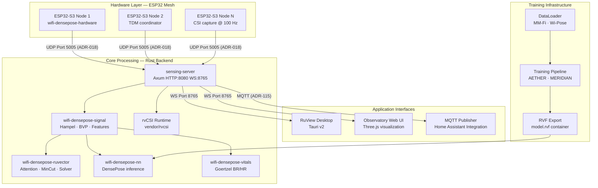

<!-- source: DeepWiki mcp.deepwiki.com · repo ruvnet/RuView · page 1 Overview · fetched 2026-10-30 -->

# Overview

Relevant source files

The following files were used as context for generating this wiki page:

- [CHANGELOG.md](CHANGELOG.md)
- [CLAUDE.md](CLAUDE.md)
- [README.md](README.md)
- [assets/ruview-hero-h3-v3.gif](assets/ruview-hero-h3-v3.gif)
- [assets/screen.png](assets/screen.png)
- [docs/adr/ADR-030-ruvsense-persistent-field-model.md](docs/adr/ADR-030-ruvsense-persistent-field-model.md)
- [docs/adr/ADR-095-rvcsi-edge-rf-sensing-platform.md](docs/adr/ADR-095-rvcsi-edge-rf-sensing-platform.md)
- [docs/adr/ADR-355-local-empty-room-bootstrap-prior.md](docs/adr/ADR-355-local-empty-room-bootstrap-prior.md)
- [docs/adr/ADR-357-raw-csi-calibration-sample-integrity.md](docs/adr/ADR-357-raw-csi-calibration-sample-integrity.md)
- [docs/ddd/README.md](docs/ddd/README.md)
- [docs/ddd/hardware-platform-domain-model.md](docs/ddd/hardware-platform-domain-model.md)
- [docs/ddd/ruvsense-domain-model.md](docs/ddd/ruvsense-domain-model.md)
- [docs/ddd/rvcsi-domain-model.md](docs/ddd/rvcsi-domain-model.md)
- [docs/ddd/sensing-server-domain-model.md](docs/ddd/sensing-server-domain-model.md)
- [docs/ddd/signal-processing-domain-model.md](docs/ddd/signal-processing-domain-model.md)
- [docs/ddd/training-pipeline-domain-model.md](docs/ddd/training-pipeline-domain-model.md)
- [docs/prd/rvcsi-platform-prd.md](docs/prd/rvcsi-platform-prd.md)
- [docs/readme-details.md](docs/readme-details.md)
- [docs/user-guide.md](docs/user-guide.md)
- [scripts/esp32_jsonl_to_rvcsi.py](scripts/esp32_jsonl_to_rvcsi.py)
- [v2/Cargo.lock](v2/Cargo.lock)
- [v2/Cargo.toml](v2/Cargo.toml)
- [v2/crates/wifi-densepose-sensing-server/Cargo.toml](v2/crates/wifi-densepose-sensing-server/Cargo.toml)
- [v2/crates/wifi-densepose-sensing-server/README.md](v2/crates/wifi-densepose-sensing-server/README.md)
- [v2/crates/wifi-densepose-sensing-server/src/bootstrap_baseline.rs](v2/crates/wifi-densepose-sensing-server/src/bootstrap_baseline.rs)
- [v2/crates/wifi-densepose-sensing-server/src/field_bridge.rs](v2/crates/wifi-densepose-sensing-server/src/field_bridge.rs)
- [v2/crates/wifi-densepose-sensing-server/src/lib.rs](v2/crates/wifi-densepose-sensing-server/src/lib.rs)
- [v2/crates/wifi-densepose-sensing-server/src/main.rs](v2/crates/wifi-densepose-sensing-server/src/main.rs)
- [v2/crates/wifi-densepose-signal/src/ruvsense/field_model.rs](v2/crates/wifi-densepose-signal/src/ruvsense/field_model.rs)

## Purpose and Scope
This document introduces the RuView/WiFi DensePose system, explaining its fundamental architecture, core capabilities (WiFi-based pose estimation, vital sign monitoring, camera-free sensing, privacy control planes, quantum sensing research, and Home Assistant integration), and its main software and hardware components. It bridges natural language explanations with explicit code entity citations from the `v2/` Rust workspace and supporting directories.

---

## What is RuView?

RuView (RuVector-based Viewing system) transforms ordinary Wi-Fi routers and low-cost edge sensors into contact-free spatial intelligence systems [README.md:12-22](). By capturing Channel State Information (CSI)—the physical properties of radio wave propagation—RuView interprets human presence, motion, breathing, and body posture without requiring cameras or wearables [README.md:12-12]().

- **WiFi-Based Pose Estimation**: Reconstructs 17 COCO keypoints and DensePose UV mappings from temporal CSI fluctuations [README.md:33-33]().
- **Vital Sign Monitoring**: Tracks contactless breathing (6–30 BPM) and heart rate (40–120 BPM) during sleeping or stationary periods [README.md:26-29]().
- **Camera-Free Sensing**: Operates through walls, in total darkness, and across partitions using Fresnel zone radio scattering [README.md:12-12]().
- **Privacy Control Planes**: Enforces strict governance, data reduction, and identity anonymization via the Beamforming Feedback Layer (`wifi-densepose-bfld`) [v2/Cargo.toml:65-67]().
- **Quantum Sensing Research**: Simulates NV-diamond ensemble magnetometers and ODMR response via the `nvsim` crate [v2/Cargo.toml:41-42]().
- **Home Assistant & Smart Home Integration**: Publishes 21 entities per node via `HA-DISCO` MQTT and integrates natively with Matter and Apple Home (HAP) bridges [README.md:14-18]().

---

## System Architecture

The RuView system is structured around an edge capture layer, a high-performance Rust processing server, application frontends, and a structured training pipeline [v2/crates/wifi-densepose-sensing-server/src/main.rs:1-8]().

### Diagram: End-to-End Data Flow

Sources: [CLAUDE.md:7-26](), [v2/crates/wifi-densepose-sensing-server/src/main.rs:1-9](), [README.md:18-22](), [docs/readme-details.md:13-19]()

---

## Main Components

RuView's architecture is divided into modular subsystems maintained within the `v2/crates/` workspace:

| Component | Implementation | Description |
|---|---|---|
| **Hardware & Edge Nodes** | ESP32-S3 firmware, NVS provisioning | Captures raw CSI, manages edge intelligence tiers (0–3), and handles time-division multiplexing (TDM) mesh coordination [CLAUDE.md:75-84](). |
| **Core Sensing Engine** | `wifi-densepose-signal`, `wifi-densepose-nn`, `wifi-densepose-vitals` | Processes subcarrier amplitudes, phase sanitization, Hampel filtering, and neural inference [v2/Cargo.toml:4-7](). |
| **rvCSI Runtime** | `vendor/rvcsi` | Edge RF sensing runtime normalizing multi-vendor Wi-Fi chipsets (ESP32, Intel 5300, Atheros) [CLAUDE.toml:75-80](). |
| **Applications & UI** | `wifi-densepose-desktop`, `ui/` | Tauri desktop app, Three.js Observatory web interface, and dashboard services [v2/Cargo.toml:29-30](). |
| **Training & Deployment** | `wifi-densepose-train`, `rvf_container` | Model training pipelines, dataset loaders, and portable RVF model container packaging [v2/Cargo.toml:22-23](). |
| **Quantum Research** | `nvsim`, `nvsim-server` | Deterministic NV-diamond ensemble magnetometer simulation and quantum-sensing/neural-decoding research docs [v2/Cargo.toml:41-42](). |

Sources: [README.md:31-47](), [CLAUDE.md:7-26](), [v2/Cargo.toml:1-111]()

---

## Component Interactions

### Diagram: Data Flow from CSI to Code Entities

```mermaid
graph LR
    subgraph CaptureChain ["CSI Capture"]
        RawCSI["Raw CSI<br/>56 subcarriers<br/>I/Q pairs"]
        ESPEdge["Edge Intelligence<br/>wifi-densepose-hardware"]
    end
    
    subgraph TransportChain ["UDP Transport"]
        UDPFrame["UDP Frame<br/>ADR-018 format<br/>Magic: 0xC5110001"]
        CsiFrame["CsiFrame Struct<br/>rvcsi-core"]
    end
    
    subgraph SignalChain ["Signal Processing"]
        PhaseUnwrap["phase_align.rs<br/>signal/src/ruvsense/"]
        Hampel["hampel_filter()<br/>signal/src/sota.rs"]
        BVP["extract_bvp()<br/>signal/src/bvp.rs"]
        Features["compute_features()<br/>signal/src/features.rs"]
    end
    
    subgraph ClassificationChain ["Classification & Detection"]
        AdaptiveClass["AdaptiveClassifier<br/>sensing-server/src/"]
        VitalDet["VitalSignDetector<br/>wifi-densepose-vitals"]
        Pose["PoseEstimator<br/>nn/src/inference.rs"]
    end
    
    subgraph OutputChain ["Output"]
        AxumRouter["Axum Router<br/>main.rs"]
        MqttPub["MqttPublisher<br/>mqtt/publisher.rs"]
        WS["WebSocket<br/>SensingUpdate Struct"]
    end
    
    RawCSI --> ESPEdge
    ESPEdge --> UDPFrame
    UDPFrame --> CsiFrame
    CsiFrame --> PhaseUnwrap
    PhaseUnwrap --> Hampel
    Hampel --> BVP
    BVP --> Features
    Features --> AdaptiveClass
    AdaptiveClass --> VitalDet
    VitalDet --> Pose
    Pose --> AxumRouter
    AxumRouter --> WS
    AxumRouter --> MqttPub
```

Sources: [CLAUDE.md:7-57](), [v2/crates/wifi-densepose-sensing-server/src/main.rs:12-22](), [v2/crates/wifi-densepose-sensing-server/src/main.rs:58-65]()

---

## Key Capabilities & Performance

| Capability / Metric | Value / Spec | Code / Architecture Reference |
|---|---|---|
| **Pose Estimation** | 17 COCO keypoints, DensePose UV mapping | [README.md:33-33]() |
| **Vital Signs** | 6–30 BPM breathing, 40–120 BPM heart rate | [README.md:26-29]() |
| **Presence Accuracy** | 82.3% temporal-triplet accuracy (v2 encoder) | [README.md:73-74]() |
| **Sensing Latency** | < 1 ms presence detection | [docs/user-guide.md:1-20]() |
| **Test Coverage** | 1,463+ unit and integration tests | [README.md:80-81]() |
| **Adaptation Speed** | < 30 seconds online calibration | [README.md:71-72]() |

Sources: [README.md:33-81](), [docs/user-guide.md:1-20]()

---

Sources: [README.md:1-81](), [v2/crates/wifi-densepose-sensing-server/src/main.rs:1-176](), [v2/Cargo.toml:1-111](), [CLAUDE.md:1-148]()

---

