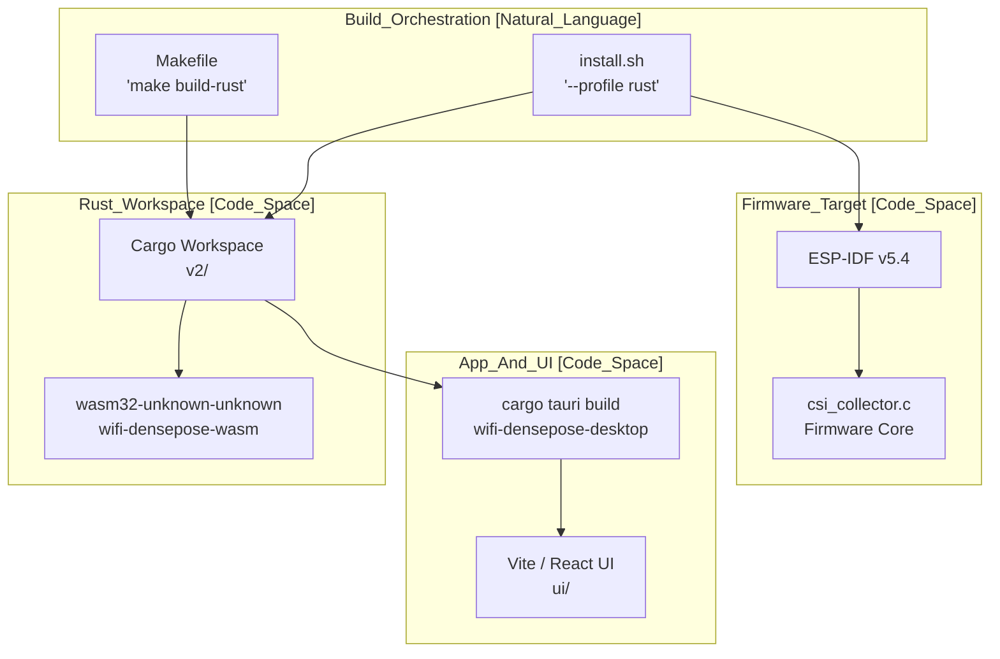
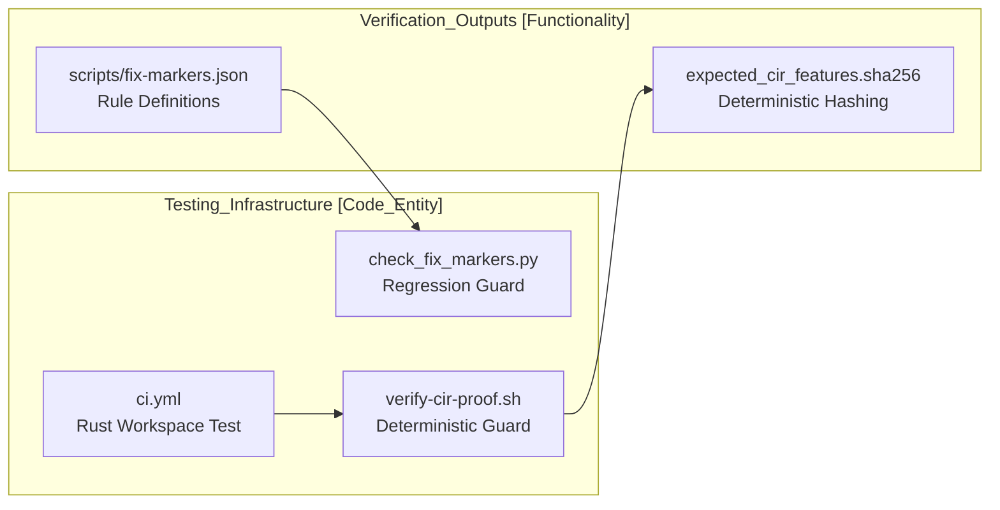
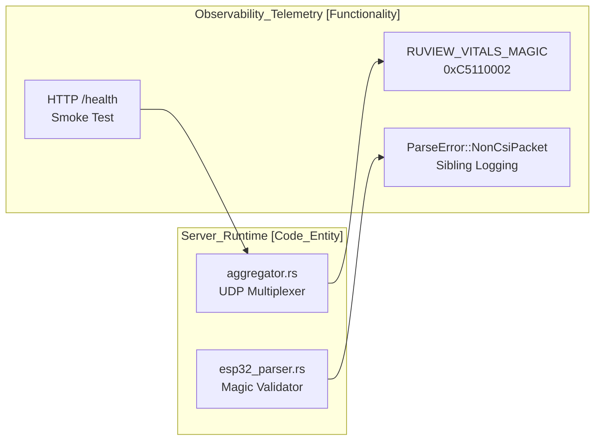

<!-- source: DeepWiki mcp.deepwiki.com · repo ruvnet/RuView · page 10 Development Guide · fetched 2026-10-30 -->

# Development Guide

Relevant source files

The following files were used as context for generating this wiki page:

- [.github/dependabot.yml](.github/dependabot.yml)
- [.github/workflows/ci.yml](.github/workflows/ci.yml)
- [.github/workflows/fix-regression-guard.yml](.github/workflows/fix-regression-guard.yml)
- [.github/workflows/nvsim-server-docker.yml](.github/workflows/nvsim-server-docker.yml)
- [.github/workflows/python-ci.yml](.github/workflows/python-ci.yml)
- [.github/workflows/security-scan.yml](.github/workflows/security-scan.yml)
- [.github/workflows/sensing-server-docker.yml](.github/workflows/sensing-server-docker.yml)
- [.github/workflows/update-submodules.yml](.github/workflows/update-submodules.yml)
- [.gitmodules](.gitmodules)
- [firmware/esp32-csi-node/sdkconfig.defaults.devkitc](firmware/esp32-csi-node/sdkconfig.defaults.devkitc)
- [scripts/check_fix_markers.py](scripts/check_fix_markers.py)
- [scripts/fix-markers.json](scripts/fix-markers.json)
- [ui/mobile/package-lock.json](ui/mobile/package-lock.json)
- [ui/mobile/package.json](ui/mobile/package.json)

This page serves as the parent overview for developers building, testing, contributing to, and operating the RuView system. It outlines the build infrastructure, testing harnesses, CI/CD pipelines, and monitoring systems. 

As a parent page, this document provides a high-level conceptual summary. For deep technical instructions, architecture notes, and step-by-step procedures, refer to the following child pages:
- [Building from Source](#10.1) — Detailed workspace compilation, Tauri app builds, ESP32 firmware targets, WASM modules, and Python wheel packaging.
- [Testing & Validation](#10.2) — Unit/integration test suites, simulated collectors, fuzzing, deterministic validation pipelines, and witness bundles.
- [CI/CD & Release Process](#10.3) — GitHub Actions workflows, security scanning matrices, container publishing, and release automation.
- [Monitoring & Observability](#10.4) — Prometheus/Grafana integration, telemetry, Docker manifests, introspection taps, and background daemons.
- [Agent Harnesses & Automation](#10.5) — Autonomous agent scaffolding (`harness/`), skills, brains, nightly SOTA agents, and plugin layers.

Sources: [install.sh:1-123](), [.github/workflows/ci.yml:1-30]()

---

## Build System Overview

The RuView workspace is organized around a multi-component structure supporting diverse deployment targets through installation profiles defined in `install.sh` [install.sh:41-105](). The architecture features a high-performance Rust workspace (`v2/`) with over 60 crates, alongside a legacy Python v1 reference base in `archive/v1/` [.github/workflows/ci.yml:18-22]().

### Installation Profiles

The system configures installations via eight distinct profiles optimized for target environments [install.sh:96-104]():

| Profile | Target Environment | Primary Components |
|---------|--------------------|--------------------|
| `verify` | Quick validation | Python, numpy, scipy [install.sh:97]() |
| `python` | Legacy research | v1 REST API, sensing, analytics [install.sh:98]() |
| `rust` | Production server | Rust v2 workspace and benchmarks [install.sh:99]() |
| `browser` | Web clients | WASM edge modules [install.sh:100]() |
| `iot` | Edge hardware | ESP32 firmware & aggregator daemon [install.sh:101]() |
| `docker` | Cloud container | Containerized microservice image [install.sh:102]() |
| `field` | Disaster response | WiFi-Mat field kit binaries [install.sh:103]() |
| `full` | Complete suite | All components and debug utilities [install.sh:104]() |

Makefile targets provide convenient shortcuts such as `make install-rust` [Makefile:20-21]() and `make install-full` [Makefile:32-33]().

**Build Orchestration Map**

Sources: [install.sh:28-56](), [Makefile:53-60](), [.github/workflows/ci.yml:91-106](), [scripts/fix-markers.json:8-12]()

For complete compilation steps, see [Building from Source](#10.1).

---

## Testing & Validation Infrastructure

Testing across the codebase covers multi-crate workspace verification, deterministic pipeline proofs, and regression guards.

### Testing Frameworks & Guards
- **Rust Tests**: Executed via cargo workspace invocations with feature flags, such as `cargo test --workspace --no-default-features` [.github/workflows/ci.yml:140]().
- **CIR Determinism**: Channel Impulse Response (CIR) tests validate algorithmic convergence behind the `cir` feature [.github/workflows/ci.yml:155-157]().
- **Fix-Marker Regression Guard**: The `scripts/check_fix_markers.py` script parses `scripts/fix-markers.json` to assert that vital defect corrections (such as SPI flash cache race mitigations in `firmware/esp32-csi-node/main/csi_collector.c`) remain present in the source tree [scripts/fix-markers.json:1-12](), [.github/workflows/fix-regression-guard.yml:1-10]().

**Validation & Regression Architecture**

Sources: [.github/workflows/ci.yml:168-172](), [.github/workflows/fix-regression-guard.yml:32-37](), [scripts/fix-markers.json:1-12]()

For detailed test harnesses, fuzzing pipelines, and validation reports, see [Testing & Validation](#10.2).

---

## CI/CD & Release Pipelines

Automated integration and delivery are governed by a matrix of GitHub Actions workflows ensuring strict build integrity, vulnerability assessment, and artifact publishing.

### Key Workflow Components
- **Continuous Integration (`ci.yml`)**: Compiles the Rust workspace, handles native Linux desktop libraries (GTK/WebKit2GTK), and enforces witness checks [.github/workflows/ci.yml:97-140]().
- **Python Package CI (`python-ci.yml`)**: Validates PyO3 bindings, runs maturin wheel builds with SOTA features, and enforces the default wheel size budget (<= 5 MiB) [.github/workflows/python-ci.yml:61-162]().
- **Security Scanning (`security-scan.yml`)**: Executes daily dependency audits via `cargo-audit`, static application security testing via Bandit and Semgrep, and container scans [.github/workflows/security-scan.yml:19-41, 74-110]().
- **Submodule Automation (`update-submodules.yml`)**: Periodically syncs tracked git submodules under `vendor/` to upstream heads [.github/workflows/update-submodules.yml:1-40]().

For detailed release procedures, container registries, and publishing steps, see [CI/CD & Release Process](#10.3).

Sources: [.github/workflows/ci.yml:1-173](), [.github/workflows/python-ci.yml:1-170](), [.github/workflows/security-scan.yml:1-196](), [.github/workflows/update-submodules.yml:1-67]()

---

## Monitoring & Observability

Observability features encompass HTTP health probes, container smoke-tests, telemetry taps, and autonomous background daemons.

### Runtime Telemetry & Background Workers
- **Health Endpoints**: The sensing server exposes `/health` and unauthenticated `/api/v1/info` endpoints for operational liveness verification [.github/workflows/sensing-server-docker.yml:118-142]().
- **Midstream Introspection**: UDP frame streams support introspection taps (ADR-099) for packet tracing across the network layer.
- **Claude-Flow Daemon**: Background workers maintain workspace codebase health, execution optimization, and test gap analysis [.claude-flow/daemon-state.json:1-54]().

**Observability Telemetry Map**

Sources: [scripts/fix-markers.json:22-32](), [.github/workflows/sensing-server-docker.yml:118-142](), [.claude-flow/daemon-state.json:1-54]()

For complete monitoring configurations, Prometheus/Grafana dashboards, and deployment manifests, see [Monitoring & Observability](#10.4).

---

