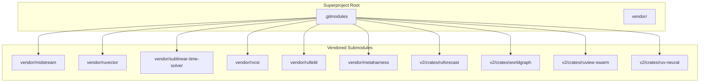
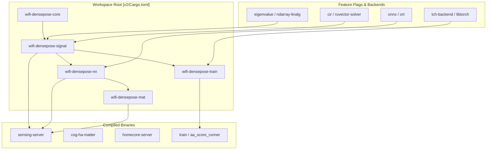
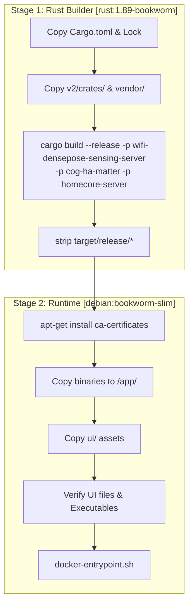

<!-- source: DeepWiki mcp.deepwiki.com · repo ruvnet/RuView · page 10.1 Building from Source · fetched 2026-10-30 -->

# Building from Source

<details>
<summary>Relevant source files</summary>

The following files were used as context for generating this wiki page:

- [.github/workflows/update-submodules.yml](.github/workflows/update-submodules.yml)
- [.gitmodules](.gitmodules)
- [docker/Dockerfile.rust](docker/Dockerfile.rust)
- [docker/docker-compose.yml](docker/docker-compose.yml)
- [docker/docker-entrypoint.sh](docker/docker-entrypoint.sh)
- [docs/TROUBLESHOOTING.md](docs/TROUBLESHOOTING.md)
- [example.env](example.env)
- [firmware/esp32-csi-node/components/wasm3/CMakeLists.txt](firmware/esp32-csi-node/components/wasm3/CMakeLists.txt)
- [firmware/esp32-csi-node/main/swarm_bridge.c](firmware/esp32-csi-node/main/swarm_bridge.c)
- [firmware/esp32-csi-node/sdkconfig.defaults.devkitc](firmware/esp32-csi-node/sdkconfig.defaults.devkitc)
- [requirements-dev.txt](requirements-dev.txt)
- [requirements.txt](requirements.txt)
- [scripts/udp-relay.py](scripts/udp-relay.py)
- [tests/test_docker_entrypoint.sh](tests/test_docker_entrypoint.sh)
- [v2/crates/wifi-densepose-core/Cargo.toml](v2/crates/wifi-densepose-core/Cargo.toml)
- [v2/crates/wifi-densepose-desktop/src/commands/server.rs](v2/crates/wifi-densepose-desktop/src/commands/server.rs)
- [v2/crates/wifi-densepose-hardware/Cargo.toml](v2/crates/wifi-densepose-hardware/Cargo.toml)
- [v2/crates/wifi-densepose-mat/Cargo.toml](v2/crates/wifi-densepose-mat/Cargo.toml)
- [v2/crates/wifi-densepose-nn/Cargo.toml](v2/crates/wifi-densepose-nn/Cargo.toml)
- [v2/crates/wifi-densepose-ruvector/Cargo.toml](v2/crates/wifi-densepose-ruvector/Cargo.toml)
- [v2/crates/wifi-densepose-signal/Cargo.toml](v2/crates/wifi-densepose-signal/Cargo.toml)
- [v2/crates/wifi-densepose-train/Cargo.toml](v2/crates/wifi-densepose-train/Cargo.toml)
- [v2/crates/wifi-densepose-vitals/Cargo.toml](v2/crates/wifi-densepose-vitals/Cargo.toml)
- [v2/crates/wifi-densepose-wifiscan/Cargo.toml](v2/crates/wifi-densepose-wifiscan/Cargo.toml)

</details>


This leaf page provides complete technical instructions for building all components of the RuView WiFi DensePose system from source. It covers compiling the Rust workspace (60+ crates), packaging Tauri desktop applications, compiling ESP32 firmware using ESP-IDF v5.4, building the web Observatory UI, compiling WASM edge modules, packaging Python wheels via `maturin`, managing git submodules under `vendor/`, and building production Docker images.

---

## 1. Git Submodules & Vendor Layout

The RuView repository manages several external dependencies and core bridge components as git submodules located under the `vendor/` directory and specific workspace paths (`.gitmodules`). Keeping these submodules synchronized is a prerequisite before invoking workspace compilation.

### Submodule Architecture


*Explanation*: Submodules define pointers to upstream research repositories. Automated updates are handled via `.github/workflows/update-submodules.yml`, which runs periodic git submodule synchronization.

To initialize and update all submodules locally:
```bash
git submodule update --init --recursive
```

Sources: [.gitmodules:1-39](), [.github/workflows/update-submodules.yml:1-67]()

---

## 2. Rust Workspace & Sensing Server Build

The core sensing engine, training binaries, and application daemons reside in the Rust workspace (`v2/crates/`). Building the workspace requires Rust 1.83+ (or matching workspace edition requirements).

### Workspace Compilation Data Flow


*Explanation*: Crate feature flags (such as `eigenvalue` and `cir` in `wifi-densepose-signal`, and `ml`/`api` in `wifi-densepose-mat`) govern optional bindings to BLAS, ONNX Runtime (`ort`), and PyTorch (`tch`) [v2/crates/wifi-densepose-signal/Cargo.toml:14-21](), [v2/crates/wifi-densepose-mat/Cargo.toml:14-44](), [v2/crates/wifi-densepose-nn/Cargo.toml:14-22]().

### Build Commands
To build all release binaries in the workspace:
```bash
cd v2
cargo build --release --workspace
```

To build specific targets with specialized feature flags (e.g., slim MAT wheel or ONNX inference):
```bash
cargo build --release -p wifi-densepose-sensing-server --features mqtt
cargo build --release -p wifi-densepose-mat --no-default-features --features portable
```

Sources: [v2/crates/wifi-densepose-signal/Cargo.toml:1-105](), [v2/crates/wifi-densepose-mat/Cargo.toml:1-111](), [v2/crates/wifi-densepose-nn/Cargo.toml:1-69](), [v2/crates/wifi-densepose-train/Cargo.toml:1-115]()

---

## 3. ESP32 Firmware Build (ESP-IDF v5.4)

Firmware targets (ESP32-S3 and ESP32-C6) are compiled using the Espressif IoT Development Framework (ESP-IDF) version 5.4.

### Firmware Configuration & Build
The configuration leverages Kconfig (`Kconfig.projbuild`) for setting node IDs, target IPs, and edge intelligence tiers.
```bash
cd firmware/esp32-csi-node
idf.py set-target esp32s3
idf.py menuconfig
idf.py build
```

For ESP32-C6 nodes using TDM synchronization (ADR-110):
```bash
idf.py set-target esp32c6
idf.py build
```

Sources: [firmware/esp32-csi-node/main/Kconfig.projbuild:1-171](), [firmware/esp32-csi-node/CMakeLists.txt:1-13]()

---

## 4. Web UI & WASM Edge Modules

### Web Observatory UI
The web interface is built using Vite.
```bash
cd ui/observatory
npm install
npm run build
```

### WASM Edge Modules
Tier 3 edge processing modules are compiled to `wasm32-unknown-unknown` targets using `wasm-pack` or Cargo:
```bash
cd v2
cargo build -p wifi-densepose-wasm-edge --target wasm32-unknown-unknown --release
```

Sources: [docker/Dockerfile.rust:56-73]()

---

## 5. Python Wheels via Maturin

Python bindings and packaging are managed via `maturin` and `pyproject.toml`. To build the Python package wheels (`wifi-densepose-py`):
```bash
maturin build --release --strip
```
For specific feature profiles (e.g., `[mat]` or `[meridian]`), invoke maturin with cargo features to prune heavy runtime dependencies like ONNX Runtime.

Sources: [v2/crates/wifi-densepose-mat/Cargo.toml:14-38](), [requirements.txt:1-39]()

---

## 6. Docker Image Build

The RuView production container image is built using a multi-stage Dockerfile (`docker/Dockerfile.rust`) that compiles the Rust sensing server, `cog-ha-matter`, and `homecore-server`, then packages them onto a minimal `debian:bookworm-slim` base image alongside UI assets.

### Docker Build Pipeline


*Explanation*: The multi-stage build guarantees that heavy build toolchains and cargo caches are discarded, leaving only compiled release binaries, required CA certificates, and web Observatory assets in the runtime container.

To build the Docker image locally:
```bash
docker build -t ruvnet/wifi-densepose:latest -f docker/Dockerfile.rust .
```

To run the container via Docker Compose with volume-mounted models and strict posture validation:
```bash
docker compose -f docker/docker-compose.yml up --build
```

Sources: [docker/Dockerfile.rust:1-110](), [docker/docker-compose.yml:1-80](), [docker/docker-entrypoint.sh:1-110]()

---

