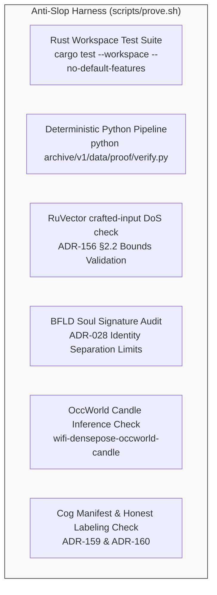
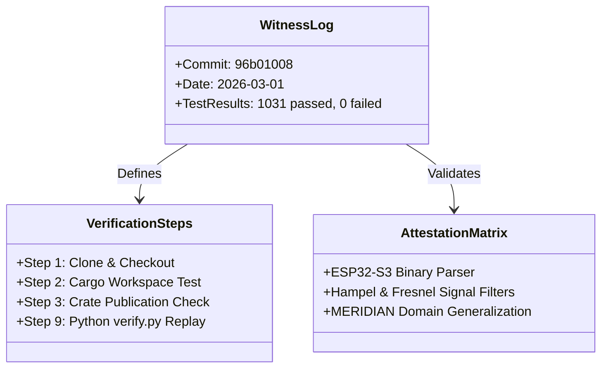

<!-- source: DeepWiki mcp.deepwiki.com · repo ruvnet/RuView · page 10.2 Testing & Validation · fetched 2026-10-30 -->

# Testing & Validation

<details>
<summary>Relevant source files</summary>

The following files were used as context for generating this wiki page:

- [.github/workflows/verify-pipeline.yml](.github/workflows/verify-pipeline.yml)
- [PROOF.md](PROOF.md)
- [archive/v1/data/proof/expected_features.sha256](archive/v1/data/proof/expected_features.sha256)
- [archive/v1/data/proof/expected_features_reference.npz](archive/v1/data/proof/expected_features_reference.npz)
- [archive/v1/data/proof/verify.py](archive/v1/data/proof/verify.py)
- [archive/v1/src/config/settings.py](archive/v1/src/config/settings.py)
- [benchmarks/edge-latency/RESULTS.md](benchmarks/edge-latency/RESULTS.md)
- [benchmarks/edge-skills/RESULTS.md](benchmarks/edge-skills/RESULTS.md)
- [docs/WITNESS-LOG-028.md](docs/WITNESS-LOG-028.md)
- [docs/adr/ADR-028-esp32-capability-audit.md](docs/adr/ADR-028-esp32-capability-audit.md)
- [docs/adr/ADR-159-cognitum-appliance-beyond-sota.md](docs/adr/ADR-159-cognitum-appliance-beyond-sota.md)
- [docs/adr/ADR-160-edge-skill-library-honest-labeling.md](docs/adr/ADR-160-edge-skill-library-honest-labeling.md)
- [docs/adr/ADR-163-edge-latency-measurement.md](docs/adr/ADR-163-edge-latency-measurement.md)
- [docs/csi-frame-selection-measured.md](docs/csi-frame-selection-measured.md)
- [firmware/esp32-csi-node/run_arms.py](firmware/esp32-csi-node/run_arms.py)
- [scripts/generate-witness-bundle.sh](scripts/generate-witness-bundle.sh)
- [scripts/probe-fft-platform.py](scripts/probe-fft-platform.py)
- [scripts/prove.sh](scripts/prove.sh)
- [ui/components/body-model.js](ui/components/body-model.js)
- [v2/crates/wifi-densepose-signal/src/lib.rs](v2/crates/wifi-densepose-signal/src/lib.rs)
- [v2/crates/wifi-densepose-wasm-edge/tests/honest_labeling.rs](v2/crates/wifi-densepose-wasm-edge/tests/honest_labeling.rs)
- [v2/crates/wifi-densepose-wasm-edge/tests/synthetic_validation.rs](v2/crates/wifi-densepose-wasm-edge/tests/synthetic_validation.rs)

</details>


**Purpose & Scope**: This page documents RuView's comprehensive testing infrastructure, validation pipelines, benchmarks, simulated collectors, firmware unit testing, and the trust kill switch mechanism. It details how the codebase enforces determinism, regression guards, anti-slop assertion tests, and witness bundles to make all performance and architectural claims falsifiable and machine-verifiable.

---

## 1. Testing Strategy & Architecture

RuView employs a multi-tiered testing methodology spanning low-level ESP32 C firmware, Rust workspace unit/integration test suites, Python deterministic verification pipelines, and anti-slop assertion frameworks [.github/workflows/verify-pipeline.yml:1-126](), [scripts/prove.sh:1-147](), [PROOF.md:1-78]().

| Test Layer | Purpose | Target Components | Execution Tools |
|---|---|---|---|
| **Workspace Unit Tests** | Verify individual Rust modules in isolation | `wifi-densepose-*` crates (`v2/crates/`) | `cargo test --workspace --no-default-features` [scripts/prove.sh:34-36]() |
| **Deterministic Verify Pipeline** | Bit-exact SHA-256 reproducibility proof | `archive/v1/data/proof/verify.py` [archive/v1/data/proof/verify.py:1-34]() | `python archive/v1/data/proof/verify.py` [.github/workflows/verify-pipeline.yml:76-78]() |
| **Anti-Slop Assertion Tests** | Fail-on-pre-fix regression guarantees for neural & signal code | `wifi-densepose-ruvector`, `wifi-densepose-bfld`, `cog-pose-estimation`, `wifi-densepose-wasm-edge` [scripts/prove.sh:96-121]() | `bash scripts/prove.sh` [scripts/prove.sh:1-15]() |
| **Firmware Frame Selection Gates** | Evaluate TDM and frame-dropping strategies on physical fleets | `firmware/esp32-csi-node/run_arms.py` [firmware/esp32-csi-node/run_arms.py:1-31]() | Python runner against ESP32 node REST endpoints [firmware/esp32-csi-node/run_arms.py:55-93]() |

```mermaid
graph TD
    subgraph NaturalLanguageSpace ["Natural Language Space"]
      A[""Trust Kill Switch Proof""] --> B[""Anti-Slop Assertion Tests""]
      B --> C[""Cross-Node Fusion Gate Analysis""]
    end

    subgraph CodeEntitySpace ["Code Entity Space"]
      D[""archive/v1/data/proof/verify.py""] --> E[""src.core.csi_processor::CSIProcessor""]
      F[""scripts/prove.sh""] --> G[""wifi-densepose-ruvector::triangulation_out_of_range""]
      H[""firmware/esp32-csi-node/run_arms.py""] --> I[""Node REST /config & /api/v1/fusion""]
    end

    A --> D
    B --> F
    C --> H

    style NaturalLanguageSpace fill:#f9f9f9,stroke:#333,stroke-width:1px
    style CodeEntitySpace fill:#fefefe,stroke:#333,stroke-width:1px
```



**Sources**: [.github/workflows/verify-pipeline.yml:1-126](), [scripts/prove.sh:1-147](), [archive/v1/data/proof/verify.py:1-34](), [firmware/esp32-csi-node/run_arms.py:1-31]()

---

## 2. Deterministic Verify Pipeline & Trust Kill Switch

To address claims regarding simulation or unverified pipelines, RuView provides a "Trust Kill Switch"—a one-command proof replay located at `archive/v1/data/proof/verify.py` [archive/v1/data/proof/verify.py:1-34]().

### Pipeline Execution & Flow

```mermaid
graph TD
    subgraph VerificationPipeline ["Verification Pipeline Flow"]
      J[""load_reference_signal()""] --> K[""frame_to_csi_data()""]
      K --> L[""CSIProcessor::process_frame()""]
      L --> M[""Feature Extraction (CSIFeatures)""]
      M --> N[""Quantization & Byte Packing""]
      N --> O[""SHA-256 Hash Computation""]
      O --> P{""Compare Hash Match?""}
      P -->|""Match (Expected: f8e76f21...)""| Q[""VERDICT: PASS""]
      P -->|""Mismatch""| R[""VERDICT: FAIL (Abort CI)""]
    end

    style VerificationPipeline fill:#f9f9f9,stroke:#333,stroke-width:1px
```

1. **Reference Loading**: The script loads the published reference CSI signal from `archive/v1/data/proof/sample_csi_data.json` [archive/v1/data/proof/verify.py:119-134]().
2. **Feature Extraction**: Each frame is passed directly through the production `CSIProcessor` and `CSIData` classes [archive/v1/data/proof/verify.py:56-57]().
3. **Quantization & Thread Pinning**: To eliminate cross-platform floating-point divergence caused by SIMD vector reordering (`scipy.fft` pocketfft kernels across Intel AVX2, AVX-512, and ARM NEON), thread counts are strictly pinned to single-threaded execution via environment variables (`OMP_NUM_THREADS="1"`, `OPENBLAS_NUM_THREADS="1"`, etc.) [.github/workflows/verify-pipeline.yml:65-75](), and intermediate arrays are quantized [archive/v1/data/proof/verify.py:167-183]().
4. **Hash Verification**: The resulting canonical byte representation is hashed with SHA-256 and compared against `archive/v1/data/proof/expected_features.sha256` [archive/v1/data/proof/verify.py:14-16]().

**Sources**: [archive/v1/data/proof/verify.py:1-190](), [.github/workflows/verify-pipeline.yml:1-126](), [archive/v1/data/proof/expected_features.sha256:1]()

---

## 3. Anti-Slop Proof Harness (`prove.sh`)

The `scripts/prove.sh` script executes a series of anti-slop assertion tests designed to verify that key codebase claims are backed by executable code and tests that fail on pre-fix versions [scripts/prove.sh:1-147](), [PROOF.md:1-78]().

### Verified Assertion Test Suite



- **RuVector DoS Check**: Asserts that `wifi-densepose-ruvector` handles out-of-range triangulation indices gracefully by returning `None` instead of panicking [scripts/prove.sh:97-99]().
- **BFLD Soul Signature Audit**: Asserts that WiFi-only cardiac and respiratory channels cannot uniquely separate identity on their own (measured gap ~0.0005), validating honest bounds rather than false biometric claims [scripts/prove.sh:101-104]().
- **OccWorld Candle Inference**: Asserts that `predict()` is deterministic and input-dependent for identical tensor inputs, rather than returning random noise [scripts/prove.sh:105-107]().
- **Cog Manifest & Honest Labeling**: Validates that `cog-pose-estimation` emits frames under its default configuration threshold (ADR-159 A1) [scripts/prove.sh:109-111](), `cog-person-count` flags untrained count classes as `low_confidence` (ADR-159 A2) [scripts/prove.sh:113-115](), and experimental medical edge modules in `wifi-densepose-wasm-edge` carry mandatory non-clinical disclaimers (ADR-160 A1) [scripts/prove.sh:117-120]().

**Sources**: [scripts/prove.sh:1-147](), [PROOF.md:1-78](), [docs/adr/ADR-159-cognitum-appliance-beyond-sota.md:1-114](), [docs/adr/ADR-160-edge-skill-library-honest-labeling.md:1-115]()

---

## 4. Firmware Field Validation & Frame Selection Gates

To determine how node-level CSI frame collection impacts cross-node fusion, the codebase provides `firmware/esp32-csi-node/run_arms.py` [firmware/esp32-csi-node/run_arms.py:1-31](). This script executes a Latin-square blocked factorial experiment across four frame-selection gates [docs/csi-frame-selection-measured.md:25-67](), [firmware/esp32-csi-node/run_arms.py:44-46]():

1. **`elapsed`**: Rate-limits by requiring a minimum time delta (e.g. 20 ms) since the node's last accepted frame [docs/csi-frame-selection-measured.md:27-29]().
2. **`mesh`**: Aligns acceptance to the first frame heard in shared 20 ms mesh clock windows [docs/csi-frame-selection-measured.md:27-30]().
3. **`seq`**: Keeps frames where the 802.11 `rx_seq` is divisible by a set period $N$ (e.g., $N=8$) [docs/csi-frame-selection-measured.md:27-35]().
4. **`mesh+seq`**: Stacks both mechanisms [docs/csi-frame-selection-measured.md:39-40]().

The runner posts configuration changes to all active nodes, verifies the active state via `/config` endpoints [firmware/esp32-csi-node/run_arms.py:76-93](), and measures `paired_fraction` via the central server's `/api/v1/fusion` telemetry [firmware/esp32-csi-node/run_arms.py:95-106]().

**Sources**: [docs/csi-frame-selection-measured.md:1-149](), [firmware/esp32-csi-node/run_arms.py:1-182]()

---

## 5. Witness Bundles & Capability Attestation

RuView utilizes machine-verifiable witness logs (`docs/WITNESS-LOG-028.md`) to record system capabilities at pinned git commits [docs/WITNESS-LOG-028.md:1-200](), [docs/adr/ADR-028-esp32-capability-audit.md:1-160]().



### Reproducing Witness Attestations
Third parties can independently verify workspace integrity and test parity using the documented commands:
```bash
# Run full Rust workspace tests without default features
cd v2 && cargo test --workspace --no-default-features

# Replay deterministic Python verification
python archive/v1/data/proof/verify.py
```
The expected outcome is a passing workspace test suite and a verified SHA-256 pipeline match (`VERDICT: PASS`) [docs/WITNESS-LOG-028.md:35-145]().

**Sources**: [docs/WITNESS-LOG-028.md:1-281](), [docs/adr/ADR-028-esp32-capability-audit.md:1-308]()

---

