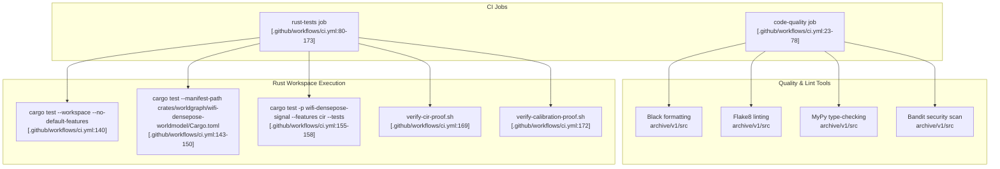
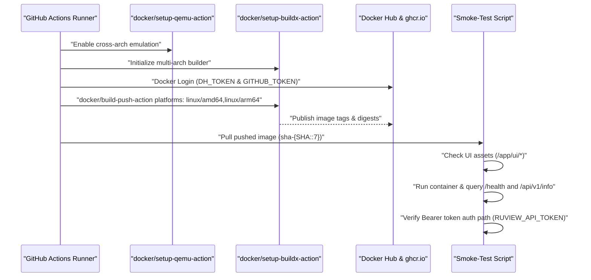
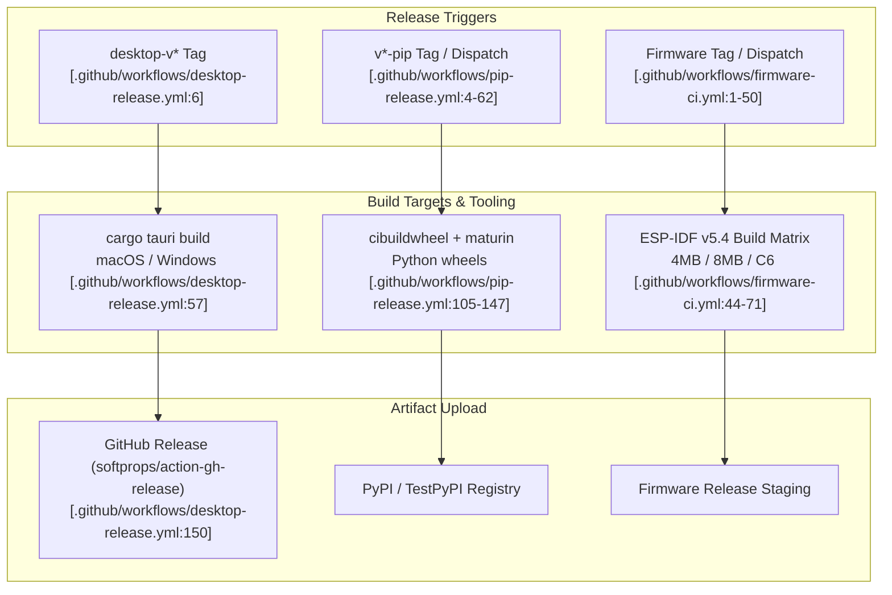

<!-- source: DeepWiki mcp.deepwiki.com · repo ruvnet/RuView · page 10.3 CI/CD & Release Process · fetched 2026-10-30 -->

# CI/CD & Release Process

Relevant source files

The following files were used as context for generating this wiki page:

- [.github/dependabot.yml](.github/dependabot.yml)
- [.github/workflows/bfld-mqtt-integration.yml](.github/workflows/bfld-mqtt-integration.yml)
- [.github/workflows/cd.yml](.github/workflows/cd.yml)
- [.github/workflows/ci.yml](.github/workflows/ci.yml)
- [.github/workflows/clone-tracking.yml](.github/workflows/clone-tracking.yml)
- [.github/workflows/cog-ha-matter-release.yml](.github/workflows/cog-ha-matter-release.yml)
- [.github/workflows/dashboard-a11y.yml](.github/workflows/dashboard-a11y.yml)
- [.github/workflows/dashboard-pages.yml](.github/workflows/dashboard-pages.yml)
- [.github/workflows/desktop-release.yml](.github/workflows/desktop-release.yml)
- [.github/workflows/fix-regression-guard.yml](.github/workflows/fix-regression-guard.yml)
- [.github/workflows/nvsim-server-docker.yml](.github/workflows/nvsim-server-docker.yml)
- [.github/workflows/pip-release.yml](.github/workflows/pip-release.yml)
- [.github/workflows/python-ci.yml](.github/workflows/python-ci.yml)
- [.github/workflows/security-scan.yml](.github/workflows/security-scan.yml)
- [.github/workflows/sensing-server-docker.yml](.github/workflows/sensing-server-docker.yml)
- [data/clone-data.rvf](data/clone-data.rvf)
- [docs/adr/ADR-117-pip-wifi-densepose-modernization.md](docs/adr/ADR-117-pip-wifi-densepose-modernization.md)
- [docs/integrations/pypi-release.md](docs/integrations/pypi-release.md)
- [docs/research/soul/README.md](docs/research/soul/README.md)
- [docs/research/soul/references.md](docs/research/soul/references.md)
- [docs/research/soul/scanning-process.md](docs/research/soul/scanning-process.md)
- [docs/research/soul/security.md](docs/research/soul/security.md)
- [docs/research/soul/specification.md](docs/research/soul/specification.md)
- [python/.gitignore](python/.gitignore)
- [python/tests/aether_parity.rs](python/tests/aether_parity.rs)
- [python/tests/aether_weights_parity.rs](python/tests/aether_weights_parity.rs)
- [python/tests/golden/aether_embedding.json](python/tests/golden/aether_embedding.json)
- [python/tests/golden/aether_loaded_embedding.json](python/tests/golden/aether_loaded_embedding.json)
- [python/tests/test_mat.py](python/tests/test_mat.py)
- [python/tests/test_meridian.py](python/tests/test_meridian.py)
- [python/wifi_densepose/aether.py](python/wifi_densepose/aether.py)
- [python/wifi_densepose/mat.py](python/wifi_densepose/mat.py)
- [python/wifi_densepose/meridian.py](python/wifi_densepose/meridian.py)
- [scripts/check_fix_markers.py](scripts/check_fix_markers.py)
- [scripts/fix-markers.json](scripts/fix-markers.json)
- [ui/mobile/package-lock.json](ui/mobile/package-lock.json)
- [ui/mobile/package.json](ui/mobile/package.json)
- [v2/crates/cog-ha-matter/cog/Makefile](v2/crates/cog-ha-matter/cog/Makefile)
- [v2/crates/cog-ha-matter/cog/README.md](v2/crates/cog-ha-matter/cog/README.md)
- [v2/crates/cog-ha-matter/cog/manifest.template.json](v2/crates/cog-ha-matter/cog/manifest.template.json)
- [v2/crates/nvsim-server/Dockerfile](v2/crates/nvsim-server/Dockerfile)
- [v2/crates/wifi-densepose-bfld/tests/ci_workflow.rs](v2/crates/wifi-densepose-bfld/tests/ci_workflow.rs)

## Purpose and Scope
This leaf page documents the automated Continuous Integration (CI), Continuous Deployment (CD), security scanning, regression guarding, and multi-platform release workflows for the RuView/WiFi DensePose codebase. The build infrastructure orchestrates testing, validation, container publishing, firmware building, and artifact distribution across Rust workspaces, Python analysis packages, Tauri desktop applications, and ESP32 edge firmware.

Sources: [.github/workflows/ci.yml:1-173](), [.github/workflows/sensing-server-docker.yml:1-185]()

---

## Continuous Integration Pipeline

The RuView CI pipeline (`.github/workflows/ci.yml`) validates code quality, executes the Rust workspace test suite, verifies Python hygiene in the archived research folders, and enforces cryptographic determinism proofs for signal processing algorithms [.github/workflows/ci.yml:1-173]().

### Pipeline Architecture & Code Entities

Sources: [.github/workflows/ci.yml:17-173]()

### Implementation Details
- **Rust Workspace Testing**: Runs `cargo test --workspace --no-default-features` with debuginfo disabled (`CARGO_PROFILE_DEV_DEBUG: "0"`, `CARGO_PROFILE_TEST_DEBUG: "0"`) to prevent runner disk exhaustion on the 38-crate workspace [.github/workflows/ci.yml:135-140]().
- **Tauri System Dependencies**: Installs Linux desktop libraries (`libglib2.0-dev`, `libgtk-3-dev`, `libwebkit2gtk-4.1-dev`, `libssl-dev`, etc.) to allow the `wifi-densepose-desktop` Tauri v2 app and related crates to build successfully [.github/workflows/ci.yml:97-112]().
- **Deterministic Pipeline Proofs (Trust Kill Switch)**: Executes `verify-cir-proof.sh` and `verify-calibration-proof.sh` to validate that bit-deterministic SHA-256 hashes over reference signal outputs match `expected_cir_features.sha256`, preventing silent algorithmic regressions [scripts/fix-markers.json:94-105](), [.github/workflows/ci.yml:168-172]().

---

## Container Publishing & Multi-Architecture Builds

The container publishing workflows (`.github/workflows/sensing-server-docker.yml` and `.github/workflows/nvsim-server-docker.yml`) build and push production container images to Docker Hub (`ruvnet/wifi-densepose`) and GitHub Container Registry (`ghcr.io/ruvnet/wifi-densepose`) [.github/workflows/sensing-server-docker.yml:1-185](), [.github/workflows/nvsim-server-docker.yml:1-71]().

### Container Build & Smoke Test Flow

Sources: [.github/workflows/sensing-server-docker.yml:48-163]()

### Implementation Details
- **Multi-Architecture Support**: Uses QEMU and Buildx to emit `linux/amd64` and `linux/arm64` manifests simultaneously, ensuring compatibility with Apple Silicon Macs and standard x86 servers [.github/workflows/sensing-server-docker.yml:56-111]().
- **Post-Push Smoke Testing**: Automatically pulls the freshly pushed image, verifies required UI assets (`observatory.html`, `pose-fusion.html`, `index.html`) exist in `/app/ui`, and tests HTTP endpoints `/health` and `/api/v1/info` under both unauthenticated LAN mode and bearer token authentication (`RUVIEW_API_TOKEN`) [.github/workflows/sensing-server-docker.yml:123-163]().

---

## Release Workflows: Desktop, Pip, and Firmware

RuView manages several specialized release pipelines corresponding to different distribution channels.

### Release Architecture & Artifact Distribution

Sources: [.github/workflows/desktop-release.yml:1-185](), [.github/workflows/pip-release.yml:1-200](), [.github/workflows/firmware-ci.yml:1-158]()

### Desktop & Python Release Details
- **Tauri Desktop Release**: Builds unsigned/signed `.zip` bundles for macOS (ARM and Intel targets) and `.msi`/`.exe` installers for Windows using Node.js v20 and Tauri CLI v2 [.github/workflows/desktop-release.yml:22-132]().
- **Python Wheel Matrix (`pip-release.yml`)**: Builds Python wheels across Linux (`x86_64`, `aarch64`), macOS (`x86_64`, `arm64`), and Windows (`AMD64`) using `cibuildwheel` targeting ABI3 (`cp310-*`) with `maturin` [.github/workflows/pip-release.yml:72-126]().
- **Firmware CI & Version Guard**: Enforces that `version.txt` matches release tags (RuView#505), validates binary size limits (< 1100 KB for OTA compatibility on 4MB flash variants), and checks partition table magic numbers [.github/workflows/firmware-ci.yml:19-145]().

---

## Security Scanning & Vulnerability Management

The security scanning workflow (`.github/workflows/security-scan.yml`) runs on pushes, PRs, and a daily 2 AM UTC cron schedule to audit dependencies and source code [.github/workflows/security-scan.yml:1-196]().

| Job Name | Tools Used | Scope & Purpose |
| :--- | :--- | :--- |
| **rust-audit** | `cargo-audit` | Audits Rust dependencies against the RustSec Advisory Database (`v2/Cargo.lock`) [.github/workflows/security-scan.yml:19-42]() |
| **sast** | `bandit`, `semgrep` | Performs Static Application Security Testing on Python code and configuration files, outputting SARIF to GitHub Security [.github/workflows/security-scan.yml:45-120]() |
| **dependency-scan** | `safety`, `pip-audit`, `Snyk` | Scans Python dependencies for known CVE vulnerabilities [.github/workflows/security-scan.yml:122-185]() |
| **container-scan** | Container vulnerability scanners | Audits built Docker images for OS and library CVEs [.github/workflows/security-scan.yml:187-196]() |

Sources: [.github/workflows/security-scan.yml:1-196]()

---

## Fix-Markers Regression Guard

RuView implements a deterministic regression guard (`scripts/fix-markers.json` and `.github/workflows/fix-regression-guard.yml`) to ensure previously shipped critical fixes and bug mitigations are never accidentally reverted or deleted [scripts/fix-markers.json:1-309]().

### Implementation & Verification Mechanism
- **Manifest Definition**: `scripts/fix-markers.json` defines structured markers with unique IDs (e.g., `RuView#396`, `RuView#521`, `RuView#505`, `ADR-028-proof`), target file paths, required literal/regex patterns (`require`), forbidden anti-patterns (`forbid`), and technical rationales [scripts/fix-markers.json:1-120]().
- **Guard Execution**: The Python script `scripts/check_fix_markers.py` checks each marker against the codebase. In CI, `.github/workflows/fix-regression-guard.yml` automatically fails PRs if a required mitigation snippet is missing or a forbidden bug pattern reappears [scripts/fix-markers.json:2]().

| Marker ID | Title | Target File | Rationale |
| :--- | :--- | :--- | :--- |
| **RuView#396** | MGMT-only promiscuous filter | `firmware/esp32-csi-node/main/csi_collector.c` | Prevents SPI flash cache race crashes in Core 0 `wDev_ProcessFiq` [scripts/fix-markers.json:6-12]() |
| **RuView#521** | Disable WiFi modem sleep (`WIFI_PS_NONE`) | `firmware/esp32-csi-node/main/csi_collector.c` | Prevents modem sleep from starving the CSI callback [scripts/fix-markers.json:14-20]() |
| **RuView#505** | Firmware version guard | `.github/workflows/firmware-ci.yml` | Asserts that `version.txt` matches release tags [scripts/fix-markers.json:35-40]() |
| **ADR-028-proof** | Deterministic pipeline proof | `archive/v1/data/proof/verify.py` | Pins SHA-256 hash over reference signal output to guarantee tamper evidence [scripts/fix-markers.json:94-105]() |

Sources: [scripts/fix-markers.json:1-120]()

---

## Sources
- [.github/workflows/ci.yml:1-173]()
- [.github/workflows/sensing-server-docker.yml:1-185]()
- [.github/workflows/desktop-release.yml:1-185]()
- [.github/workflows/pip-release.yml:1-200]()
- [.github/workflows/firmware-ci.yml:1-158]()
- [.github/workflows/security-scan.yml:1-196]()
- [.github/workflows/cd.yml:1-192]()
- [.github/workflows/dashboard-pages.yml:1-89]()
- [scripts/fix-markers.json:1-120]()

---

