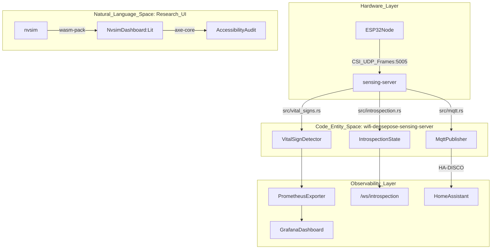
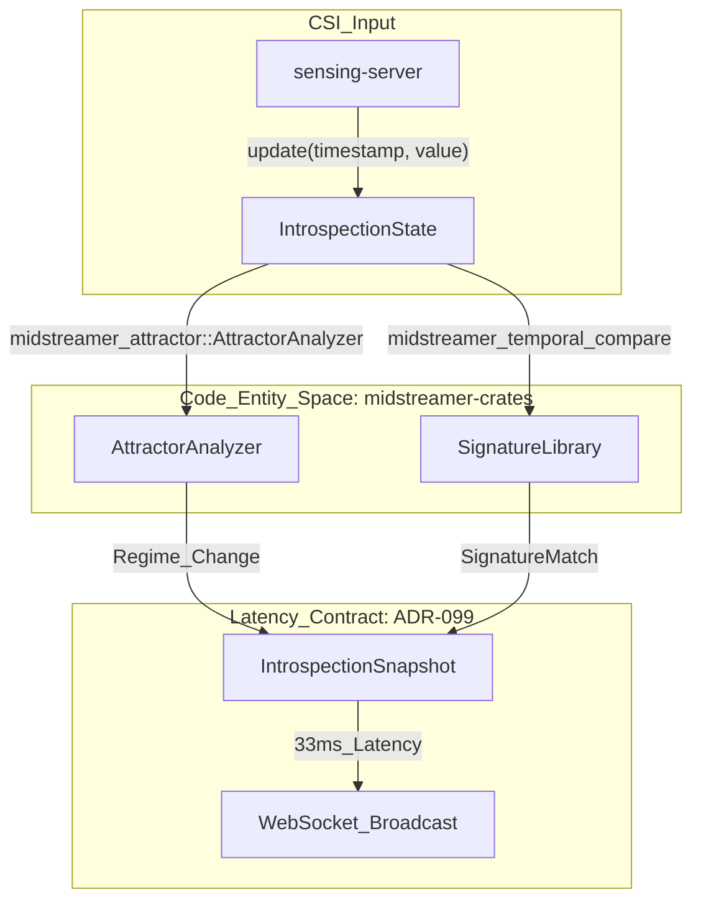

<!-- source: DeepWiki mcp.deepwiki.com · repo ruvnet/RuView · page 10.4 Monitoring & Observability · fetched 2026-10-30 -->

# Monitoring & Observability

Relevant source files

The following files were used as context for generating this wiki page:

- [.claude-flow/daemon-state.json](.claude-flow/daemon-state.json)
- [.claude-flow/metrics/codebase-map.json](.claude-flow/metrics/codebase-map.json)
- [.claude-flow/metrics/consolidation.json](.claude-flow/metrics/consolidation.json)
- [.claude-flow/metrics/performance.json](.claude-flow/metrics/performance.json)
- [.claude-flow/metrics/security-audit.json](.claude-flow/metrics/security-audit.json)
- [.claude-flow/metrics/test-gaps.json](.claude-flow/metrics/test-gaps.json)
- [.claude/scheduled_tasks.lock](.claude/scheduled_tasks.lock)
- [Makefile](Makefile)
- [docker/Dockerfile.rust](docker/Dockerfile.rust)
- [docker/docker-compose.yml](docker/docker-compose.yml)
- [docker/docker-entrypoint.sh](docker/docker-entrypoint.sh)
- [docs/TROUBLESHOOTING.md](docs/TROUBLESHOOTING.md)
- [docs/adr/ADR-099-midstream-introspection-tap.md](docs/adr/ADR-099-midstream-introspection-tap.md)
- [docs/adr/ADR-126-ruview-native-ha-port-master.md](docs/adr/ADR-126-ruview-native-ha-port-master.md)
- [firmware/esp32-csi-node/components/wasm3/CMakeLists.txt](firmware/esp32-csi-node/components/wasm3/CMakeLists.txt)
- [firmware/esp32-csi-node/main/swarm_bridge.c](firmware/esp32-csi-node/main/swarm_bridge.c)
- [install.sh](install.sh)
- [scripts/udp-relay.py](scripts/udp-relay.py)
- [tests/test_docker_entrypoint.sh](tests/test_docker_entrypoint.sh)
- [v2/crates/wifi-densepose-desktop/src/commands/server.rs](v2/crates/wifi-densepose-desktop/src/commands/server.rs)
- [v2/crates/wifi-densepose-sensing-server/src/introspection.rs](v2/crates/wifi-densepose-sensing-server/src/introspection.rs)
- [v2/crates/wifi-densepose-sensing-server/tests/introspection_latency.rs](v2/crates/wifi-densepose-sensing-server/tests/introspection_latency.rs)

This page documents the monitoring infrastructure, metrics collection, deployment manifests, and background maintenance workers that ensure the reliability and performance of the RuView/WiFi-DensePose system. The observability stack spans from real-time Prometheus metrics and the low-latency **ADR-099** introspection tap to Docker Compose container orchestration, the `claude-flow` daemon that manages codebase health, and the **NVsim Dashboard** for research-grade sensing visualization.

## Metrics Collection & Dashboards

The system provides deep visibility into signal processing performance, hardware health, and model inference accuracy.

### Prometheus Metrics
The Rust-based sensing server, defined in `wifi-densepose-sensing-server` [v2/crates/wifi-densepose-sensing-server/Cargo.toml:1-3](), exposes metrics through the Axum web framework [v2/crates/wifi-densepose-sensing-server/Cargo.toml:24-24](). Key metrics include:
*   **Signal Intelligence**: Subcarrier variance, SNR (Signal-to-Noise Ratio), and Goertzel filter bank SNR for breathing detection (0.1–0.5 Hz).
*   **Processing Latency**: Time spent in the RuvSense pipeline stages.
*   **Data Source Tracking**: Real-time identification of the active CSI source (`esp32`, `wifi`, or `simulated`) via `CSI_SOURCE` [docker/Dockerfile.rust:91-97]().
*   **Network Health**: UDP packet loss from ESP32 nodes on port 5005 and WebSocket client connection counts.

### Grafana & NVsim Dashboards
The **WiFi-DensePose Monitoring Dashboard** provides a unified view of the sensing cluster, utilizing Kubernetes namespace and pod templating to allow operators to drill down into individual ESP32 edge nodes.

Additionally, the **NVsim Dashboard** (Vite + Lit, **ADR-092**) provides a specialized interface for quantum sensing and magnetometer simulation results [.github/workflows/dashboard-pages.yml:1-5](). It is deployed to GitHub Pages and visualizes data from the `nvsim` Rust crate [.github/workflows/dashboard-pages.yml:50-58]().

### Data Flow: Metrics to Visualization
The following diagram bridges Natural Language Space to Code Entity Space by mapping architectural observability layers directly to code symbols and modules.

**Signal-to-Metrics Data Flow**

Sources: [v2/crates/wifi-densepose-sensing-server/src/lib.rs:1-29](), [v2/crates/wifi-densepose-sensing-server/Cargo.toml:71-77](), [.github/workflows/dashboard-pages.yml:50-58](), [.github/workflows/dashboard-a11y.yml:1-5]()

---

## Midstream Introspection Tap (ADR-099)

To solve the latency floor of window-aggregated events, RuView implements a real-time introspection tap in `introspection.rs` [v2/crates/wifi-densepose-sensing-server/src/introspection.rs:1-21]().

### Architecture & Primitives
The tap runs parallel to the main event pipeline and is never window-blocked, ensuring a latency-win contract where signals can emit within one frame (~33ms) [v2/crates/wifi-densepose-sensing-server/src/introspection.rs:14-18](). It uses two primary midstream primitives:
*   **`midstreamer-attractor`**: Analyzes Lyapunov exponents and attractor regimes (point / limit cycle / strange / unknown) over a sliding window [v2/crates/wifi-densepose-sensing-server/src/introspection.rs:6-9]().
*   **`midstreamer-temporal-compare`**: Performs Dynamic Time Warping (DTW) similarity matching against a `SignatureLibrary` [v2/crates/wifi-densepose-sensing-server/src/introspection.rs:10-12]().

### Introspection Snapshot
The `IntrospectionSnapshot` struct [v2/crates/wifi-densepose-sensing-server/src/introspection.rs:143-165]() is broadcast on `/ws/introspection`.
*   `regime`: Current classification from the attractor analyzer [v2/crates/wifi-densepose-sensing-server/src/introspection.rs:149-149]().
*   `regime_changed`: An early-detection signal that fires when the classification flips, achieving ≥10× p99 latency reduction over windowed paths [v2/crates/wifi-densepose-sensing-server/tests/introspection_latency.rs:43-44]().
*   `top_k_similarity`: Top-k matches against signatures like "motion_ramp" [v2/crates/wifi-densepose-sensing-server/tests/introspection_latency.rs:53-67]().

**Introspection Tap Data Flow**

Sources: [v2/crates/wifi-densepose-sensing-server/src/introspection.rs:142-165](), [v2/crates/wifi-densepose-sensing-server/tests/introspection_latency.rs:1-51]()

---

## Docker Compose & Deployment Manifests

RuView provides containerized deployment artifacts via Docker Compose and multi-stage Dockerfiles that bundle the sensing server, MQTT discovery, Home Assistant bridges, and UI assets [docker/docker-compose.yml:1-80](), [docker/Dockerfile.rust:1-110]().

### Docker Compose Architecture
The `docker-compose.yml` configuration orchestrates two primary services:
*   `sensing-server`: Builds from `docker/Dockerfile.rust` [docker/docker-compose.yml:2-6](), exposing port `3000` (REST), `3001` (WebSocket), and `5005/udp` (ESP32 CSI input) [docker/docker-compose.yml:10-23](). It implements resource limits (`cpus: "2.0"`, `memory: 1G`) and security restrictions (`cap_drop: [ALL]`, `security_opt: [no-new-privileges:true]`) [docker/docker-compose.yml:40-48]().
*   `python-sensing`: Standalone Python container for legacy pipeline components, exposing ports `8765` and `8080` [docker/docker-compose.yml:57-64]().

### Entrypoint Security & Environment Validation
The container entrypoint script (`docker-entrypoint.sh`) enforces security hardening rules, such as **Issue #864** (fail-closed on default unauthenticated bindings over public interfaces) [docker/docker-entrypoint.sh:27-71](). Unless `RUVIEW_API_TOKEN` is provided, `RUVIEW_ALLOW_UNAUTHENTICATED=1` is set, or the bind address is restricted to loopback (`127.*`, `localhost`, `::1`), the entrypoint refuses to start and exits with code `64` [docker/docker-entrypoint.sh:48-67]().

Sources: [docker/docker-compose.yml:1-80](), [docker/Dockerfile.rust:1-110](), [docker/docker-entrypoint.sh:1-110]()

---

## Claude-Flow Daemon Background Workers

The `claude-flow` daemon runs background workers responsible for codebase maintenance and performance optimization [.claude-flow/daemon-state.json:1-4]().

### Worker Definitions
The daemon manages several specialized workers with defined intervals and priorities [.claude-flow/daemon-state.json:80-137]().

| Worker | Priority | Description | Key Metric |
| :--- | :--- | :--- | :--- |
| `map` | Normal | Codebase mapping and structure analysis [.claude-flow/daemon-state.json:82-88]() | `runCount`, `successCount` |
| `audit` | Critical | Security analysis and vulnerability scanning [.claude-flow/daemon-state.json:90-96]() | `failureCount` |
| `optimize` | High | Performance optimization [.claude-flow/daemon-state.json:98-104]() | `averageDurationMs` |
| `consolidate` | Low | Memory consolidation and pattern cleanup [.claude-flow/daemon-state.json:106-112]() | `memoryCleaned` |
| `testgaps` | Normal | Test coverage analysis [.claude-flow/daemon-state.json:114-120]() | `successCount` |

The daemon persists its state in `.claude-flow/daemon-state.json` [.claude-flow/daemon-state.json:1-64]() and enforces resource thresholds: `maxCpuLoad: 2` and `minFreeMemoryPercent: 20` [.claude-flow/daemon-state.json:76-79]().

Sources: [.claude-flow/daemon-state.json:1-135](), [.claude-flow/metrics/codebase-map.json:1-11](), [.claude-flow/metrics/consolidation.json:1-6]()

---

## Installation & Deployment Profiles

RuView uses a profile-based installation system to optimize dependencies for different observability and sensing needs [install.sh:14-23]().

| Profile | Description | Components Installed |
| :--- | :--- | :--- |
| `verify` | Quick verification | Python + numpy + scipy [install.sh:97-97]() |
| `rust` | Core pipeline | Rust signal processing, sensing-server [install.sh:99-99]() |
| `iot` | Edge mesh | ESP32 sensor mesh + aggregator [install.sh:101-101]() |
| `docker` | Containerized | Docker-based deployment [install.sh:102-102]() |
| `full` | Everything | All profiles and development tools [install.sh:104-104]() |

The installer performs hardware detection (CPU, RAM, GPU, WiFi) to ensure the environment meets the requirements for real-time monitoring [install.sh:129-196]().

Sources: [install.sh:1-123](), [install.sh:129-196](), [Makefile:1-123]()

---

