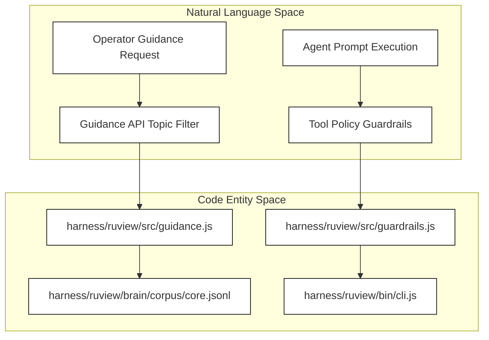
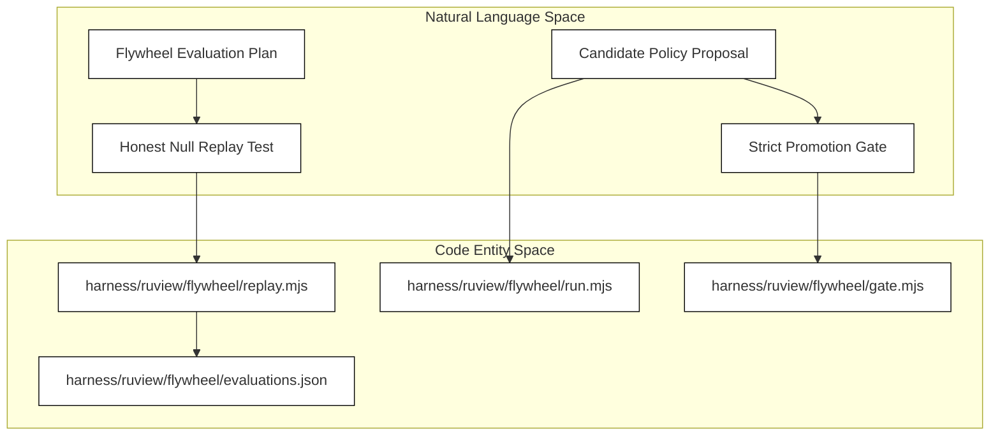

<!-- source: DeepWiki mcp.deepwiki.com · repo ruvnet/RuView · page 10.5 Agent Harnesses & Automation · fetched 2026-10-30 -->

# Agent Harnesses & Automation

<details>
<summary>Relevant source files</summary>

The following files were used as context for generating this wiki page:

- [.github/scripts/nightly-sota/README.md](.github/scripts/nightly-sota/README.md)
- [.github/scripts/nightly-sota/agent.mjs](.github/scripts/nightly-sota/agent.mjs)
- [.github/scripts/nightly-sota/lib.mjs](.github/scripts/nightly-sota/lib.mjs)
- [.github/workflows/nightly-sota-agent.yml](.github/workflows/nightly-sota-agent.yml)
- [.github/workflows/npm-packages.yml](.github/workflows/npm-packages.yml)
- [.github/workflows/ruview-harness-flywheel.yml](.github/workflows/ruview-harness-flywheel.yml)
- [.github/workflows/ruview-npm-release.yml](.github/workflows/ruview-npm-release.yml)
- [AGENTS.md](AGENTS.md)
- [docs/adr/ADR-263-ruview-npm-harness-deep-review.md](docs/adr/ADR-263-ruview-npm-harness-deep-review.md)
- [docs/adr/ADR-284-bounded-nightly-sota-agent.md](docs/adr/ADR-284-bounded-nightly-sota-agent.md)
- [docs/adr/ADR-325-cognitum-spaces-activation-and-governed-spatial-exchange.md](docs/adr/ADR-325-cognitum-spaces-activation-and-governed-spatial-exchange.md)
- [docs/research/rvagent-rvf-integration/README.md](docs/research/rvagent-rvf-integration/README.md)
- [harness/ruview/.harness/manifest.json](harness/ruview/.harness/manifest.json)
- [harness/ruview/.harness/manifest.sha256](harness/ruview/.harness/manifest.sha256)
- [harness/ruview/CLAUDE.md](harness/ruview/CLAUDE.md)
- [harness/ruview/README.md](harness/ruview/README.md)
- [harness/ruview/bin/cli.js](harness/ruview/bin/cli.js)
- [harness/ruview/package-lock.json](harness/ruview/package-lock.json)
- [harness/ruview/package.json](harness/ruview/package.json)
- [harness/ruview/src/guidance.js](harness/ruview/src/guidance.js)
- [harness/ruview/src/mcp-server.js](harness/ruview/src/mcp-server.js)
- [harness/ruview/src/tools.js](harness/ruview/src/tools.js)
- [harness/ruview/test/mcp.test.mjs](harness/ruview/test/mcp.test.mjs)
- [harness/ruview/test/nightly-sota.test.mjs](harness/ruview/test/nightly-sota.test.mjs)
- [harness/ruview/test/tools.test.mjs](harness/ruview/test/tools.test.mjs)
- [plugins/ruview/.claude-plugin/plugin.json](plugins/ruview/.claude-plugin/plugin.json)
- [plugins/ruview/codex/AGENTS.md](plugins/ruview/codex/AGENTS.md)
- [plugins/ruview/codex/prompts/ruview-rvagent.md](plugins/ruview/codex/prompts/ruview-rvagent.md)
- [plugins/ruview/skills/ruview-rvagent/SKILL.md](plugins/ruview/skills/ruview-rvagent/SKILL.md)

</details>


This leaf page details the automation infrastructure, contributor harnesses, agent plug-ins, learning flywheels, and nightly state-of-the-art (SOTA) research agents implemented across the `harness/` and `plugins/` directories of the RuView codebase. These systems enforce strict security boundaries, coordinate multi-modal agentic workflows, maintain reviewed knowledge corpuses, and automate continuous evaluation.

---

## 1. Contributor Harnesses & Shared Brain Architecture

The `harness/` directory houses standalone, production-ready operator and developer harnesses (primarily `ruview` and `homecore`) that expose command-line interfaces, Model Context Protocol (MCP) servers, guidance catalogs, and cryptographic manifest verification [AGENTS.md:1-11, harness/ruview/package.json:1-85]().

### Manifest and Security Policy

The root contributor harness is governed by a strict metadata manifest (`harness/ruview/.harness/manifest.json`) and an explicit tool policy (`default-deny-mutations`) [harness/ruview/.harness/manifest.json:1-70](). 

*   **Manifest Files**: Tracks hashes for all skill definitions, brain corpora, and internal scripts to prevent tampering.
*   **Guardrails (`src/guardrails.js`)**: Enforces read-only isolation, secret redaction, and strict sandbox enforcement for executing agent tools.
*   **Guidance Engine (`src/guidance.js`)**: Exposes source-cited maps of subsystems, capability statuses, focused validation commands, and known limitations [harness/ruview/src/guidance.js:1-53]().



**Sources:** `harness/ruview/.harness/manifest.json:1-70()`, `harness/ruview/src/guidance.js:1-53()`, `AGENTS.md:1-11()`

---

## 2. Learning Flywheel & Evolutionary Policy Evaluation

The learning flywheel under `harness/ruview/flywheel/` provides a secure, offline evaluation and proposal pipeline for evolving agent heuristics and harness rules without compromising core repository safety.

### Components

*   **`run.mjs`**: Executes dry-run or confirmed flywheel iterations, generating candidate rule modifications under `.metaharness/` [harness/ruview/.harness/manifest.json:61-65(), .github/workflows/ruview-harness-flywheel.yml:51-76()]().
*   **`replay.mjs`**: Runs honest-null test vectors and replay suites to measure candidate performance against frozen regression baselines [harness/ruview/package.json:30-43()]().
*   **`gate.mjs`**: Implements strict promotion gates requiring holdout lift, frozen-anchor retention, and zero security violations before any rule change can be considered for upstream review [harness/ruview/.harness/manifest.json:28-33()]().



**Sources:** `harness/ruview/package.json:30-43()`, `harness/ruview/.harness/manifest.json:28-33()`, `.github/workflows/ruview-harness-flywheel.yml:51-76()`

---

## 3. Nightly SOTA Research Agent (ADR-284)

ADR-284 defines the bounded nightly state-of-the-art research agent. Scheduled via GitHub Actions (`.github/workflows/nightly-sota-agent.yml`), the agent fetches public research updates and evaluates architectural integrations securely [docs/adr/ADR-284-bounded-nightly-sota-agent.md:1-1(), .github/workflows/nightly-sota-agent.yml:1-35()]().

### Execution Pipeline

1.  **Collection (`agent.mjs collect`)**: Pulls bounded public metadata from arXiv Atom feeds and the Cognitum registry, classifying records as `CLAIMED` or `SYNTHETIC` [harness/ruview/test/nightly-sota.test.mjs:48-100(), .github/workflows/nightly-sota-agent.yml:27-55()]().
2.  **Synthesis (`agent.mjs propose`)**: Uses a locked LLM backend with cryptographic receipts (`cognitum-receipt.json`) to propose a single bounded research direction or transformation [.github/workflows/nightly-sota-agent.yml:56-96()]().
3.  **Scoring & Replay (`agent.mjs score`)**: Evaluates the proposal against frozen Darwin policies and runs honest-null replay vectors [.github/workflows/nightly-sota-agent.yml:97-140()]().
4.  **Triage**: Deduplicates existing repository issues/PRs and creates a single labelled research issue if metrics pass thresholds [.github/workflows/nightly-sota-agent.yml:141-174()]().

```mermaid
graph TD
    subgraph NaturalLanguageSpace ["Natural Language Space"]
      Q["Scheduled Nightly Cron Trigger"] --> R["Public Research Feed Collection"]
      S ["LLM Proposal Synthesis"] --> T ["Darwin & Flywheel Scoring"]
    end

    subgraph CodeEntitySpace ["Code Entity Space"]
      R --> U[".github/scripts/nightly-sota/agent.mjs"]
      S --> V[".github/workflows/nightly-sota-agent.yml"]
      T --> W["harness/ruview/test/nightly-sota.test.mjs"]
      U --> X[".github/scripts/nightly-sota/lib.mjs"]
    end

    classDef default stroke:#000,fill:#fff;
```

**Sources:** `docs/adr/ADR-284-bounded-nightly-sota-agent.md:1-1()`, `.github/workflows/nightly-sota-agent.yml:1-174()`, `harness/ruview/test/nightly-sota.test.mjs:1-100()`

---

## 4. Claude & Codex Plugin Integration (`plugins/ruview/`)

The `plugins/ruview/` directory bundles operational prompt suites and plugin configurations for Claude Code and OpenAI Codex [.claude-plugin/plugin.json:1-32(), plugins/ruview/codex/AGENTS.md:1-21()]().

### Key Capabilities

*   **Plugin Manifest (`plugins/ruview/.claude-plugin/plugin.json`)**: Configures runtime environment variables (`RVAGENT_SENSING_URL`), metadata, and registers MCP servers like `@ruvnet/rvagent` [plugins/ruview/.claude-plugin/plugin.json:1-32()]().
*   **Skill Definitions (`plugins/ruview/skills/`)**: Specialized operational instructions covering onboarding (`onboard`), node provisioning (`provision-node`), room calibration (`calibrate-room`), and agentic integration (`ruview-rvagent`) [plugins/ruview/skills/ruview-rvagent/SKILL.md:1-27()]().
*   **MCP Tool Mapping**: Bridges sensing updates—such as BFLD presence scans (`bfld_last_scan`), breathing rate (`vitals_get_breathing`), and heart rate telemetry (`vitals_get_heart_rate`)—directly into agentic tool loops [plugins/ruview/skills/ruview-rvagent/SKILL.md:10-24()]().

**Sources:** `plugins/ruview/.claude-plugin/plugin.json:1-32()`, `plugins/ruview/codex/AGENTS.md:1-21()`, `plugins/ruview/skills/ruview-rvagent/SKILL.md:1-27()`

---

## 5. Background Metrics Workers & Telemetry (`.claude-flow`)

Background worker processes and telemetry scripts coordinate execution telemetry, metric tracking, and sandbox log scrubbing across local agent sessions.

*   **Isolation Controls**: Scripts invoked by agent harnesses enforce `--disable-proto=prototype` or `--disable-proto=throw` constraints to prevent prototype pollution attacks [.github/workflows/nightly-sota-agent.yml:46-48()]().
*   **Secret Scrubbing**: Telemetry serialization layers automatically sanitize environment variables, bearer tokens, API keys, and raw CSI arrays before persisting metrics or generating artifact bundles [plugins/ruview/codex/AGENTS.md:27-48()]().

**Sources:** `.github/workflows/nightly-sota-agent.yml:45-48()`, `plugins/ruview/codex/AGENTS.md:32-48()`

---

