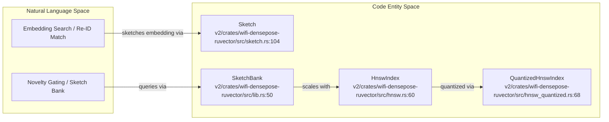
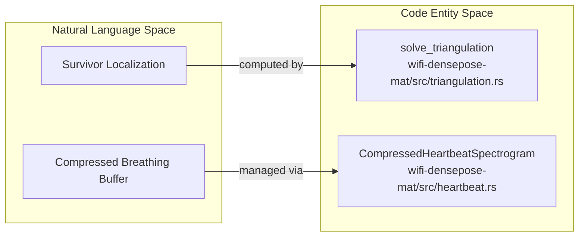

<!-- source: DeepWiki mcp.deepwiki.com · repo ruvnet/RuView · page 11 Advanced Topics · fetched 2026-10-30 -->

# Advanced Topics

Relevant source files

The following files were used as context for generating this wiki page:

- [docs/adr/ADR-084-rabitq-similarity-sensor.md](docs/adr/ADR-084-rabitq-similarity-sensor.md)
- [docs/adr/ADR-156-ruvector-fusion-beyond-sota.md](docs/adr/ADR-156-ruvector-fusion-beyond-sota.md)
- [docs/adr/ADR-261-ruvector-graph-ann-index.md](docs/adr/ADR-261-ruvector-graph-ann-index.md)
- [v2/crates/wifi-densepose-ruvector/benches/ann_bench.rs](v2/crates/wifi-densepose-ruvector/benches/ann_bench.rs)
- [v2/crates/wifi-densepose-ruvector/benches/sketch_bench.rs](v2/crates/wifi-densepose-ruvector/benches/sketch_bench.rs)
- [v2/crates/wifi-densepose-ruvector/src/ann_measure.rs](v2/crates/wifi-densepose-ruvector/src/ann_measure.rs)
- [v2/crates/wifi-densepose-ruvector/src/coverage.rs](v2/crates/wifi-densepose-ruvector/src/coverage.rs)
- [v2/crates/wifi-densepose-ruvector/src/estimator.rs](v2/crates/wifi-densepose-ruvector/src/estimator.rs)
- [v2/crates/wifi-densepose-ruvector/src/hnsw.rs](v2/crates/wifi-densepose-ruvector/src/hnsw.rs)
- [v2/crates/wifi-densepose-ruvector/src/hnsw_quantized.rs](v2/crates/wifi-densepose-ruvector/src/hnsw_quantized.rs)
- [v2/crates/wifi-densepose-ruvector/src/lib.rs](v2/crates/wifi-densepose-ruvector/src/lib.rs)
- [v2/crates/wifi-densepose-ruvector/src/rotation.rs](v2/crates/wifi-densepose-ruvector/src/rotation.rs)
- [v2/crates/wifi-densepose-ruvector/src/sketch.rs](v2/crates/wifi-densepose-ruvector/src/sketch.rs)

This page covers specialized features and integrations that extend RuView beyond standard WiFi sensing. Topics include RuVector algorithm integration for advanced signal processing and retrieval, WASM edge modules for custom on-device logic, privacy shield and WiFi-Veil countermeasures, the Mass Casualty Assessment Tool (MAT) for disaster survivor detection, the Cognitum Seed appliance and Cognitum Spaces, and the legacy Python v1 implementation. For basic WiFi sensing concepts, see [Core Sensing Engine](#4). For training workflows, see [Training & Model Deployment](#6). For application usage, see [Applications](#5).

---

## 11.1 RuVector Algorithm Integration

RuVector provides a comprehensive cognitive computing platform integrated into the WiFi-DensePose system [v2/crates/wifi-densepose-ruvector/src/lib.rs:1-15](). The integration encompasses subcarrier partitioning, RaBitQ similarity sketches, HNSW quantized ANN indexing, coverage/estimator utilities, viewpoint coherence, and tiered compression layout [v2/crates/wifi-densepose-ruvector/src/lib.rs:29-53](). RaBitQ-style binary sketches act as cheap similarity sensors for embedding hot-caches and novelty gating [docs/adr/ADR-084-rabitq-similarity-sensor.md:39-51]().

### Natural Language to Code Space: RuVector Retrieval Pipeline

**Sources:** [v2/crates/wifi-densepose-ruvector/src/lib.rs:29-53](), [docs/adr/ADR-084-rabitq-similarity-sensor.md:39-51](), [v2/crates/wifi-densepose-ruvector/src/sketch.rs:104-111](), [v2/crates/wifi-densepose-ruvector/src/hnsw.rs:60-74]()

For details, see [RuVector Algorithm Integration](#11.1).

---

## 11.2 WASM Edge Modules

Tier 3 edge processing enables deployment of custom signal processing logic as WebAssembly modules on edge nodes across categories such as Medical, Security, and Signal Intelligence. Modules are packaged in the RVF container format and secured using cryptographic signature verification.

The runtime utilizes `wasm3` with strict memory and execution budget guards, ensuring reliable module lifecycles, honest labeling, and low-latency benchmark compliance.

For details, see [WASM Edge Modules](#11.2).

---

## 11.3 Privacy Shield & WiFi-Veil

The `wifi-densepose-privshield` crate and the standalone `wifi-veil` repository provide compliant obfuscation waveforms (ADR-288) to protect personal privacy against unauthorized passive sensing. 

The system includes an attacker/protector experiment harness, throughput cost modeling, a veil TUI console, and firmware deployment targets for ESP32, nexmon, openwifi, and OpenWrt devices alongside comprehensive research documentation.

For details, see [Privacy Shield & WiFi-Veil](#11.3).

---

## 11.4 Mass Casualty Assessment Tool (MAT)

The Mass Casualty Assessment Tool (MAT) crate (`wifi-densepose-mat`) is a specialized extension for disaster survivor detection [v2/crates/wifi-densepose-ruvector/src/lib.rs:12-13](). It implements Time Difference of Arrival (TDoA) triangulation, vital sign buffers, debris propagation models, and hardware adapters [v2/crates/wifi-densepose-ruvector/src/lib.rs:23-25]().

### Natural Language to Code Space: MAT Triage & Triangulation

**Sources:** [v2/crates/wifi-densepose-ruvector/src/lib.rs:12-13](), [v2/crates/wifi-densepose-ruvector/src/lib.rs:23-25]()

For details, see [Mass Casualty Assessment Tool (MAT)](#11.4).

---

## 11.5 Cognitum Seed Appliance & Spaces

The Cognitum Seed appliance provides persistent RVF vector storage and kNN similarity search at the edge. It supports cog packaging specifications, edge module registries, and swarm bridge cloud ingestion.

Additionally, Cognitum Spaces govern secure, standardized spatial exchange protocols (ADR-325) via the `ruview-cognitum-spaces` crate.

For details, see [Cognitum Seed Appliance & Spaces](#11.5).

---

## 11.6 Legacy Python Implementation (v1)

The archived Python v1 implementation located under `archive/v1/` contains the legacy FastAPI REST API, SQLAlchemy database models and migrations, PyTorch-based CSI processors, hardware abstraction interfaces, background task runners, and proof/verify data pipelines. 

This implementation serves as the historical reference for mathematical validation before the high-performance Rust port.

For details, see [Legacy Python Implementation (v1)](#11.6).

---

## Child Pages

- [RuVector Algorithm Integration](#11.1)
- [WASM Edge Modules](#11.2)
- [Privacy Shield & WiFi-Veil](#11.3)
- [Mass Casualty Assessment Tool (MAT)](#11.4)
- [Cognitum Seed Appliance & Spaces](#11.5)
- [Legacy Python Implementation (v1)](#11.6)

---

