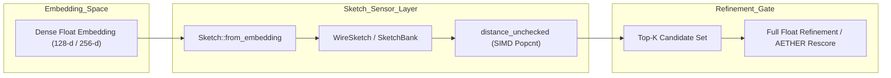

<!-- source: DeepWiki mcp.deepwiki.com · repo ruvnet/RuView · page 11.1 RuVector Algorithm Integration · fetched 2026-10-30 -->

# RuVector Algorithm Integration

Relevant source files

The following files were used as context for generating this wiki page:

- [.github/workflows/update-submodules.yml](.github/workflows/update-submodules.yml)
- [.gitmodules](.gitmodules)
- [docs/adr/ADR-002-ruvector-rvf-integration-strategy.md](docs/adr/ADR-002-ruvector-rvf-integration-strategy.md)
- [docs/adr/ADR-003-rvf-cognitive-containers-csi.md](docs/adr/ADR-003-rvf-cognitive-containers-csi.md)
- [docs/adr/ADR-004-hnsw-vector-search-fingerprinting.md](docs/adr/ADR-004-hnsw-vector-search-fingerprinting.md)
- [docs/adr/ADR-005-sona-self-learning-pose-estimation.md](docs/adr/ADR-005-sona-self-learning-pose-estimation.md)
- [docs/adr/ADR-006-gnn-enhanced-csi-pattern-recognition.md](docs/adr/ADR-006-gnn-enhanced-csi-pattern-recognition.md)
- [docs/adr/ADR-007-post-quantum-cryptography-secure-sensing.md](docs/adr/ADR-007-post-quantum-cryptography-secure-sensing.md)
- [docs/adr/ADR-008-distributed-consensus-multi-ap.md](docs/adr/ADR-008-distributed-consensus-multi-ap.md)
- [docs/adr/ADR-009-rvf-wasm-runtime-edge-deployment.md](docs/adr/ADR-009-rvf-wasm-runtime-edge-deployment.md)
- [docs/adr/ADR-010-witness-chains-audit-trail-integrity.md](docs/adr/ADR-010-witness-chains-audit-trail-integrity.md)
- [docs/adr/ADR-011-python-proof-of-reality-mock-elimination.md](docs/adr/ADR-011-python-proof-of-reality-mock-elimination.md)
- [docs/adr/ADR-017-ruvector-signal-mat-integration.md](docs/adr/ADR-017-ruvector-signal-mat-integration.md)
- [docs/adr/ADR-084-rabitq-similarity-sensor.md](docs/adr/ADR-084-rabitq-similarity-sensor.md)
- [docs/adr/ADR-156-ruvector-fusion-beyond-sota.md](docs/adr/ADR-156-ruvector-fusion-beyond-sota.md)
- [docs/adr/ADR-261-ruvector-graph-ann-index.md](docs/adr/ADR-261-ruvector-graph-ann-index.md)
- [firmware/esp32-csi-node/sdkconfig.defaults.devkitc](firmware/esp32-csi-node/sdkconfig.defaults.devkitc)
- [v2/crates/wifi-densepose-ruvector/benches/ann_bench.rs](v2/crates/wifi-densepose-ruvector/benches/ann_bench.rs)
- [v2/crates/wifi-densepose-ruvector/benches/sketch_bench.rs](v2/crates/wifi-densepose-ruvector/benches/sketch_bench.rs)
- [v2/crates/wifi-densepose-ruvector/src/ann_measure.rs](v2/crates/wifi-densepose-ruvector/src/ann_measure.rs)
- [v2/crates/wifi-densepose-ruvector/src/coverage.rs](v2/crates/wifi-densepose-ruvector/src/coverage.rs)
- [v2/crates/wifi-densepose-ruvector/src/estimator.rs](v2/crates/wifi-densepose-ruvector/src/estimator.rs)
- [v2/crates/wifi-densepose-ruvector/src/hnsw.rs](v2/crates/wifi-densepose-ruvector/src/hnsw.rs)
- [v2/crates/wifi-densepose-ruvector/src/hnsw_quantized.rs](v2/crates/wifi-densepose-ruvector/src/hnsw_quantized.rs)
- [v2/crates/wifi-densepose-ruvector/src/lib.rs](v2/crates/wifi-densepose-ruvector/src/lib.rs)
- [v2/crates/wifi-densepose-ruvector/src/rotation.rs](v2/crates/wifi-densepose-ruvector/src/rotation.rs)
- [v2/crates/wifi-densepose-ruvector/src/sketch.rs](v2/crates/wifi-densepose-ruvector/src/sketch.rs)

## Purpose and Scope

This page details the integration of **RuVector v2.0.4/v2.0.5** crates and the `wifi-densepose-ruvector` crate into the RuView system. RuVector provides subpolynomial algorithms, graph-based optimization, RaBitQ binary similarity sketches, quantized HNSW approximate nearest neighbor (ANN) indexing, and self-optimizing neural architectures (`SONA`). These components enable high-fidelity signal processing, cross-viewpoint sensor fusion, fast spatial indexing, and tiered temporal compression.

Sources: [docs/adr/ADR-017-ruvector-signal-mat-integration.md:1-14](), [v2/crates/wifi-densepose-ruvector/src/lib.rs:1-15]()

---

## RuVector Component Crates & Ecosystem

The RuVector ecosystem is integrated into RuView via specialized core and integration crates located under `vendor/ruvector` and the `wifi-densepose-ruvector` crate workspace (`v2/crates/wifi-densepose-ruvector`) [ .gitmodules:5-8](), [v2/crates/wifi-densepose-ruvector/src/lib.rs:31-42]().

| Crate / Module | Purpose | Key Algorithm | Complexity / Benefit |
|----------------|---------|---------------|----------------------|
| `ruvector-mincut` | Subcarrier/Graph Partitioning | Dynamic Min-Cut (exact/approx) | $O(n^{1.5} \log n)$ amortized updates [docs/adr/ADR-017-ruvector-signal-mat-integration.md:40-40]() |
| `ruvector-attn-mincut` | Spectrogram Denoising | Attention + mincut gating | Linear time temporal-frequency gating [docs/adr/ADR-017-ruvector-signal-mat-integration.md:41-41]() |
| `ruvector-attention` | BVP/Viewpoint Fusion | Scaled Dot-Product Attention | Sublinear scaling for small $d$ [docs/adr/ADR-017-ruvector-signal-mat-integration.md:44-44]() |
| `ruvector-solver` | Fresnel/TDoA Solving | Neumann Sparse Solver | $O(\sqrt{n})$ convergence rate [docs/adr/ADR-017-ruvector-signal-mat-integration.md:43-43]() |
| `ruvector-temporal-tensor` | Tiered Compression | Quantized temporal buffers | 50–75% memory footprint reduction [docs/adr/ADR-017-ruvector-signal-mat-integration.md:42-42]() |
| `wifi-densepose-ruvector::sketch` | RaBitQ Similarity Sensors | 1-bit binary quantization (`BinaryQuantized`) | 32× compression, SIMD popcnt/hamming distance [docs/adr/ADR-084-rabitq-similarity-sensor.md:30-33]() |
| `wifi-densepose-ruvector::hnsw_quantized` | Quantized HNSW Indexing | SymphonyQG-style quantized graph traversal | 3.5–17× QPS over float HNSW at equal recall [v2/crates/wifi-densepose-ruvector/src/hnsw_quantized.rs:1-14]() |

### System Integration Map (Natural Language to Code Entity)

```mermaid
graph TB
    subgraph "Natural_Language_Space"
        Partitioning["Subcarrier Partitioning"]
        Denoising["Spectrogram Denoising"]
        Aggregation["BVP Aggregation"]
        Triangulation["TDoA Triangulation"]
        Compression["Vital Signs Compression"]
        Sketching["RaBitQ Similarity Sketching"]
        Indexing["Quantized HNSW Indexing"]
    end

    subgraph "Code_Entity_Space"
        DynamicMinCut["wifi_densepose_signal::subcarrier_selection::mincut_subcarrier_partition"]
        AttnMincutFn["wifi_densepose_signal::spectrogram::gate_spectrogram"]
        SDPAttention["wifi_densepose_signal::bvp::aggregate_bvp"]
        NeumannSolver["mat::triangulation::solve_triangulation"]
        TemporalComp["mat::breathing::CompressedBreathingBuffer"]
        SketchStruct["wifi_densepose_ruvector::sketch::Sketch"]
        QuantIndex["wifi_densepose_ruvector::hnsw_quantized::QuantizedHnswIndex"]
    end

    Partitioning --> DynamicMinCut
    Denoising --> AttnMincutFn
    Aggregation --> SDPAttention
    Triangulation --> NeumannSolver
    Compression --> TemporalComp
    Sketching --> SketchStruct
    Indexing --> QuantIndex
```

Sources: [docs/adr/ADR-017-ruvector-signal-mat-integration.md:53-66](), [v2/crates/wifi-densepose-ruvector/src/lib.rs:31-53](), [docs/adr/ADR-084-rabitq-similarity-sensor.md:83-90]()

---

## Signal Processing Pipeline & Subcarrier Partitioning

The `wifi-densepose-signal` crate utilizes RuVector algorithms for subcarrier graph optimization and time-frequency denoising [docs/adr/ADR-017-ruvector-signal-mat-integration.md:18-24]().

### Subcarrier Sensitivity Selection (`ruvector-mincut`)
*   **Graph Construction**: Subcarriers act as graph vertices where edges encode variance-ratio similarity weights [docs/adr/ADR-017-ruvector-signal-mat-integration.md:78-82]().
*   **Dynamic Partitioning**: `DynamicMinCut` separates motion-responsive (sensitive) subcarriers from noise-dominated (insensitive) ones [docs/adr/ADR-017-ruvector-signal-mat-integration.md:80-84](). Incremental edge updates maintain partitions in $O(n^{1.5} \log n)$ amortized time without full re-sorting [docs/adr/ADR-017-ruvector-signal-mat-integration.md:82-84]().

### Spectrogram Genders and Phase Alignment (`ruvector-attn-mincut` & `ruvector-solver`)
*   **Spectrogram Gating**: `gate_spectrogram` applies `attn_mincut` over STFT tokens to suppress ambient multipath noise while keeping active body-motion periods [docs/adr/ADR-017-ruvector-signal-mat-integration.md:137-164]().
*   **Neumann Solver**: Local oscillator phase discrepancies are resolved using `ruvector-solver::NeumannSolver` [docs/adr/ADR-017-ruvector-signal-mat-integration.md:43-43]().

Sources: [docs/adr/ADR-017-ruvector-signal-mat-integration.md:70-164]()

---

## RaBitQ Similarity Sketches & Hot-Cache Filtering

RuView implements RaBitQ-style binary sketches as cheap similarity sensors via `wifi_densepose_ruvector::sketch` [docs/adr/ADR-084-rabitq-similarity-sensor.md:39-51]().

### Mechanics and Deployment Pattern
*   **Binary Quantization**: Dense float embeddings (such as 128-d AETHER re-ID vectors or 256-d CSI spectrogram embeddings) are reduced to 1 bit per dimension using `BinaryQuantized` (`vendor/ruvector/crates/ruvector-core/src/quantization.rs`) [docs/adr/ADR-084-rabitq-similarity-sensor.md:14-34]()
*   **Hamming Distance Pre-filtering**: Instead of computing full-precision dot products across candidate banks, a fast SIMD popcnt hamming distance filters candidates to a top-$K$ list before full float refinement [docs/adr/ADR-084-rabitq-similarity-sensor.md:30-33]().
*   **Use Cases**: Functions as a novelty/drift detector, cluster-Pi memory router, mesh-exchange compression format, and privacy-preserving ephemeral log [docs/adr/ADR-084-rabitq-similarity-sensor.md:39-48]().

Sources: [docs/adr/ADR-084-rabitq-similarity-sensor.md:14-90](), [v2/crates/wifi-densepose-ruvector/src/sketch.rs:1-53]()

---

## Quantized HNSW Indexing & SymphonyQG Traversal

To accelerate nearest-neighbor retrieval over large temporal collections, RuView integrates `QuantizedHnswIndex` (`wifi-densepose-ruvector::hnsw_quantized`) [v2/crates/wifi-densepose-ruvector/src/hnsw_quantized.rs:1-12]().

### SymphonyQG Quantized Traversal
*   **Quantized Graph Traversal**: During beam search, candidate nodes are scored using a multi-bit scalar code over RaBitQ Pass-2 rotated coordinates (`Rotation`) rather than full float distance calculations [v2/crates/wifi-densepose-ruvector/src/hnsw_quantized.rs:28-40]().
*   **Exact Reranking**: Only the final beam window undergoes precise floating-point distance recalculation and reranking, reducing graph traversal bottlenecks [v2/crates/wifi-densepose-ruvector/src/hnsw_quantized.rs:38-40]().
*   **Memory Footprint**: Multi-bit scalar quantization supports 1-bit, 2-bit, and 4-bit configurations, scaling memory consumption per node from $\frac{D}{8}$ to $\frac{D}{2}$ bytes [v2/crates/wifi-densepose-ruvector/src/hnsw_quantized.rs:127-133]().

Sources: [v2/crates/wifi-densepose-ruvector/src/hnsw_quantized.rs:1-133](), [v2/crates/wifi-densepose-ruvector/src/rotation.rs:1-50]()

---

## Viewpoint Coherence & Cross-Viewpoint Fusion

The `wifi-densepose-ruvector::viewpoint` module handles multi-node spatial fusion and geometrical alignment (ADR-031, ADR-156) [docs/adr/ADR-156-ruvector-fusion-beyond-sota.md:8-10]().

*   **Geometric Bias**: `GeometricBias::build_matrix` constructs spatial attention biases using wrapped angular separations to handle 0/2π seams correctly [docs/adr/ADR-156-ruvector-fusion-beyond-sota.md:40-47]().
*   **Safety Guards**: Crafting protection ensures that triangulation solvers (`mat::triangulation::solve_triangulation`) and spectrogram utilities (`mat::heartbeat::CompressedHeartbeatSpectrogram::band_power`) return typed `None` or safe zeroed bounds rather than panicking on invalid or out-of-range AP indices [docs/adr/ADR-156-ruvector-fusion-beyond-sota.md:52-58]().

Sources: [docs/adr/ADR-156-ruvector-fusion-beyond-sota.md:8-58]()

---

## Coverage, Estimator & Temporal Utilities

The `wifi-densepose-ruvector` crate provides auxiliary analytical and compression utilities:
*   **Coverage & Estimators**: `wifi_densepose_ruvector::coverage` and `wifi_densepose_ruvector::estimator` (`DistanceEstimator`, `EstimatorBank`) evaluate quantization coverage and distance bounding parameters [v2/crates/wifi-densepose-ruvector/src/lib.rs:43-46]().
*   **Event Logging**: `wifi_densepose_ruvector::event_log` structures privacy-compliant novelty and privacy event logs (`PrivacyEventLog`) [v2/crates/wifi-densepose-ruvector/src/lib.rs:46-46]().
*   **Tiered Compression**: `ruvector-temporal-tensor` manages temporal buffering for vital signs and micro-Doppler spectrograms, achieving 50–75% storage savings [docs/adr/ADR-017-ruvector-signal-mat-integration.md:42-66]().

Sources: [v2/crates/wifi-densepose-ruvector/src/lib.rs:31-53](), [docs/adr/ADR-017-ruvector-signal-mat-integration.md:42-66]()

---

## Vendor Structure and Submodule Layout

RuVector dependencies are integrated via git submodules mapped in `.gitmodules` under the `vendor/` directory [ .gitmodules:1-12]().

*   **Submodule References**: `vendor/ruvector`, `vendor/sublinear-time-solver`, `vendor/rvcsi`, `vendor/rufield`, and `vendor/worldgraph` isolate external algorithm implementations [ .gitmodules:1-31]().
*   **Automated Sync**: A dedicated GitHub Actions workflow (`update-submodules.yml`) polls tracked branches every 6 hours and automatically opens update pull requests for superproject pointer bumps [ .github/workflows/update-submodules.yml:1-68]().

Sources: [ .gitmodules:1-40](), [ .github/workflows/update-submodules.yml:1-68]()

---

