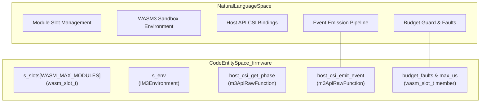
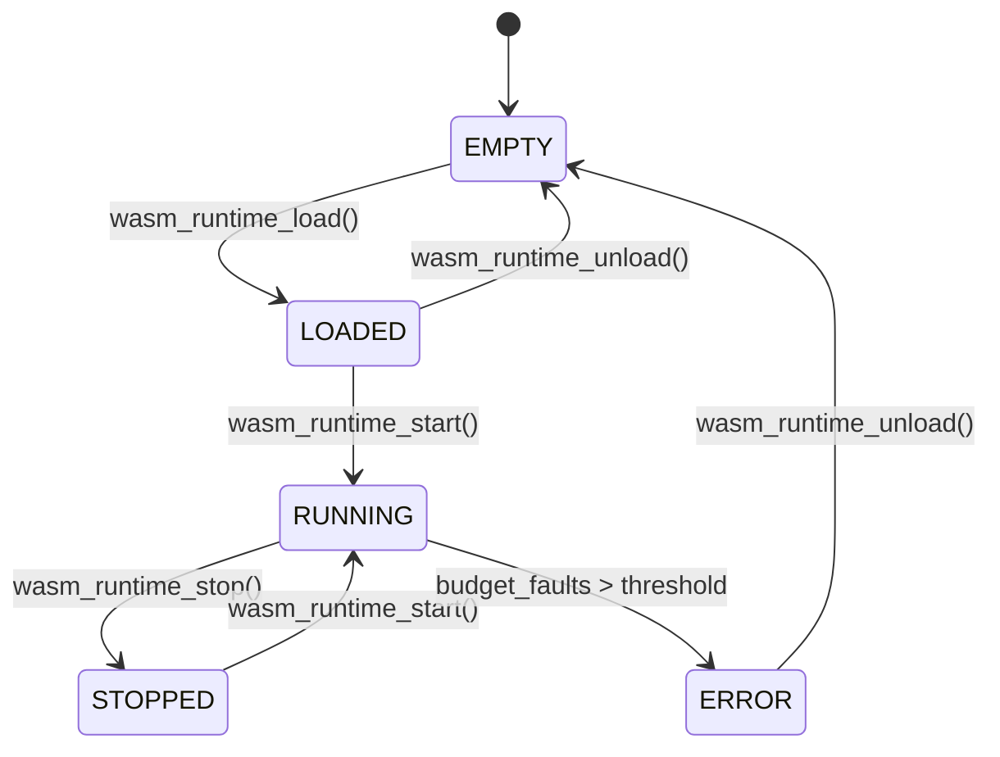
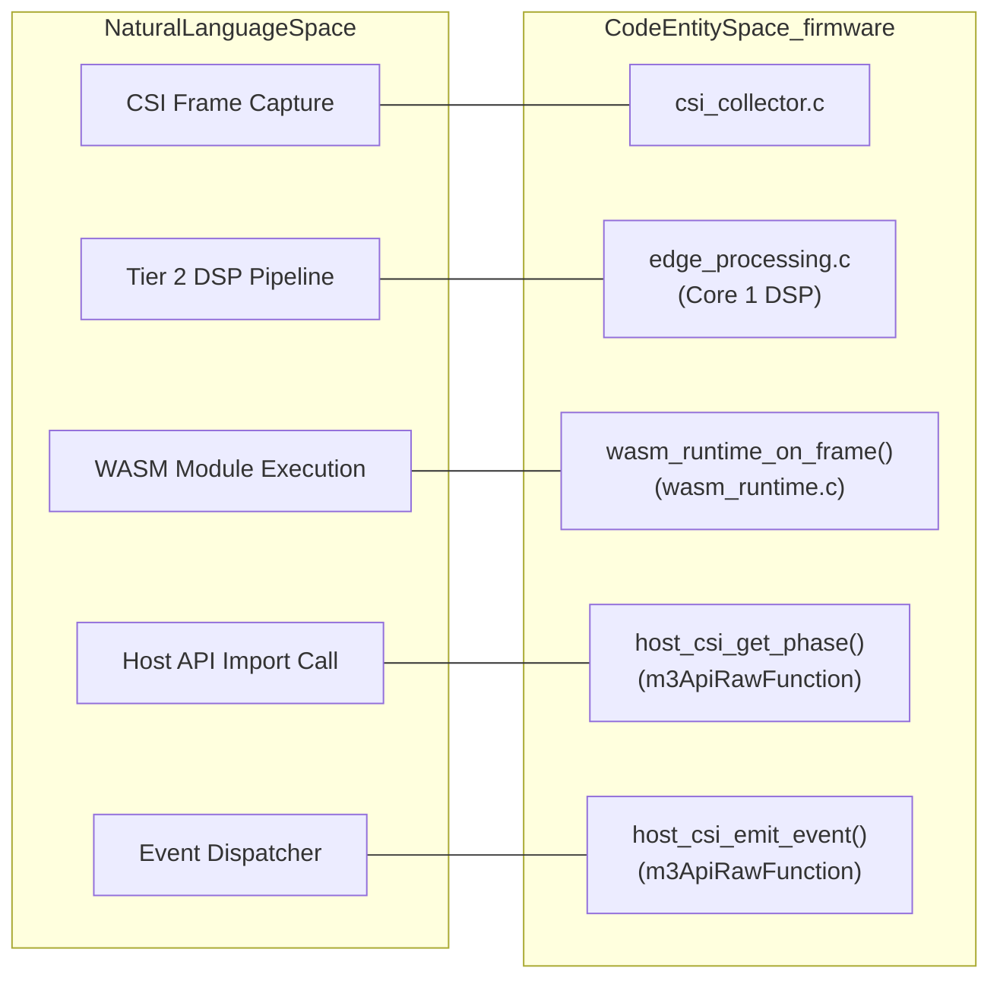

<!-- source: DeepWiki mcp.deepwiki.com · repo ruvnet/RuView · page 11.2 WASM Edge Modules · fetched 2026-10-30 -->

# WASM Edge Modules

Relevant source files

The following files were used as context for generating this wiki page:

- [PROOF.md](PROOF.md)
- [benchmarks/edge-latency/RESULTS.md](benchmarks/edge-latency/RESULTS.md)
- [benchmarks/edge-skills/RESULTS.md](benchmarks/edge-skills/RESULTS.md)
- [docs/adr/ADR-159-cognitum-appliance-beyond-sota.md](docs/adr/ADR-159-cognitum-appliance-beyond-sota.md)
- [docs/adr/ADR-160-edge-skill-library-honest-labeling.md](docs/adr/ADR-160-edge-skill-library-honest-labeling.md)
- [docs/adr/ADR-163-edge-latency-measurement.md](docs/adr/ADR-163-edge-latency-measurement.md)
- [firmware/esp32-csi-node/main/display_ui.c](firmware/esp32-csi-node/main/display_ui.c)
- [firmware/esp32-csi-node/main/wasm_runtime.c](firmware/esp32-csi-node/main/wasm_runtime.c)
- [scripts/prove.sh](scripts/prove.sh)
- [v2/crates/wifi-densepose-wasm-edge/tests/honest_labeling.rs](v2/crates/wifi-densepose-wasm-edge/tests/honest_labeling.rs)
- [v2/crates/wifi-densepose-wasm-edge/tests/synthetic_validation.rs](v2/crates/wifi-densepose-wasm-edge/tests/synthetic_validation.rs)

## Purpose and Scope

This page documents the WASM edge module system (**ADR-040**), which enables custom signal processing logic to execute directly on ESP32-S3 nodes as **Tier 3 edge intelligence** [firmware/esp32-csi-node/main/wasm_runtime.c:1-11](). WASM modules are packaged in the **RVF** (RuView Format) container format with **Ed25519** cryptographic signature verification, provisioned via HTTP, and executed inside a sandboxed `wasm3` interpreter environment [firmware/esp32-csi-node/main/wasm_runtime.c:34-37](). 

The architecture supports a curated registry of edge skill modules across multiple categories, governed by strict execution budget guards, capability access masks, honest labeling constraints (**ADR-160**), and reproducible host-side latency benchmarks (**ADR-163**).

Sources: [firmware/esp32-csi-node/main/wasm_runtime.c:1-37](), [docs/adr/ADR-160-edge-skill-library-honest-labeling.md:1-30](), [docs/adr/ADR-163-edge-latency-measurement.md:1-25]()

---

## Architecture Overview

WASM edge modules occupy **Tier 3** in the four-tier ESP32 processing hierarchy [docs/adr/ADR-039-esp32-edge-intelligence.md:135-140](). They execute on **Core 1** (DSP task context) immediately after Tier 2 DSP feature extraction completes [firmware/esp32-csi-node/main/wasm_runtime.c:3-11](). 

### Processing Tiers & Execution Budgets

| Tier | Name | Description | Execution Budget | RAM Allocation |
|------|------|-------------|------------------|----------------|
| 0 | Raw | Raw passthrough | N/A | 0 KB |
| 1 | Signal | Phase sanitization, Welford stats | N/A | ~30 KB |
| 2 | Vitals | Breathing, heart rate, presence | N/A | ~33 KB |
| **3** | **WASM** | **Custom edge intelligence** | **2ms - 10ms** | **Configurable Arena** |

The system classifies WASM execution budgets into three strict tiers:
- **L (Lightweight)**: `< 2,000 µs` (e.g., threshold alerts, basic triggers).
- **S (Standard)**: `< 5,000 µs` (e.g., windowed statistics, moving averages).
- **H (Heavy)**: `< 10,000 µs` (e.g., complex autocorrelation, pattern recognition).

### Code-to-System Mapping: Runtime Engine

The following diagram bridges natural language runtime concepts to concrete C implementation symbols within the firmware codebase.

**Diagram: Mapping WASM runtime concepts to firmware implementation**

Sources: [firmware/esp32-csi-node/main/wasm_runtime.c:43-85](), [firmware/esp32-csi-node/main/wasm_runtime.c:111-226]()

---

## RVF Container & Signature Verification

Modules are distributed and loaded via the **RuView Format (RVF)** container structure [firmware/esp32-csi-node/main/wasm_upload.c:13-16](). The container bundles a file header, manifest metadata, the compiled WASM binary, and a cryptographic signature.

### Ed25519 Security Hardening
To prevent unauthorized code injection on deployed edge nodes:
1. **Public Key Provisioning**: The trusted public key is stored in Non-Volatile Storage (NVS) during node provisioning via `provision.py` [firmware/esp32-csi-node/main/wasm_upload.c:114-120]().
2. **Signature Verification**: The `wasm_upload_handler` validates the RVF payload signature against the stored public key using `rvf_verify_signature`, unless explicitly bypassed via build flags (`CONFIG_WASM_SKIP_SIGNATURE`) [firmware/esp32-csi-node/main/wasm_upload.c:129-135]().
3. **Format Detection**: The parser detects container magic bytes (`RVF\x01`) versus raw WASM binaries (`\0asm`) [firmware/esp32-csi-node/main/wasm_upload.c:16-17]().

Sources: [firmware/esp32-csi-node/main/wasm_upload.c:97-137](), [firmware/esp32-csi-node/main/wasm_runtime.c:22-26]()

---

## Module Lifecycle & Management

The `wasm_runtime` subsystem handles up to `WASM_MAX_MODULES` concurrent module slots [firmware/esp32-csi-node/main/wasm_runtime.c:84](). Management commands are accepted over HTTP or local IPC.

### Lifecycle State Machine

**Diagram: WASM module state transitions**

### Runtime Sandbox & Budget Monitoring
Each module executes within fixed memory bounds and strict timing envelopes:
- **Arena Isolation**: Allocated inside a fixed PSRAM arena of size `WASM_ARENA_SIZE` per slot [firmware/esp32-csi-node/main/wasm_runtime.c:48-49]().
- **Budget Tracking**: Cumulative execution time (`total_us`), worst-case single-frame time (`max_us`), and budget violation counts (`budget_faults`) are tracked per slot [firmware/esp32-csi-node/main/wasm_runtime.c:58-63]().
- **Fault Handling**: If execution duration exceeds `manifest_budget_us`, a budget fault is logged and corrective throttling or unloading is triggered [firmware/esp32-csi-node/main/wasm_runtime.c:63-72]().

Sources: [firmware/esp32-csi-node/main/wasm_runtime.c:43-76](), [firmware/esp32-csi-node/main/wasm_upload.c:85-173]()

---

## Host API & Custom Edge Logic

WASM modules interact with hardware sensors and Tier 2 processing outputs through imported functions grouped under the `csi` namespace [firmware/esp32-csi-node/main/wasm_runtime.c:8-11]().

### Host API Import Summary
| Function | Return Type | Description |
|----------|-------------|-------------|
| `host_csi_get_phase(idx)` | `float` | Retrieve sanitized phase for subcarrier index [firmware/esp32-csi-node/main/wasm_runtime.c:112]() |
| `host_csi_get_amplitude(idx)` | `float` | Retrieve amplitude for subcarrier index [firmware/esp32-csi-node/main/wasm_runtime.c:126]() |
| `host_csi_get_variance(idx)` | `float` | Retrieve motion variance for subcarrier index [firmware/esp32-csi-node/main/wasm_runtime.c:138]() |
| `host_csi_get_bpm_breathing()` | `float` | Retrieve Tier 2 breathing rate (BPM) [firmware/esp32-csi-node/main/wasm_runtime.c:151]() |
| `host_csi_get_bpm_heartrate()` | `float` | Retrieve Tier 2 heart rate (BPM) [firmware/esp32-csi-node/main/wasm_runtime.c:161]() |
| `host_csi_emit_event(id, val)` | `void` | Dispatch asynchronous custom event (e.g., alert trigger) [firmware/esp32-csi-node/main/wasm_runtime.c:209]() |

### Code-to-System Mapping: Data Flow Pipeline

The data flow from raw hardware capture to WASM event emission is structured as follows:

**Diagram: Data flow mapping from physical capture to host API execution**

Sources: [firmware/esp32-csi-node/main/wasm_runtime.c:111-226](), [firmware/esp32-csi-node/main/edge_processing.c:28-31]()

---

## Curated Module Categories & Honest Labeling

The `wifi-densepose-wasm-edge` crate contains approximately 70 edge skill modules implementing genuine signal processing algorithms (Welford statistics, autocorrelation, Dynamic Time Warping, sliced-Wasserstein distance, and sparse recovery) [docs/adr/ADR-160-edge-skill-library-honest-labeling.md:1-21]().

### Honest Labeling Guidelines (ADR-160)
In accordance with the project's rigorous anti-slop guidelines, claim surfaces have been audited and hardened:
- **Medical Modules (`med_*`)**: Modules such as `med_seizure_detect`, `med_sleep_apnea`, and `med_cardiac_arrhythmia` perform real signal analysis but lack clinical validation. They carry mandatory documentation disclaimers (*"NOT VALIDATED AGAINST CLINICAL DATA. NOT A MEDICAL DEVICE"*) and are feature-gated behind a non-default `medical-experimental` cargo feature so they cannot be silently compiled into production binaries [docs/adr/ADR-160-edge-skill-library-honest-labeling.md:54-79]().
- **Affect Modules (`exo_*`)**: Affect and emotion modules (`exo_happiness_score`, `exo_emotion_detect`) are explicitly reframed in documentation as speculative proxies (e.g., gait-energy proxies) rather than direct measurements of psychological state [docs/adr/ADR-160-edge-skill-library-honest-labeling.md:82-96]().
- **Security Modules (`sec_*`)**: Constant and event names that overclaimed security discrimination (such as weapon detection) have been renamed to reflect the underlying physical measurements (e.g., `EVENT_WEAPON_ALERT` renamed to `EVENT_HIGH_METAL_REFLECTIVITY`) [docs/adr/ADR-160-edge-skill-library-honest-labeling.md:98-113]().

### Latency Benchmarks (ADR-163)
Criterion benchmarks measure the host-side execution medians for key hot paths under `--release` [docs/adr/ADR-163-edge-latency-measurement.md:35-58](). 

> **Honest Caveat**: Host medians run on native x86_64 hardware (Intel Core Ultra 9 285H) and serve as algorithmic work upper bounds. Interpretation under `wasm3` on an Xtensa ESP32-S3 core operates slower; hardware-targeted benchmarks remain pending [docs/adr/ADR-163-edge-latency-measurement.md:77-84]().

| Hot Path Module | Benchmark Identifier | Host Median Latency | Grade |
|-----------------|----------------------|---------------------|-------|
| `exo_time_crystal` | `exo_time_crystal::process_frame[autocorr_256x128]` | **17.3 µs** | MEASURED-on-host [benchmarks/edge-latency/RESULTS.md:60-60]() |
| `exo_ghost_hunter` | `exo_ghost_hunter::process_frame[empty_room_periodicity]` | **1.44 µs** | MEASURED-on-host [benchmarks/edge-latency/RESULTS.md:61-61]() |
| `sec_weapon_detect` | `sec_weapon_detect::process_frame[per_sc_welford]` | **0.42 µs** | MEASURED-on-host [benchmarks/edge-latency/RESULTS.md:62-62]() |
| `med_seizure_detect` | `med_seizure_detect::process_frame[clonic_rhythm]` | **0.10 µs** | MEASURED-on-host (feature-gated) [benchmarks/edge-latency/RESULTS.md:63-63]() |

Sources: [docs/adr/ADR-160-edge-skill-library-honest-labeling.md:1-113](), [docs/adr/ADR-163-edge-latency-measurement.md:1-94](), [benchmarks/edge-latency/RESULTS.md:1-120]()

---

