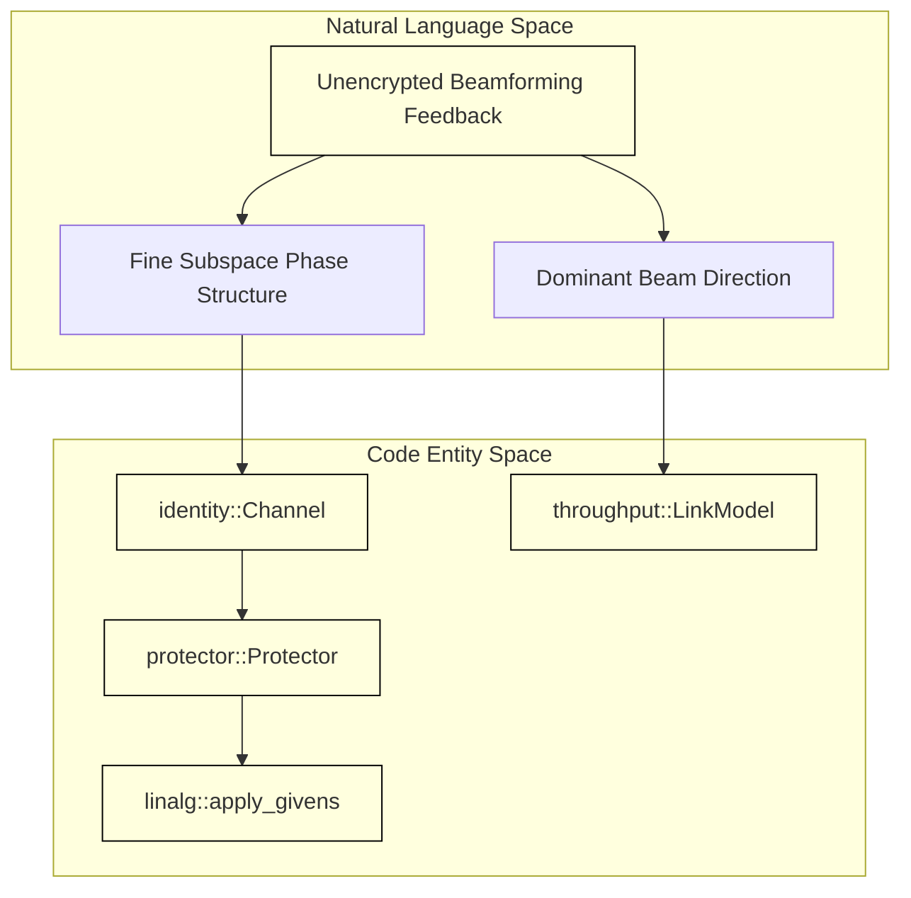
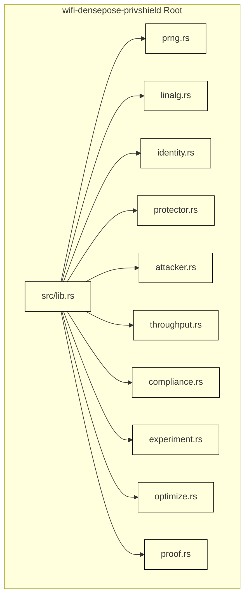

<!-- source: DeepWiki mcp.deepwiki.com · repo ruvnet/RuView · page 11.3 Privacy Shield & WiFi-Veil · fetched 2026-10-30 -->

# Privacy Shield & WiFi-Veil

<details>
<summary>Relevant source files</summary>

The following files were used as context for generating this wiki page:

- [docs/adr/ADR-288-veil-privacy-shield-compliant-waveform.md](docs/adr/ADR-288-veil-privacy-shield-compliant-waveform.md)
- [docs/research/privacy-shield/03-countermeasure-design.md](docs/research/privacy-shield/03-countermeasure-design.md)
- [docs/research/privacy-shield/05-experiment-protocol.md](docs/research/privacy-shield/05-experiment-protocol.md)
- [docs/research/privacy-shield/07-implementation-and-roadmap.md](docs/research/privacy-shield/07-implementation-and-roadmap.md)
- [docs/research/privacy-shield/08-optimization.md](docs/research/privacy-shield/08-optimization.md)
- [docs/research/privacy-shield/09-sota-update-2026.md](docs/research/privacy-shield/09-sota-update-2026.md)
- [docs/research/privacy-shield/README.md](docs/research/privacy-shield/README.md)
- [v2/crates/wifi-densepose-privshield/Cargo.toml](v2/crates/wifi-densepose-privshield/Cargo.toml)
- [v2/crates/wifi-densepose-privshield/README.md](v2/crates/wifi-densepose-privshield/README.md)
- [v2/crates/wifi-densepose-privshield/docs/veil-tui.gif](v2/crates/wifi-densepose-privshield/docs/veil-tui.gif)
- [v2/crates/wifi-densepose-privshield/src/attacker.rs](v2/crates/wifi-densepose-privshield/src/attacker.rs)
- [v2/crates/wifi-densepose-privshield/src/bin/veil.rs](v2/crates/wifi-densepose-privshield/src/bin/veil.rs)
- [v2/crates/wifi-densepose-privshield/src/experiment.rs](v2/crates/wifi-densepose-privshield/src/experiment.rs)
- [v2/crates/wifi-densepose-privshield/src/lib.rs](v2/crates/wifi-densepose-privshield/src/lib.rs)
- [v2/crates/wifi-densepose-privshield/src/optimize.rs](v2/crates/wifi-densepose-privshield/src/optimize.rs)
- [v2/crates/wifi-densepose-privshield/src/proof.rs](v2/crates/wifi-densepose-privshield/src/proof.rs)
- [v2/crates/wifi-densepose-privshield/src/protector.rs](v2/crates/wifi-densepose-privshield/src/protector.rs)
- [v2/crates/wifi-densepose-privshield/src/throughput.rs](v2/crates/wifi-densepose-privshield/src/throughput.rs)
- [v2/crates/wifi-densepose-privshield/ui/veil-console.html](v2/crates/wifi-densepose-privshield/ui/veil-console.html)
- [wifi-veil/.github/workflows/ci.yml](wifi-veil/.github/workflows/ci.yml)
- [wifi-veil/CHANGELOG.md](wifi-veil/CHANGELOG.md)
- [wifi-veil/CONTRIBUTING.md](wifi-veil/CONTRIBUTING.md)
- [wifi-veil/Cargo.toml](wifi-veil/Cargo.toml)
- [wifi-veil/LICENSE-APACHE](wifi-veil/LICENSE-APACHE)
- [wifi-veil/LICENSE-MIT](wifi-veil/LICENSE-MIT)
- [wifi-veil/README.md](wifi-veil/README.md)
- [wifi-veil/docs/adr/ADR-288-veil-privacy-shield-compliant-waveform.md](wifi-veil/docs/adr/ADR-288-veil-privacy-shield-compliant-waveform.md)
- [wifi-veil/docs/adr/ADR-289-wifi-densepose-privshield-harness-via-metaharness.md](wifi-veil/docs/adr/ADR-289-wifi-densepose-privshield-harness-via-metaharness.md)
- [wifi-veil/docs/adr/ADR-290-veil-e2e-hardware-implementation-program.md](wifi-veil/docs/adr/ADR-290-veil-e2e-hardware-implementation-program.md)
- [wifi-veil/scripts/ci-guard.sh](wifi-veil/scripts/ci-guard.sh)

</details>


## Purpose and Scope

This section documents the `wifi-densepose-privshield` crate and the standalone `wifi-veil` repository, which implement **WiFi Veil** (codename **VEIL** — Verifiable Emission-shaping for Identity-Leakage prevention) [v2/crates/wifi-densepose-privshield/README.md:1-23](), [docs/adr/ADR-288-veil-privacy-shield-compliant-waveform.md:1-14](). While BFLD detects when beamforming feedback becomes identifying, WiFi Veil acts by shaping a node's outgoing beamforming feedback to prevent unauthorized passive sniffers from re-identifying individuals or inferring activity, while ensuring legitimate receivers see a fully functional link [v2/crates/wifi-densepose-privshield/README.md:3-13]().

Sources: `v2/crates/wifi-densepose-privshield/README.md:1-23`(), `docs/adr/ADR-288-veil-privacy-shield-compliant-waveform.md:1-14`()

---

## Threat Model & Separability Principle

WiFi 5 and later standards rely on unencrypted beamforming feedback (BFI) transmitted on the management plane to allow access points to steer signals [docs/adr/ADR-288-veil-privacy-shield-compliant-waveform.md:27-41](). Passive sniffers within range can capture these reports to perform identity tracking and occupancy detection through walls without client participation [docs/adr/ADR-288-veil-privacy-shield-compliant-waveform.md:31-41](). 

WiFi Veil exploits the **separability principle**: identity leaks primarily through the *fine* cross-subcarrier phase structure of compressed beamforming reports, whereas data throughput depends on the *dominant* beam direction [docs/adr/ADR-288-veil-privacy-shield-compliant-waveform.md:58-64](). By applying keyed Givens rotations exclusively to the fine subspace, the system scrambles the radio fingerprint while preserving link throughput [docs/adr/ADR-288-veil-privacy-shield-compliant-waveform.md:65-76]().



Sources: `docs/adr/ADR-288-veil-privacy-shield-compliant-waveform.md:27-64`(), `docs/research/privacy-shield/README.md:39-70`()

---

## Crate Architecture & Module Layout

The `wifi-densepose-privshield` crate is designed as a pure-compute, dependency-free, WASM-ready Rust leaf library [v2/crates/wifi-densepose-privshield/Cargo.toml:14-19](), [v2/crates/wifi-densepose-privshield/src/lib.rs:11-16](). It contains no radio drivers, cannot emit RF, and runs entirely deterministically in tests and browser sandboxes [v2/crates/wifi-densepose-privshield/Cargo.toml:14-19]().



| Module | Core Responsibility | Key Code Symbols |
|---|---|---|
| `prng` | Deterministic pseudo-random number generator | Seed management, stream derivation |
| `linalg` | Givens rotation primitives | `linalg::apply_givens()` [v2/crates/wifi-densepose-privshield/src/lib.rs:22-23]() |
| `identity` | Synthetic BFI and channel generator | `identity::Channel`, `identity::BfiSample` [v2/crates/wifi-densepose-privshield/src/lib.rs:83]() |
| `protector` | Waveform shaping and shield controls | `protector::Protector`, `protector::ShieldConfig` [v2/crates/wifi-densepose-privshield/src/lib.rs:86]() |
| `attacker` | Passive adversarial re-identifiers | `attacker::NearestCentroidAttacker`, `attacker::ReconstructionAttacker` [v2/crates/wifi-densepose-privshield/src/lib.rs:78-80]() |
| `throughput` | Link-throughput and airtime impact | `throughput::LinkModel` [v2/crates/wifi-densepose-privshield/src/lib.rs:87]() |
| `compliance` | Energy-preservation verification | `compliance::ComplianceReport` [v2/crates/wifi-densepose-privshield/src/lib.rs:81]() |
| `experiment` | Head-to-head simulation harness | `experiment::run()`, `ExperimentConfig` [v2/crates/wifi-densepose-privshield/src/lib.rs:82]() |
| `optimize` | Hyper-parameter optimization | `optimize::hyper_optimize()` [v2/crates/wifi-densepose-privshield/src/lib.rs:84]() |
| `proof` | Deterministic FNV-1a cryptographic witness | `proof::Proof` [v2/crates/wifi-densepose-privshield/src/lib.rs:85]() |

Sources: `v2/crates/wifi-densepose-privshield/src/lib.rs:40-77`(), `v2/crates/wifi-densepose-privshield/Cargo.toml:14-19`()

---

## Attacker & Protector Experiment Harness

The experiment harness simulates the interaction between an unshielded or shielded node and a passive eavesdropper [docs/adr/ADR-288-veil-privacy-shield-compliant-waveform.md:70-80](). The `protector::Protector` module applies key-derivation and Givens rotation matrices to the fine subspace of `identity::Channel` outputs [docs/adr/ADR-288-veil-privacy-shield-compliant-waveform.md:70-78](). 

The `attacker` module provides multiple threat profiles:
- `NearestCentroidAttacker`: Evaluates baseline Euclidean and Cosine distance matching against enrollment templates [docs/adr/ADR-288-veil-privacy-shield-compliant-waveform.md:78-80]().
- `ReconstructionAttacker`: Simulates closed-form CSI reconstruction attacks from sniffed BFI to verify that unkeyed rotations collapse to random chance [docs/research/privacy-shield/09-sota-update-2026.md:71-77]().
- `AdaptivePoolingAttacker`: Whitens and pools multi-capture data per identity to challenge static obfuscation assumptions [docs/research/privacy-shield/09-sota-update-2026.md:78-82]().

Sources: `docs/adr/ADR-288-veil-privacy-shield-compliant-waveform.md:70-80](), `docs/research/privacy-shield/09-sota-update-2026.md:71-82`()

---

## Throughput Cost & Compliance Modeling

To ensure practical viability, the shield's impact on communication performance is continuously audited by `throughput::LinkModel` [v2/crates/wifi-densepose-privshield/src/throughput.rs:33-50](). Throughput ratio is computed based on three primary factors:
1. **Beamforming Residual ($\rho$)**: Quantization error from finite-bit feedback representation [v2/crates/wifi-densepose-privshield/src/throughput.rs:7-10]().
2. **Feedback Airtime**: Overhead costs scaling with `feedback_bits` [v2/crates/wifi-densepose-privshield/src/throughput.rs:11-15]().
3. **Sounding Overhead**: Airtime fraction consumed by NDP sounding cadences [v2/crates/wifi-densepose-privshield/src/throughput.rs:16-18]().

The mathematical model yields an interior optimum for feedback resolution (around 3 to 5 bits) where re-identification collapses while preserving $\geq 97\%$ of unshielded capacity [v2/crates/wifi-densepose-privshield/README.md:77-91](), [v2/crates/wifi-densepose-privshield/src/throughput.rs:19-24](). Compliance verification guarantees that the rotation matrix remains orthogonal, meaning emission energy is strictly preserved ($energy_{in} = energy_{out}$) and the device does not engage in illegal jamming [v2/crates/wifi-densepose-privshield/README.md:46-49](), [docs/adr/ADR-288-veil-privacy-shield-compliant-waveform.md:85-87]().

Sources: `v2/crates/wifi-densepose-privshield/src/throughput.rs:1-114](), `docs/adr/ADR-288-veil-privacy-shield-compliant-waveform.md:85-87`()

---

## Veil TUI Console & Standalone Repository

The crate includes a dependency-free native terminal harness and TUI (`src/bin/veil.rs`), serving as the interactive counterpart to the npm contributor metaharness [v2/crates/wifi-densepose-privshield/src/bin/veil.rs:1-10](). It operates via std-only ANSI commands to render real-time simulation metrics, sweep passes versus bit allocations, and run self-diagnostic checks [v2/crates/wifi-densepose-privshield/src/bin/veil.rs:11-23]().

```bash
cargo run -p wifi-densepose-privshield --bin veil            # Interactive TUI / one-shot report
cargo run -p wifi-densepose-privshield --bin veil -- sweep   # Re-ID vs passes & throughput vs bits
cargo run -p wifi-densepose-privshield --bin veil -- optimize # Hyper-optimizer recommendation
cargo run -p wifi-densepose-privshield --bin veil -- doctor  # Self-check health validation
```

An HTML/CSS frontend dashboard (`ui/veil-console.html`) is also provided for web-based visualization of the privacy shield state [v2/crates/wifi-densepose-privshield/ui/veil-console.html:1-15]().

Sources: `v2/crates/wifi-densepose-privshield/src/bin/veil.rs:1-24](), `v2/crates/wifi-densepose-privshield/ui/veil-console.html:1-40`()

---

## Firmware Targets & Hardware Integration Reality

Deploying WiFi Veil to real silicon requires modifying the lower-layer PHY/MAC firmware where beamforming feedback frames are compiled [docs/research/privacy-shield/07-implementation-and-roadmap.md:55-59](). 

- **ESP32 Limitations**: Espressif's closed-source lower-layer WiFi blobs allow CSI extraction (`esp_wifi_set_csi`), making ESP32 an ideal *attacker* node, but prevent direct rewriting of outgoing beamforming feedback [docs/research/privacy-shield/07-implementation-and-roadmap.md:60-66]().
- **Compliant Hardware Targets**: Realistic protector implementations require platforms offering full PHY/MAC access, such as **openwifi** (FPGA/SDR open 802.11 stack), **Nexmon** firmware patches for Broadcom chipsets (e.g., Raspberry Pi BCM43455), or open-driver wireless cards (`ath9k`/`mt76`) [docs/research/privacy-shield/07-implementation-and-roadmap.md:67-73]().

Sources: `docs/research/privacy-shield/07-implementation-and-roadmap.md:55-83`()

---

