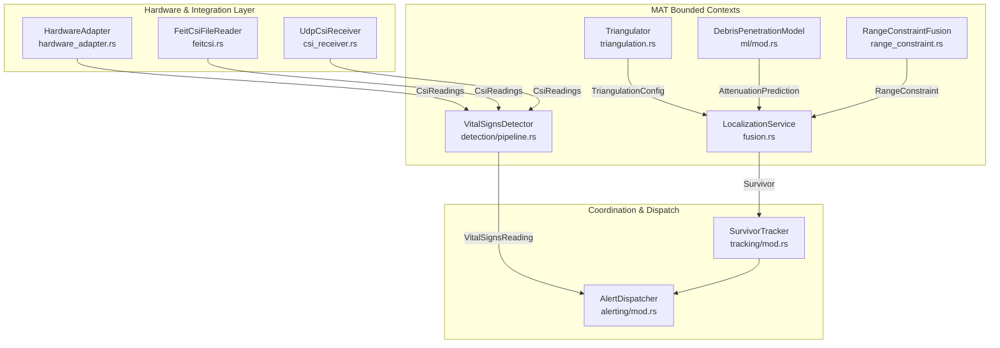
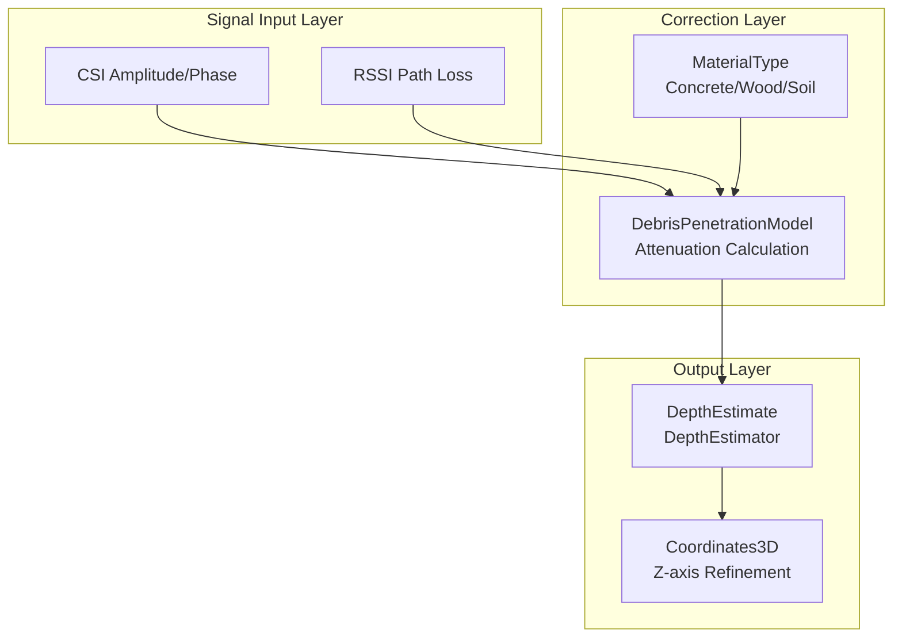

<!-- source: DeepWiki mcp.deepwiki.com · repo ruvnet/RuView · page 11.4 Mass Casualty Assessment Tool (MAT) · fetched 2026-10-30 -->

# Mass Casualty Assessment Tool (MAT)

Relevant source files

The following files were used as context for generating this wiki page:

- [docs/adr/ADR-173-metric-locked-pck-mpjpe-accuracy-harness.md](docs/adr/ADR-173-metric-locked-pck-mpjpe-accuracy-harness.md)
- [python/Cargo.lock](python/Cargo.lock)
- [python/Cargo.toml](python/Cargo.toml)
- [python/pyproject.toml](python/pyproject.toml)
- [python/ruview-meta/pyproject.toml](python/ruview-meta/pyproject.toml)
- [python/src/bindings/mat.rs](python/src/bindings/mat.rs)
- [python/src/lib.rs](python/src/lib.rs)
- [python/tests/golden/mat_input.json](python/tests/golden/mat_input.json)
- [python/tests/golden/mat_result.sha256](python/tests/golden/mat_result.sha256)
- [python/tests/mat_parity.rs](python/tests/mat_parity.rs)
- [python/wifi_densepose/__init__.py](python/wifi_densepose/__init__.py)
- [python/wifi_densepose/mat.pyi](python/wifi_densepose/mat.pyi)
- [v2/crates/wifi-densepose-mat/benches/feitcsi_bench.rs](v2/crates/wifi-densepose-mat/benches/feitcsi_bench.rs)
- [v2/crates/wifi-densepose-mat/src/detection/pipeline.rs](v2/crates/wifi-densepose-mat/src/detection/pipeline.rs)
- [v2/crates/wifi-densepose-mat/src/integration/csi_receiver.rs](v2/crates/wifi-densepose-mat/src/integration/csi_receiver.rs)
- [v2/crates/wifi-densepose-mat/src/integration/feitcsi.rs](v2/crates/wifi-densepose-mat/src/integration/feitcsi.rs)
- [v2/crates/wifi-densepose-mat/src/integration/hardware_adapter.rs](v2/crates/wifi-densepose-mat/src/integration/hardware_adapter.rs)
- [v2/crates/wifi-densepose-mat/src/integration/mod.rs](v2/crates/wifi-densepose-mat/src/integration/mod.rs)
- [v2/crates/wifi-densepose-mat/src/lib.rs](v2/crates/wifi-densepose-mat/src/lib.rs)
- [v2/crates/wifi-densepose-train/benches/benchmark_harness.rs](v2/crates/wifi-densepose-train/benches/benchmark_harness.rs)
- [v2/crates/wifi-densepose-train/src/accuracy.rs](v2/crates/wifi-densepose-train/src/accuracy.rs)
- [v2/crates/wifi-densepose-train/src/bin/train.rs](v2/crates/wifi-densepose-train/src/bin/train.rs)
- [v2/crates/wifi-densepose-train/src/dataset.rs](v2/crates/wifi-densepose-train/src/dataset.rs)
- [v2/crates/wifi-densepose-train/src/dataset/widar.rs](v2/crates/wifi-densepose-train/src/dataset/widar.rs)
- [v2/crates/wifi-densepose-train/src/error.rs](v2/crates/wifi-densepose-train/src/error.rs)
- [v2/crates/wifi-densepose-train/src/lib.rs](v2/crates/wifi-densepose-train/src/lib.rs)
- [v2/crates/wifi-densepose-train/tests/test_metrics.rs](v2/crates/wifi-densepose-train/tests/test_metrics.rs)

## Purpose and Scope

The Mass Casualty Assessment Tool (MAT) is a specialized disaster survivor detection system that uses WiFi Channel State Information (CSI) to locate and monitor survivors trapped in rubble or collapsed structures [v2/crates/wifi-densepose-mat/src/localization/mod.rs:1-6](). MAT combines Time Difference of Arrival (TDoA) and RSSI-based triangulation for localization with continuous vital signs monitoring (breathing and heartbeat detection) to enable rapid triage in mass casualty scenarios [v2/crates/wifi-densepose-mat/src/localization/mod.rs:8-11]().

The system is designed for high-stakes environments where camera-based sensing is impossible, utilizing the unique penetration capabilities of WiFi signals to detect sub-millimeter chest cavity movements through debris.

Sources: `v2/crates/wifi-densepose-mat/src/localization/mod.rs:1-11`()

---

## System Overview & Architecture

MAT extends the core RuView sensing pipeline with disaster-specific capabilities. The system operates across multiple hardware nodes forming a multistatic array to detect breathing patterns and heartbeats through debris. It integrates with drone swarms for rapid area coverage and uses sophisticated range constraints for precise localization [v2/crates/ruview-swarm/src/lib.rs:1-10]().

### Diagram: MAT Core Processing & Code Entities

Sources: `v2/crates/wifi-densepose-mat/src/localization/mod.rs:1-18](), [v2/crates/wifi-densepose-mat/src/integration/hardware_adapter.rs:31-46](), [v2/crates/wifi-densepose-mat/src/lib.rs:80-167`()

---

## Localization & Triangulation

MAT employs the `LocalizationService` to fuse multiple estimation techniques into a coherent 3D position [v2/crates/wifi-densepose-mat/src/localization/fusion.rs:14]().

### UWB and Range Constraint Fusion
The system utilizes `RangeConstraint` objects (ADR-144) to refine person-track estimates. While primarily using CSI, MAT can consume UWB anchor ranges to constrain positions via Mahalanobis gating, ensuring multipath or Non-Line-of-Sight (NLOS) readings do not corrupt the estimate [v2/crates/wifi-densepose-mat/src/localization/range_constraint.rs:1-12]().

*   `RangeConstraint`: Represents one anchor-to-tag measurement including uncertainty and signal quality [v2/crates/wifi-densepose-mat/src/localization/range_constraint.rs:16-29]().
*   `RangeConstraintFusion`: Minimizes residuals using gradient descent from a CSI/CIR prior [v2/crates/wifi-densepose-mat/src/localization/range_constraint.rs:72-87]().
*   `Consistency Gating`: The `is_consistent` check uses `gate_sigma` to reject outliers [v2/crates/wifi-densepose-mat/src/localization/range_constraint.rs:51-57]().

### TDoA Triangulation
The `solve_tdoa_triangulation` function (requiring the `ruvector` feature) computes survivor positions by analyzing the time difference of signal arrival across the node mesh [v2/crates/wifi-densepose-mat/src/localization/triangulation.rs:16-17]().

Sources: `v2/crates/wifi-densepose-mat/src/localization/range_constraint.rs:31-57](), [v2/crates/wifi-densepose-mat/src/localization/mod.rs:8-18`()

---

## Hardware Adapters & FeitCSI Ingest

The integration layer (`wifi-densepose-mat::integration`) acts as an Anti-Corruption Layer connecting raw sensor hardware to MAT domain services [v2/crates/wifi-densepose-mat/src/integration/mod.rs:1-7]().

### Supported Hardware Interfaces
*   **ESP32**: Communicates via serial streams using ESP-CSI firmware (`HardwareConfig::esp32`) [v2/crates/wifi-densepose-mat/src/integration/hardware_adapter.rs:62-80]().
*   **Intel 5300 NIC**: Consumes Linux CSI Tool capture data (`HardwareConfig::intel_5300`) [v2/crates/wifi-densepose-mat/src/integration/hardware_adapter.rs:82-102]().
*   **Atheros NICs**: Supports `ath9k`, `ath10k`, and `ath11k` kernel driver CSI extractions [v2/crates/wifi-densepose-mat/src/integration/hardware_adapter.rs:104-130]().
*   **FeitCSI (Intel AX200/AX210)**: Wideband 802.11ax CSI capture ingest up to 160 MHz and 1992 subcarriers (ADR-292), supporting file replay and live stream pipes (`HardwareConfig::feitcsi_replay`, `HardwareConfig::feitcsi_stream`) [v2/crates/wifi-densepose-mat/src/integration/hardware_adapter.rs:132-166]().
*   **Generic UDP Receivers**: Streams raw or formatted CSI packets over network sockets (`HardwareConfig::udp_receiver`) [v2/crates/wifi-densepose-mat/src/integration/hardware_adapter.rs:168-184]().

Sources: `v2/crates/wifi-densepose-mat/src/integration/hardware_adapter.rs:31-184](), [v2/crates/wifi-densepose-mat/src/integration/mod.rs:1-19`()

---

## Debris Penetration & Depth Estimation

The `DepthEstimator` accounts for signal attenuation through various materials (Concrete, Wood, Soil) [v2/crates/wifi-densepose-mat/src/localization/mod.rs:13](). It uses a `DebrisPenetrationModel` and `DebrisModel` to adjust the Z-axis (depth) estimate based on the material's dielectric properties and signal power loss [v2/crates/wifi-densepose-mat/src/lib.rs:137-162]().

### Diagram: Debris Model Logic

Sources: `v2/crates/wifi-densepose-mat/src/localization/mod.rs:8-14](), [v2/crates/wifi-densepose-mat/src/lib.rs:137-162`()

---

## Drone Swarm Deployment & Coordination

For large-scale disasters, MAT integrates with the `ruview-swarm` system to deploy drones in coordinated search patterns [v2/crates/ruview-swarm/src/lib.rs:1-10]().

### Flight Patterns & Coverage
Drones execute specific `FlightPattern` strategies to maximize the Probability of Detection (PoD) [v2/crates/ruview-swarm/src/bin/eval_swarm.rs:21-22]().
*   `partitioned_lawnmower`: High coverage efficiency (IQM ~1.000) [v2/crates/ruview-swarm/evals/RESULTS.md:18]().
*   `pheromone / levy_flight`: Bio-inspired search patterns for unstructured debris fields [v2/crates/ruview-swarm/evals/RESULTS.md:19-20]().

### Swarm Metrics (ADR-149)
The system evaluates search performance using the `eval_swarm` utility, which tracks:
*   **Coverage IQM**: Interquartile Mean of area scanned [v2/crates/ruview-swarm/src/evals/metrics.rs:8-9]().
*   **Localization Error**: Distance (m) between fused estimate and actual victim position [v2/crates/ruview-swarm/src/evals/metrics.rs:10-11]().
*   **GDOP**: Geometric Dilution of Precision, quantifying how drone geometry affects localization accuracy [v2/crates/ruview-swarm/src/evals/gdop.rs:1-13]().

Sources: `v2/crates/ruview-swarm/src/evals/runner.rs:26-35](), [v2/crates/ruview-swarm/src/evals/metrics.rs:7-24](), [v2/crates/ruview-swarm/evals/RESULTS.md:1-24`()

---

## Alert Dispatcher, Triage & Python Bindings

The system generates automated alerts based on survivor status. The `AlertDispatcher` (integrated into the core sensing server) routes messages based on:
*   **Vital Sign Thresholds**: Alerts for low breathing rate (< 8 BPM) or tachycardia [v2/crates/wifi-densepose-mat/src/lib.rs:125-127]().
*   **Localization Confidence**: Alerts when a survivor is localized with low GDOP (high confidence) [v2/crates/ruview-swarm/src/evals/metrics.rs:12-13]().
*   **Proximity Violations**: Kinematic alerts for drone-survivor or drone-drone collision risks [v2/crates/ruview-swarm/src/evals/metrics.rs:18-19]().

### Python Package & MAT Feature Bindings
Under ADR-185 (P3), MAT is exposed to Python through the `wifi-densepose` PyPI wheel under the optional `mat` feature flag (`wifi-densepose[mat]`) [python/Cargo.toml:39-43](). This compiles `wifi-densepose-mat` bindings (`bindings::mat`) into `wifi-densepose._native`, enabling Python scripts and test harnesses to orchestrate disaster scans and receive triage classifications without compiling full server binaries [python/src/lib.rs:23-24]().

Sources: `v2/crates/ruview-swarm/src/evals/metrics.rs:7-24](), [python/Cargo.toml:39-43](), [python/src/lib.rs:20-25`()

---

