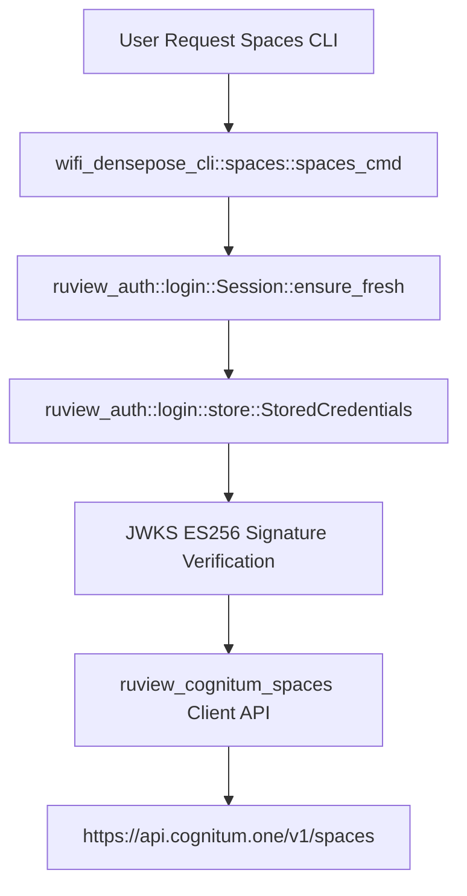
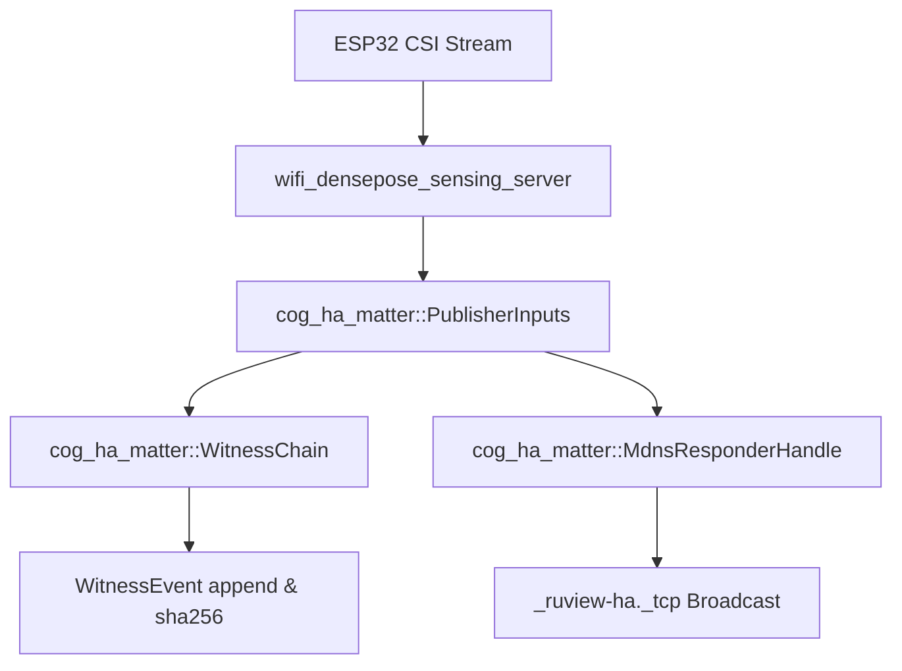
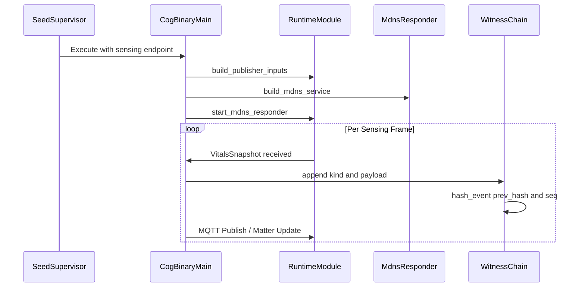

<!-- source: DeepWiki mcp.deepwiki.com · repo ruvnet/RuView · page 11.5 Cognitum Seed Appliance & Spaces · fetched 2026-10-30 -->

# Cognitum Seed Appliance & Spaces

Relevant source files

The following files were used as context for generating this wiki page:

- [.github/workflows/npm-packages.yml](.github/workflows/npm-packages.yml)
- [.github/workflows/ruview-npm-release.yml](.github/workflows/ruview-npm-release.yml)
- [PROOF.md](PROOF.md)
- [benchmarks/edge-latency/RESULTS.md](benchmarks/edge-latency/RESULTS.md)
- [benchmarks/edge-skills/RESULTS.md](benchmarks/edge-skills/RESULTS.md)
- [docs/adr/ADR-159-cognitum-appliance-beyond-sota.md](docs/adr/ADR-159-cognitum-appliance-beyond-sota.md)
- [docs/adr/ADR-160-edge-skill-library-honest-labeling.md](docs/adr/ADR-160-edge-skill-library-honest-labeling.md)
- [docs/adr/ADR-163-edge-latency-measurement.md](docs/adr/ADR-163-edge-latency-measurement.md)
- [docs/adr/ADR-263-ruview-npm-harness-deep-review.md](docs/adr/ADR-263-ruview-npm-harness-deep-review.md)
- [docs/adr/ADR-325-cognitum-spaces-activation-and-governed-spatial-exchange.md](docs/adr/ADR-325-cognitum-spaces-activation-and-governed-spatial-exchange.md)
- [harness/ruview/.harness/manifest.json](harness/ruview/.harness/manifest.json)
- [harness/ruview/.harness/manifest.sha256](harness/ruview/.harness/manifest.sha256)
- [harness/ruview/CLAUDE.md](harness/ruview/CLAUDE.md)
- [harness/ruview/README.md](harness/ruview/README.md)
- [harness/ruview/bin/cli.js](harness/ruview/bin/cli.js)
- [harness/ruview/package-lock.json](harness/ruview/package-lock.json)
- [harness/ruview/package.json](harness/ruview/package.json)
- [harness/ruview/src/guidance.js](harness/ruview/src/guidance.js)
- [harness/ruview/src/mcp-server.js](harness/ruview/src/mcp-server.js)
- [harness/ruview/src/tools.js](harness/ruview/src/tools.js)
- [harness/ruview/test/mcp.test.mjs](harness/ruview/test/mcp.test.mjs)
- [harness/ruview/test/tools.test.mjs](harness/ruview/test/tools.test.mjs)
- [scripts/prove.sh](scripts/prove.sh)
- [v2/crates/ruview-auth/src/login/store.rs](v2/crates/ruview-auth/src/login/store.rs)
- [v2/crates/ruview-auth/src/principal.rs](v2/crates/ruview-auth/src/principal.rs)
- [v2/crates/ruview-cognitum-spaces/Cargo.toml](v2/crates/ruview-cognitum-spaces/Cargo.toml)
- [v2/crates/ruview-cognitum-spaces/src/lib.rs](v2/crates/ruview-cognitum-spaces/src/lib.rs)
- [v2/crates/wifi-densepose-cli/Cargo.toml](v2/crates/wifi-densepose-cli/Cargo.toml)
- [v2/crates/wifi-densepose-cli/src/auth.rs](v2/crates/wifi-densepose-cli/src/auth.rs)
- [v2/crates/wifi-densepose-cli/src/lib.rs](v2/crates/wifi-densepose-cli/src/lib.rs)
- [v2/crates/wifi-densepose-cli/src/main.rs](v2/crates/wifi-densepose-cli/src/main.rs)
- [v2/crates/wifi-densepose-cli/src/spaces.rs](v2/crates/wifi-densepose-cli/src/spaces.rs)
- [v2/crates/wifi-densepose-wasm-edge/tests/honest_labeling.rs](v2/crates/wifi-densepose-wasm-edge/tests/honest_labeling.rs)
- [v2/crates/wifi-densepose-wasm-edge/tests/synthetic_validation.rs](v2/crates/wifi-densepose-wasm-edge/tests/synthetic_validation.rs)

## Purpose and Scope
The **Cognitum Seed** is a dedicated hardware appliance (typically based on Raspberry Pi Zero 2 W or Pi 5) providing persistent RVF vector storage, localized kNN search, edge AI inference via standardized **Cogs**, swarm bridge cloud ingestion, and governed spatial exchange through Cognitum Spaces (ADR-325) via the `ruview-cognitum-spaces` crate. It acts as the local intelligence hub for ESP32 sensing nodes.

Sources: [docs/adr/ADR-325-cognitum-spaces-activation-and-governed-spatial-exchange.md:1-27](), [docs/adr/ADR-100-cog-packaging-specification.md]()

---

## 1. Cog Packaging Specification & Edge Module Registry

The Seed uses a standardized application format known as a **Cog** to ensure edge intelligence modules can be cross-compiled, cryptographically signed, and deployed across diverse architectures (ARM, x86_64, NPU backbones).

### 1.1 Packaging Structure
A Cog is distributed as an immutable bundle containing:
*   **Signed Binary**: Architecture-specific executable.
*   **Manifest**: A `manifest.json` file defining metadata, versioning, and cryptographic hashes [v2/crates/cog-person-count/cog/artifacts/manifests/arm/manifest.json:1-27]().
*   **Weights**: Model artifacts in `safetensors` or `ONNX` format [docs/adr/ADR-101-pose-estimation-cog.md:31-32]().
*   **Witness Chain**: An append-only audit log for sensitive state transitions [v2/crates/cog-ha-matter/src/witness.rs:1-18]().

### 1.2 The Edge Module Registry
The `app-registry.json` acts as the central catalog for the Seed, supporting one-click installations of modular applications like `cog-pose-estimation`, `cog-person-count`, and `cog-ha-matter` [docs/adr/ADR-116-cog-ha-matter-seed.md:18-20]().

Sources: [docs/adr/ADR-100-cog-packaging-specification.md](), [docs/adr/ADR-101-pose-estimation-cog.md](), [v2/crates/cog-person-count/cog/artifacts/manifests/arm/manifest.json:1-27]()

---

## 2. Persistent RVF Vector Storage & kNN Search

The Cognitum Seed appliance maintains persistent vector embeddings derived from raw RF channel state information (CSI) using the proprietary **RuVector** storage engine format (`.rvf`).

*   **RVF Container Format**: Encapsulates subcarrier tensors, localized spatial descriptors, and AETHER re-ID embeddings.
*   **kNN Search Indexing**: Employs quantized Hierarchical Navigable Small World (HNSW) and RaBitQ similarity sketches to execute sub-millisecond nearest-neighbor lookups locally on resource-constrained ARM hardware.
*   **Tenant-Scoped Persistence**: Vector stores are isolated by tenant and workspace IDs, enforcing strict data residency boundaries before any spatial projection is synchronized upstream.

Sources: [docs/adr/ADR-325-cognitum-spaces-activation-and-governed-spatial-exchange.md:17-26]()

---

## 3. First-Class Seed Apps

### 3.1 cog-ha-matter (Home Assistant & Matter)
The `cog-ha-matter` application wraps the sensing server MQTT publisher logic into a Seed-native artifact [v2/crates/cog-ha-matter/Cargo.toml:8-32](). Features include:
*   **mDNS Discovery**: Advertises `_ruview-ha._tcp` so Home Assistant auto-discovers the Seed [v2/crates/cog-ha-matter/src/lib.rs:7-8]().
*   **Embedded Broker**: Optional `rumqttd` instance for standalone deployments [v2/crates/cog-ha-matter/src/lib.rs:9-11]().
*   **Matter Bridge**: Maps WiFi-CSI entities to Matter `OccupancySensor` clusters [docs/adr/ADR-116-cog-ha-matter-seed.md:70-71]().

### 3.2 cog-pose-estimation
Provides 17-keypoint COCO pose estimation consuming CSI windows and outputting image-normalized coordinates [docs/adr/ADR-101-pose-estimation-cog.md:62-67]().
*   **Inference**: Supports `candle-cpu` and Hailo-8/10 NPU backbones [docs/adr/ADR-101-pose-estimation-cog.md:120-125]().
*   **Artifacts**: Utilizes `pose_v1.safetensors` and `pose_v1.onnx` [docs/benchmarks/pose-estimation-cog.md:97-132]().

### 3.3 cog-person-count
A specialized Cog for occupancy analytics, providing person counting and confidence scoring [v2/crates/cog-person-count/src/inference.rs:75-76]().
*   **Calibration**: Includes temperature scaling (e.g., `T = 0.9262`) via a `.temperature` sidecar to improve confidence reliability [docs/benchmarks/person-count-cog.md:21-27]().

Sources: [docs/adr/ADR-116-cog-ha-matter-seed.md:1-76](), [v2/crates/cog-ha-matter/src/lib.rs:1-46](), [docs/benchmarks/person-count-cog.md:1-51]()

---

## 4. Witness Chain & Audit Integrity

To support regulated environments, Cogs implement an Ed25519-signed witness chain (`WitnessChain`), ensuring that reported events (such as occupancy transitions or fall alerts) cannot be retroactively modified [v2/crates/cog-ha-matter/src/witness.rs:76-103]().

| Field | Type | Description |
| :--- | :--- | :--- |
| `seq` | `u64` | Monotonic sequence number [v2/crates/cog-ha-matter/src/witness.rs:83-83]() |
| `prev_hash` | `WitnessHash` | SHA-256 hash of the previous event [v2/crates/cog-ha-matter/src/witness.rs:86-86]() |
| `kind` | `String` | Event type identifier [v2/crates/cog-ha-matter/src/witness.rs:91-95]() |
| `payload` | `Vec<u8>` | Serialized payload transmitted to MQTT/Matter [v2/crates/cog-ha-matter/src/witness.rs:96-98]() |

Sources: [v2/crates/cog-ha-matter/src/witness.rs:1-188]()

---

## 5. Cognitum Spaces & Governed Spatial Exchange (ADR-325)

Cognitum Spaces provides a tenant-scoped cloud projection of physical sites, buildings, floors, rooms, zones, and entities. Under ADR-325, RuView follows a one-way-by-default, typed spatial exchange model:

1. **Local Perception**: Raw RF capture (P0/P1) is processed locally on the Edge.
2. **Authoritative State**: HomeCore Edge maintains authoritative state; raw CSI, CIR, RF tensors, and identity observations are strictly excluded from cloud synchronization [docs/adr/ADR-325-cognitum-spaces-activation-and-governed-spatial-exchange.md:28-44]().
3. **Cloud Projection**: Permitted P2/P3 semantic events and witness envelopes project into Cognitum Spaces.
4. **OAuth & API Key Auth**: The resource server accepts legacy API keys (`cog_*`) or ES256-signed Cognitum OAuth access tokens validated against `https://auth.cognitum.one/.well-known/jwks.json` with exact audience and scope requirements (`spaces:read`) [docs/adr/ADR-325-cognitum-spaces-activation-and-governed-spatial-exchange.md:88-106]().

Sources: [docs/adr/ADR-325-cognitum-spaces-activation-and-governed-spatial-exchange.md:1-125]()

---

## 6. The `ruview-cognitum-spaces` Crate & CLI Integration

The `ruview-cognitum-spaces` crate powers programmatic access to tenant spaces, bridging the CLI and MCP agent harnesses.

*   **Credential Handling**: Managed via `wifi-densepose login --spaces`, storing credentials securely inside `~/.ruview/credentials.json` [v2/crates/wifi-densepose-cli/src/auth.rs:27-29]().
*   **Single-Flight Refresh Guard**: The credential store uses an advisory file lock and async mutexes to prevent refresh token reuse detection and session family revocation [v2/crates/ruview-auth/src/login/store.rs:21-35]().
*   **CLI Verification**: Executed via the `wifi-densepose spaces` command group, interacting directly with tenant endpoints [v2/crates/wifi-densepose-cli/src/lib.rs:65-66]().

Sources: [v2/crates/wifi-densepose-cli/src/auth.rs:1-40](), [v2/crates/ruview-auth/src/login/store.rs:1-77](), [v2/crates/wifi-densepose-cli/src/lib.rs:37-68]()

---

## 7. Architecture & Data Flow Diagrams

### Diagram 1: Natural Language Space to Code Entity Space (Cognitum Spaces & Auth)
This diagram maps abstract cloud operations and user authentication concepts to their concrete Rust code entities.

Title: "CognitumSpacesCodeEntityMap"

Sources: [v2/crates/wifi-densepose-cli/src/auth.rs:118-131](), [v2/crates/ruview-auth/src/login/store.rs:84-158](), [v2/crates/wifi-densepose-cli/src/lib.rs:65-66]()

### Diagram 2: Natural Language Space to Code Entity Space (Seed Cog & Witness Runtime)
This diagram maps physical edge observation concepts to the underlying Rust structs and runtime event loops.

Title: "SeedCogRuntimeCodeEntityMap"

Sources: [v2/crates/cog-ha-matter/src/runtime.rs:143-163](), [v2/crates/cog-ha-matter/src/witness.rs:76-103](), [v2/crates/cog-ha-matter/src/lib.rs:7-11]()

### Diagram 3: Cog Execution Lifecycle
This sequence diagram details how a Cog initializes and processes streaming sensor events.

Title: "CogRuntimeLifecycle"

Sources: [v2/crates/cog-ha-matter/src/main.rs:71-163](), [v2/crates/cog-ha-matter/src/runtime.rs:78-108](), [v2/crates/cog-ha-matter/src/witness.rs:184-187]()

---

## 8. Technical Specifications

### 8.1 mDNS TXT Record Convention
The Seed advertises specific TXT records for zero-configuration integration [v2/crates/cog-ha-matter/src/mdns.rs:28-36]():

| Key | Example | Purpose |
| :--- | :--- | :--- |
| `cog_id` | `ha-matter` | Disambiguates Cog type [v2/crates/cog-ha-matter/src/mdns.rs:30-30]() |
| `node_id` | `kitchen-seed` | Unique device identifier [v2/crates/cog-ha-matter/src/mdns.rs:32-32]() |
| `mqtt_port` | `1883` | Port for the embedded MQTT broker [v2/crates/cog-ha-matter/src/mdns.rs:33-33]() |
| `privacy` | `1` | Boolean flag for biometric filtering [v2/crates/cog-ha-matter/src/mdns.rs:34-34]() |

### 8.2 Inference Performance (Pi 5)
Benchmark metrics for `cog-pose-estimation` on reference ARM hardware [docs/benchmarks/pose-estimation-cog.md:81-91]():
*   **Cold Start**: ~8.4 ms (includes memory-mapped `safetensors` initialization) [docs/benchmarks/pose-estimation-cog.md:89-89]().
*   **Warm Inference**: Sub-millisecond per frame execution time [docs/benchmarks/pose-estimation-cog.md:91-91]().

Sources: [v2/crates/cog-ha-matter/src/mdns.rs:21-40](), [docs/benchmarks/pose-estimation-cog.md:81-91]()

---

