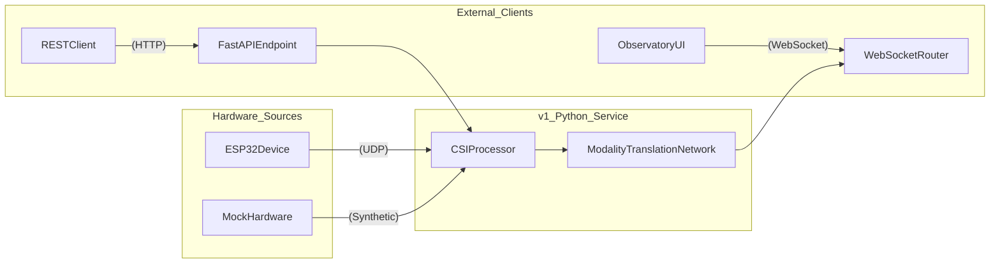

<!-- source: DeepWiki mcp.deepwiki.com · repo ruvnet/RuView · page 11.6 Legacy Python Implementation (v1) · fetched 2026-10-30 -->

# Legacy Python Implementation (v1)

<details>
<summary>Relevant source files</summary>

The following files were used as context for generating this wiki page:

- [.github/workflows/verify-pipeline.yml](.github/workflows/verify-pipeline.yml)
- [archive/v1/data/proof/expected_features.sha256](archive/v1/data/proof/expected_features.sha256)
- [archive/v1/data/proof/expected_features_reference.npz](archive/v1/data/proof/expected_features_reference.npz)
- [archive/v1/data/proof/verify.py](archive/v1/data/proof/verify.py)
- [archive/v1/src/api/routers/health.py](archive/v1/src/api/routers/health.py)
- [archive/v1/src/config/settings.py](archive/v1/src/config/settings.py)
- [archive/v1/src/services/metrics.py](archive/v1/src/services/metrics.py)
- [archive/v1/tests/unit/test_health_concurrency.py](archive/v1/tests/unit/test_health_concurrency.py)
- [scripts/probe-fft-platform.py](scripts/probe-fft-platform.py)
- [ui/components/body-model.js](ui/components/body-model.js)

</details>


This page documents the original Python-based implementation of the WiFi-DensePose system, located in the `archive/v1/` directory. While the project has transitioned to a high-performance Rust core, the v1 implementation remains a reference for the PyTorch-based modality translation, FastAPI service architecture, and original signal processing logic.

## Overview and Purpose

The v1 implementation was designed as a research-oriented platform for WiFi-based human pose estimation. It provides a complete end-to-end pipeline: from raw Channel State Information (CSI) extraction via SSH-enabled routers or ESP32 nodes to 3D pose estimation using deep neural networks.

### Key Capabilities
*   **CSI Processing**: Extraction and sanitization of OFDM subcarrier data using `CSIProcessor` for feature extraction and `PhaseSanitizer` for unwrapping [archive/v1/data/proof/verify.py:56-57]().
*   **Modality Translation**: Converting wireless signals into spatial feature maps using a multi-stage `ModalityTranslationNetwork` with attention mechanisms.
*   **Deterministic Verification**: A "Trust Kill Switch" ensures the pipeline produces reproducible results across different platforms [archive/v1/data/proof/verify.py:6-17]().
*   **Hardware Abstraction**: Support for real hardware or simulated data via configuration flags [archive/v1/src/config/settings.py:81-87]().

Sources: [archive/v1/data/proof/verify.py:5-57](), [archive/v1/src/config/settings.py:81-87]().

## System Architecture & Data Flow

The v1 architecture follows a service-oriented pattern using FastAPI for the REST/WebSocket interface and a centralized processing pipeline.

### Code Entity Mapping

The following diagram maps the logical data flow to specific Python classes and modules in the source tree, bridging natural language concepts to concrete code entities.

**Figure 1: v1 Data Flow and Code Entities**
```mermaid
graph TD
    subgraph Hardware_Interface_Layer
        CSID["CSIData"]
        RI["router_interface.py"]
        CE["csi_extractor.py"]
    end

    subgraph Processing_Pipeline
        CP["CSIProcessor"]
        PS["PhaseSanitizer"]
    end

    subgraph Neural_Inference
        MTN["ModalityTranslationNetwork"]
        DPH["DensePoseHead"]
    end

    subgraph Application_Services
        PSVC["PoseService"]
        SET["Settings"]
    end

    CE -->| "Raw CSI" | CSID
    CSID --> CP
    CP --> PS
    PS -->| "Sanitized Tensor" | MTN
    MTN -->| "Visual Features" | DPH
    DPH -->| "Pose Estimates" | PSVC
    SET -->| "Config" | PSVC
```
Sources: [archive/v1/data/proof/verify.py:56-58](), [archive/v1/src/config/settings.py:13-121]().

## Key Components and Modules

### 1. Neural Network Architecture and Processing
The core of the v1 implementation is the PyTorch-based modality translation pipeline.
*   **Modality Translation Network**: Configured with input channels corresponding to CSI subcarriers and output channels for visual features.
*   **DensePose Head**: Maps input feature channels to 24 body parts and 2 UV coordinates.
*   **3D Visualization**: The system maps these 24 body parts (e.g., `TORSO_FRONT`, `HEAD_LEFT`) to 3D positions in a Three.js-based `BodyModel` [ui/components/body-model.js:5-31]().

Sources: [ui/components/body-model.js:5-31]().

### 2. Pipeline Determinism (The "Trust Kill Switch")
A critical feature of v1 is the `verify.py` script, which ensures that the signal processing code is robust and verifiable.
*   **Hash Verification**: The script feeds a reference signal through the `CSIProcessor` and compares the SHA-256 hash of the output against `expected_features.sha256` [archive/v1/data/proof/verify.py:11-17]().
*   **Platform Stability**: To prevent floating-point divergence across different CPU architectures (AVX2 vs NEON), the pipeline uses quantization decimals before hashing [scripts/probe-fft-platform.py:48-51](), [archive/v1/data/proof/verify.py:167-183]().
*   **CI Enforcement**: GitHub Actions run this verification on every push to ensure no regressions in signal processing logic [.github/workflows/verify-pipeline.yml:63-94]().

Sources: [.github/workflows/verify-pipeline.yml:63-94](), [archive/v1/data/proof/verify.py:11-183](), [scripts/probe-fft-platform.py:48-51]().

### 3. API, Settings & Metrics Services
*   **FastAPI Backend & Health Checks**: Asynchronous request handling with system health and metrics aggregation routers (`get_system_metrics`) [archive/v1/src/api/routers/health.py:56-102]().
*   **Environment Configuration**: Configured via `Settings` inheriting from `BaseSettings` which parses `.env` files for variables like `CSI_SAMPLING_RATE` and `POSE_MODEL_PATH` [archive/v1/src/config/settings.py:13-116]().
*   **Metrics Collection Service**: `MetricsService` tracks system and application performance metrics using background concurrency controls [archive/v1/src/services/metrics.py:75-141]().

Sources: [archive/v1/src/api/routers/health.py:56-102](), [archive/v1/src/config/settings.py:13-116](), [archive/v1/src/services/metrics.py:75-141]().

## Transition to Rust

The v1 Python implementation served as the architectural blueprint for the current Rust-based sensing server.

| Feature | Python (v1) | Rust (Current) |
| :--- | :--- | :--- |
| **Concurrency** | `asyncio` / `FastAPI` | `tokio` multi-threading |
| **Signal Processing** | `scipy.fft`, `numpy` | `ruvector` / `BfldPipeline` |
| **Inference Engine** | `PyTorch` | `Candle` / `ONNX Runtime` |
| **Verification** | `verify.py` (SHA-256) | `verify-training` (Determinism Gate) |
| **Database** | `SQLAlchemy` | `HOMECORE` state machine |

**Figure 2: Component Interaction Map**

Sources: [archive/v1/data/proof/verify.py:56-58](), [archive/v1/src/config/settings.py:13-116]().

---

