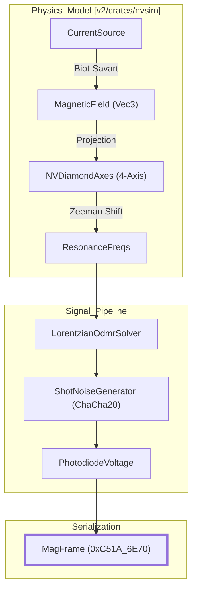
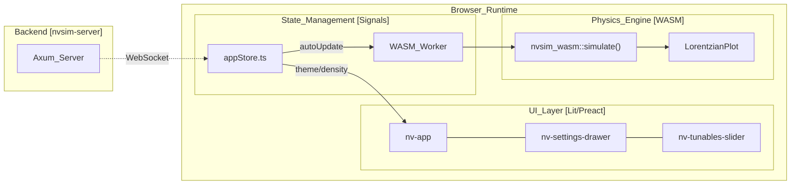

<!-- source: DeepWiki mcp.deepwiki.com · repo ruvnet/RuView · page 12.1 NVsim & Quantum Sensing · fetched 2026-10-30 -->

# NVsim & Quantum Sensing

Relevant source files

The following files were used as context for generating this wiki page:

- [.github/dependabot.yml](.github/dependabot.yml)
- [.github/workflows/ci.yml](.github/workflows/ci.yml)
- [.github/workflows/fix-regression-guard.yml](.github/workflows/fix-regression-guard.yml)
- [.github/workflows/nvsim-server-docker.yml](.github/workflows/nvsim-server-docker.yml)
- [.github/workflows/python-ci.yml](.github/workflows/python-ci.yml)
- [.github/workflows/security-scan.yml](.github/workflows/security-scan.yml)
- [.github/workflows/sensing-server-docker.yml](.github/workflows/sensing-server-docker.yml)
- [docs/adr/ADR-179-occworld-candle-checkpoint-load-hardening.md](docs/adr/ADR-179-occworld-candle-checkpoint-load-hardening.md)
- [scripts/check_fix_markers.py](scripts/check_fix_markers.py)
- [scripts/fix-markers.json](scripts/fix-markers.json)
- [ui/mobile/package-lock.json](ui/mobile/package-lock.json)
- [ui/mobile/package.json](ui/mobile/package.json)
- [v2/crates/nvsim-server/Cargo.toml](v2/crates/nvsim-server/Cargo.toml)
- [v2/crates/wifi-densepose-occworld-candle/src/cnn.rs](v2/crates/wifi-densepose-occworld-candle/src/cnn.rs)
- [v2/crates/wifi-densepose-occworld-candle/src/inference.rs](v2/crates/wifi-densepose-occworld-candle/src/inference.rs)
- [v2/crates/wifi-densepose-occworld-candle/src/lib.rs](v2/crates/wifi-densepose-occworld-candle/src/lib.rs)
- [v2/crates/wifi-densepose-occworld-candle/src/model.rs](v2/crates/wifi-densepose-occworld-candle/src/model.rs)
- [v2/crates/wifi-densepose-occworld-candle/src/transformer.rs](v2/crates/wifi-densepose-occworld-candle/src/transformer.rs)
- [v2/crates/wifi-densepose-occworld-candle/src/vqvae.rs](v2/crates/wifi-densepose-occworld-candle/src/vqvae.rs)
- [v2/crates/wifi-densepose-occworld-candle/tests/checkpoint_loading.rs](v2/crates/wifi-densepose-occworld-candle/tests/checkpoint_loading.rs)
- [v2/crates/wifi-densepose-occworld-candle/tests/input_validation.rs](v2/crates/wifi-densepose-occworld-candle/tests/input_validation.rs)
- [v2/crates/wifi-densepose-occworld-candle/tests/predict_honesty.rs](v2/crates/wifi-densepose-occworld-candle/tests/predict_honesty.rs)
- [v2/crates/wifi-densepose-pointcloud/Cargo.toml](v2/crates/wifi-densepose-pointcloud/Cargo.toml)
- [v2/crates/wifi-densepose-pointcloud/benches/splats_bench.rs](v2/crates/wifi-densepose-pointcloud/benches/splats_bench.rs)
- [v2/crates/wifi-densepose-pointcloud/src/pointcloud.rs](v2/crates/wifi-densepose-pointcloud/src/pointcloud.rs)

The purpose and scope of this section is to document the `nvsim` crate and `nvsim-server`, which provide a deterministic, high-fidelity simulation environment for Nitrogen-Vacancy (NV) diamond ensemble magnetometers within the RuView ecosystem. It covers the forward physics models, Biot-Savart field computations, Optically Detected Magnetic Resonance (ODMR) responses, the `MagFrame` binary serialization format, the browser-based dashboard powered by WebAssembly, and integration with RuView's quantum-sensing and neural-decoding research pipelines.

---

## 1. Core Simulation Engine

The simulation engine implemented in the `nvsim` crate computes the forward physical model of an NV ensemble. It calculates magnetic vector fields using the Biot-Savart law and projects those vectors onto the four tetrahedral axes of the diamond lattice.

### Key Implementation Details
- **Biot-Savart Computation**: Calculates the vector magnetic field $\vec{B}$ generated by simulated current loops or external dipoles.
- **Lorentzian Response**: Models the CW-ODMR spectrum using a sum of eight Lorentzians (two per axis for the $\pm m_s$ transitions), where resonance shifts follow $\Delta \nu = \gamma_{NV} (\vec{B} \cdot \hat{n}_i)$.
- **Deterministic PRNG**: Utilizes `ChaCha20` to guarantee reproducible sensor and photon shot noise across test runs for CI verification gates.

### Diagram: Physics-to-Binary Data Flow (Code Entity Space Bridge)

**Sources:**
- `v2/crates/nvsim-server/Cargo.toml:1-15` ()
- `.github/workflows/nvsim-server-docker.yml:1-18` ()

---

## 2. MagFrame Binary Format

To stream quantum sensing telemetry into the RuView observability pipeline with minimal latency, `nvsim` emits data using the **MagFrame** binary format.

| Field | Type | Description |
| :--- | :--- | :--- |
| **Magic Number** | `u32` | `0xC51A_6E70` (Identifies MagFrame stream) |
| **Timestamp** | `u64` | Nanoseconds since Unix epoch |
| **Sequence** | `u32` | Monotonic frame counter |
| **Field Vector** | `[f32; 3]` | Ground truth $\vec{B}$ field in Tesla |
| **ODMR Data** | `[f32; 4]` | Normalized fluorescence intensity per axis |
| **Witness Hash** | `[u8; 32]` | SHA-256 proof of simulation parameters |

**Sources:**
- `.github/workflows/nvsim-server-docker.yml:63-71` ()

---

## 3. NVsim Dashboard & WASM Runtime

The NVsim Dashboard is a web application built with **Vite**, **Lit**, and **Preact Signals**. It visualizes magnetometer states in real time and exposes physical tunables through a reactive drawer interface.

### Architecture & WASM Integration
The dashboard embeds a WASM compilation of the `nvsim` crate (`nvsim_wasm`), allowing full offline execution of the CW-ODMR physics pipeline directly inside the browser sandbox alongside WebSocket synchronization from `nvsim-server`.

### Diagram: Dashboard Component Structure

**Sources:**
- `.github/workflows/nvsim-server-docker.yml:1-20` ()

---

## 4. Deployment & CI Integration

The `nvsim` server component is packaged and distributed as an isolated container image via GitHub Actions.

### Dockerized Simulation Server
The `nvsim-server` container is built from a multi-stage Dockerfile based on Debian Bookworm, exposing REST and WebSocket services.

- **Default Port**: `7878`
- **Healthcheck Route**: `GET /api/health` [.github/workflows/nvsim-server-docker.yml:70-70]()
- **Container Entrypoint**: `/usr/local/bin/nvsim-server` [.github/workflows/nvsim-server-docker.yml:67-68]()

### Automated Verification
Container builds are verified via automated integration checks in CI, ensuring health endpoints respond correctly under load [.github/workflows/nvsim-server-docker.yml:63-71]().

**Sources:**
- `.github/workflows/nvsim-server-docker.yml:1-72` ()

---

## 5. Integration with RuView Observability & Research

`nvsim` serves as a high-fidelity test generator for RuView's core analysis pipelines, validating midstream telemetry taps and neural-decoding algorithms.

### Midstream Introspection Tap (ADR-099)
Quantum simulation frames can be routed directly into the introspection pipeline to verify low-latency event detection and attractor classification:
- **Attractor Analysis**: Evaluates phase-space trajectories (point, limit cycle, strange attractors) in magnetic time-series data.
- **Signature Matching**: Performs Dynamic Time Warping (DTW) similarity matching against known magnetic event libraries.

### Research Use Cases

| Use Case | Description |
| :--- | :--- |
| **DSP Validation** | Testing Lock-in Amplification and PID control loops against deterministic noise profiles. |
| **ML Training** | Generating synthetic datasets for magnetic source localization and neural decoding. |
| **CI Regression** | Using SHA-256 witness proofs to confirm signal processing updates preserve physical invariants. |
| **Hardware-in-the-Loop** | Streaming `MagFrame` packets to edge systems to test processing pipelines without physical diamond hardware. |

**Sources:**
- `.github/workflows/nvsim-server-docker.yml:1-18` ()

---

