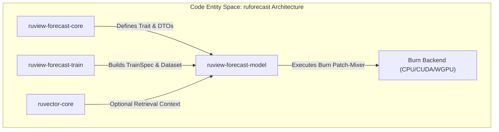
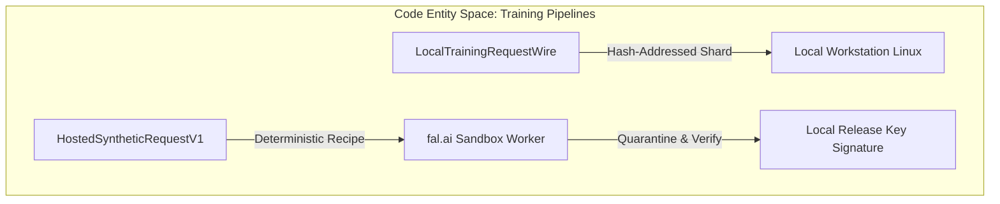

<!-- source: DeepWiki mcp.deepwiki.com · repo ruvnet/RuView · page 12.2 Forecasting & Predictive Memory · fetched 2026-10-30 -->

# Forecasting & Predictive Memory

Relevant source files

The following files were used as context for generating this wiki page:

- [.github/workflows/ruforecast-ci.yml](.github/workflows/ruforecast-ci.yml)
- [docs/adr/ADR-348-independent-rust-multivariate-forecasting.md](docs/adr/ADR-348-independent-rust-multivariate-forecasting.md)
- [docs/adr/ADR-349-governed-local-and-fal-forecast-training.md](docs/adr/ADR-349-governed-local-and-fal-forecast-training.md)
- [docs/adr/ADR-350-ruvector-predictive-memory-and-ruvllm-boundary.md](docs/adr/ADR-350-ruvector-predictive-memory-and-ruvllm-boundary.md)
- [docs/benchmarks/ruforecast.md](docs/benchmarks/ruforecast.md)
- [docs/huggingface/RUVIEW_FORECAST_MODEL_CARD_TEMPLATE.md](docs/huggingface/RUVIEW_FORECAST_MODEL_CARD_TEMPLATE.md)
- [docs/security/ruview-forecast-clean-room.md](docs/security/ruview-forecast-clean-room.md)
- [docs/security/ruview-forecast-threat-model.md](docs/security/ruview-forecast-threat-model.md)
- [docs/validation/ruforecast-requirements-evidence.md](docs/validation/ruforecast-requirements-evidence.md)
- [scripts/ruforecast-zeroshot/bidmc_windows.py](scripts/ruforecast-zeroshot/bidmc_windows.py)
- [scripts/ruforecast-zeroshot/run_zeroshot_eval.py](scripts/ruforecast-zeroshot/run_zeroshot_eval.py)

This leaf page details the architecture, implementation, training governance, evaluation protocols, and security boundaries of the RuView forecasting subsystem (`ruforecast`). Governed by ADR-348, ADR-349, and ADR-350, the subsystem provides independent Rust-native multivariate time-series forecasting, optional split-scoped predictive memory retrieval via `ruvector`, secure local and governed hosted (`fal.ai`) training pipelines, and strict clean-room protocols.

---

## 1. Independent Rust Forecasting Subsystem (`ruforecast`)

The forecasting engine is structured into three discrete crates under `v2/crates/ruforecast/` (`ruforecast-core`, `ruforecast-model`, and `ruforecast-train`), ensuring backend-neutral contracts are separated from model execution and training pipelines [docs/adr/ADR-348-independent-rust-multivariate-forecasting.md:94-100]().

### Crate Architecture & Data Flow

*Sources: `docs/adr/ADR-348-independent-rust-multivariate-forecasting.md:94-100`*

### Core Components
*   **`ruview-forecast-core`**: Owns backend-neutral schemas, bounded feature configurations, metrics, and the core `Forecaster` trait [docs/huggingface/RUVIEW_FORECAST_MODEL_CARD_TEMPLATE.md:108-109](). It depends on no heavy deep-learning frameworks, CUDA libraries, or network SDKs [docs/adr/ADR-348-independent-rust-multivariate-forecasting.md:98]().
*   **`ruview-forecast-model`**: Implements the patch-mixer architecture using Burn 0.21 [docs/huggingface/RUVIEW_FORECAST_MODEL_CARD_TEMPLATE.md:109](). Backends (`cpu`, `cuda`, `wgpu`, `ruvector`) are strictly opt-in feature flags and default to off [docs/adr/ADR-348-independent-rust-multivariate-forecasting.md:99](), [.github/workflows/ruforecast-ci.yml:138-146]().
*   **`ruview-forecast-train`**: Manages dataset slicing, splitting, optimizers, CLI integration, and hosted execution descriptors [docs/adr/ADR-349-governed-local-and-fal-forecast-training.md:57-62]().

Sources: `docs/adr/ADR-348-independent-rust-multivariate-forecasting.md:94-100`, `.github/workflows/ruforecast-ci.yml:138-146`

---

## 2. Governed Local & Hosted Training Architecture (`ruview-forecast-train`)

Training is governed by ADR-349, enforcing strict separation between local workstation execution and sandboxed hosted accelerators (`fal.ai`) [docs/adr/ADR-349-governed-local-and-fal-forecast-training.md:12-27]().

### Training Request Boundaries

*Sources: `docs/adr/ADR-349-governed-local-and-fal-forecast-training.md:12-32`*

### Training Enforcement Rules
*   **Local Execution**: Binds hash-addressed JSONL shards on local Linux operators with full root confinement [`v2/crates/ruview-forecast-train/src/config.rs`]().
*   **Hosted v1 Restriction**: Hosted requests accept *only* bounded, deterministic synthetic generator recipes [docs/adr/ADR-349-governed-local-and-fal-forecast-training.md:16-19](). No real RF data, tenant identifiers, or external datasets may traverse the hosted boundary [docs/security/ruview-forecast-threat-model.md:21-26]().
*   **Quarantine Promotion**: Results from `fal.ai` are treated as untrusted input, downloaded into quarantine, re-hashed, validated against schema contracts, and signed locally before activation [docs/adr/ADR-349-governed-local-and-fal-forecast-training.md:28-31]().

Sources: `docs/adr/ADR-349-governed-local-and-fal-forecast-training.md:12-44`, `docs/security/ruview-forecast-threat-model.md:21-47`

---

## 3. Predictive Memory & RuVector Integration

Per ADR-350, RuView Forecast leverages `ruvector` as an optional, split-scoped retrieval engine to supply analogous historical latent states as context [docs/adr/ADR-350-ruvector-predictive-memory-and-ruvllm-boundary.md:14-19]().

### Memory Retrieval Data Flow
1.  **Latent Projection**: The model generates a bounded representation via `ForecastModelOutput.state` with shape `[batch, variates, d_model]` [docs/adr/ADR-350-ruvector-predictive-memory-and-ruvllm-boundary.md:46-47]().
2.  **Split-Scoped Indexing**: `PredictiveMemoryRecord` stores vectors segregated by tenant, site, split namespace, and artifact digest [docs/adr/ADR-350-ruvector-predictive-memory-and-ruvllm-boundary.md:56-67]().
3.  **Isolation Guardrails**: Test queries are strictly constrained to retrieve approved training analogues, preventing validation/calibration leakage [docs/adr/ADR-350-ruvector-predictive-memory-and-ruvllm-boundary.md:88-91]().
4.  **RuVLLM Authority Boundary**: RuVLLM may inspect the signed forecast envelope to provide natural language explanations but is prohibited from modifying numeric forecasts or triggering physical actuators [docs/adr/ADR-350-ruvector-predictive-memory-and-ruvllm-boundary.md:23-26]().

Sources: `docs/adr/ADR-350-ruvector-predictive-memory-and-ruvllm-boundary.md:14-105`

---

## 4. Evaluation, Zero-Shot BIDMC Benchmarking, and Compliance

To measure runtime generalization without relying on closed models, RuView includes a clean-room benchmarking suite targeting the BIDMC PPG/Respiration dataset (`scripts/ruforecast-zeroshot/`) [scripts/ruforecast-zeroshot/bidmc_windows.py:1-10]().

### Evaluation Pipeline Structure
*   **Window Generation**: `build_window()` parses multi-variate vital sign numerics (`HR`, `RESP`, `SpO2`) into fixed context windows (`CONTEXT = 64`) and horizon targets (`HORIZON = 12`) [scripts/ruforecast-zeroshot/bidmc_windows.py:15-60]().
*   **Baselines**: Implements rigorous baseline estimators including `last_value_predictions()` and `seasonal_naive_predictions()` [scripts/ruforecast-zeroshot/bidmc_windows.py:90-112]().
*   **Quantile Metrics**: Evaluates probabilistic outputs using `weighted_quantile_loss()` across 7 designated quantile levels (`0.05` to `0.95`) [scripts/ruforecast-zeroshot/bidmc_windows.py:18-20, 125-140]().
*   **Zero-Shot Comparison**: `run_zeroshot_eval.py` compares independent predictions against public pretrained checkpoints (such as Amazon Chronos-Bolt and TimesFM) under matching metric definitions [scripts/ruforecast-zeroshot/run_zeroshot_eval.py:1-10]().

Sources: `scripts/ruforecast-zeroshot/bidmc_windows.py:1-161`, `scripts/ruforecast-zeroshot/run_zeroshot_eval.py:1-135`

---

## 5. Clean-Room Protocols & Threat Model Security Posture

The forecasting subsystem operates under mandatory clean-room and threat modeling constraints [docs/security/ruview-forecast-clean-room.md:1-15](), [docs/security/ruview-forecast-threat-model.md:1-12]().

### Key Security Invariants
*   **Clean-Room Firewall**: No proprietary weights, activation values, configuration structures, or source expressions from external restricted repositories (e.g., Google TimesFM 3) may enter implementation, training, or evaluation paths [docs/security/ruview-forecast-clean-room.md:30-41]().
*   **Evidence Status**: All inference accuracy, false-alert reduction, calibration metrics, and CPU throughput claims remain strictly `UNMEASURED` until verified by an immutable, signed CI evidence bundle [docs/adr/ADR-348-independent-rust-multivariate-forecasting.md:25-29]().
*   **Derivation Invariant**: Forecasts are marked explicitly as `DERIVED_FORECAST` evidence. They must never overwrite raw sensor observations or elevate the trust boundary of an unauthenticated radio link [docs/security/ruview-forecast-threat-model.md:38-40]().

Sources: `docs/security/ruview-forecast-clean-room.md:1-55`, `docs/security/ruview-forecast-threat-model.md:1-47`

---

