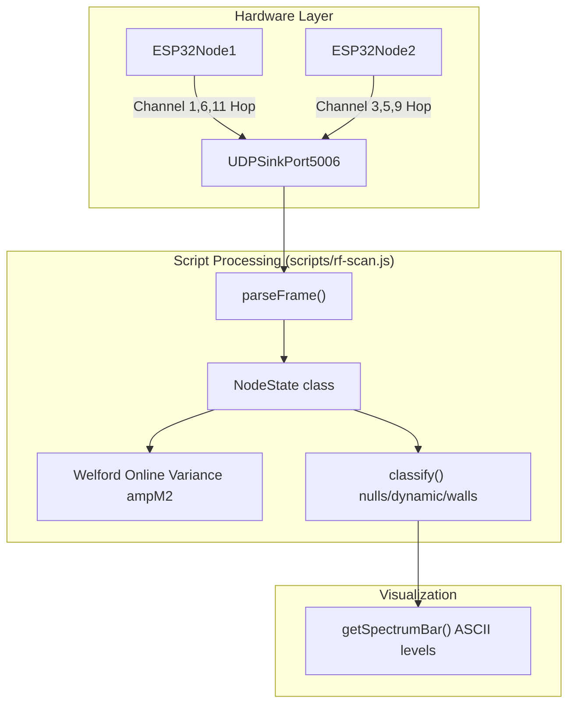
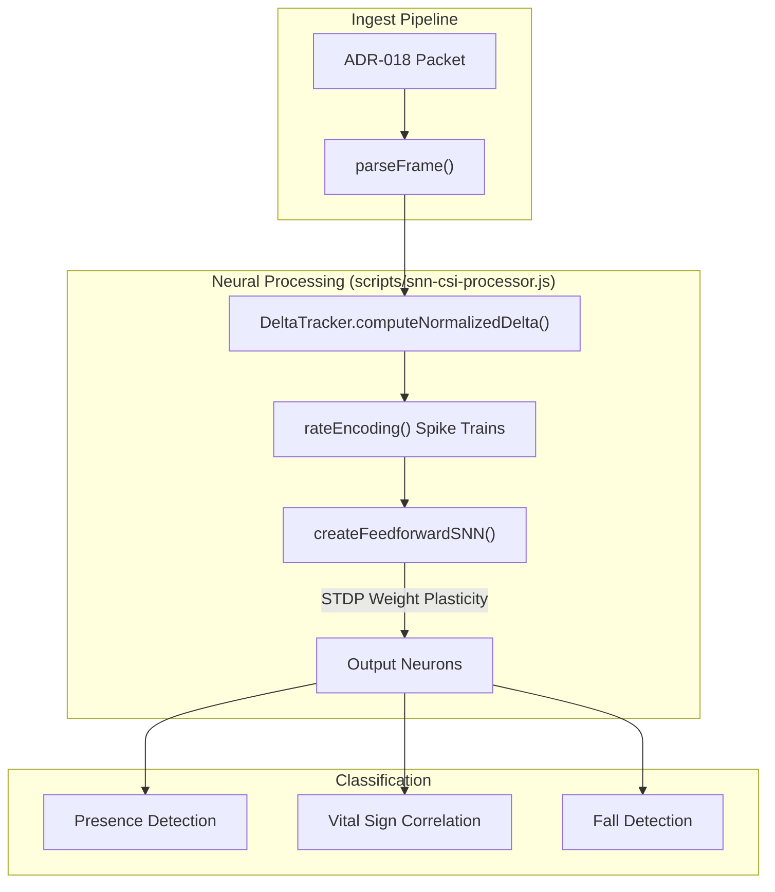

<!-- source: DeepWiki mcp.deepwiki.com · repo ruvnet/RuView · page 12.3 Multi-Modal & Spatial Research · fetched 2026-10-30 -->

# Multi-Modal & Spatial Research

<details>
<summary>Relevant source files</summary>

The following files were used as context for generating this wiki page:

- [.gitignore](.gitignore)
- [assets/fal-visual-teacher-sample.json](assets/fal-visual-teacher-sample.json)
- [assets/fal-visual-teacher-sample.png](assets/fal-visual-teacher-sample.png)
- [docs/adr/ADR-073-multifrequency-mesh-scan.md](docs/adr/ADR-073-multifrequency-mesh-scan.md)
- [docs/adr/ADR-074-spiking-neural-csi-sensing.md](docs/adr/ADR-074-spiking-neural-csi-sensing.md)
- [docs/adr/ADR-324-off-axis-head-coupled-perspective-demo.md](docs/adr/ADR-324-off-axis-head-coupled-perspective-demo.md)
- [docs/adr/ADR-353-fal-visual-teacher-lora.md](docs/adr/ADR-353-fal-visual-teacher-lora.md)
- [docs/adr/ADR-361-single-transmitter-pairing.md](docs/adr/ADR-361-single-transmitter-pairing.md)
- [docs/research/data/s1_arm_a1.csv](docs/research/data/s1_arm_a1.csv)
- [docs/research/data/s1_arm_a2.csv](docs/research/data/s1_arm_a2.csv)
- [docs/research/data/s1_arm_b.csv](docs/research/data/s1_arm_b.csv)
- [docs/tutorials/coherent-rf-tomography-backprojection.md](docs/tutorials/coherent-rf-tomography-backprojection.md)
- [examples/three.js/demos/07-off-axis-window.html](examples/three.js/demos/07-off-axis-window.html)
- [scripts/benchmark-rf-scan.js](scripts/benchmark-rf-scan.js)
- [scripts/fal-visual-teacher/extract_frames.py](scripts/fal-visual-teacher/extract_frames.py)
- [scripts/fal-visual-teacher/train_lora.py](scripts/fal-visual-teacher/train_lora.py)
- [scripts/fal-visual-teacher/validate.py](scripts/fal-visual-teacher/validate.py)
- [scripts/rf-scan-multifreq.js](scripts/rf-scan-multifreq.js)
- [scripts/rf-scan.js](scripts/rf-scan.js)
- [scripts/seed_csi_bridge.py](scripts/seed_csi_bridge.py)
- [scripts/snn-csi-processor.js](scripts/snn-csi-processor.js)
- [v2/crates/ruview-offaxis/Cargo.toml](v2/crates/ruview-offaxis/Cargo.toml)
- [v2/crates/ruview-offaxis/README.md](v2/crates/ruview-offaxis/README.md)
- [v2/crates/ruview-offaxis/benches/offaxis.rs](v2/crates/ruview-offaxis/benches/offaxis.rs)
- [v2/crates/ruview-offaxis/src/filter.rs](v2/crates/ruview-offaxis/src/filter.rs)
- [v2/crates/ruview-offaxis/src/lib.rs](v2/crates/ruview-offaxis/src/lib.rs)
- [v2/crates/ruview-offaxis/src/math.rs](v2/crates/ruview-offaxis/src/math.rs)
- [v2/crates/wifi-densepose-sar/Cargo.toml](v2/crates/wifi-densepose-sar/Cargo.toml)
- [v2/crates/wifi-densepose-sar/README.md](v2/crates/wifi-densepose-sar/README.md)
- [v2/crates/wifi-densepose-sar/src/geometry.rs](v2/crates/wifi-densepose-sar/src/geometry.rs)
- [v2/crates/wifi-densepose-sar/src/lib.rs](v2/crates/wifi-densepose-sar/src/lib.rs)
- [v2/crates/wifi-densepose-sar/src/measurement.rs](v2/crates/wifi-densepose-sar/src/measurement.rs)
- [v2/crates/wifi-densepose-sar/src/pointcloud.rs](v2/crates/wifi-densepose-sar/src/pointcloud.rs)
- [v2/crates/wifi-densepose-sar/src/reconstruct.rs](v2/crates/wifi-densepose-sar/src/reconstruct.rs)
- [v2/crates/wifi-densepose-sar/src/resolution.rs](v2/crates/wifi-densepose-sar/src/resolution.rs)
- [v2/crates/wifi-densepose-sar/tests/physics_validation.rs](v2/crates/wifi-densepose-sar/tests/physics_validation.rs)

</details>


## Purpose and Scope

This leaf page documents the advanced multi-modal and spatial research subsystems in RuView. It covers multi-frequency mesh scanning (ADR-073), spiking neural CSI processing (ADR-074), coherent RF tomography and synthetic-aperture radar (SAR) backprojection (`wifi-densepose-sar`), off-axis head-coupled perspective demos (ADR-324), fal visual teacher LoRA adaptation, and the research-sota example corpus.

---

## 1. Multi-Frequency Mesh Scanning (ADR-073)

Standard CSI sensing is limited by frequency-selective fading and static "null" subcarriers caused by metal reflectors in the environment [docs/adr/ADR-073-multifrequency-mesh-scan.md:14-18](). The multi-frequency mesh design (ADR-073) utilizes interleaved channel hopping across ESP32 nodes to construct a wideband RF room map [docs/adr/ADR-073-multifrequency-mesh-scan.md:24-27]().

### Channel Allocation & Diversity

Nodes are partitioned across channels to maximize both spectral coverage and the exploitation of neighboring AP "illuminators of opportunity" [docs/adr/ADR-073-multifrequency-mesh-scan.md:30-36]():

| Node | Channels | Freq Range (MHz) | Purpose & Illuminators |
| :--- | :--- | :--- | :--- |
| **Node 1** | 1, 6, 11 | 2412 - 2462 | Non-overlapping full band coverage; high penetration and high frequency [docs/adr/ADR-073-multifrequency-mesh-scan.md:33-47]() |
| **Node 2** | 3, 5, 9 | 2422 - 2452 | Interleaved coverage near primary routers and strong neighbor APs [docs/adr/ADR-073-multifrequency-mesh-scan.md:34-47]() |

The script `scripts/rf-scan.js` implements the live spectrum analyzer that listens for ADR-018 UDP frames, tracking rolling amplitudes, phases, and online Welford variance across up to 256 subcarriers [scripts/rf-scan.js:3-92]().

### Code Entity Mapping: Multi-Frequency Mesh Ingestion



Sources: `[docs/adr/ADR-073-multifrequency-mesh-scan.md:1-114]()`, `[scripts/rf-scan.js:1-211]()`

---

## 2. Spiking Neural CSI Processing (ADR-074)

To achieve low-latency online adaptation without heavy floating-point backpropagation overhead, RuView integrates a Spiking Neural Network (SNN) pipeline for real-time spectrum analysis [docs/adr/ADR-074-spiking-neural-csi-sensing.md:27-31]().

### SNN Architecture & LIF Dynamics

The processing pipeline (implemented in `scripts/snn-csi-processor.js`) simulates Leaky Integrate-and-Fire (LIF) neurons combined with Spike-Timing-Dependent Plasticity (STDP) [docs/adr/ADR-074-spiking-neural-csi-sensing.md:33-50]().

*   **Input Layer**: Rate-coded spike trains generated from subcarrier amplitude deltas [docs/adr/ADR-074-spiking-neural-csi-sensing.md:56-56]().
*   **Hidden Layer**: Learns temporal cross-correlations via STDP weight updates [docs/adr/ADR-074-spiking-neural-csi-sensing.md:57-57]().
*   **Output Layer**: Specialized classification heads for presence, micro-motions, and vital sign anomalies [docs/adr/ADR-074-spiking-neural-csi-sensing.md:58-58]().

### Code Entity Mapping: SNN Spike Pipeline



Sources: `[docs/adr/ADR-074-spiking-neural-csi-sensing.md:1-102]`, `[scripts/snn-csi-processor.js:1-175]()`

---

## 3. Coherent RF Tomography & SAR Backprojection (`wifi-densepose-sar`)

The `wifi-densepose-sar` crate implements synthetic stepped-frequency multi-position measurement simulation and delay-and-sum backprojection reconstruction of 3D reflectivity fields (ADR-287) [v2/crates/wifi-densepose-sar/README.md:1-15]().

### Mathematical Forward & Reconstruction Model

The monostatic forward model computes complex stepped-frequency returns from discrete scatterers [v2/crates/wifi-densepose-sar/src/measurement.rs:1-15]():

```text
y_{m,k} = sum_j  sigma_j / R_{m,j}^2 * exp(-i * 4*pi * f_k * R_{m,j} / c)  +  noise
```

The matched-filter backprojection kernel in [`v2/crates/wifi-densepose-sar/src/reconstruct.rs`] reconstructs the 3D reflectivity image on a regular voxel grid [v2/crates/wifi-densepose-sar/src/reconstruct.rs:1-21]():

```text
I(x) = | (1 / (M*K)) * sum_m sum_k  y_{m,k} * R_{m,x}^2 * exp(+i * 4*pi * f_k * R_{m,x} / c) |
```

### Performance & Incremental Phasor Optimization

Because frequencies in a [`FrequencySweep`](v2/crates/wifi-densepose-sar/src/measurement.rs) are evenly spaced by construction, `focus_at_point` evaluates the phasor once per pose and advances it by a fixed complex-multiply step per frequency, reducing trigonometric function overhead by ~4.4x [v2/crates/wifi-densepose-sar/README.md:64-74]().

Sources: `[v2/crates/wifi-densepose-sar/src/reconstruct.rs:1-166]()`, `[v2/crates/wifi-densepose-sar/src/measurement.rs:1-160]()`, `[v2/crates/wifi-densepose-sar/README.md:1-74]()`, `[v2/crates/wifi-densepose-sar/tests/physics_validation.rs:1-139]()`

---

## 4. Off-Axis Head-Coupled Perspective Demos (ADR-324)

ADR-324 introduces `off-axis-mode` — an RF-assisted head-coupled perspective ("fish-tank VR" / window-into-the-screen illusion) for the `examples/three.js/demos/07-off-axis-window.html` demo [docs/adr/ADR-324-off-axis-head-coupled-perspective-demo.md:1-11]().

### Projection & Tracking Mechanics

- **Asymmetric Frustum**: Implements Robert Kooima's generalized perspective projection (`makePerspective(left, right, top, bottom, near, far)`) using screen-corner formulations [docs/adr/ADR-324-off-axis-head-coupled-perspective-demo.md:38-51]().
- **Hybrid Input**: Combines fine MediaPipe Face Mesh tracking with coarse RF positional context from `/ws/sensing` field peaks (`wifi-densepose-sensing-server/src/field_localize.rs`), ensuring continuous presence awareness even when camera visibility is obstructed [docs/adr/ADR-324-off-axis-head-coupled-perspective-demo.md:68-95]().

Sources: `[docs/adr/ADR-324-off-axis-head-coupled-perspective-demo.md:1-128]()`, `[examples/three.js/demos/07-off-axis-window.html:1-100]()`

---

## 5. Fal Visual Teacher LoRA & Research SOTA Corpora

The research repository incorporates the `fal-visual-teacher` LoRA training and validation pipeline (`scripts/fal-visual-teacher/`) to distill camera-supervised multi-modal teacher priors into RF feature extractors (ADR-353) [scripts/fal-visual-teacher/train_lora.py:1-50]()].

### Pipeline Structure
1. **Frame Extraction**: `scripts/fal-visual-teacher/extract_frames.py` synchronizes video streams with raw CSI binary logs.
2. **LoRA Training**: `scripts/fal-visual-teacher/train_lora.py` fine-tunes adapter weights on frozen backbones using PEFT routines.
3. **Validation**: `scripts/fal-visual-teacher/validate.py` evaluates cross-modal alignment metrics before packaging into RVF container assets.

Sources: `[scripts/fal-visual-teacher/train_lora.py:1-50]`, `[scripts/fal-visual-teacher/validate.py:1-50]`, `[docs/adr/ADR-353-fal-visual-teacher-lora.md:1-50]`

---

