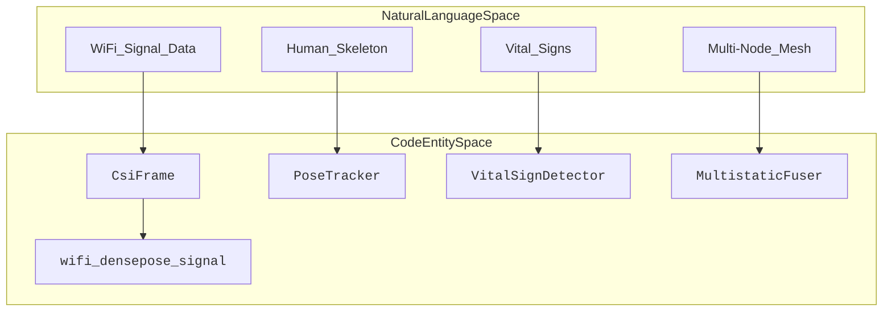
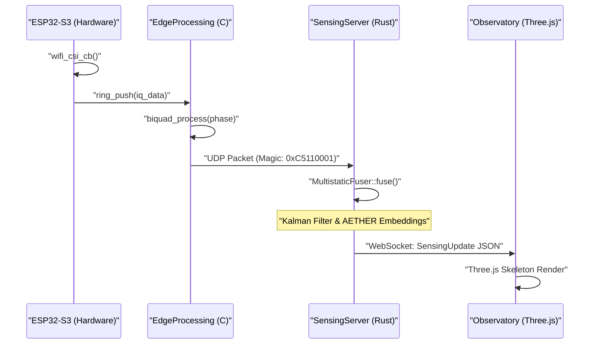

<!-- source: DeepWiki mcp.deepwiki.com · repo ruvnet/RuView · page 13 Glossary · fetched 2026-10-30 -->

# Glossary

Relevant source files

The following files were used as context for generating this wiki page:

- [.github/workflows/firmware-ci.yml](.github/workflows/firmware-ci.yml)
- [CHANGELOG.md](CHANGELOG.md)
- [CLAUDE.md](CLAUDE.md)
- [README.md](README.md)
- [assets/ruview-hero-h3-v3.gif](assets/ruview-hero-h3-v3.gif)
- [assets/screen.png](assets/screen.png)
- [docs/adr/ADR-030-ruvsense-persistent-field-model.md](docs/adr/ADR-030-ruvsense-persistent-field-model.md)
- [docs/adr/ADR-095-rvcsi-edge-rf-sensing-platform.md](docs/adr/ADR-095-rvcsi-edge-rf-sensing-platform.md)
- [docs/adr/ADR-355-local-empty-room-bootstrap-prior.md](docs/adr/ADR-355-local-empty-room-bootstrap-prior.md)
- [docs/adr/ADR-357-raw-csi-calibration-sample-integrity.md](docs/adr/ADR-357-raw-csi-calibration-sample-integrity.md)
- [docs/adr/ADR-363-native-macos-usb-node-onboarding.md](docs/adr/ADR-363-native-macos-usb-node-onboarding.md)
- [docs/adr/README.md](docs/adr/README.md)
- [docs/ddd/README.md](docs/ddd/README.md)
- [docs/ddd/hardware-platform-domain-model.md](docs/ddd/hardware-platform-domain-model.md)
- [docs/ddd/ruvsense-domain-model.md](docs/ddd/ruvsense-domain-model.md)
- [docs/ddd/rvcsi-domain-model.md](docs/ddd/rvcsi-domain-model.md)
- [docs/ddd/sensing-server-domain-model.md](docs/ddd/sensing-server-domain-model.md)
- [docs/ddd/signal-processing-domain-model.md](docs/ddd/signal-processing-domain-model.md)
- [docs/ddd/training-pipeline-domain-model.md](docs/ddd/training-pipeline-domain-model.md)
- [docs/prd/rvcsi-platform-prd.md](docs/prd/rvcsi-platform-prd.md)
- [docs/readme-details.md](docs/readme-details.md)
- [docs/user-guide.md](docs/user-guide.md)
- [docs/validation/2026-08-31-macos-usb-node-onboarding.md](docs/validation/2026-08-31-macos-usb-node-onboarding.md)
- [firmware/esp32-csi-node/README.md](firmware/esp32-csi-node/README.md)
- [firmware/esp32-csi-node/main/CMakeLists.txt](firmware/esp32-csi-node/main/CMakeLists.txt)
- [firmware/esp32-csi-node/main/Kconfig.projbuild](firmware/esp32-csi-node/main/Kconfig.projbuild)
- [firmware/esp32-csi-node/main/adaptive_controller.c](firmware/esp32-csi-node/main/adaptive_controller.c)
- [firmware/esp32-csi-node/main/main.c](firmware/esp32-csi-node/main/main.c)
- [firmware/esp32-csi-node/main/nvs_config.c](firmware/esp32-csi-node/main/nvs_config.c)
- [firmware/esp32-csi-node/main/serial_onboarding.c](firmware/esp32-csi-node/main/serial_onboarding.c)
- [firmware/esp32-csi-node/main/serial_onboarding.h](firmware/esp32-csi-node/main/serial_onboarding.h)
- [firmware/esp32-csi-node/main/serial_onboarding_protocol.c](firmware/esp32-csi-node/main/serial_onboarding_protocol.c)
- [firmware/esp32-csi-node/main/thermal.c](firmware/esp32-csi-node/main/thermal.c)
- [firmware/esp32-csi-node/main/thermal.h](firmware/esp32-csi-node/main/thermal.h)
- [firmware/esp32-csi-node/test/Makefile](firmware/esp32-csi-node/test/Makefile)
- [firmware/esp32-csi-node/test/test_thermal_hysteresis.c](firmware/esp32-csi-node/test/test_thermal_hysteresis.c)
- [firmware/esp32-csi-node/version.txt](firmware/esp32-csi-node/version.txt)
- [scripts/esp32_jsonl_to_rvcsi.py](scripts/esp32_jsonl_to_rvcsi.py)
- [v2/Cargo.lock](v2/Cargo.lock)
- [v2/Cargo.toml](v2/Cargo.toml)
- [v2/crates/wifi-densepose-bfld/src/availability.rs](v2/crates/wifi-densepose-bfld/src/availability.rs)
- [v2/crates/wifi-densepose-bfld/src/coherence_gate.rs](v2/crates/wifi-densepose-bfld/src/coherence_gate.rs)
- [v2/crates/wifi-densepose-bfld/src/ha_discovery.rs](v2/crates/wifi-densepose-bfld/src/ha_discovery.rs)
- [v2/crates/wifi-densepose-bfld/src/lib.rs](v2/crates/wifi-densepose-bfld/src/lib.rs)
- [v2/crates/wifi-densepose-bfld/src/rumqttc_publisher.rs](v2/crates/wifi-densepose-bfld/src/rumqttc_publisher.rs)
- [v2/crates/wifi-densepose-bfld/tests/availability_topic.rs](v2/crates/wifi-densepose-bfld/tests/availability_topic.rs)
- [v2/crates/wifi-densepose-bfld/tests/coherence_gate.rs](v2/crates/wifi-densepose-bfld/tests/coherence_gate.rs)
- [v2/crates/wifi-densepose-bfld/tests/ha_discovery.rs](v2/crates/wifi-densepose-bfld/tests/ha_discovery.rs)
- [v2/crates/wifi-densepose-bfld/tests/ha_discovery_publish.rs](v2/crates/wifi-densepose-bfld/tests/ha_discovery_publish.rs)
- [v2/crates/wifi-densepose-bfld/tests/mosquitto_integration.rs](v2/crates/wifi-densepose-bfld/tests/mosquitto_integration.rs)
- [v2/crates/wifi-densepose-bfld/tests/rumqttc_lwt.rs](v2/crates/wifi-densepose-bfld/tests/rumqttc_lwt.rs)
- [v2/crates/wifi-densepose-bfld/tests/rumqttc_publisher_smoke.rs](v2/crates/wifi-densepose-bfld/tests/rumqttc_publisher_smoke.rs)
- [v2/crates/wifi-densepose-bfld/tests/soul_match_oracle.rs](v2/crates/wifi-densepose-bfld/tests/soul_match_oracle.rs)
- [v2/crates/wifi-densepose-sensing-server/Cargo.toml](v2/crates/wifi-densepose-sensing-server/Cargo.toml)
- [v2/crates/wifi-densepose-sensing-server/README.md](v2/crates/wifi-densepose-sensing-server/README.md)
- [v2/crates/wifi-densepose-sensing-server/src/bootstrap_baseline.rs](v2/crates/wifi-densepose-sensing-server/src/bootstrap_baseline.rs)
- [v2/crates/wifi-densepose-sensing-server/src/field_bridge.rs](v2/crates/wifi-densepose-sensing-server/src/field_bridge.rs)
- [v2/crates/wifi-densepose-sensing-server/src/lib.rs](v2/crates/wifi-densepose-sensing-server/src/lib.rs)
- [v2/crates/wifi-densepose-sensing-server/src/main.rs](v2/crates/wifi-densepose-sensing-server/src/main.rs)
- [v2/crates/wifi-densepose-signal/src/ruvsense/field_model.rs](v2/crates/wifi-densepose-signal/src/ruvsense/field_model.rs)

This page provides definitions for codebase-specific terms, domain concepts, and technical jargon used within the RuView/WiFi-DensePose ecosystem. It serves as a reference for onboarding engineers to understand the relationship between signal processing theory and the specific implementations in the Rust and C (ESP-IDF) codebases.

## 1. Core Sensing & Signal Concepts

Terms related to the extraction of human data from raw radio frequency (RF) signals.

| Term | Definition | Code Pointer |
|:---|:---|:---|
| **CSI** | **Channel State Information**. Per-subcarrier amplitude and phase data representing how a WiFi signal was distorted by the environment. | `CsiFrame` [v2/crates/wifi-densepose-sensing-server/src/csi.rs:1-10]() |
| **BVP** | **Body Velocity Profile**. A Doppler-like representation of human movement derived from CSI phase changes across subcarriers. | `wifi-densepose-ruvector` [v2/Cargo.toml:28-28]() |
| **Subcarrier** | A narrow frequency band within a WiFi channel (e.g., 56 subcarriers for ESP32-S3). | `n_subcarriers` [firmware/esp32-csi-node/main/csi_collector.c:130-130]() |
| **Phase Sanitization** | The process of removing linear phase offsets caused by unsynchronized local oscillators (LO). | `phase_align` [v2/crates/wifi-densepose-signal/src/lib.rs:1-15]() |
| **Fresnel Zone** | Ellipsoidal regions around the line-of-sight where signal reflections interfere constructively or destructively. | [README.md:10-22]() |
| **Phase Unwrapping** | Maintaining continuity in phase measurements to avoid $2\pi$ jumps. | `unwrap_phase` [firmware/esp32-csi-node/main/edge_processing.c:143-150]() |
| **rvCSI** | The RuVector Channel State Information runtime; a stable, hardware-abstracted layer for RF sensing. | [v2/Cargo.toml:75-79]() |

**Sources:** [README.md:10-22](), [firmware/esp32-csi-node/main/csi_collector.c:130-130](), [firmware/esp32-csi-node/main/edge_processing.c:143-150](), [v2/Cargo.toml:28-79]()

---

## 2. Architecture & System Components

Key acronyms and named systems within the RuView architecture.

### RuvSense Domain Model
The high-level sensing logic is organized into Domain-Driven Design (DDD) bounded contexts.

*   **AETHER**: Contrastive CSI embedding system (128-dim) used for re-identification (re-ID) and spatial identity [v2/Cargo.toml:24-24]().
*   **BFLD**: **Beamforming Feedback Layer for Detection**. A privacy-gated WiFi sensing primitive derived from 802.11ac/ax feedback [v2/crates/wifi-densepose-bfld/src/lib.rs:1-4]().
*   **MERIDIAN**: Cross-environment domain generalization system for making models work in new rooms without retraining [v2/Cargo.toml:84-88]().
*   **SONA**: Rapid adaptation system using MicroLoRA or EWC++ to tune models to specific local RF signatures [docs/adr/README.md:80-86]().
*   **WiFi-Mat**: Mass Casualty Assessment Tool; specialized deployment for disaster survivor detection [v2/Cargo.toml:21-21]().
*   **Cognitum Seed**: An edge intelligence appliance used for persistent storage, kNN validation, and witness chain attestation [v2/Cargo.toml:59-62]().
*   **NVsim**: Deterministic NV-diamond magnetometer pipeline simulator for quantum sensing research [v2/Cargo.toml:41-42]().
*   **HOMECORE**: The Rust-based Home Assistant port and state machine ecosystem [v2/Cargo.toml:43-48]().

### System Entity Mapping
The following diagram bridges natural language concepts to their specific code entities.

**Diagram: System Concept to Code Entity Mapping**

**Sources:** [v2/crates/wifi-densepose-sensing-server/src/main.rs:90-94](), [v2/crates/wifi-densepose-sensing-server/src/csi.rs:1-10](), [v2/crates/wifi-densepose-sensing-server/src/vital_signs.rs:80-85]()

---

## 3. Hardware & Edge Terms

Terms specific to the ESP32 firmware and edge processing tiers.

*   **ADR-018**: The binary frame format specification for serializing CSI data over UDP (Magic: `0xC5110001`) [firmware/esp32-csi-node/main/csi_collector.c:111-111]().
*   **Edge Intelligence Tiers**: Processing levels on the ESP32 [firmware/esp32-csi-node/main/edge_processing.c:5-18]():
    *   **Tier 0**: Raw passthrough.
    *   **Tier 1**: Signal cleanup and basic statistics.
    *   **Tier 2**: On-device vital signs (Breathing/Heart Rate).
    *   **Tier 3**: WASM runtime for custom edge logic (Programmable Sensing).
*   **Vitals Packet**: A 32-byte per-node sensing state packet (Magic: `0xC5110002`) [firmware/esp32-csi-node/main/edge_processing.c:18-18]().
*   **TDM (Time Division Multiplexing)**: Coordination protocol for multi-node mesh to prevent signal collisions [firmware/esp32-csi-node/main/csi_collector.c:9-12]().
*   **Welford Variance**: An online algorithm for computing running variance used for subcarrier selection at the edge [firmware/esp32-csi-node/main/edge_processing.c:153-175]().
*   **BFLD Privacy Class**: Classification levels for sensing data (Raw, Derived, Anonymous, Restricted) [v2/crates/wifi-densepose-bfld/src/lib.rs:105-120]().

**Sources:** [firmware/esp32-csi-node/main/csi_collector.c:108-121](), [firmware/esp32-csi-node/main/edge_processing.c:5-19](), [v2/crates/wifi-densepose-bfld/src/lib.rs:105-120]()

---

## 4. Machine Learning & Data Formats

Terms related to the training and deployment of the DensePose models.

*   **RVF (RuVector Format)**: A container format for packaging model weights, manifests, and progressive loading layers [v2/crates/wifi-densepose-sensing-server/src/main.rs:80-83]().
*   **MM-Fi / Wi-Pose**: Standard academic datasets used for training [docs/adr/README.md:80-87]().
*   **AetherArena**: The official spatial-intelligence benchmark and leaderboard platform [docs/adr/README.md:1-12]().
*   **PCK@20**: Percentage of Correct Keypoints; a metric where a predicted point is correct if it falls within 20mm of ground truth [README.md:73-74]().
*   **RF Foundation Encoder**: A pose-preserving, subject/room-invariant CSI embedding model [docs/adr/README.md:84-88]().
*   **LoRA / MicroLoRA**: Low-Rank Adaptation used for few-shot calibration to specific rooms [docs/adr/README.md:80-88]().

**Sources:** [README.md:73-74](), [docs/adr/README.md:80-88](), [v2/crates/wifi-densepose-sensing-server/src/main.rs:80-83]()

---

## 5. Implementation Data Flow

The following diagram illustrates how a raw RF signal transforms into a UI visualization across the system components.

**Diagram: Data Transformation Pipeline**

**Sources:** [firmware/esp32-csi-node/main/csi_collector.c:122-132](), [firmware/esp32-csi-node/main/edge_processing.c:54-75](), [v2/crates/wifi-densepose-sensing-server/src/main.rs:1-10]()